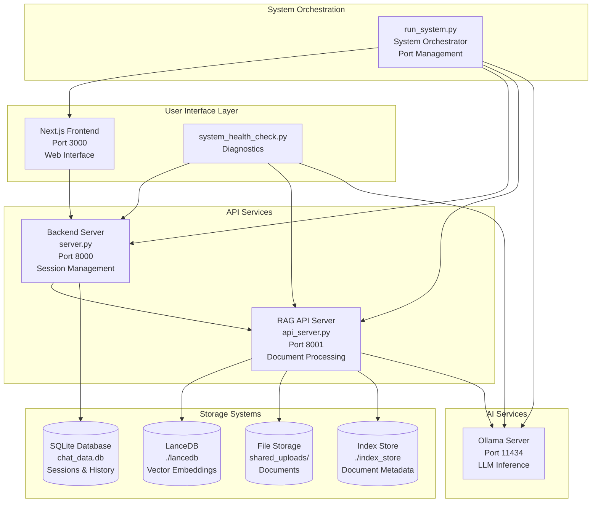
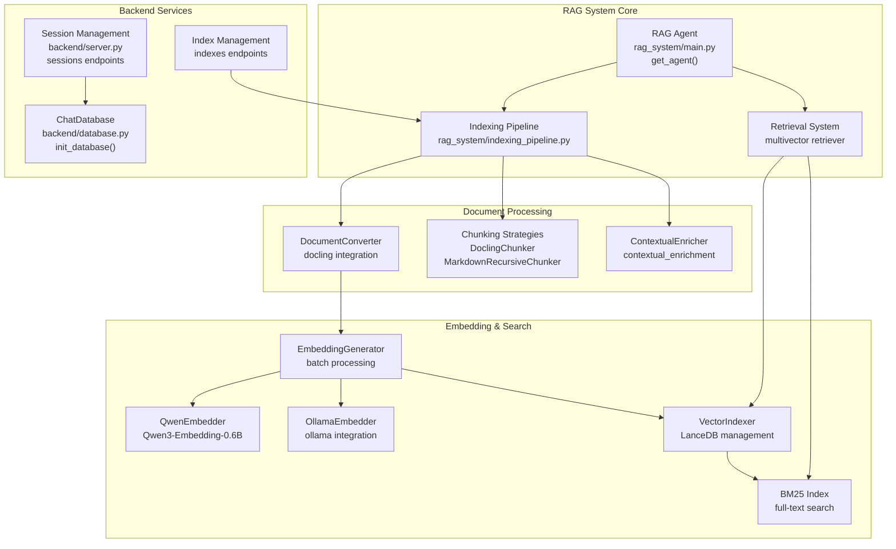
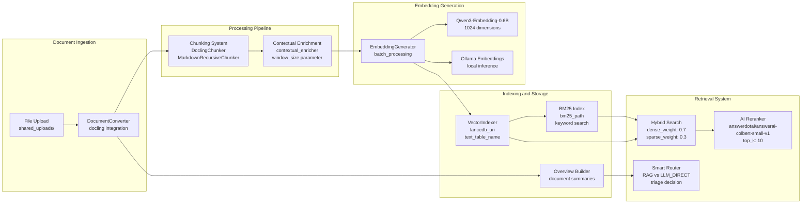

<!-- source: DeepWiki mcp.deepwiki.com · repo PromtEngineer/localGPT · page 1 Overview · fetched 2026-10-26 -->

# Overview

Relevant source files

The following files were used as context for generating this wiki page:

- [README.md](README.md)

## Purpose and Scope

This document provides a comprehensive overview of LocalGPT, a private, on-premise Document Intelligence platform that enables users to query and analyze their documents using AI without data leaving their infrastructure. LocalGPT implements a sophisticated Retrieval-Augmented Generation (RAG) system with hybrid search capabilities, smart routing, and modular architecture.

For detailed installation procedures, see [Installation & Setup](#2). For specific component deep-dives, see [Core Components](#3). For usage instructions and API documentation, see [Usage](#5).

## Core Capabilities

LocalGPT provides a complete document intelligence solution with the following key capabilities:

| Feature Category | Capabilities |
|------------------|--------------|
| **Document Processing** | Multi-format support (PDF, DOCX, TXT, Markdown), contextual enrichment, batch processing |
| **Search & Retrieval** | Hybrid search (vector + BM25), late chunking, AI-powered reranking, semantic caching |
| **AI Integration** | Multiple model support via Ollama, HuggingFace embeddings, smart routing between RAG/direct LLM |
| **User Experience** | Web interface, session management, streaming responses, real-time progress tracking |
| **Privacy & Security** | Fully on-premise operation, no external data transmission, local model storage |
| **Developer Tools** | RESTful APIs, flexible configuration, extensible architecture, comprehensive health monitoring |

The system supports advanced features including query decomposition for complex questions, answer verification for accuracy, and contextual enrichment for better document understanding.

**Sources:** [README.md:27-79]()

## System Architecture

LocalGPT implements a multi-service architecture orchestrated by the `run_system.py` script. The system consists of four primary services that communicate through well-defined APIs:

### High-Level Service Architecture

The `run_system.py` orchestrator manages service lifecycle, health monitoring, and graceful shutdown across all components. Each service operates independently with clearly defined responsibilities and can be started manually for development purposes.

**Sources:** [README.md:191-197](), [README.md:198-214]()

### Core Components and Code Entities

The system's modular design allows for flexible configuration and component swapping. The `RAG Agent` serves as the central orchestrator, coordinating between document processing, retrieval, and generation pipelines.

**Sources:** [README.md:290-296](), [README.md:385-455]()

## Data Flow and Processing Pipeline

LocalGPT processes documents through a sophisticated pipeline that transforms raw files into queryable knowledge bases:

### Document Processing and RAG Pipeline

The pipeline supports two main configuration modes: a production-ready "default" configuration with full hybrid search and verification, and a speed-optimized "fast" configuration with minimal overhead.

**Sources:** [README.md:410-455](), [README.md:52-66]()

## Deployment Options

LocalGPT provides flexible deployment options to accommodate different use cases and environments:

| Deployment Method | Use Case | Key Files |
|------------------|----------|-----------|
| **Docker Compose** | Production deployment | `docker-compose.yml`, `start-docker.sh` |
| **System Orchestrator** | Development and testing | `run_system.py`, automated service management |
| **Manual Component Startup** | Development and debugging | Individual service scripts |

The Docker deployment creates isolated containers for each service with shared volumes for data persistence, while the system orchestrator provides integrated logging and health monitoring across all components.

### Configuration Management

The system uses centralized configuration through environment variables and configuration files:

- **Environment Configuration**: `.env` file with service ports, model settings, and database paths
- **Pipeline Configuration**: JSON-based pipeline definitions for different use cases
- **Model Configuration**: Support for Ollama local models and HuggingFace external models
- **Search Configuration**: Hybrid search parameters, reranking settings, and retrieval options

**Sources:** [README.md:101-133](), [README.md:135-189](), [README.md:261-280]()

---

