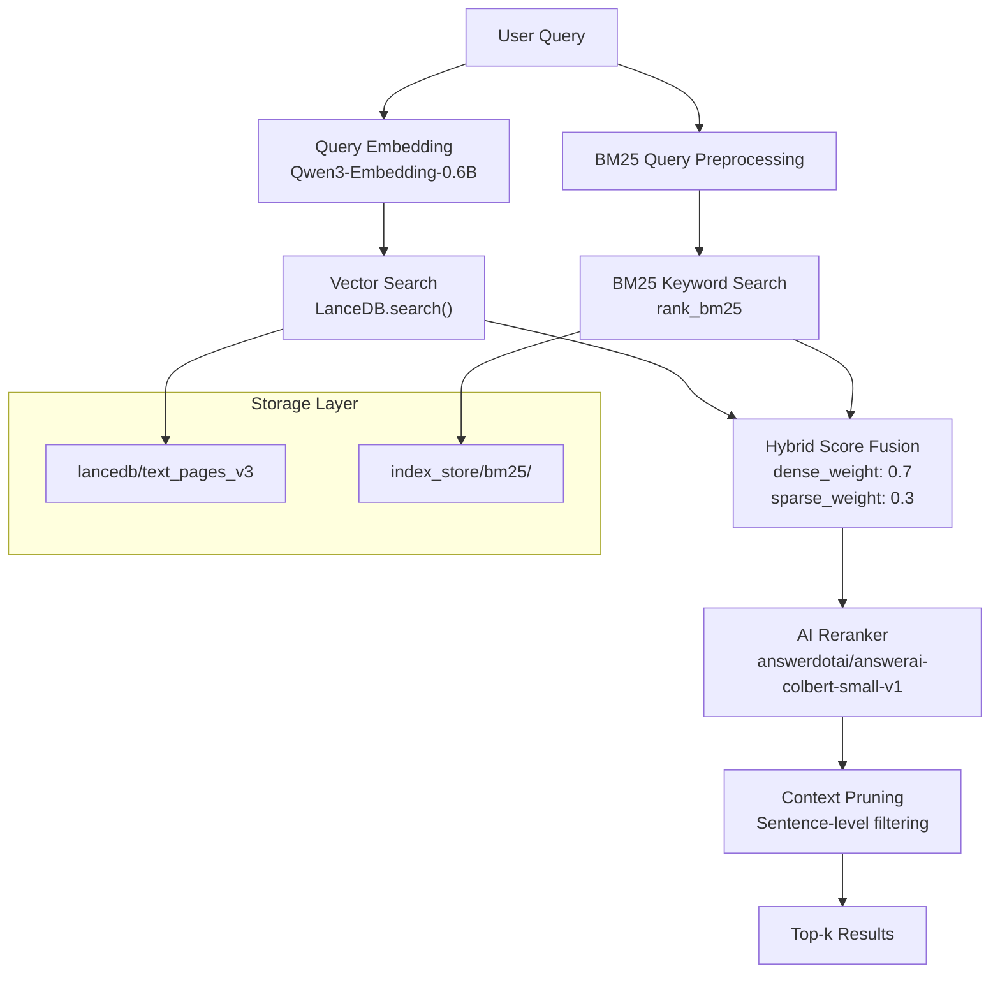
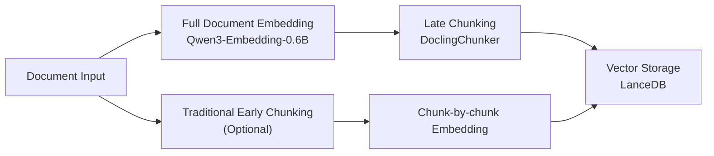
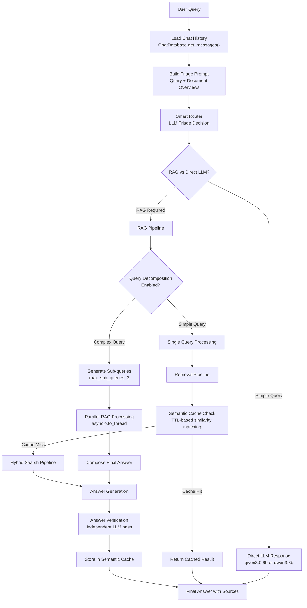
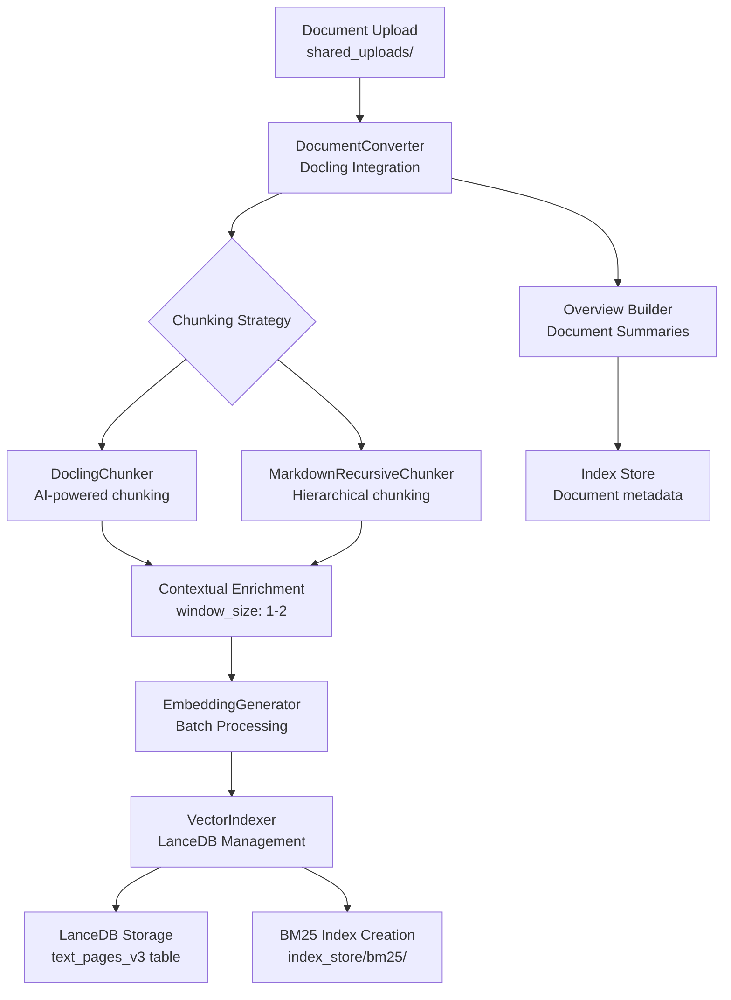
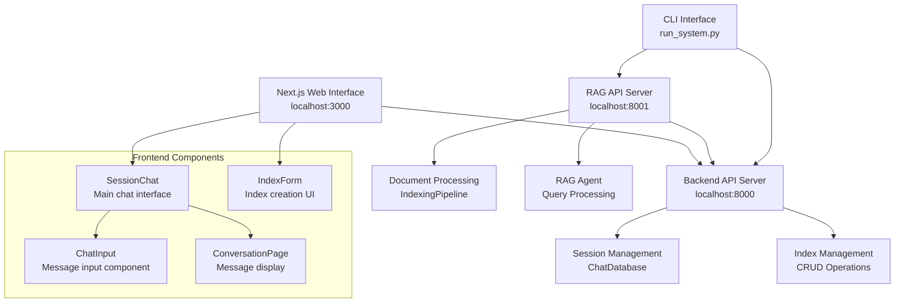
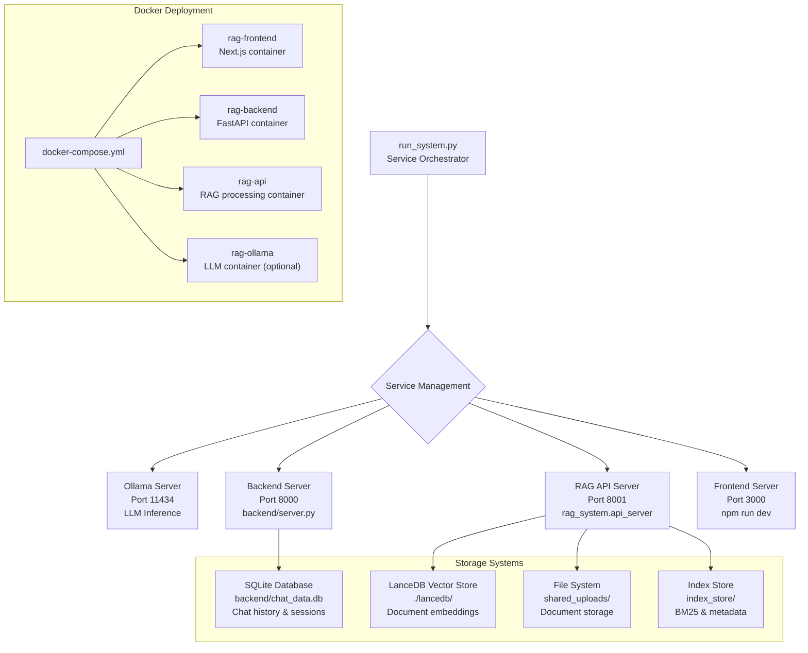

<!-- source: DeepWiki mcp.deepwiki.com · repo PromtEngineer/localGPT · page 1.1 Key Features · fetched 2026-10-26 -->

# Key Features

<details>
<summary>Relevant source files</summary>

The following files were used as context for generating this wiki page:

- [README.md](README.md)

</details>


This page provides a comprehensive overview of LocalGPT's core capabilities and technical features. It covers the system's privacy-focused design, advanced retrieval mechanisms, document processing pipeline, and integration capabilities. For installation and setup procedures, see [Installation & Setup](#2). For detailed technical architecture information, see [System Architecture](#1.2).

## Privacy & Local Processing

LocalGPT operates as a fully **on-premise Document Intelligence platform** where all data processing occurs locally without external API dependencies. The system ensures complete data privacy by keeping documents, embeddings, chat history, and model inference entirely within your infrastructure.

| Privacy Feature | Implementation | Technical Details |
|------------------|----------------|-------------------|
| **Local Model Inference** | Ollama integration | Models served via `http://localhost:11434` |
| **Local Vector Storage** | LanceDB database | Stored in `./lancedb` directory |
| **Local Chat History** | SQLite database | Stored in `./backend/chat_data.db` |
| **Local Document Storage** | File system | Documents stored in `shared_uploads/` |

The system supports multiple hardware platforms including **GPU (CUDA)**, **CPU**, **HPU (Intel® Gaudi®)**, and **MPS (Apple Silicon)** for flexible deployment across different infrastructure environments.

**Sources:** [README.md:44-50]()

## Advanced Retrieval System

LocalGPT implements a sophisticated **hybrid search architecture** that combines multiple retrieval strategies for optimal document discovery and context extraction.

### Hybrid Search Architecture



### Late Chunking Implementation

The system implements **Late Chunking** methodology for enhanced context preservation:



**Key Technical Features:**
- **Vector Similarity Search**: Dense embeddings via `Qwen/Qwen3-Embedding-0.6B` model
- **BM25 Keyword Search**: Sparse retrieval using `rank_bm25` library  
- **ColBERT Reranking**: Neural reranking with `answerdotai/answerai-colbert-small-v1`
- **Configurable Weights**: `dense_weight: 0.7`, `sparse_weight: 0.3` in hybrid mode
- **Retrieval Parameters**: `retrieval_k: 20`, `reranker_top_k: 10`

**Sources:** [README.md:31](), [README.md:461-467](), [README.md:423-427]()

## Smart Query Processing

LocalGPT features an intelligent **query routing system** that automatically determines the optimal processing strategy for each user query.

### Query Processing Flow



**Advanced Processing Features:**

| Feature | Technical Implementation | Configuration |
|---------|------------------------|---------------|
| **Smart Routing** | LLM-based triage using document overviews | Automatic RAG vs Direct decision |
| **Query Decomposition** | Complex queries split into sub-questions | `max_sub_queries: 3` |
| **Semantic Caching** | TTL-based similarity matching | Embedding-based cache lookup |
| **Answer Verification** | Independent verification pass | Separate LLM model validation |
| **Parallel Processing** | `asyncio.to_thread` for concurrent operations | Sub-query parallel execution |

**Sources:** [README.md:60-64](), [README.md:434](), [README.md:648-659]()

## Document Processing Pipeline

The document processing system transforms raw documents into searchable, contextually-enriched knowledge bases through a multi-stage pipeline.

### Processing Architecture



### Contextual Enrichment Process

The system implements **Contextual Enrichment** inspired by Anthropic's contextual retrieval methodology:

| Processing Stage | Technical Details | Configuration |
|------------------|-------------------|---------------|
| **Document Conversion** | Docling-based conversion for PDF, DOCX, TXT, MD | `enable_docling: true` |
| **Chunk Generation** | Configurable chunk sizes and overlap | `chunk_size: 512`, `chunk_overlap: 64` |
| **Context Generation** | AI-generated contextual descriptions | `enable_enrich: true`, `window_size: 2` |
| **Embedding Generation** | Batch embedding processing | `Qwen/Qwen3-Embedding-0.6B` |
| **Index Building** | Vector and keyword index creation | Parallel processing enabled |

**Sources:** [README.md:52-55](), [README.md:673-681](), [README.md:716-726]()

## Model Integration & Flexibility

LocalGPT supports multiple AI model providers and configurations for different processing requirements.

### Model Configuration Matrix

| Model Type | Primary Model | Alternative Models | Usage |
|------------|---------------|-------------------|-------|
| **Generation Models** | `qwen3:8b` | `qwen3:0.6b` | Main text generation |
| **Enrichment Models** | `qwen3:0.6b` | `qwen3:8b` | Lightweight routing/enrichment |
| **Embedding Models** | `Qwen/Qwen3-Embedding-0.6B` | `Qwen/Qwen3-Embedding-4B` | Vector embeddings (1024 dim) |
| **Reranker Models** | `answerdotai/answerai-colbert-small-v1` | `BAAI/bge-reranker-base` | ColBERT reranking |

### Pipeline Configurations

The system provides pre-configured pipelines optimized for different use cases:

**Default Pipeline (Production)**
```json
{
  "retrieval": {
    "search_type": "hybrid",
    "late_chunking": {"enabled": true},
    "dense": {"weight": 0.7},
    "bm25": {"enabled": true}
  },
  "reranker": {"enabled": true, "top_k": 10},
  "query_decomposition": {"enabled": true},
  "verification": {"enabled": true},
  "contextual_enricher": {"enabled": true}
}
```

**Fast Pipeline (Speed-Optimized)**
```json
{
  "retrieval": {
    "search_type": "vector_only",
    "late_chunking": {"enabled": false}
  },
  "reranker": {"enabled": false},
  "query_decomposition": {"enabled": false},
  "verification": {"enabled": false}
}
```

**Sources:** [README.md:388-404](), [README.md:412-438](), [README.md:441-454]()

## User Interface & Developer Experience

LocalGPT provides both intuitive web interfaces and comprehensive API access for different user types and integration scenarios.

### Multi-Interface Architecture



### API Capabilities

| API Category | Key Endpoints | Functionality |
|--------------|---------------|---------------|
| **Chat API** | `POST /sessions/{id}/chat` | Session-based chat with streaming |
| **Index Management** | `POST /indexes`, `GET /indexes/{id}` | CRUD operations for document collections |
| **Session Management** | `POST /sessions`, `GET /sessions` | Conversation persistence and organization |
| **Document Upload** | `POST /indexes/{id}/upload` | Multi-file document processing |
| **Health Monitoring** | `GET /health`, `GET /api/tags` | System diagnostics and status |

**Key Developer Features:**
- **RESTful API Design**: Complete programmatic access
- **Streaming Responses**: Real-time chat feedback via `POST /chat/stream`
- **Batch Processing**: Multi-document indexing via `demo_batch_indexing.py`
- **System Orchestration**: Single-command startup via `run_system.py`
- **Health Monitoring**: Comprehensive diagnostics via `system_health_check.py`

**Sources:** [README.md:68-78](), [README.md:547-645](), [README.md:691-701]()

## System Architecture Features

LocalGPT implements a **modular, multi-service architecture** that supports flexible deployment and scaling strategies.

### Service Orchestration



### Deployment Flexibility

| Deployment Mode | Command | Use Case |
|-----------------|---------|----------|
| **Development Mode** | `python run_system.py --mode dev` | Local development with hot reload |
| **Production Mode** | `python run_system.py --mode prod` | Production deployment |
| **Docker Mode** | `./start-docker.sh` | Containerized multi-service deployment |
| **Backend Only** | `python run_system.py --no-frontend` | API-only deployment |
| **Manual Services** | Individual service startup | Fine-grained control |

**Key Architectural Benefits:**
- **Service Independence**: Each component can be scaled or replaced independently
- **Flexible Deployment**: Docker, manual, or orchestrated startup options
- **Health Monitoring**: Built-in health checks and diagnostics
- **State Persistence**: Separate data storage for different system components
- **Resource Optimization**: Optional services based on deployment requirements

**Sources:** [README.md:191-214](), [README.md:169-189](), [README.md:750-772]()

---

