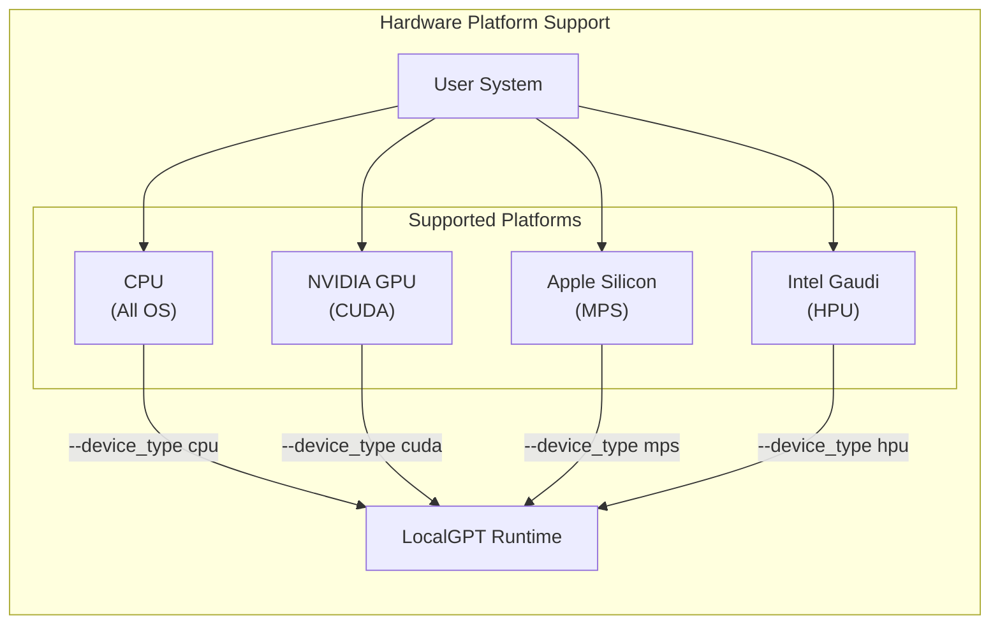
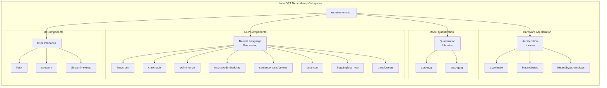
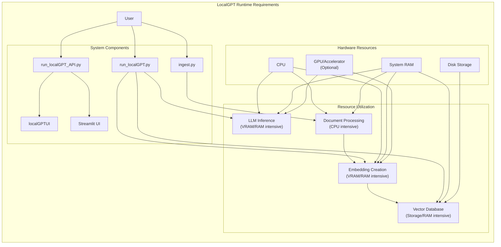

<!-- source: DeepWiki mcp.deepwiki.com · repo PromtEngineer/localGPT · page 1.2 System Architecture · fetched 2026-10-26 -->

# System Requirements

<details>
<summary>Relevant source files</summary>

The following files were used as context for generating this wiki page:

- [.gitignore](.gitignore)
- [README.md](README.md)
- [backend/ollama_client.py](backend/ollama_client.py)
- [backend/test_ollama_connectivity.py](backend/test_ollama_connectivity.py)
- [docker-compose.yml](docker-compose.yml)
- [docker.env](docker.env)

</details>


This page details the hardware and software requirements needed to run localGPT effectively. It covers the necessary computing resources, supported platforms, and dependency requirements to ensure optimal performance. For installation instructions, see [Installation](#2).

## Hardware Requirements

LocalGPT's hardware requirements vary based on the language models you intend to use and your performance expectations. The system can run on a variety of hardware configurations, from basic CPU setups to specialized accelerators.

### Minimum Requirements

- **CPU-only setup**: 
  - Modern multi-core processor (8+ cores recommended)
  - 16GB RAM minimum (32GB+ recommended)
  - 10GB+ free disk space for models and database storage

- **GPU-accelerated setup (recommended)**:
  - NVIDIA GPU with 4GB+ VRAM (larger models require more VRAM)
  - CUDA-compatible GPU for optimal performance
  - 16GB system RAM

Sources: [README.md:268-277]()

### Hardware Platform Support

LocalGPT provides explicit support for multiple computing platforms, allowing model loading and inference on different hardware accelerators.



Sources: [README.md:155-183](), [README.md:268-277]()

## VRAM Requirements by Model Size

LLM performance is directly tied to available VRAM. Below are the approximate VRAM requirements for different model sizes and quantization levels. Note that embedding models require additional VRAM (2-7GB depending on the model).

| Model Size (B) | float32 | float16 | GPTQ 8bit | GPTQ 4bit |
|----------------|---------|---------|-----------|-----------|
| 7B             | 28 GB   | 14 GB   | 7-9 GB    | 3.5-5 GB  |
| 13B            | 52 GB   | 26 GB   | 13-15 GB  | 6.5-8 GB  |
| 32B            | 130 GB  | 65 GB   | 32.5-35 GB| 16.25-19 GB|
| 65B            | 260.8 GB| 130.4 GB| 65.2-67 GB| 32.6-35 GB|

Sources: [README.md:268-277]()

## Software Requirements

### Python Version

LocalGPT requires **Python 3.10 or later**. Earlier versions are not compatible and will cause compilation errors.

### Operating System Compatibility

LocalGPT is compatible with:
- Windows 10/11
- Linux distributions (Ubuntu recommended)
- macOS (including Apple Silicon)

### C++ Compiler Requirements

A C++ compiler is required to build certain dependencies during installation:

- **Windows**: Visual Studio 2022 with "Universal Windows Platform development" and "C++ CMake tools for Windows" components, plus MinGW with GCC component
- **Linux**: GCC/G++ compiler suite (typically installed via build-essential package)
- **macOS**: Xcode Command Line Tools

Sources: [README.md:282-301]()

## Installation Dependencies

LocalGPT has numerous Python package dependencies that handle different system functions.



Sources: [requirements.txt:1-34]()

### Special Installation Considerations

#### CUDA Support

For NVIDIA GPU acceleration:
- Install appropriate NVIDIA drivers for your GPU
- Use CUDA-enabled installations for certain packages:
  ```
  CMAKE_ARGS="-DLLAMA_CUBLAS=on" FORCE_CMAKE=1 pip install llama-cpp-python --no-cache-dir
  ```

#### Apple Silicon (M1/M2) Support

For Apple Silicon acceleration:
- Use MPS-enabled installations:
  ```
  CMAKE_ARGS="-DLLAMA_METAL=on" FORCE_CMAKE=1 pip install llama-cpp-python --no-cache-dir
  ```

Sources: [README.md:75-94]()

## Runtime Requirements Model

The following diagram shows how different system requirements map to LocalGPT's runtime components:



Sources: [README.md:31-38](), [README.md:268-277]()

## Common Hardware-Related Issues

Users may encounter these common hardware-related issues:

1. **CUDA compatibility issues**
   - Check if PyTorch is compatible with your CUDA version
   - Verify with `nvcc --version` and `nvidia-smi`
   - May require reinstalling PyTorch:
     ```
     pip uninstall torch
     pip cache purge
     pip install torch -f https://download.pytorch.org/whl/torch_stable.html
     ```

2. **C++ compilation errors during installation**
   - Ensure appropriate C++ compiler is installed
   - On Windows, verify Visual Studio components
   - On Linux, install required development packages

3. **Memory errors**
   - Occur when models exceed available VRAM/RAM
   - Solution: Use smaller models or more quantized versions (GPTQ 4-bit)
   - Consider models with fewer parameters (7B instead of 13B)

Sources: [README.md:313-340](), [README.md:268-277]()

## Docker Alternative

For users who want to avoid potential compiler conflicts or ensure a consistent environment, LocalGPT provides Docker support:

- Requires Docker, BuildKit, NVIDIA GPU drivers, and NVIDIA container toolkit
- Build with: `docker build -t localgpt .`
- Run with: `docker run -it --mount src="$HOME/.cache",target=/root/.cache,type=bind --gpus=all localgpt`

For Intel Gaudi HPU support, use the Dockerfile_hpu file.

Sources: [README.md:96-104]()

---

