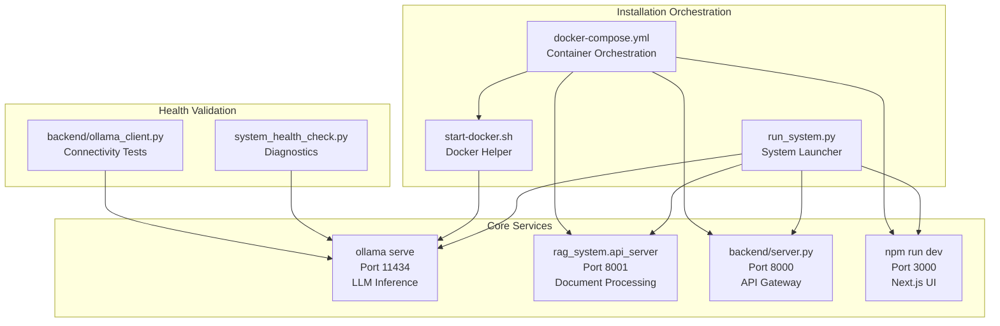
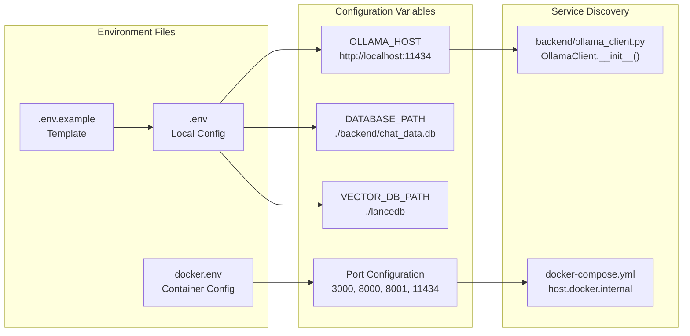
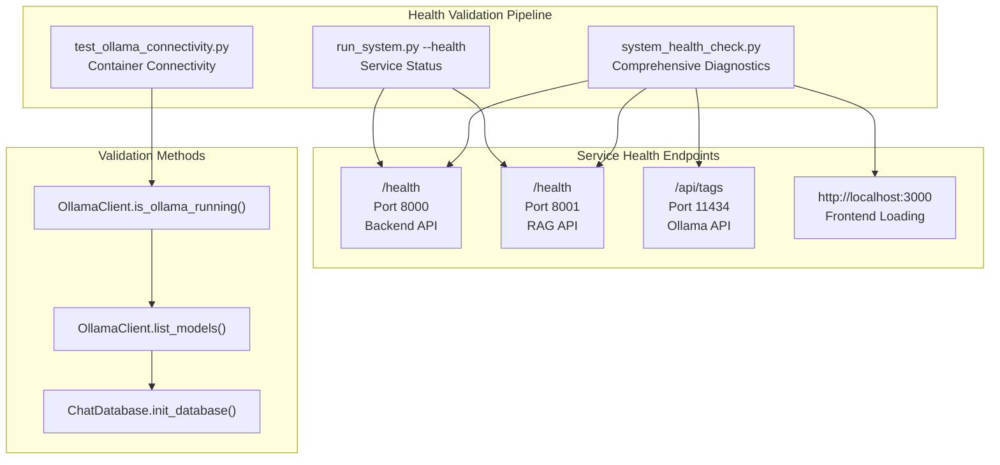

<!-- source: DeepWiki mcp.deepwiki.com · repo PromtEngineer/localGPT · page 2 Installation & Setup · fetched 2026-10-26 -->

# Installation & Setup

<details>
<summary>Relevant source files</summary>

The following files were used as context for generating this wiki page:

- [README.md](README.md)
- [backend/ollama_client.py](backend/ollama_client.py)
- [backend/test_ollama_connectivity.py](backend/test_ollama_connectivity.py)
- [docker-compose.yml](docker-compose.yml)
- [docker.env](docker.env)

</details>


This page covers the installation methods and initial setup procedures for LocalGPT. It provides an overview of deployment options and system initialization steps required to get LocalGPT running on your machine.

For detailed Docker containerization steps, see [Docker Installation](#2.1). For manual Python environment setup, see [Manual Installation](#2.2). For hardware and software prerequisites, see [System Requirements](#2.3).

## Installation Overview

LocalGPT supports multiple deployment approaches, each managed through different orchestration mechanisms. The system consists of four core services that must be running simultaneously for full functionality.

### Deployment Options

LocalGPT provides three primary installation methods:

| Method | Orchestrator | Use Case | Complexity |
|--------|-------------|----------|------------|
| **Docker Compose** | `docker-compose.yml` | Production deployment | Low |
| **System Launcher** | `run_system.py` | Development and testing | Medium |
| **Manual Services** | Individual terminals | Debugging and development | High |

The Docker approach uses containerized services defined in [docker-compose.yml:1-104](), while the system launcher approach uses the Python orchestrator in [run_system.py:163]() to manage local processes.

### Service Architecture

The following diagram shows the core services and their relationships during installation:



Sources: [README.md:192-197](), [docker-compose.yml:1-104](), [backend/ollama_client.py:13-19]()

### Configuration and Environment Setup

The installation process requires environment configuration through multiple files:



Sources: [README.md:254-280](), [docker.env:1-12](), [backend/ollama_client.py:7-12]()

## Prerequisites

Before installation, ensure the following dependencies are available:

### System Requirements
- **Python**: 3.8+ (tested with 3.11.5) as specified in [README.md:87]()
- **Node.js**: 16+ and npm (tested with 23.10.0, npm 10.9.2) from [README.md:88]()
- **Docker**: Optional for containerized deployment [README.md:89]()
- **Memory**: 8GB+ RAM (16GB+ recommended) per [README.md:90]()

### Model Dependencies
- **Ollama**: Required for both Docker and manual deployment [README.md:91]()
- **AI Models**: `qwen3:0.6b` and `qwen3:8b` as referenced in [README.md:110-111]()

The `OllamaClient` class in [backend/ollama_client.py:33-55]() provides automated model pulling functionality through the `pull_model()` method.

## Quick Validation

### Health Check System
LocalGPT includes comprehensive health monitoring through multiple validation layers:



Sources: [README.md:171-175](), [README.md:284-296](), [backend/ollama_client.py:13-31](), [backend/test_ollama_connectivity.py:6-33]()

### Validation Commands

After installation, run these validation steps to confirm system readiness:

```bash
# Comprehensive system diagnostics
python system_health_check.py

# Service health verification  
python run_system.py --health

# Database connectivity test
python -c "from backend.database import ChatDatabase; ChatDatabase().init_database()"

# RAG system validation
python -c "from rag_system.main import get_agent; print('✅ Installation successful!')"
```

The validation process uses the `is_ollama_running()` method from [backend/ollama_client.py:13-19]() to verify Ollama connectivity and the `list_models()` method from [backend/ollama_client.py:21-31]() to confirm model availability.

## Installation Method Selection

Choose your installation approach based on your deployment requirements:

- **For production deployment**: Use [Docker Installation](#2.1) with `docker-compose.yml`
- **For development work**: Use [Manual Installation](#2.2) with `run_system.py` 
- **For debugging or custom setups**: Use individual service startup as documented in [README.md:200-214]()

Each method will result in the same four-service architecture running on ports 3000, 8000, 8001, and 11434 respectively.

Sources: [README.md:101-134](), [README.md:135-189](), [README.md:200-214]()

---

