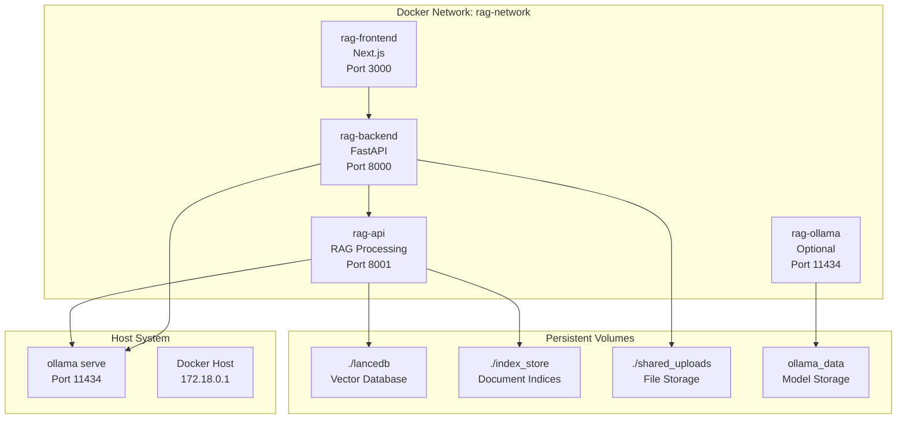
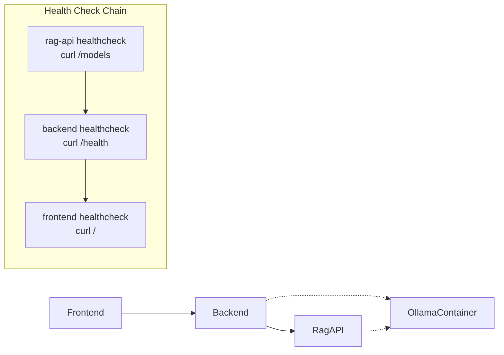
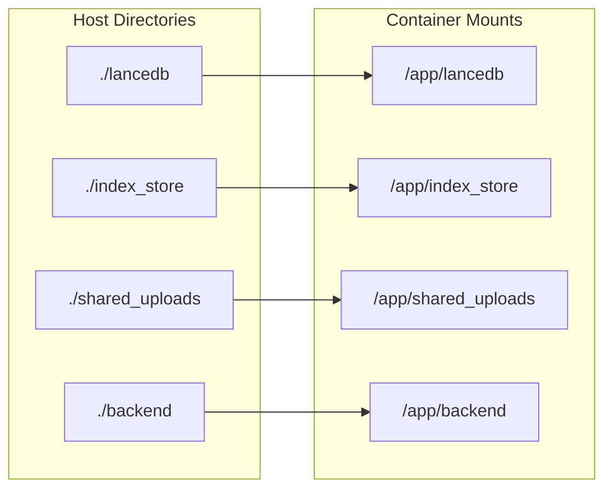
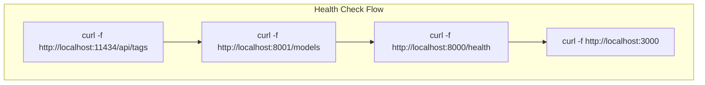

<!-- source: DeepWiki mcp.deepwiki.com · repo PromtEngineer/localGPT · page 2.1 Docker Installation · fetched 2026-10-26 -->

# Docker Installation

<details>
<summary>Relevant source files</summary>

The following files were used as context for generating this wiki page:

- [README.md](README.md)
- [backend/ollama_client.py](backend/ollama_client.py)
- [backend/test_ollama_connectivity.py](backend/test_ollama_connectivity.py)
- [docker-compose.yml](docker-compose.yml)
- [docker.env](docker.env)

</details>


This page covers the containerized deployment of LocalGPT using Docker Compose. This approach packages the entire system into isolated containers with automated service orchestration and dependency management. For manual installation using `run_system.py`, see [Manual Installation](#2.2). For system requirements and hardware specifications, see [System Requirements](#2.3).

## Overview

Docker deployment creates a multi-service architecture with four main containers: `rag-frontend`, `rag-backend`, `rag-api`, and optionally `rag-ollama`. The system uses Docker Compose to orchestrate service startup, networking, and volume management.

## Prerequisites

### Required Software

| Component | Version | Purpose |
|-----------|---------|---------|
| Docker | 20.10+ | Container runtime |
| Docker Compose | 2.0+ | Service orchestration |
| Ollama | Latest | LLM inference (must run on host) |
| Git | Any | Repository cloning |

### Hardware Requirements

- **Memory**: 8GB+ RAM (16GB+ recommended for production)
- **Storage**: 10GB+ available disk space
- **Network**: Internet connection for model downloads

Sources: [README.md:86-91]()

## Architecture Overview

The Docker deployment creates a networked environment where services communicate through the `rag-network` bridge network.

### Service Architecture Diagram



### Container Dependencies



Sources: [docker-compose.yml:1-104]()

## Installation Steps

### Step 1: Repository Setup

```bash
# Clone the repository
git clone https://github.com/PromtEngineer/localGPT.git
cd localGPT
```

### Step 2: Ollama Installation and Setup

Ollama must be installed and running on the host system before starting Docker containers:

```bash
# Install Ollama
curl -fsSL https://ollama.ai/install.sh | sh

# Pull required models
ollama pull qwen3:0.6b
ollama pull qwen3:8b

# Start Ollama server
ollama serve
```

The `OllamaClient` class in the backend connects to Ollama via the `OLLAMA_HOST` environment variable.

Sources: [README.md:108-114](), [backend/ollama_client.py:7-11]()

### Step 3: Docker Container Launch

```bash
# Start all services with Docker Compose
./start-docker.sh

# Access the application
open http://localhost:3000
```

The `start-docker.sh` script manages the Docker Compose deployment with proper environment configuration.

Sources: [README.md:117-120]()

## Service Configuration

### Environment Variables

The Docker deployment uses environment variables to configure service connectivity:

| Variable | Default | Purpose |
|----------|---------|---------|
| `OLLAMA_HOST` | `http://host.docker.internal:11434` | Ollama server URL |
| `RAG_API_URL` | `http://rag-api:8001` | Internal RAG API endpoint |
| `NEXT_PUBLIC_API_URL` | `http://localhost:8000` | Public backend API URL |
| `NODE_ENV` | `production` | Application environment |

Sources: [docker-compose.yml:32-34](), [docker-compose.yml:57-59](), [docker.env:1-12]()

### Volume Mappings



Sources: [docker-compose.yml:35-38](), [docker-compose.yml:60-62]()

## Service Specifications

### rag-api Service

The `rag-api` container handles document processing and retrieval operations:

```yaml
# From docker-compose.yml:24-46
build:
  context: .
  dockerfile: Dockerfile.rag-api
environment:
  - OLLAMA_HOST=http://host.docker.internal:11434
healthcheck:
  test: ["CMD", "curl", "-f", "http://localhost:8001/models"]
```

### rag-backend Service

The `rag-backend` container manages sessions and API routing:

```yaml
# From docker-compose.yml:49-73
build:
  context: .
  dockerfile: Dockerfile.backend
environment:
  - RAG_API_URL=http://rag-api:8001
depends_on:
  rag-api:
    condition: service_healthy
```

### rag-frontend Service

The `rag-frontend` container serves the Next.js web application:

```yaml
# From docker-compose.yml:76-96
build:
  context: .
  dockerfile: Dockerfile.frontend
environment:
  - NEXT_PUBLIC_API_URL=http://localhost:8000
depends_on:
  backend:
    condition: service_healthy
```

Sources: [docker-compose.yml:24-96]()

## Health Checks and Monitoring

### Health Check Endpoints

Each service implements health check endpoints that Docker Compose monitors:



### Container Status Monitoring

```bash
# Check container status
docker compose ps

# View service logs
docker compose logs -f

# View specific service logs
docker compose logs rag-api
docker compose logs backend
docker compose logs frontend
```

Sources: [README.md:124-133](), [docker-compose.yml:40-43](), [docker-compose.yml:66-70](), [docker-compose.yml:89-93]()

## Ollama Connectivity

### Host vs Container Ollama

The system supports two Ollama deployment modes:

1. **Host Ollama** (Default): Ollama runs on host system
2. **Container Ollama** (Optional): Ollama runs in Docker container

```mermaid
graph TB
    subgraph "Host Ollama Mode"
        HostOllamaService["ollama serve<br/>Host Port 11434"]
        DockerGateway["Docker Gateway<br/>172.18.0.1:11434"]
        
        HostOllamaService --> DockerGateway
    end
    
    subgraph "Container Ollama Mode" 
        ContainerOllama["rag-ollama<br/>Container Port 11434"]
        OllamaNetwork["ollama:11434<br/>Internal Network"]
        
        ContainerOllama --> OllamaNetwork
    end
    
    subgraph "Service Configuration"
        RagAPIConfig["`OLLAMA_HOST`<br/>Environment Variable"]
        BackendConfig["`OllamaClient`<br/>Connection Logic"]
    end
    
    DockerGateway --> RagAPIConfig
    OllamaNetwork --> RagAPIConfig
    RagAPIConfig --> BackendConfig
```

The `OllamaClient.is_ollama_running()` method tests connectivity using the configured `OLLAMA_HOST`:

Sources: [docker-compose.yml:3-21](), [docker.env:2-7](), [backend/ollama_client.py:13-19]()

### Connectivity Testing

The system includes connectivity testing capabilities via `test_ollama_connectivity.py`:

```python
# Key functionality from test_ollama_connectivity.py
def test_ollama_connectivity():
    ollama_host = os.getenv('OLLAMA_HOST', 'Not set')
    client = OllamaClient()
    is_running = client.is_ollama_running()
    if is_running:
        models = client.list_models()
```

Sources: [backend/test_ollama_connectivity.py:6-33]()

## Management Commands

### Starting and Stopping

```bash
# Start all services
./start-docker.sh

# Stop all services  
./start-docker.sh stop

# Start with containerized Ollama
docker compose --profile with-ollama up -d

# Stop all containers
docker compose down
```

### Service Management

```bash
# Restart specific service
docker compose restart rag-api

# Scale services (if supported)
docker compose up --scale backend=2

# Remove all containers and volumes
docker compose down -v
```

### Log Management

```bash
# Follow logs for all services
docker compose logs -f

# Follow logs for specific service
docker compose logs -f rag-api

# View last 100 lines
docker compose logs --tail=100 backend
```

Sources: [README.md:124-133]()

## Troubleshooting

### Common Issues

#### Ollama Connection Failures

```bash
# Check if Ollama is accessible from container
docker exec rag-api curl -f http://host.docker.internal:11434/api/tags

# Test environment variables
docker exec rag-backend env | grep OLLAMA_HOST

# Run connectivity test
docker exec rag-backend python test_ollama_connectivity.py
```

#### Port Conflicts

If ports 3000, 8000, 8001, or 11434 are already in use:

```bash
# Check port usage
netstat -tulpn | grep -E ":(3000|8000|8001|11434) "

# Modify port mappings in docker-compose.yml
ports:
  - "3001:3000"  # Frontend on port 3001
  - "8002:8000"  # Backend on port 8002
```

#### Volume Permission Issues

```bash
# Fix volume permissions
sudo chown -R $USER:$USER ./lancedb ./index_store ./shared_uploads

# Check volume mounts
docker compose exec rag-api ls -la /app/lancedb
```

### Service Health Verification

```bash
# Check all service health
curl http://localhost:8000/health    # Backend
curl http://localhost:8001/models    # RAG API  
curl http://localhost:3000           # Frontend
curl http://localhost:11434/api/tags # Ollama
```

Sources: [backend/test_ollama_connectivity.py:6-37](), [docker-compose.yml:40-43](), [docker-compose.yml:66-70]()

---

