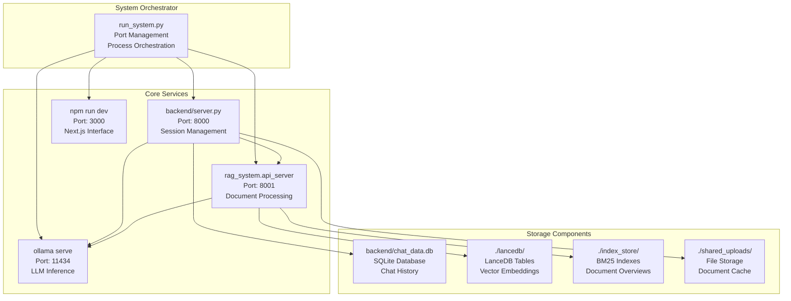
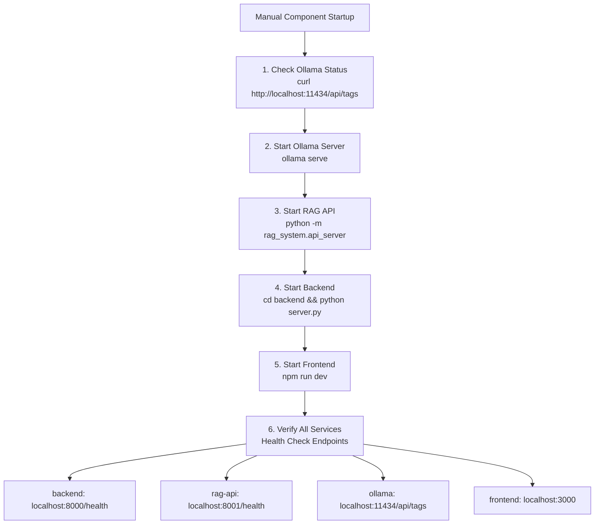

<!-- source: DeepWiki mcp.deepwiki.com · repo PromtEngineer/localGPT · page 2.2 Manual Installation · fetched 2026-10-26 -->

# Manual Installation

<details>
<summary>Relevant source files</summary>

The following files were used as context for generating this wiki page:

- [README.md](README.md)
- [requirements.txt](requirements.txt)

</details>


This document covers manual installation of LocalGPT using direct Python environment setup and the `run_system.py` orchestrator. This approach provides more control over individual components and is recommended for development environments.

For containerized deployment, see [Docker Installation](#2.1). For system requirements and hardware specifications, see [System Requirements](#2.3).

## Prerequisites

Manual installation requires Python 3.8+, Node.js 16+, and Ollama for AI model serving. The system has been tested primarily on macOS with the following versions:

| Component | Tested Version | Minimum |
|-----------|----------------|---------|
| Python | 3.11.5 | 3.8+ |
| Node.js | 23.10.0 | 16+ |
| npm | 10.9.2 | - |
| RAM | 16GB | 8GB |

**Sources:** [README.md:86-91]()

## System Dependencies

Install system-level dependencies based on your operating system:

**Ubuntu/Debian:**
```bash
sudo apt update
sudo apt install python3.8 python3-pip nodejs npm docker.io docker-compose
```

**macOS:**
```bash
brew install python@3.8 node npm docker docker-compose
```

**Windows:**
```bash
# Install Python 3.8+, Node.js, and Docker Desktop
# Then use PowerShell or WSL2
```

**Sources:** [README.md:222-237]()

## Python Dependencies Installation

The system requires specific AI and data processing libraries defined in `requirements.txt`:

```bash
# Install Python dependencies
pip install -r requirements.txt
```

### Key Dependencies by Category

| Category | Libraries | Purpose |
|----------|-----------|---------|
| **AI Models** | `torch==2.4.1`, `transformers==4.51.0` | PyTorch and HuggingFace model support |
| **Vector Database** | `lancedb` | Vector storage and similarity search |
| **Search Algorithms** | `rank_bm25`, `fuzzywuzzy` | BM25 keyword search and fuzzy matching |
| **Embeddings** | `sentence_transformers`, `rerankers` | Text embeddings and result reranking |
| **Document Processing** | `docling`, `PyPDF2`, `PyMuPDF` | Document conversion and text extraction |
| **Multimodal** | `colpali-engine` | Multimodal processing (future support) |

**Sources:** [README.md:145-151](), [requirements.txt:1-33]()

## Node.js Dependencies Installation

Install frontend dependencies for the React/Next.js interface:

```bash
# Install Node.js dependencies
npm install
```

**Sources:** [README.md:153-154]()

## AI Model Setup

LocalGPT requires Ollama for LLM inference and embedding generation:

### Ollama Installation

```bash
# Install Ollama
curl -fsSL https://ollama.ai/install.sh | sh

# Pull recommended models
ollama pull qwen3:0.6b          # Fast generation model
ollama pull qwen3:8b            # High-quality generation model

# Start Ollama server
ollama serve
```

The Ollama server runs on port 11434 and provides the AI inference backend for the RAG system.

**Sources:** [README.md:156-160](), [README.md:242-249]()

## System Orchestration Architecture

### Service Architecture with Module Names



**Sources:** [README.md:191-196](), [README.md:200-214]()

## System Orchestration with run_system.py

The `run_system.py` script provides centralized management of all LocalGPT services:

### Basic System Start

```bash
# Start all services with default configuration
python run_system.py

# Access the application
open http://localhost:3000
```

### System Management Commands

```bash
# Check service status and health
python run_system.py --health

# Start in production mode
python run_system.py --mode prod

# Skip frontend (backend + RAG API only)
python run_system.py --no-frontend

# View aggregated logs
python run_system.py --logs-only

# Stop all services
python run_system.py --stop
```

### Service Orchestration Process

The orchestrator manages four key services with automatic dependency handling:

1. **Ollama Server** (port 11434): Started first for model serving
2. **RAG API Server** (port 8001): Document processing and retrieval
3. **Backend Server** (port 8000): Session management and API endpoints  
4. **Frontend Server** (port 3000): React/Next.js web interface

**Sources:** [README.md:162-189]()

## Manual Component Startup

For advanced users or debugging purposes, services can be started individually:

### Individual Service Commands

```bash
# Terminal 1: Start Ollama
ollama serve

# Terminal 2: Start RAG API
python -m rag_system.api_server

# Terminal 3: Start Backend
cd backend && python server.py

# Terminal 4: Start Frontend
npm run dev

# Access at http://localhost:3000
```

### Manual Startup Flow



**Sources:** [README.md:200-214]()

## Environment Configuration

### Configuration File Setup

```bash
# Copy environment template
cp .env.example .env

# Edit configuration
nano .env
```

### Key Configuration Variables

The system uses environment variables for service configuration:

```env
# AI Models (referenced in rag_system/main.py)
OLLAMA_HOST=http://localhost:11434

# Database Paths (used by backend and RAG system)
DATABASE_PATH=./backend/chat_data.db
VECTOR_DB_PATH=./lancedb

# Server Settings (used by run_system.py)
BACKEND_PORT=8000
FRONTEND_PORT=3000
RAG_API_PORT=8001

# Optional: Override default models
GENERATION_MODEL=qwen3:8b
ENRICHMENT_MODEL=qwen3:0.6b
EMBEDDING_MODEL=Qwen/Qwen3-Embedding-0.6B
RERANKER_MODEL=answerdotai/answerai-colbert-small-v1
```

**Sources:** [README.md:253-280]()

## System Initialization and Verification

### Database Initialization

```bash
# Initialize chat database
python -c "from backend.database import ChatDatabase; ChatDatabase().init_database()"

# Test RAG system installation
python -c "from rag_system.main import get_agent; print('✅ Installation successful!')"
```

### Health Verification Commands

```bash
# Comprehensive system diagnostics
python system_health_check.py

# Service health check via run_system.py
python run_system.py --health

# Individual service health endpoints
curl http://localhost:8000/health    # Backend health
curl http://localhost:8001/health    # RAG API health
curl http://localhost:11434/api/tags # Ollama status
```

### Validation Checklist

| Component | Validation Command | Expected Result |
|-----------|-------------------|----------------|
| **Python Environment** | `python --version` | Python 3.8+ |
| **Dependencies** | `pip list \| grep -E "(torch\|transformers\|lancedb)"` | All packages installed |
| **Ollama Models** | `ollama list` | qwen3:0.6b, qwen3:8b listed |
| **Database Connection** | `python -c "from backend.database import ChatDatabase; db = ChatDatabase(); print('✅ Database OK')"` | Database OK |
| **RAG System** | `python -c "from rag_system.main import get_agent; print('✅ RAG OK')"` | RAG OK |

**Sources:** [README.md:284-296](), [README.md:528-533]()

## Troubleshooting Manual Installation

### Common Installation Issues

**Dependency Conflicts:**
```bash
# Check Python version compatibility
python --version  # Should be 3.8+

# Force reinstall dependencies
pip install -r requirements.txt --force-reinstall
```

**Model Loading Issues:**
```bash
# Verify Ollama installation
ollama list
curl http://localhost:11434/api/tags

# Pull missing models
ollama pull qwen3:0.6b
ollama pull qwen3:8b
```

**Service Startup Issues:**
```bash
# Check port availability
netstat -tulpn | grep -E ":(3000|8000|8001|11434)"

# Kill existing processes
pkill -f "ollama serve"
pkill -f "python.*run_system"
```

### Log File Locations

The system creates structured logs for debugging:

- `logs/system.log`: Main system events and errors
- `logs/ollama.log`: Ollama server logs  
- `logs/rag-api.log`: RAG API processing logs
- `logs/backend.log`: Backend server logs
- `logs/frontend.log`: Frontend build and runtime logs

**Sources:** [README.md:476-532]()

---

