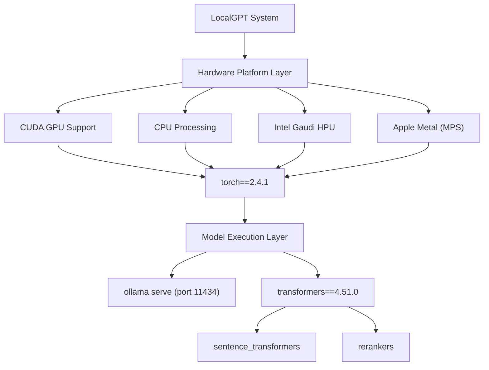
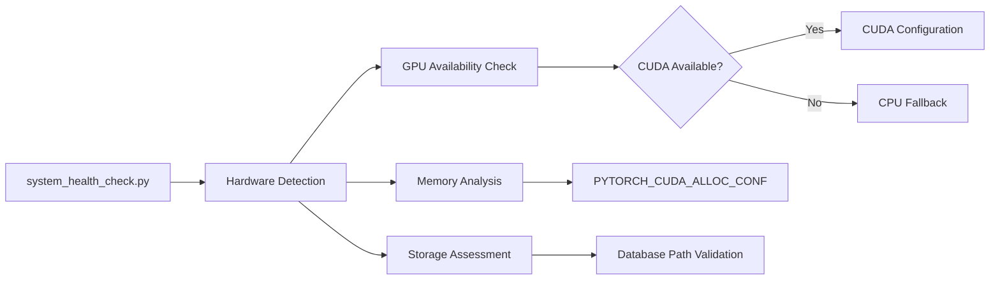
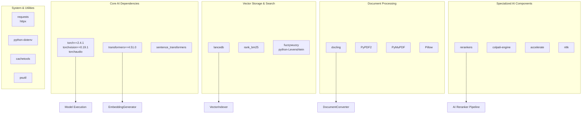
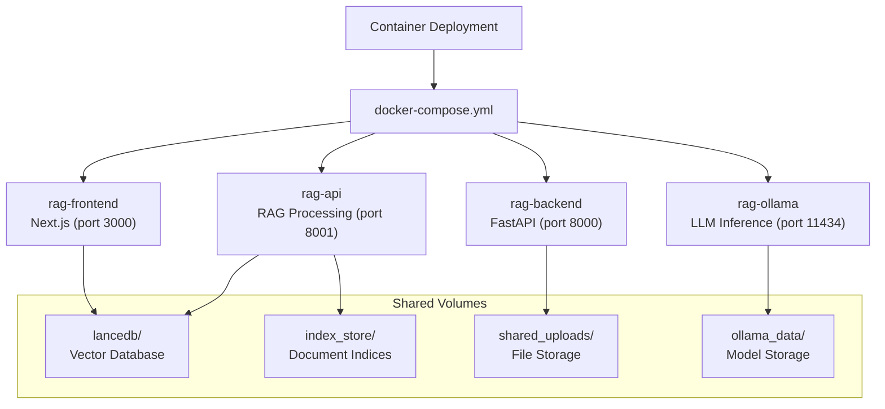
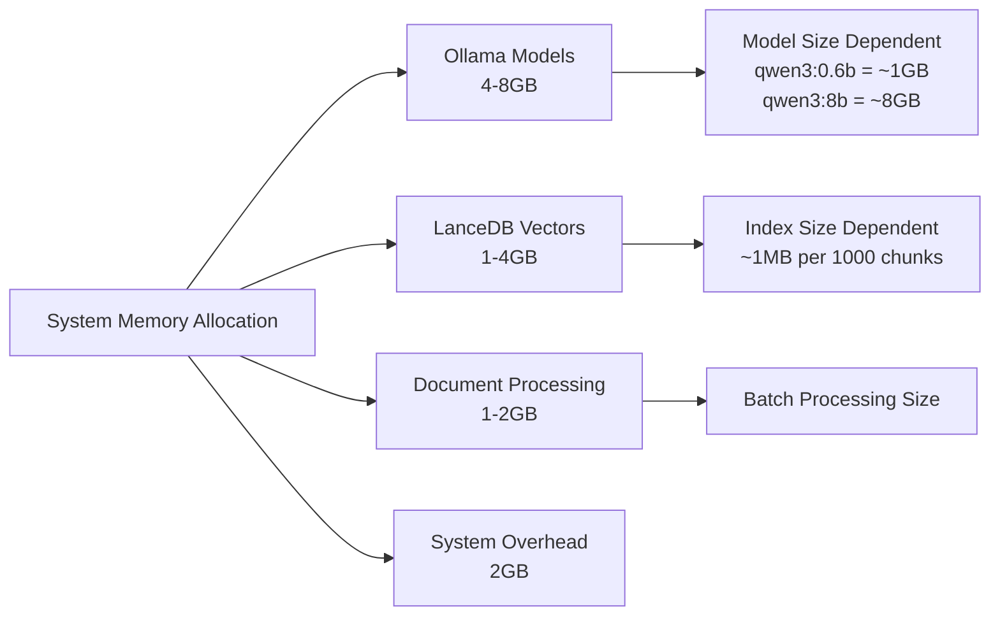
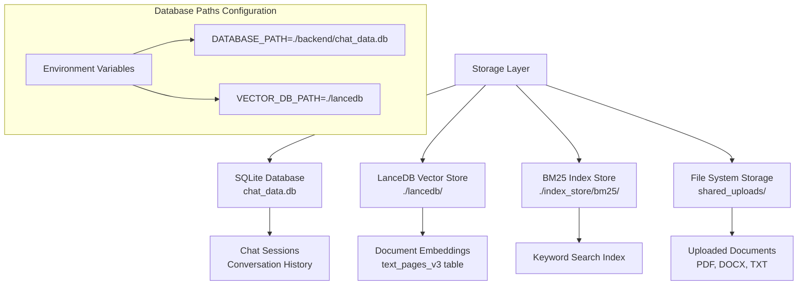
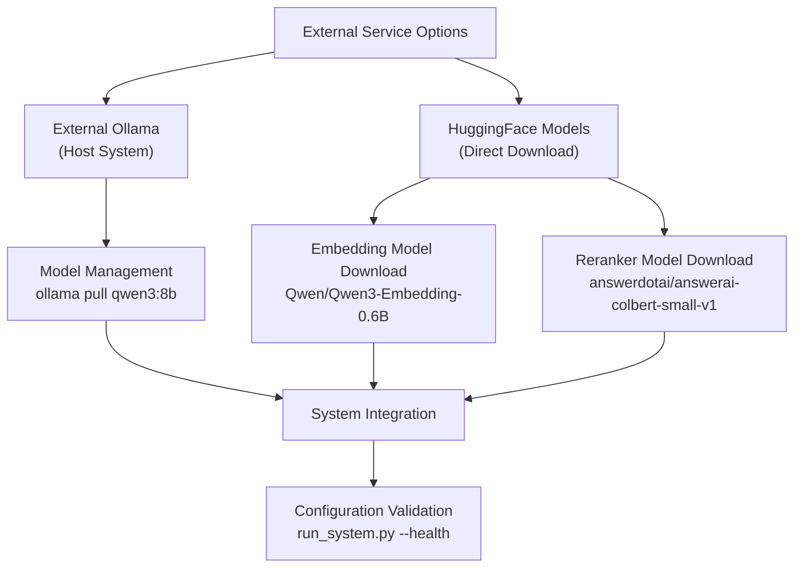

<!-- source: DeepWiki mcp.deepwiki.com · repo PromtEngineer/localGPT · page 2.3 System Requirements · fetched 2026-10-26 -->

# System Requirements

Relevant source files

The following files were used as context for generating this wiki page:

- [README.md](README.md)
- [requirements.txt](requirements.txt)

This document outlines the hardware, software, and system requirements needed to run LocalGPT effectively. It covers minimum and recommended specifications, platform compatibility, and dependency requirements for all deployment modes.

For installation procedures, see [Docker Installation](#2.1) and [Manual Installation](#2.2). For performance optimization guidance, see [Performance & Optimization](#9).

## Hardware Requirements

### Minimum System Specifications

| Component | Minimum | Recommended | Notes |
|-----------|---------|-------------|-------|
| **RAM** | 8GB | 16GB+ | Vector embeddings and model loading require substantial memory |
| **Storage** | 10GB free | 50GB+ | Models, indexes, and document storage |
| **CPU** | 4 cores | 8+ cores | Multi-threaded document processing and embedding generation |
| **GPU** | None | CUDA-compatible | Optional but significantly improves performance |

### Hardware Platform Support

LocalGPT supports multiple hardware acceleration platforms:

**Hardware Platform Detection**

Sources: [README.md:50-50](), [README.md:86-91](), [README.md:515-517]()

## Software Dependencies

### Core Runtime Requirements

#### Python Environment
- **Python Version**: 3.8+ (tested with 3.11.5)
- **Package Manager**: pip for Python dependencies
- **Virtual Environment**: Recommended for isolation

#### Node.js Environment  
- **Node.js Version**: 16+ (tested with 23.10.0)
- **Package Manager**: npm (tested with 10.9.2)
- **Purpose**: Next.js frontend compilation and runtime

#### AI Model Serving
- **Ollama**: Required for LLM inference
- **Installation**: `curl -fsSL https://ollama.ai/install.sh | sh`
- **Models**: `qwen3:0.6b` (fast), `qwen3:8b` (high-quality)

Sources: [README.md:87-88](), [README.md:241-249]()

### Python Dependencies Analysis

**Dependency Categories:**

| Category | Purpose | Key Components |
|----------|---------|----------------|
| **AI Models** | Neural network inference | `torch`, `transformers`, `sentence_transformers` |
| **Vector Search** | Similarity search and ranking | `lancedb`, `rank_bm25`, `fuzzywuzzy` |
| **Document Processing** | File parsing and conversion | `docling`, `PyPDF2`, `PyMuPDF` |
| **Reranking** | Result refinement | `rerankers`, `colpali-engine` |
| **System Utilities** | Configuration and monitoring | `psutil`, `cachetools`, `python-dotenv` |

Sources: [requirements.txt:1-33](), [README.md:145-151]()

## Platform Compatibility

### Operating System Support

| OS | Status | Installation Method | Notes |
|----|--------|-------------------|-------|
| **macOS** | ✅ Fully Tested | `brew install python@3.8 node npm docker` | Primary development platform |
| **Ubuntu/Debian** | ✅ Supported | `apt install python3.8 python3-pip nodejs npm docker.io` | Production deployment tested |
| **Windows** | ⚠️ Limited Testing | PowerShell or WSL2 recommended | Requires Docker Desktop |

### Container Platform Support

**Docker Requirements:**
- **Docker Engine**: 20.10+
- **Docker Compose**: 2.0+
- **Container Resources**: 4GB RAM minimum per container
- **Volume Storage**: Persistent volumes for data retention

Sources: [README.md:222-237](), [README.md:101-133]()

## Performance Considerations

### Memory Requirements by Component

### Performance Optimization Settings

| Component | Setting | Default | Optimization |
|-----------|---------|---------|-------------|
| **PyTorch CUDA** | `PYTORCH_CUDA_ALLOC_CONF` | None | `max_split_size_mb:512` |
| **Ollama Concurrency** | Concurrent requests | 1 | Limited by GPU memory |
| **Vector Search** | `retrieval_k` | 20 | Adjust based on document corpus |
| **Batch Processing** | Document batch size | 10 | Reduce for low-memory systems |

**System Health Monitoring:**
- `system_health_check.py` provides comprehensive diagnostics
- `run_system.py --health` checks service status
- Memory usage monitoring via `psutil`

Sources: [README.md:515-517](), [README.md:529-532]()

## Database Requirements

### Storage Backend Specifications

**Database Initialization:**
- SQLite database auto-created on first run
- LanceDB tables created during first indexing
- File system directories created automatically
- Database health checks via `ChatDatabase().init_database()`

Sources: [README.md:267-268](), [README.md:288-289](), [README.md:498-504]()

## Optional Components

### Enhanced Features Dependencies

| Feature | Dependencies | Purpose | Performance Impact |
|---------|-------------|---------|-------------------|
| **AI Reranking** | `rerankers`, ColBERT models | Improved search quality | +2-3s per query |
| **Contextual Enrichment** | Additional LLM calls | Enhanced document understanding | +30% indexing time |
| **Late Chunking** | Extended embedding models | Better context preservation | +20% memory usage |
| **Query Decomposition** | Sub-query generation | Complex query handling | +5-10s per complex query |
| **Answer Verification** | Secondary LLM validation | Improved accuracy | +3-5s per response |

### External Service Integration

**External Dependencies:**
- **Internet Connection**: Required for initial model downloads
- **Model Storage**: 5-50GB depending on selected models  
- **API Rate Limits**: None for self-hosted Ollama
- **External Services**: Optional HuggingFace model hub access

Sources: [README.md:241-249](), [README.md:398-405](), [README.md:529-537]()

---

