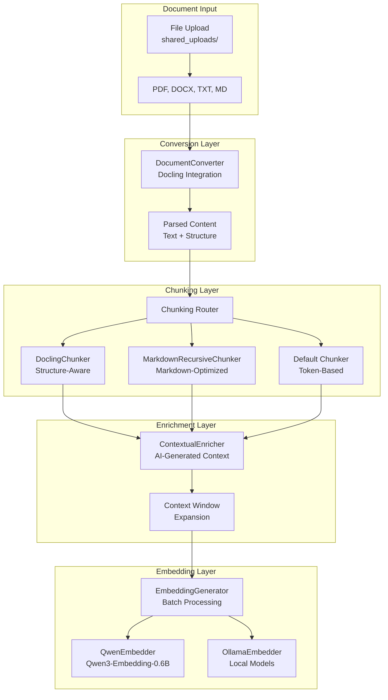
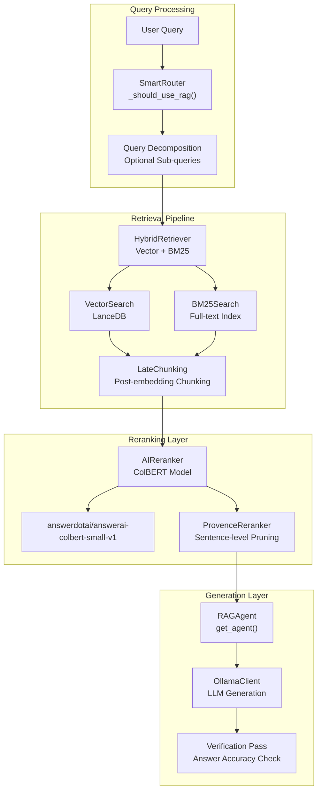
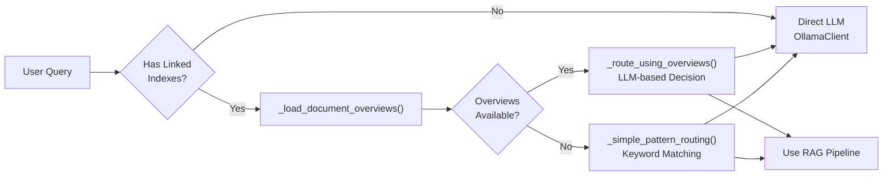
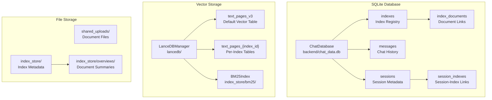
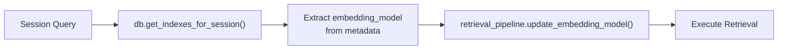

<!-- source: DeepWiki mcp.deepwiki.com · repo PromtEngineer/localGPT · page 3 Core Components · fetched 2026-10-26 -->

# Core Components

Relevant source files

The following files were used as context for generating this wiki page:

- [Dockerfile.backend](Dockerfile.backend)
- [README.md](README.md)
- [backend/database.py](backend/database.py)
- [backend/server.py](backend/server.py)
- [rag_system/api_server.py](rag_system/api_server.py)

This document provides a detailed technical overview of LocalGPT's core architectural components and their interactions. It covers the document processing pipeline, RAG system architecture, database and storage systems, and model integration layers that form the foundation of the system.

For information about system installation and deployment, see [Installation & Setup](#2). For usage instructions and API details, see [Usage](#5).

## Document Processing Pipeline

The document processing pipeline transforms uploaded documents into searchable, contextually-enriched chunks stored in vector databases. This pipeline supports multiple document formats and provides configurable chunking strategies.

### Pipeline Architecture

The pipeline processes documents through multiple configurable stages, with chunking strategy determined by the `chunker_mode` configuration in [rag_system/api_server.py:557](). The contextual enrichment step can be enabled or disabled via the `enable_enrich` parameter in [rag_system/api_server.py:560-562]().

### Configuration Parameters

| Parameter | Default | Description | Location |
|-----------|---------|-------------|----------|
| `chunk_size` | 512 | Token count per chunk | [rag_system/api_server.py:518]() |
| `chunk_overlap` | 64 | Overlap between chunks | [rag_system/api_server.py:519]() |
| `enable_enrich` | true | Enable contextual enrichment | [rag_system/api_server.py:522]() |
| `window_size` | 2 | Context window for enrichment | [rag_system/api_server.py:521]() |
| `batch_size_embed` | 50 | Embedding batch size | [rag_system/api_server.py:526]() |
| `batch_size_enrich` | 25 | Enrichment batch size | [rag_system/api_server.py:527]() |

**Sources:** [rag_system/api_server.py:501-690](), [README.md:52-56]()

## RAG System Architecture

The RAG system coordinates intelligent retrieval and generation through multiple specialized components. The system employs smart routing to decide between direct LLM responses and document-based retrieval.

### Core RAG Components

### Smart Routing Logic

The system implements intelligent query routing through the `_should_use_rag()` function in [backend/server.py:342-366](). The routing decision process follows this hierarchy:

1. **Document Overview Analysis** - Uses AI to compare query against document summaries
2. **Pattern Matching Fallback** - Simple keyword-based routing when overviews unavailable  
3. **Default Behavior** - Conservative approach favoring document search when uncertain

**Sources:** [backend/server.py:342-552](), [rag_system/api_server.py:20-36](), [README.md:30-31]()

## Database & Storage

LocalGPT employs a multi-tier storage architecture combining relational data for session management, vector storage for semantic search, and file storage for document persistence.

### Storage Architecture

### Database Schema

The `ChatDatabase` class in [backend/database.py:7-668]() manages all SQLite operations with the following core tables:

| Table | Primary Key | Purpose | Key Relations |
|-------|-------------|---------|---------------|
| `sessions` | `id` (TEXT) | Chat session metadata | ↔ `messages.session_id` |
| `messages` | `id` (TEXT) | Individual chat messages | → `sessions.id` |
| `indexes` | `id` (TEXT) | Document index registry | ↔ `index_documents.index_id` |
| `index_documents` | `id` (INTEGER) | Document-to-index mapping | → `indexes.id` |
| `session_indexes` | `id` (INTEGER) | Session-to-index linking | → `sessions.id`, `indexes.id` |

### Vector Database Integration

Vector storage is managed through LanceDB with table naming conventions that link to SQLite metadata:

- **Default Table**: `text_pages_v3` for system-wide documents
- **Index Tables**: `text_pages_{index_id}` for isolated document collections
- **Table Resolution**: Handled by `_get_table_name_for_session()` in [rag_system/api_server.py:71-114]()

**Sources:** [backend/database.py:20-106](), [rag_system/api_server.py:71-114](), [README.md:266-274]()

## Model Integration

LocalGPT integrates multiple AI model types through a flexible provider system supporting both local and cloud-based models.

### Model Provider Architecture

```mermaid
graph TB
    subgraph "Generation Models"
        OllamaModels["Ollama Models<br/>qwen3:0.6b, qwen3:8b"]
        OllamaClient["OllamaClient<br/>backend/ollama_client.py"]
        GenerationConfig["Generation Config<br/>OLLAMA_CONFIG"]
    end
    
    subgraph "Embedding Models"  
        QwenEmbedding["Qwen/Qwen3-Embedding-0.6B<br/>HuggingFace Direct"]
        OllamaEmbedding["Ollama Embedding Models<br/>Local Inference"]
        EmbeddingGenerator["EmbeddingGenerator<br/>Batch Processing"]
    end
    
    subgraph "Reranking Models"
        ColBERTReranker["answerdotai/answerai-colbert-small-v1<br/>Primary Reranker"]
        BGEReranker["BAAI/bge-reranker-base<br/>Fallback Reranker"]
        AIReranker["AIReranker Component"]
    end
    
    subgraph "Model Configuration"
        PipelineConfigs["PIPELINE_CONFIGS<br/>Model Selection"]
        RuntimeOverrides["Runtime Model Updates<br/>update_embedding_model()"]
        ModelValidation["Model Availability Check"]
    end
    
    OllamaClient --> OllamaModels
    GenerationConfig --> OllamaClient
    EmbeddingGenerator --> QwenEmbedding
    EmbeddingGenerator --> OllamaEmbedding
    AIReranker --> ColBERTReranker
    AIReranker --> BGEReranker
    PipelineConfigs --> RuntimeOverrides
    RuntimeOverrides --> ModelValidation
```

### Model Configuration System

Model selection and configuration is handled through multiple layers:

1. **System Defaults**: Defined in `PIPELINE_CONFIGS` with fallback models
2. **Index-Specific**: Stored in database metadata via `update_index_metadata()` 
3. **Runtime Overrides**: Applied per-request through `_apply_index_embedding_model()`

The model resolution process in [rag_system/api_server.py:42-70]() ensures embedding model consistency:

### Supported Model Types

| Model Type | Purpose | Examples | Configuration Location |
|------------|---------|----------|----------------------|
| Generation | Text completion, chat | `qwen3:0.6b`, `qwen3:8b` | [README.md:391-395]() |
| Embedding | Vector representation | `Qwen/Qwen3-Embedding-0.6B` | [README.md:401-404]() |
| Reranking | Result refinement | `answerdotai/answerai-colbert-small-v1` | [README.md:427-433]() |
| Enrichment | Context generation | `qwen3:0.6b` (lightweight) | [rag_system/api_server.py:524]() |

**Sources:** [rag_system/api_server.py:42-70](), [rag_system/api_server.py:692-732](), [README.md:385-406](), [backend/server.py:746-782]()

---

