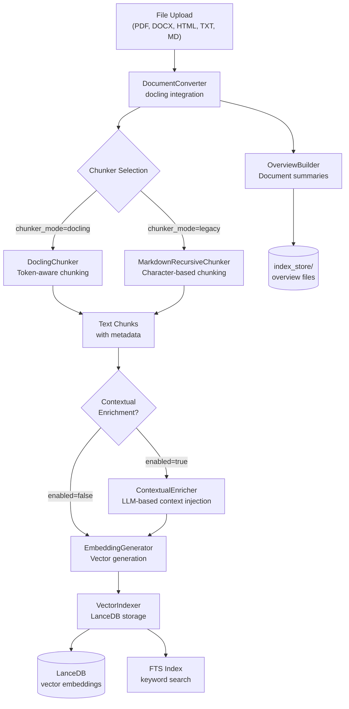
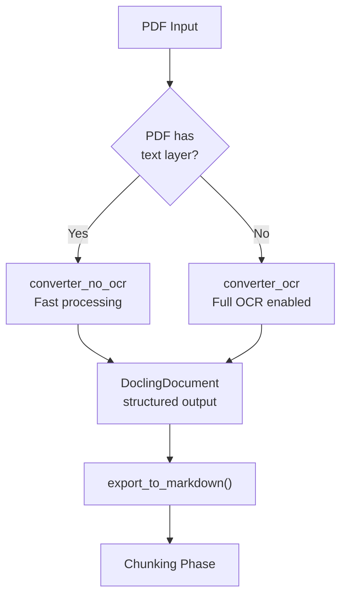
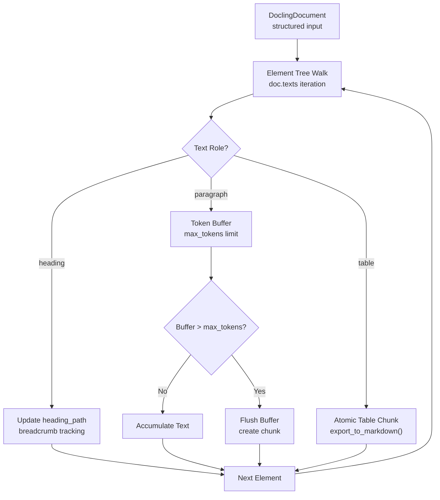
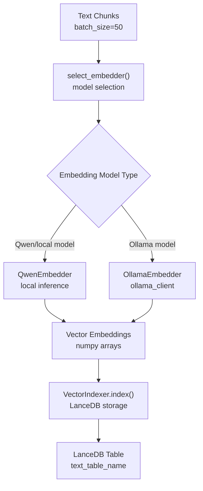
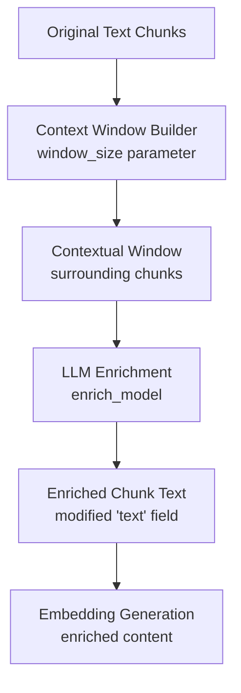
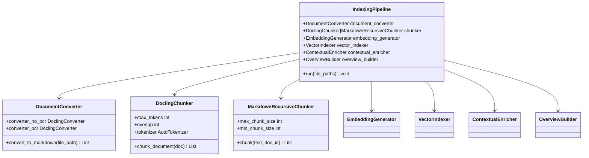

<!-- source: DeepWiki mcp.deepwiki.com · repo PromtEngineer/localGPT · page 3.1 Document Processing Pipeline · fetched 2026-10-26 -->

# Document Processing Pipeline

<details>
<summary>Relevant source files</summary>

The following files were used as context for generating this wiki page:

- [rag_system/ingestion/chunking.py](rag_system/ingestion/chunking.py)
- [rag_system/ingestion/docling_chunker.py](rag_system/ingestion/docling_chunker.py)
- [rag_system/ingestion/document_converter.py](rag_system/ingestion/document_converter.py)
- [rag_system/pipelines/indexing_pipeline.py](rag_system/pipelines/indexing_pipeline.py)

</details>


This document explains LocalGPT's document processing pipeline, which converts raw documents into searchable text chunks with embeddings. This pipeline handles document format conversion, text chunking, embedding generation, and optional enhancements like contextual enrichment. For information about the retrieval and search processes that use these processed documents, see [RAG System Architecture](#3.2). For database storage details, see [Database & Storage](#3.3).

## Pipeline Overview

The document processing pipeline is orchestrated by the `IndexingPipeline` class, which coordinates multiple processing stages to transform uploaded documents into searchable knowledge.

### Document Processing Flow



Sources: [rag_system/pipelines/indexing_pipeline.py:131-339]()

## Document Conversion

The `DocumentConverter` class handles multiple input formats using the Docling library for structured document parsing.

### Supported Document Formats

| Format | Extension | Processing Method |
|--------|-----------|------------------|
| PDF | `.pdf` | Docling with OCR detection |
| Word | `.docx` | Docling converter |
| HTML | `.html`, `.htm` | Docling converter |
| Markdown | `.md` | Docling converter |
| Text | `.txt` | Direct text reading |

### PDF Processing Strategy



The converter uses PyMuPDF to detect if a PDF already contains a text layer [rag_system/ingestion/document_converter.py:80-88](), avoiding unnecessary OCR processing for performance optimization.

Sources: [rag_system/ingestion/document_converter.py:54-135](), [rag_system/ingestion/document_converter.py:77-95]()

## Chunking Strategies

LocalGPT supports two chunking approaches, selected via the `chunker_mode` configuration parameter.

### DoclingChunker (Token-Aware)

The `DoclingChunker` provides intelligent chunking based on document structure and token limits:



Key features:
- **Token-based limits**: Uses `max_tokens` instead of character counts [rag_system/ingestion/docling_chunker.py:20-21]()
- **Sentence overlap**: Configurable overlap between chunks [rag_system/ingestion/docling_chunker.py:22]()
- **Breadcrumb metadata**: Maintains `heading_path` for context [rag_system/ingestion/docling_chunker.py:71-72]()
- **Atomic elements**: Tables and figures preserved as single chunks [rag_system/ingestion/docling_chunker.py:154-160]()

Sources: [rag_system/ingestion/docling_chunker.py:88-246]()

### MarkdownRecursiveChunker (Legacy)

The legacy chunker uses hierarchical markdown splitting:

- **Split priority**: Headers (`## `, `### `), code blocks (``` ), paragraphs (`\n\n`) [rag_system/ingestion/chunking.py:14]()
- **Size constraints**: `max_chunk_size` and `min_chunk_size` parameters [rag_system/ingestion/chunking.py:11-12]()
- **Token estimation**: Uses Hugging Face tokenizers or character approximation [rag_system/ingestion/chunking.py:29-34]()

Sources: [rag_system/ingestion/chunking.py:5-126]()

## Embedding Generation

The `EmbeddingGenerator` creates vector embeddings for text chunks using configurable embedding models.

### Embedding Process



Configuration parameters:
- `embedding_batch_size`: Batch size for processing (default: 50) [rag_system/pipelines/indexing_pipeline.py:57]()
- `embedding_model_name`: Model identifier [rag_system/pipelines/indexing_pipeline.py:79]()

Sources: [rag_system/pipelines/indexing_pipeline.py:78-85](), [rag_system/pipelines/indexing_pipeline.py:246-256]()

## Optional Enhancements

### Contextual Enrichment

The `ContextualEnricher` augments chunks with surrounding context using an LLM:



Configuration:
- `enabled`: Boolean flag [rag_system/pipelines/indexing_pipeline.py:93]()
- `window_size`: Context window size [rag_system/pipelines/indexing_pipeline.py:220]()
- `enrich_model`: LLM model name [rag_system/pipelines/indexing_pipeline.py:95-99]()
- `enrichment_batch_size`: Processing batch size [rag_system/pipelines/indexing_pipeline.py:58]()

Sources: [rag_system/pipelines/indexing_pipeline.py:93-107](), [rag_system/pipelines/indexing_pipeline.py:218-244]()

### Document Overview Generation

The `OverviewBuilder` creates document summaries for intelligent routing:

- **Purpose**: Enables smart routing decisions between RAG and direct LLM responses
- **Input**: First N chunks from each document [rag_system/pipelines/indexing_pipeline.py:114]()
- **Output**: Stored in `index_store/` directory [rag_system/pipelines/indexing_pipeline.py:115]()
- **Model**: Configurable overview generation model [rag_system/pipelines/indexing_pipeline.py:113]()

Sources: [rag_system/pipelines/indexing_pipeline.py:109-116](), [rag_system/pipelines/indexing_pipeline.py:181-185]()

## Pipeline Orchestration

### IndexingPipeline Class Structure



### Processing Statistics and Monitoring

The pipeline includes comprehensive progress tracking:

- **File-level tracking**: `ProgressTracker` for document processing [rag_system/pipelines/indexing_pipeline.py:153]()
- **Memory estimation**: `estimate_memory_usage()` for chunk collections [rag_system/pipelines/indexing_pipeline.py:204-205]()
- **Timing information**: `timer()` context manager for performance monitoring [rag_system/pipelines/indexing_pipeline.py:148]()
- **Final statistics**: Processing summary with component status [rag_system/pipelines/indexing_pipeline.py:341-358]()

Sources: [rag_system/pipelines/indexing_pipeline.py:13-17](), [rag_system/pipelines/indexing_pipeline.py:146-198](), [rag_system/pipelines/indexing_pipeline.py:341-358]()

---

