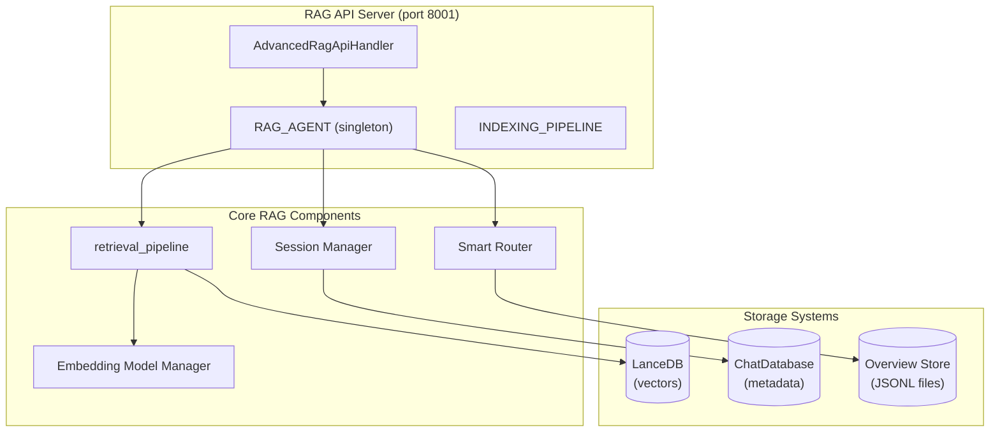
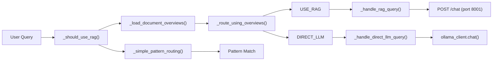
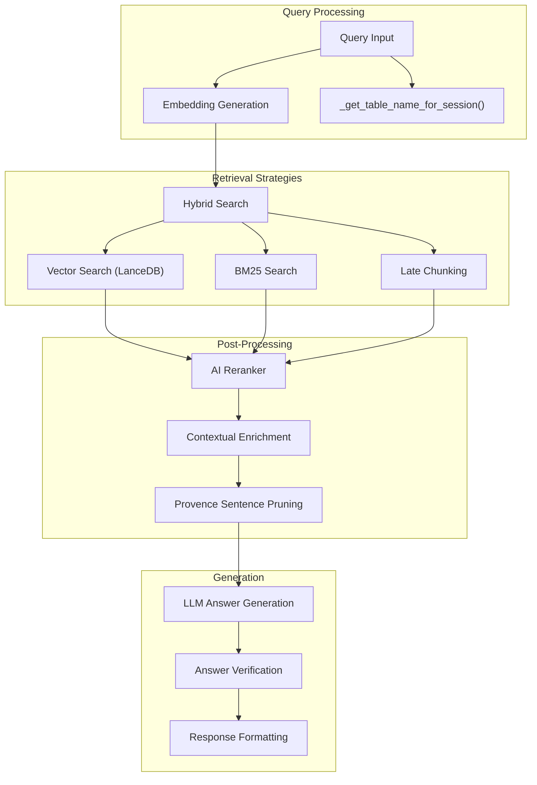
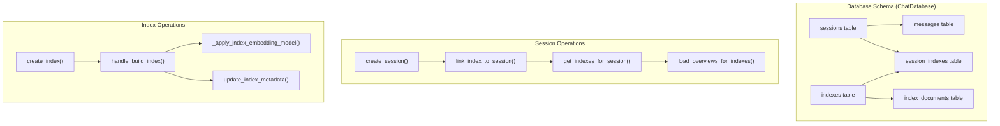
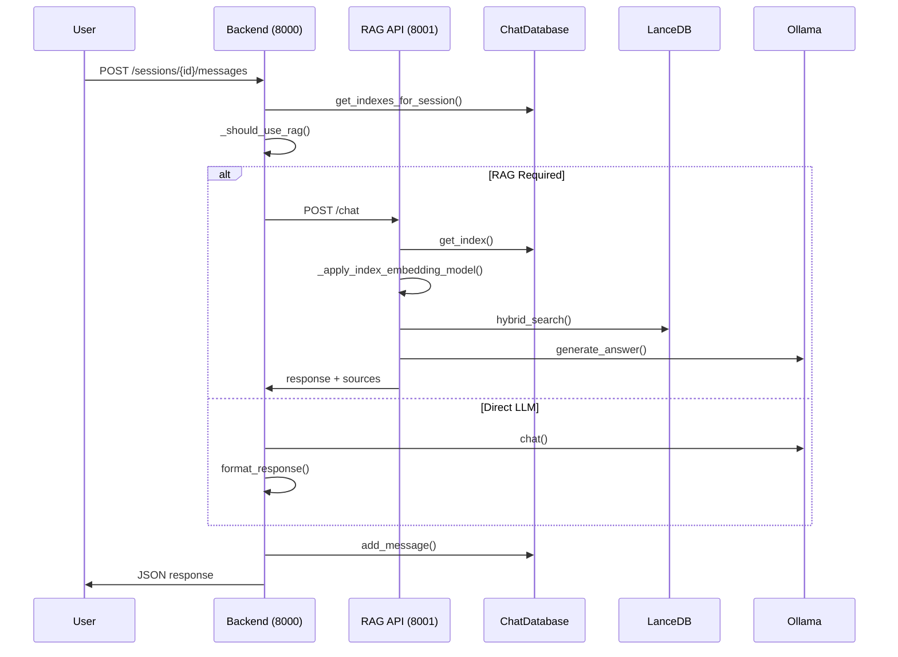

<!-- source: DeepWiki mcp.deepwiki.com · repo PromtEngineer/localGPT · page 3.2 RAG System Architecture · fetched 2026-10-26 -->

# RAG System Architecture

Relevant source files

The following files were used as context for generating this wiki page:

- [Dockerfile.backend](Dockerfile.backend)
- [README.md](README.md)
- [backend/database.py](backend/database.py)
- [backend/server.py](backend/server.py)
- [rag_system/api_server.py](rag_system/api_server.py)

This document describes the core Retrieval-Augmented Generation (RAG) system architecture within LocalGPT, focusing on how queries are processed, documents are retrieved, and responses are generated. It covers the RAG agent, smart routing logic, retrieval pipeline, and the integration between different system components.

For general system architecture and service orchestration, see [System Architecture](#1.2). For document processing and indexing details, see [Document Processing Pipeline](#3.1). For database schema and storage systems, see [Database & Storage](#3.3).

## RAG Agent Core Architecture

The RAG system centers around a singleton `RAG_AGENT` instance that orchestrates all retrieval-augmented generation operations. This agent provides intelligent routing between direct LLM responses and document-based retrieval.

**RAG Agent Initialization and Management**

Sources: [rag_system/api_server.py:26-37]()

The `RAG_AGENT` is initialized once when the API server starts and remains resident in memory to avoid reloading models on each request. The agent mode is configurable via the `RAG_CONFIG_MODE` environment variable, supporting different pipeline configurations like "default", "fast", and "react".

## Smart Routing System

LocalGPT implements intelligent query routing that decides whether to use the RAG pipeline or direct LLM generation based on document context and query analysis.

**Overview-Based Intelligent Routing**

Sources: [backend/server.py:342-505]()

The routing system first attempts to load document overviews for the session's linked indexes using `_load_document_overviews()`. These overviews are aggregated from per-index JSONL files located at `index_store/overviews/{index_id}.jsonl`. The system then uses a fast LLM model (qwen3:0.6b) to analyze the query against document summaries and determine routing.

**Fallback Pattern Matching**

When overview-based routing fails, the system falls back to pattern matching that identifies greeting patterns, document-related keywords, and query characteristics to make routing decisions.

## Retrieval Pipeline Architecture

The retrieval pipeline handles document search, hybrid retrieval, reranking, and answer generation with multiple configurable components.

**Hybrid Search Implementation**

Sources: [rag_system/api_server.py:218-286]()

The retrieval pipeline supports multiple search strategies configured through runtime parameters:
- `search_type`: "hybrid", "vector_only", "bm25_only"
- `dense_weight`: Weighting for vector vs. BM25 results (default 0.7)
- `retrieval_k`: Number of initial candidates (default 20)
- `reranker_top_k`: Final results after reranking (default 10)

**Table Name Resolution**

Sources: [rag_system/api_server.py:71-113]()

The system uses `_get_table_name_for_session()` to resolve the correct LanceDB table for a session by looking up linked indexes and retrieving their `vector_table_name`. This enables session-specific document retrieval from dedicated vector stores.

## Session and Index Management

LocalGPT implements session-based document management where each chat session can be linked to multiple document indexes, enabling contextual document retrieval.

**Session-Index Linking**

Sources: [backend/database.py:380-391](), [backend/server.py:988-993]()

Sessions are linked to indexes through the `session_indexes` table, allowing multiple indexes per session. The `get_indexes_for_session()` method retrieves all linked indexes, while `link_index_to_session()` creates new associations.

**Dynamic Embedding Model Application**

Sources: [rag_system/api_server.py:42-69]()

The `_apply_index_embedding_model()` function ensures the retrieval pipeline uses the correct embedding model for each session by reading the model name from index metadata and updating the pipeline configuration at runtime.

## Data Flow Architecture

The complete RAG system follows a multi-stage data flow from user input to final response, with branching paths for different query types.

**Request Processing Flow**

Sources: [backend/server.py:272-341](), [rag_system/api_server.py:145-302]()

1. **Session Chat Handler**: `handle_session_chat()` receives user queries and determines routing
2. **Smart Routing**: Query analysis decides between RAG pipeline or direct LLM
3. **RAG Processing**: Complex queries are forwarded to the RAG API server for document retrieval
4. **Response Storage**: All interactions are stored in the database for session continuity

**Configuration Override System**

Sources: [rag_system/api_server.py:221-236](), [rag_system/api_server.py:401-415]()

Runtime parameters can override default pipeline configuration:
- Retrieval parameters (`retrieval_k`, `reranker_top_k`, `search_type`)
- Processing flags (`provence_prune`, `context_window_size`)
- Model selection (`embedding_model`, `generation_model`)

The system applies these overrides dynamically to the pipeline configuration without requiring restart, enabling flexible per-query optimization.

---

