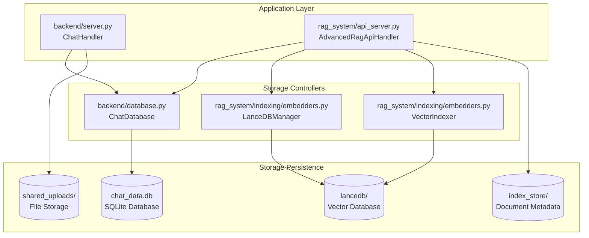
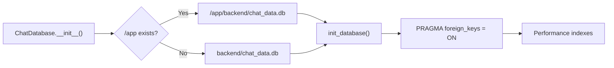
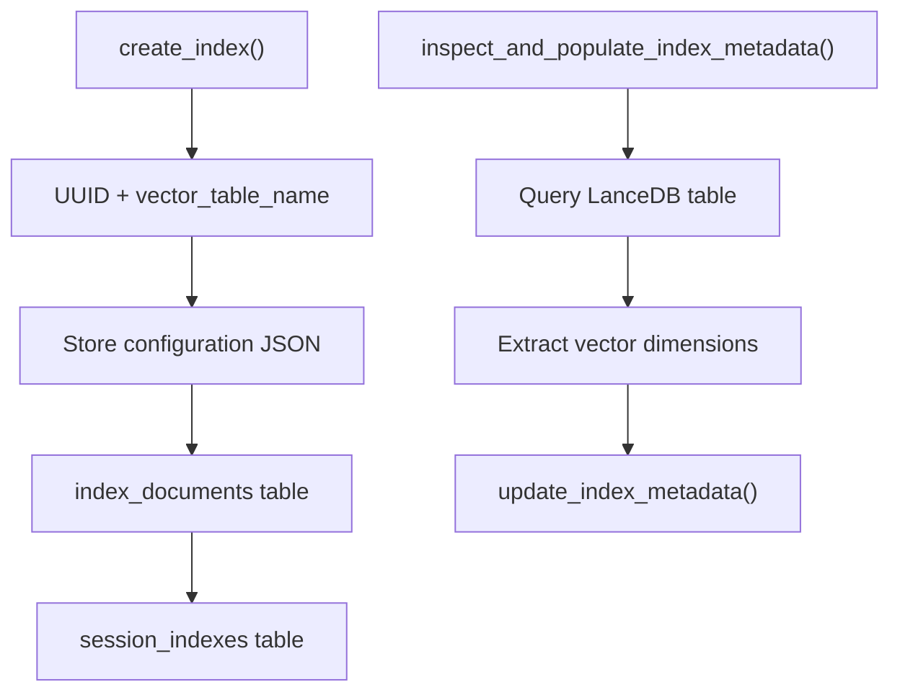
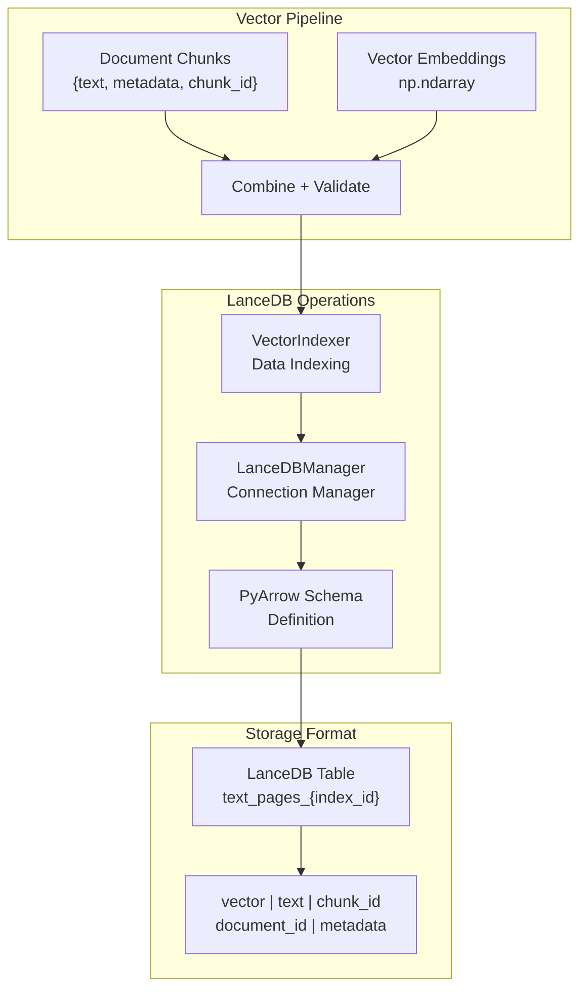
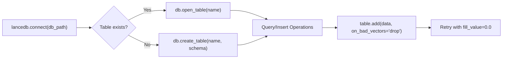
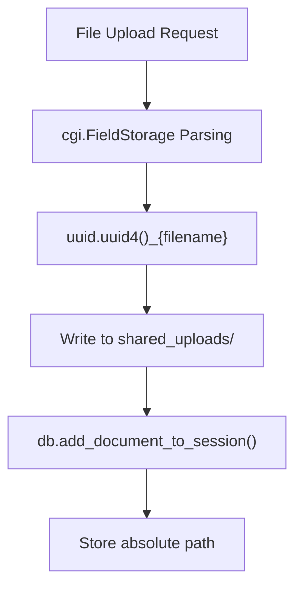
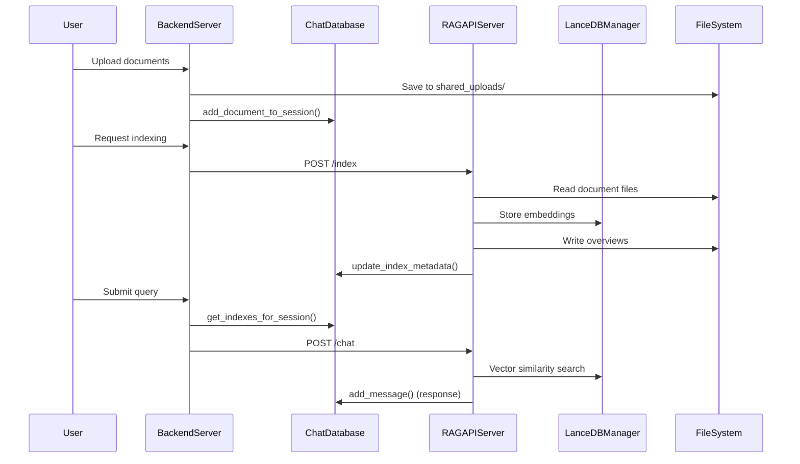
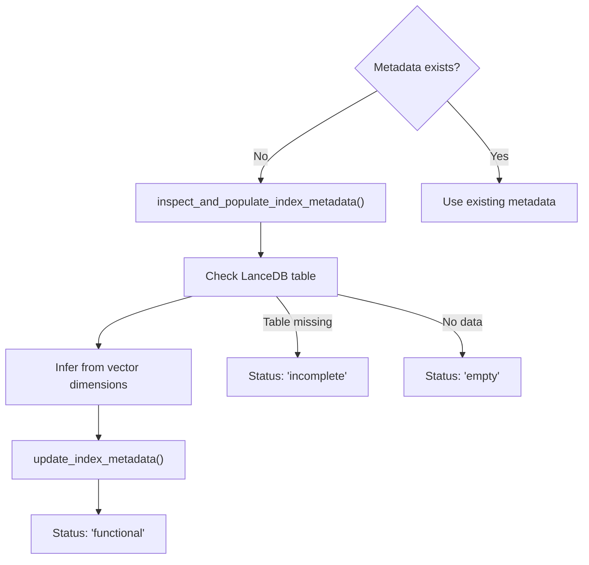

<!-- source: DeepWiki mcp.deepwiki.com · repo PromtEngineer/localGPT · page 3.3 Database & Storage · fetched 2026-10-26 -->

# Database & Storage

<details>
<summary>Relevant source files</summary>

The following files were used as context for generating this wiki page:

- [Dockerfile.backend](Dockerfile.backend)
- [backend/database.py](backend/database.py)
- [backend/server.py](backend/server.py)
- [rag_system/api_server.py](rag_system/api_server.py)
- [rag_system/indexing/embedders.py](rag_system/indexing/embedders.py)
- [rag_system/indexing/latechunk.py](rag_system/indexing/latechunk.py)
- [rag_system/indexing/representations.py](rag_system/indexing/representations.py)

</details>


This document covers LocalGPT's multi-layer storage architecture, including SQLite databases for structured data, LanceDB for vector embeddings, and file system storage for documents. It details the database schemas, storage patterns, and data persistence mechanisms across different deployment environments.

For information about model loading and configuration, see [Model Integration](#3.4). For details on indexing and retrieval processes, see [Document Processing Pipeline](#3.1).

## Storage Architecture Overview

LocalGPT uses a multi-tiered storage architecture that separates concerns between relational data, vector embeddings, and file storage:



Sources: [backend/database.py:1-667](), [rag_system/indexing/embedders.py:1-159](), [backend/server.py:1-1070](), [rag_system/api_server.py:1-800]()

## SQLite Database System

The `ChatDatabase` class manages all relational data using SQLite, with automatic environment detection for database placement.

### Database Schema

| Table | Purpose | Key Relationships |
|-------|---------|-------------------|
| `sessions` | Chat session metadata | Primary entity for conversations |
| `messages` | Individual chat messages | Foreign key to `sessions.id` |
| `session_documents` | Document-session associations | Links files to conversations |
| `indexes` | Vector index metadata | Stores index configuration |
| `index_documents` | Document-index associations | Maps files to vector indexes |
| `session_indexes` | Session-index links | Enables multi-index sessions |

### Database Initialization and Location

The database automatically detects the deployment environment:



Sources: [backend/database.py:8-18](), [backend/database.py:20-106](), [Dockerfile.backend:19-20]()

### Session and Message Management

The database stores conversation state with automatic title generation and message counting:

```python
# Session creation with metadata
session_id = db.create_session("Chat Title", "llama3.2:latest")

# Message storage with relationship tracking
message_id = db.add_message(session_id, content, sender, metadata)
```

Each message includes:
- Content text and sender identification
- Timestamp for chronological ordering
- JSON metadata field for extensible properties
- Automatic session timestamp and counter updates

Sources: [backend/database.py:108-183](), [backend/database.py:639-664]()

### Index Metadata Persistence

The database stores vector index configurations and relationships:



Sources: [backend/database.py:328-427](), [backend/database.py:443-637]()

## Vector Storage System (LanceDB)

LocalGPT uses LanceDB for high-performance vector storage and similarity search operations.

### LanceDB Architecture



### Vector Indexing Process

The `VectorIndexer` class handles embedding storage with data validation:

```python
# Schema definition for vector storage
schema = pa.schema([
    pa.field("vector", pa.list_(pa.float32(), vector_dim)),
    pa.field("text", pa.string(), nullable=False),
    pa.field("chunk_id", pa.string()),
    pa.field("document_id", pa.string()),
    pa.field("chunk_index", pa.int32()),
    pa.field("metadata", pa.string())
])
```

Key validation features:
- **NaN/Infinite Detection**: Filters invalid embedding values
- **Metadata Preservation**: Stores original text in metadata JSON
- **Incremental Indexing**: Appends to existing tables or creates new ones
- **Error Recovery**: Fallback strategies for corrupted embeddings

Sources: [rag_system/indexing/embedders.py:21-119](), [rag_system/indexing/embedders.py:30-86]()

### Database Connection Management



Sources: [rag_system/indexing/embedders.py:8-19](), [rag_system/indexing/embedders.py:96-118]()

## File Storage System

LocalGPT manages document files and metadata across multiple storage locations with automatic path resolution.

### File Organization Structure

| Directory | Contents | Access Pattern |
|-----------|----------|----------------|
| `shared_uploads/` | User-uploaded documents | Unique UUID prefixed filenames |
| `index_store/overviews/` | Document summaries | Per-index JSONL files |
| `index_store/lancedb/` | Vector database files | LanceDB internal format |
| `logs/` | System logs | Debug and error tracking |

### File Upload and Storage

Document uploads use UUID-based naming to prevent filename conflicts:



Sources: [backend/server.py:658-696](), [backend/server.py:842-861]()

### Overview File Management

Document overviews are stored as JSONL files with index-specific organization:

```python
# Per-index overview files
overview_path = f"index_store/overviews/{index_id}.jsonl"

# Legacy fallback
legacy_path = "index_store/overviews/overviews.jsonl"
```

Each overview record contains:
- Document summary and key topics
- Processing metadata and timestamps
- Configuration parameters used during indexing

Sources: [rag_system/api_server.py:266](), [rag_system/api_server.py:424](), [backend/server.py:368-438]()

## Data Flow Between Storage Systems

The following diagram shows how data moves between the different storage systems during typical operations:



Sources: [backend/server.py:272-341](), [rag_system/api_server.py:145-302](), [backend/database.py:302-391]()

## Configuration and Persistence

Storage configuration adapts to different deployment environments with automatic path detection and fallback mechanisms.

### Environment-Specific Paths

| Environment | Database Path | Vector Storage | File Storage |
|-------------|---------------|----------------|--------------|
| Docker | `/app/backend/chat_data.db` | `/app/rag_system/index_store/lancedb` | `/app/shared_uploads` |
| Local Development | `backend/chat_data.db` | `./rag_system/index_store/lancedb` | `shared_uploads/` |
| Custom | User-specified | `LANCEDB_PATH` environment variable | Configurable upload directory |

### Metadata Schema Evolution

The database includes metadata inspection capabilities to handle schema changes:



This system ensures backward compatibility with indexes created before comprehensive metadata tracking was implemented.

Sources: [backend/database.py:443-637](), [backend/database.py:10-17](), [rag_system/api_server.py:42-69]()

---

