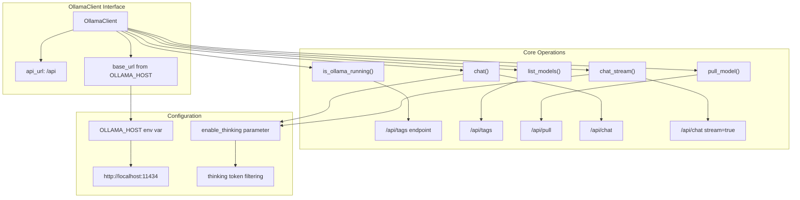
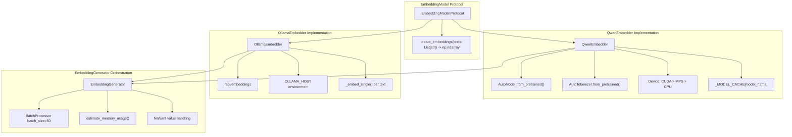
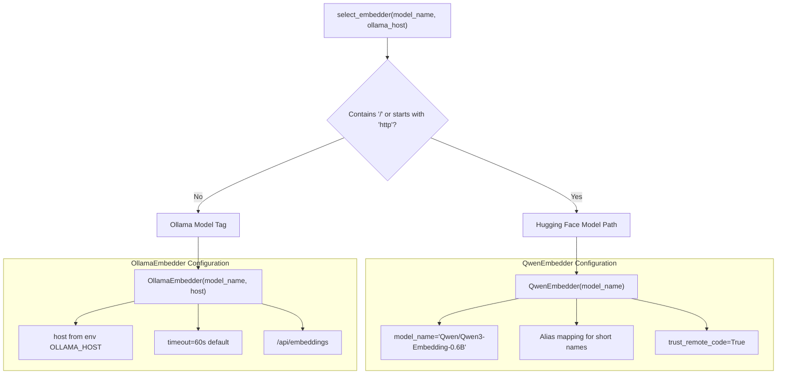
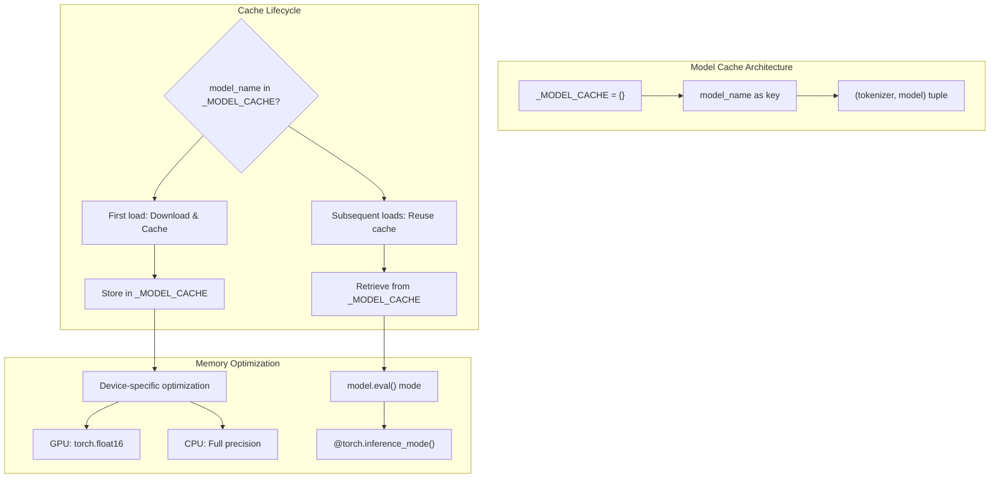
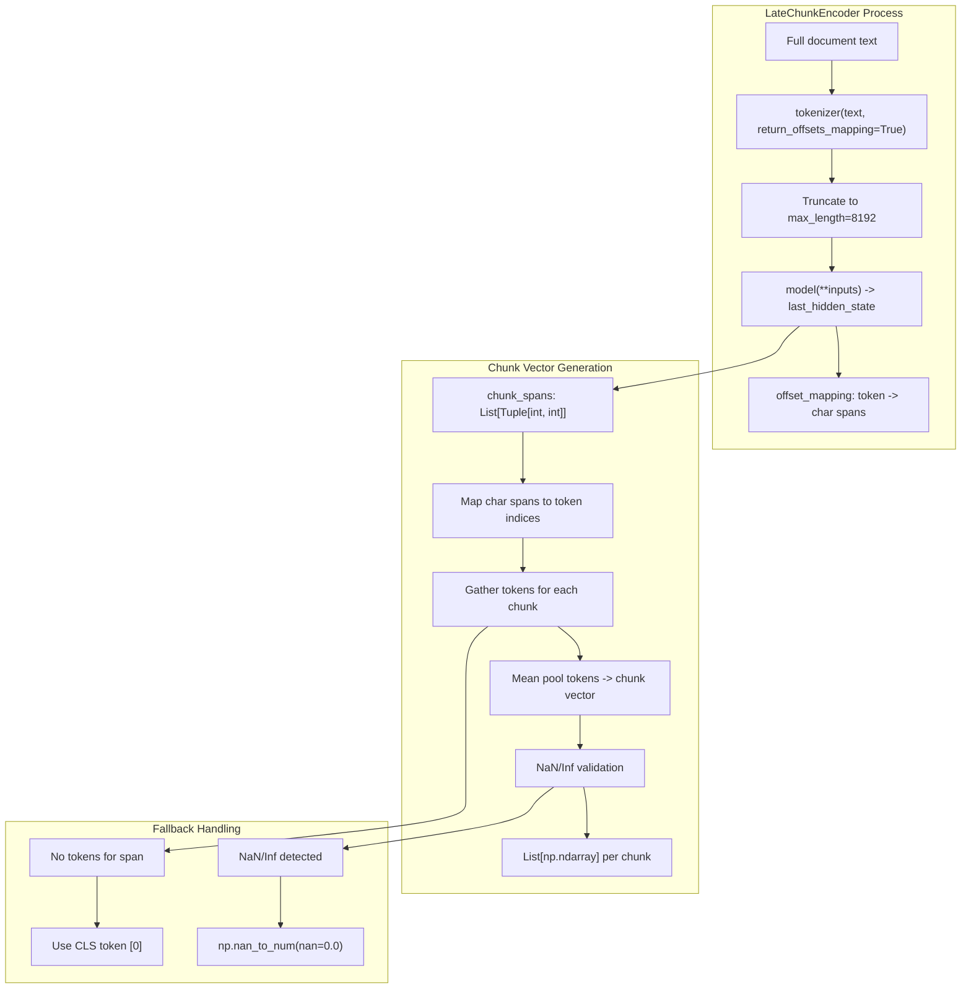
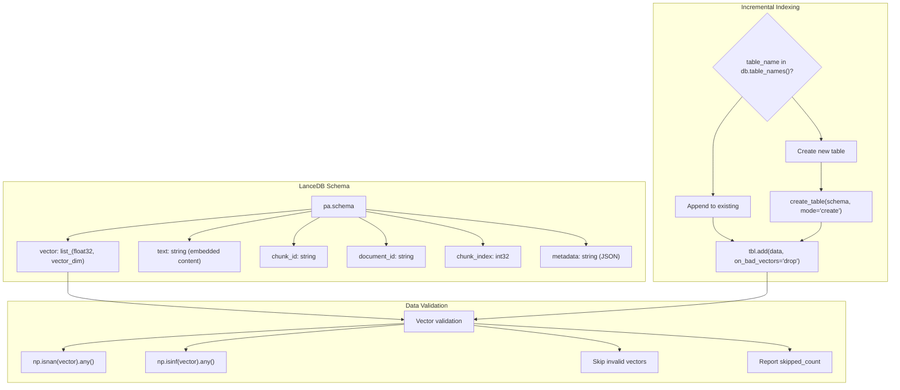

<!-- source: DeepWiki mcp.deepwiki.com · repo PromtEngineer/localGPT · page 3.4 Model Integration · fetched 2026-10-26 -->

# Model Integration

<details>
<summary>Relevant source files</summary>

The following files were used as context for generating this wiki page:

- [README.md](README.md)
- [backend/ollama_client.py](backend/ollama_client.py)
- [backend/test_ollama_connectivity.py](backend/test_ollama_connectivity.py)
- [docker-compose.yml](docker-compose.yml)
- [docker.env](docker.env)
- [rag_system/indexing/embedders.py](rag_system/indexing/embedders.py)
- [rag_system/indexing/latechunk.py](rag_system/indexing/latechunk.py)
- [rag_system/indexing/representations.py](rag_system/indexing/representations.py)

</details>


This document covers how LocalGPT integrates with various AI models for text generation, embeddings, and document processing. It details the architecture for managing Ollama models, Hugging Face transformers, embedding generation, and model caching strategies.

For information about configuring specific models and their parameters, see [Model Configuration](#4.2). For details about the RAG system architecture that uses these models, see [RAG System Architecture](#3.2).

## Ollama Integration

LocalGPT uses Ollama as the primary interface for local LLM inference. The `OllamaClient` class provides a comprehensive interface for model management and chat operations.

### OllamaClient Architecture



**Sources:** [backend/ollama_client.py:1-202]()

The `OllamaClient` handles connection management, model availability checking, and provides both synchronous and streaming chat interfaces. It includes sophisticated thinking token filtering for models that support internal reasoning.

### Model Pull and Management

The system automatically manages model availability through the pull mechanism:

| Method | Purpose | API Endpoint |
|--------|---------|--------------|
| `is_ollama_running()` | Health check | `GET /api/tags` |
| `list_models()` | Available models | `GET /api/tags` |
| `pull_model()` | Download model | `POST /api/pull` |

**Sources:** [backend/ollama_client.py:13-55]()

### Chat Interface Features

The chat interface supports advanced features including conversation history and thinking token control:

- **Conversation History**: Maintains context across multiple turns via `conversation_history` parameter
- **Thinking Token Control**: `enable_thinking` parameter controls internal reasoning display
- **Streaming Responses**: Real-time response generation via `chat_stream()`
- **Error Handling**: Comprehensive timeout and connection error management

**Sources:** [backend/ollama_client.py:57-167]()

## Embedding Models

LocalGPT supports two primary embedding model architectures: Hugging Face transformers and Ollama-based embeddings.

### Embedding Model Architecture



**Sources:** [rag_system/indexing/representations.py:8-151]()

### QwenEmbedder Features

The `QwenEmbedder` class provides local transformer-based embeddings with advanced optimizations:

- **Device Auto-Selection**: Automatically chooses CUDA > MPS > CPU for optimal performance
- **Model Caching**: Global `_MODEL_CACHE` prevents redundant model loading
- **Memory Optimization**: Uses `torch.float16` on GPU devices, full precision on CPU
- **Pooling Strategy**: Last valid token pooling recommended for Qwen3 models
- **Validation**: Built-in NaN and infinite value detection and replacement

**Sources:** [rag_system/indexing/representations.py:15-72]()

### OllamaEmbedder Integration

The `OllamaEmbedder` provides a lightweight interface to Ollama's embedding API:

```python
# Single text embedding via Ollama API
def _embed_single(self, text: str):
    payload = {"model": self.model_name, "prompt": text}
    r = requests.post(f"{self.host}/api/embeddings", json=payload)
```

**Sources:** [rag_system/indexing/representations.py:106-143]()

## Model Configuration

Model selection and configuration is handled through a centralized selection mechanism and environment-based configuration.

### Model Selection Strategy



**Sources:** [rag_system/indexing/representations.py:145-151]()

### Environment Configuration

The system uses environment variables for model configuration:

| Variable | Purpose | Default |
|----------|---------|---------|
| `OLLAMA_HOST` | Ollama server URL | `http://localhost:11434` |
| `GENERATION_MODEL` | Primary text generation | `qwen3:8b` |
| `ENRICHMENT_MODEL` | Lightweight operations | `qwen3:0.6b` |
| `EMBEDDING_MODEL` | Embedding generation | `Qwen/Qwen3-Embedding-0.6B` |
| `RERANKER_MODEL` | Result reranking | `answerdotai/answerai-colbert-small-v1` |

**Sources:** [README.md:262-279](), [docker.env:1-12]()

## Model Caching and Memory Management

LocalGPT implements sophisticated caching and memory management for optimal performance.

### Global Model Cache



**Sources:** [rag_system/indexing/representations.py:11-43]()

### Batch Processing and Memory Estimation

The `EmbeddingGenerator` implements intelligent batch processing with memory estimation:

```python
memory_mb = estimate_memory_usage(chunks)
batch_processor = BatchProcessor(batch_size=self.batch_size)
```

**Sources:** [rag_system/indexing/representations.py:74-104]()

## Late Chunking Embeddings

The `LateChunkEncoder` implements the late chunking strategy for better context preservation in embeddings.

### Late Chunking Architecture



**Sources:** [rag_system/indexing/latechunk.py:21-88]()

### Late Chunking Benefits

Late chunking addresses context-loss issues by:

1. **Full Document Context**: Each chunk vector is generated with knowledge of the entire document
2. **Character-Level Precision**: Uses character offsets for precise chunk boundary mapping
3. **Token Alignment**: Maps character spans to tokenizer output for accurate pooling
4. **Fallback Strategies**: Handles edge cases like empty spans or truncation

**Sources:** [rag_system/indexing/latechunk.py:1-13]()

## Vector Indexing and Storage

The `VectorIndexer` manages the storage of embeddings in LanceDB with comprehensive metadata handling.

### Vector Storage Schema



**Sources:** [rag_system/indexing/embedders.py:21-118]()

The indexing system ensures data integrity through validation, supports incremental updates, and preserves both the original text and enriched content for retrieval operations.

---

