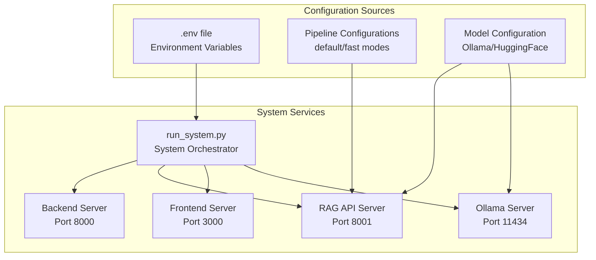
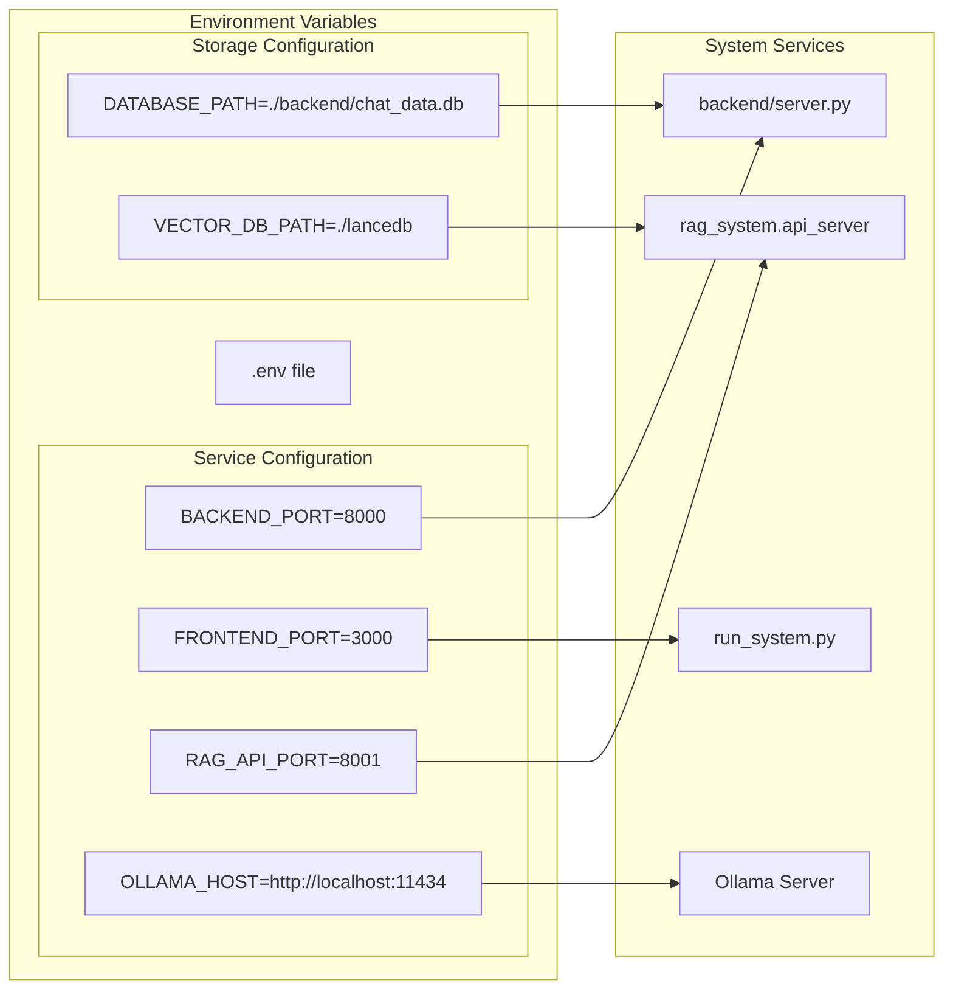
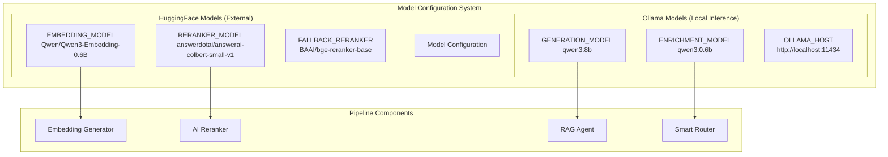
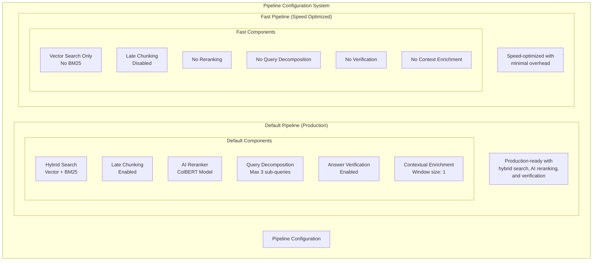
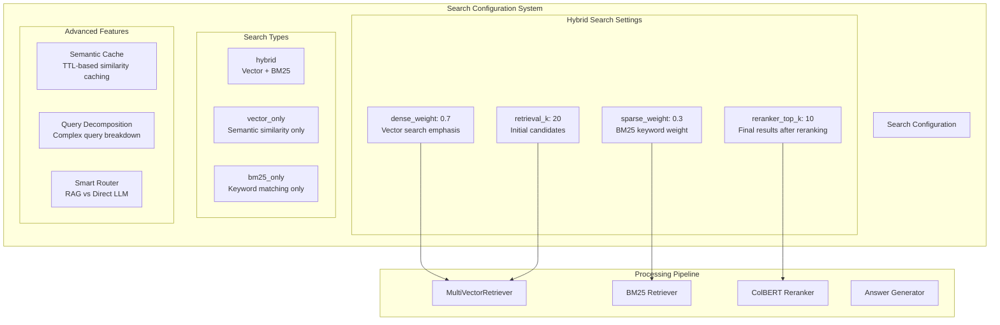
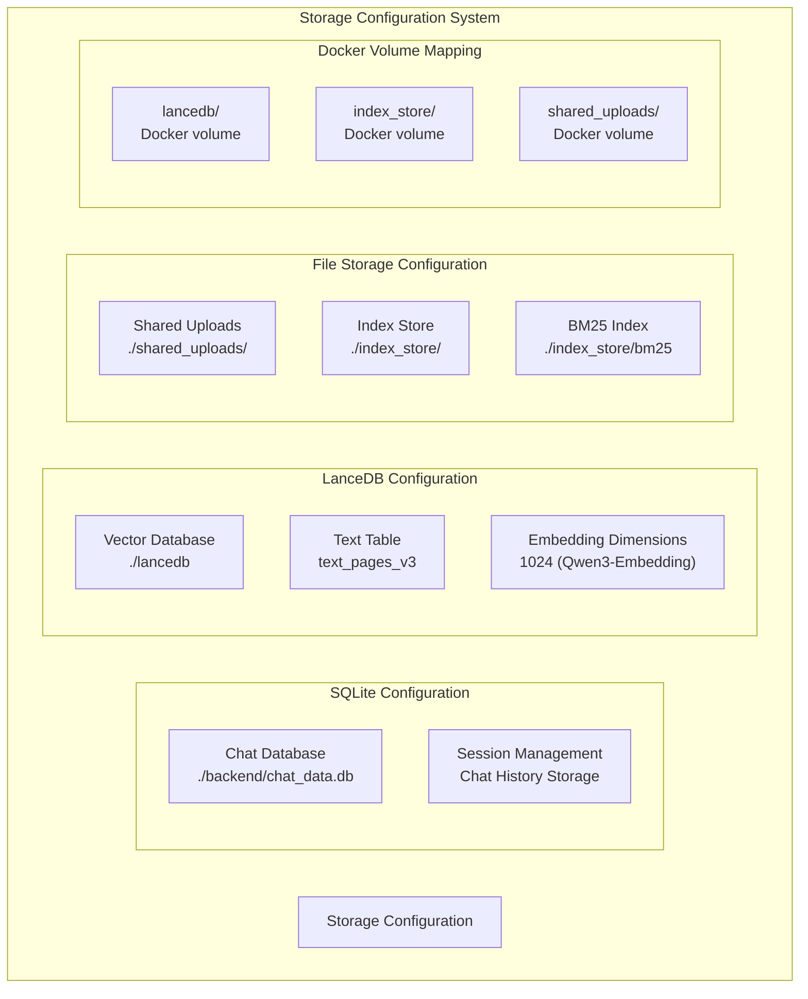
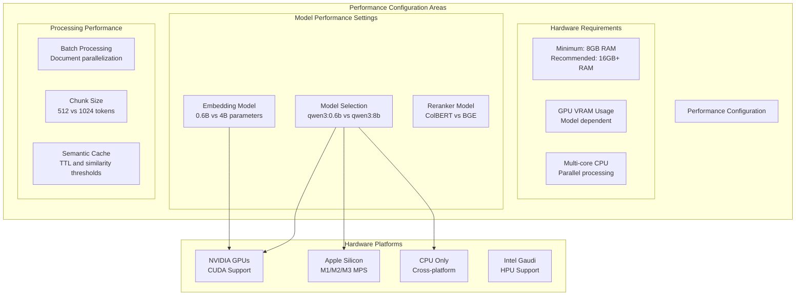
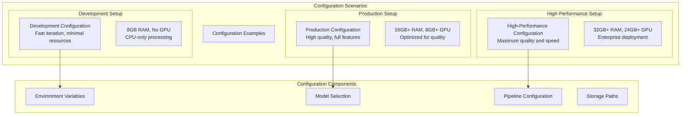

<!-- source: DeepWiki mcp.deepwiki.com · repo PromtEngineer/localGPT · page 4 Configuration · fetched 2026-10-26 -->

# Configuration

<details>
<summary>Relevant source files</summary>

The following files were used as context for generating this wiki page:

- [README.md](README.md)

</details>


This page explains how to configure LocalGPT's multi-service architecture to optimize performance and functionality for your specific needs. The configuration system allows you to customize model selection, pipeline settings, hardware utilization, and service parameters across the frontend, backend, RAG API, and Ollama services.

## Configuration Overview

LocalGPT's configuration is distributed across environment variables, pipeline configurations, and service-specific settings. The system uses a modular approach where each service can be independently configured while maintaining coherent system-wide settings.



Sources: [README.md:252-296](), [README.md:383-468]()

## System Configuration

LocalGPT's system configuration is managed through environment variables that can be set in a `.env` file. These settings control service ports, database locations, and runtime parameters.



### Core System Settings

| Environment Variable | Description | Default Value | Used By |
|---------------------|-------------|---------------|---------|
| `BACKEND_PORT` | Backend API server port | `8000` | `run_system.py` |
| `FRONTEND_PORT` | Next.js frontend port | `3000` | `run_system.py` |  
| `RAG_API_PORT` | RAG processing server port | `8001` | `run_system.py` |
| `OLLAMA_HOST` | Ollama server endpoint | `http://localhost:11434` | RAG system |
| `DATABASE_PATH` | SQLite database location | `./backend/chat_data.db` | Backend server |
| `VECTOR_DB_PATH` | LanceDB vector storage | `./lancedb` | RAG system |

### Runtime Configuration

The `run_system.py` orchestrator supports several runtime modes and options:

```bash
# Production mode with optimized settings
python run_system.py --mode prod

# Development mode with debug logging  
python run_system.py --mode dev

# Backend and RAG API only (no frontend)
python run_system.py --no-frontend

# Health check mode
python run_system.py --health
```

Sources: [README.md:252-296](), [README.md:169-196]()

## Model Configuration

LocalGPT supports multiple AI model providers with centralized configuration for generation models, embedding models, and rerankers. The system uses Ollama for local LLM inference and HuggingFace models for embeddings and reranking.



### Ollama Model Configuration

Ollama provides local LLM inference with configurable models for different tasks:

| Configuration | Purpose | Default Model | Performance |
|---------------|---------|---------------|-------------|
| `GENERATION_MODEL` | Main text generation and QA | `qwen3:8b` | High quality |
| `ENRICHMENT_MODEL` | Fast routing and enrichment | `qwen3:0.6b` | High speed |

```bash
# Install recommended models
ollama pull qwen3:0.6b          # Fast generation model  
ollama pull qwen3:8b            # High-quality generation model
```

### HuggingFace Model Configuration

External models are downloaded automatically and used for specialized tasks:

| Model Type | Configuration | Default Model | Dimensions |
|------------|---------------|---------------|------------|
| Embedding | `EMBEDDING_MODEL` | `Qwen/Qwen3-Embedding-0.6B` | 1024 |
| Reranker | `RERANKER_MODEL` | `answerdotai/answerai-colbert-small-v1` | ColBERT |
| Fallback Reranker | `FALLBACK_RERANKER` | `BAAI/bge-reranker-base` | BGE |

### Environment Override Examples

```env
# Override default models in .env file
GENERATION_MODEL=qwen3:8b
ENRICHMENT_MODEL=qwen3:0.6b  
EMBEDDING_MODEL=Qwen/Qwen3-Embedding-0.6B
RERANKER_MODEL=answerdotai/answerai-colbert-small-v1
```

Sources: [README.md:385-405](), [README.md:241-249]()

## Pipeline Configuration

LocalGPT offers configurable processing pipelines that can be optimized for different use cases. The system supports two main pipeline modes: `default` (production-ready) and `fast` (speed-optimized).



### Default Pipeline Configuration

The production-ready pipeline with comprehensive features:

| Component | Setting | Value | Purpose |
|-----------|---------|-------|---------|
| `retriever` | Multi-vector retrieval | `"multivector"` | Comprehensive search |
| `search_type` | Hybrid search | `"hybrid"` | Vector + keyword search |
| `late_chunking.enabled` | Late chunking | `true` | Better context preservation |
| `dense.weight` | Dense search weight | `0.7` | Vector search emphasis |
| `bm25.enabled` | Keyword search | `true` | Full-text search support |
| `reranker.enabled` | AI reranking | `true` | Result quality improvement |
| `reranker.model_name` | ColBERT model | `"answerdotai/answerai-colbert-small-v1"` | Advanced reranking |
| `query_decomposition.enabled` | Sub-query generation | `true` | Complex query handling |
| `verification.enabled` | Answer verification | `true` | Accuracy validation |
| `retrieval_k` | Initial retrieval count | `20` | Comprehensive recall |
| `contextual_enricher.enabled` | Context enrichment | `true` | Enhanced understanding |

### Fast Pipeline Configuration  

Speed-optimized pipeline for performance-critical scenarios:

| Component | Setting | Value | Purpose |
|-----------|---------|-------|---------|
| `search_type` | Vector search only | `"vector_only"` | Fast similarity search |
| `late_chunking.enabled` | Late chunking | `false` | Reduced processing |
| `reranker.enabled` | No reranking | `false` | Skip reranking step |
| `query_decomposition.enabled` | No decomposition | `false` | Single query processing |
| `verification.enabled` | No verification | `false` | Skip verification |
| `retrieval_k` | Reduced retrieval | `10` | Fewer candidates |
| `contextual_enricher.enabled` | No enrichment | `false` | Minimal processing |

### Storage Configuration

Pipeline storage settings define database locations and table names:

```python
"storage": {
    "lancedb_uri": "./lancedb",
    "text_table_name": "text_pages_v3", 
    "bm25_path": "./index_store/bm25"
}
```

Sources: [README.md:407-454]()

## Indexing Configuration

LocalGPT provides extensive configuration options for document processing, chunking strategies, and index building. These settings control how documents are converted, chunked, enriched, and stored in the vector database.

```mermaid
flowchart TB
    subgraph "Document Processing Pipeline Configuration"
        DocumentConfig["Document Processing Config"]
        
        subgraph "Chunking Configuration"
            ChunkSize["chunk_size: 512<br/>Token-based chunking"]
            ChunkOverlap["chunk_overlap: 64<br/>Overlap between chunks"]
            ChunkStrategy["Chunking Strategy<br/>DoclingChunker vs<br/>MarkdownRecursiveChunker"]
        end
        
        subgraph "Processing Options"
            EnableEnrich["enable_enrich: true<br/>Contextual enrichment"]
            EnableLatechunk["enable_latechunk: true<br/>Late chunking processing"]
            EnableDocling["enable_docling: true<br/>Advanced document parsing"]
            WindowSize["window_size: 2<br/>Context window for enrichment"]
        end
        
        subgraph "Model Selection"
            EmbeddingModel["embedding_model<br/>Qwen/Qwen3-Embedding-0.6B"]
            GenerationModel["generation_model<br/>qwen3:0.6b"]
            RetrievalMode["retrieval_mode<br/>hybrid"]
        end
    end

    subgraph "Index Building Components"
        DocumentConverter["DocumentConverter<br/>Docling Integration"]
        Chunkers["DoclingChunker<br/>MarkdownRecursiveChunker"]
        EmbedGen["EmbeddingGenerator<br/>Batch Processing"]
        VectorIndexer["VectorIndexer<br/>LanceDB Management"]
        BM25Indexer["BM25 Index Builder<br/>Full-text Search"]
    end

    ChunkSize --> Chunkers
    ChunkOverlap --> Chunkers
    EnableEnrich --> EmbedGen
    EnableLatechunk --> EmbedGen
    EnableDocling --> DocumentConverter
    EmbeddingModel --> EmbedGen
```



### Document Processing Configuration

Core settings for document ingestion and processing:

| Parameter | Description | Default Value | Impact |
|-----------|-------------|---------------|--------|
| `chunk_size` | Maximum tokens per chunk | `512` | Memory usage, context quality |
| `chunk_overlap` | Token overlap between chunks | `64` | Context continuity |
| `enable_docling` | Advanced document parsing | `true` | PDF processing quality |
| `enable_enrich` | Contextual enrichment | `true` | Understanding quality |
| `enable_latechunk` | Late chunking processing | `true` | Retrieval accuracy |
| `window_size` | Context window for enrichment | `2` | Enrichment context size |

### Index Building API Configuration

Configuration for programmatic index building via API:

```json
{
  "config_mode": "default",
  "enable_enrich": true,
  "chunk_size": 512,
  "chunk_overlap": 64,
  "enable_latechunk": true,
  "enable_docling": true,
  "embedding_model": "Qwen/Qwen3-Embedding-0.6B",
  "generation_model": "qwen3:0.6b",
  "retrieval_mode": "hybrid",
  "window_size": 2
}
```

### Batch Processing Configuration

For batch document processing using `demo_batch_indexing.py`:

```json
{
  "index_name": "Batch Index",
  "index_description": "Batch processed documents",
  "documents": ["./documents/doc1.pdf", "./documents/doc2.pdf"],
  "processing": {
    "chunk_size": 512,
    "chunk_overlap": 64, 
    "enable_enrich": true,
    "enable_latechunk": true,
    "enable_docling": true,
    "embedding_model": "Qwen/Qwen3-Embedding-0.6B",
    "generation_model": "qwen3:0.6b",
    "retrieval_mode": "hybrid",
    "window_size": 2
  }
}
```

### Chunking Strategy Selection

The system supports multiple chunking strategies based on document type:

| Strategy | Use Case | Configuration |
|----------|----------|---------------|
| `DoclingChunker` | PDF documents with complex layout | Default for PDF processing |
| `MarkdownRecursiveChunker` | Markdown and text documents | Hierarchical text splitting |

Sources: [README.md:704-727](), [README.md:598-604]()

## Search and Retrieval Configuration

LocalGPT's search system supports configurable hybrid search combining vector similarity and keyword matching with AI-powered reranking. The search configuration balances accuracy and performance based on your requirements.



### Hybrid Search Configuration

The hybrid search system combines multiple retrieval methods:

| Parameter | Description | Default Value | Purpose |
|-----------|-------------|---------------|---------|
| `dense_weight` | Vector search importance | `0.7` | Semantic similarity emphasis |
| `sparse_weight` | BM25 keyword importance | `0.3` | Keyword matching weight |
| `retrieval_k` | Initial candidate count | `20` | Comprehensive recall |
| `reranker_top_k` | Final result count | `10` | Refined output size |

### Search Type Options

| Search Type | Use Case | Performance | Accuracy |
|-------------|----------|-------------|----------|
| `hybrid` | Balanced semantic + keyword search | Medium | High |
| `vector_only` | Pure semantic similarity | Fast | Good |
| `bm25_only` | Traditional keyword matching | Fast | Moderate |

### Advanced Search Features

The search system includes several advanced capabilities:

```python
# Semantic caching configuration
SEARCH_CONFIG = {
    'semantic_cache': {
        'enabled': True,
        'ttl_seconds': 3600,
        'similarity_threshold': 0.95
    }
}

# Query decomposition settings  
QUERY_DECOMPOSITION = {
    'enabled': True,
    'max_sub_queries': 3,
    'compose_answers': True
}

# Smart routing configuration
SMART_ROUTER = {
    'enabled': True,
    'confidence_threshold': 0.8,
    'fallback_to_llm': True
}
```

Sources: [README.md:455-468](), [README.md:649-659](), [README.md:661-671]()

## Storage Configuration

LocalGPT uses multiple storage systems for different types of data. The storage configuration defines database locations, table names, and persistence settings across SQLite, LanceDB, and file storage systems.



### Database Configuration

| Storage System | Configuration | Default Path | Purpose |
|----------------|---------------|--------------|---------|
| SQLite | `DATABASE_PATH` | `./backend/chat_data.db` | Session and chat history |
| LanceDB | `VECTOR_DB_PATH` | `./lancedb` | Vector embeddings |
| Index Store | `index_store` | `./index_store/` | Document overviews and metadata |
| BM25 Index | `bm25_path` | `./index_store/bm25` | Full-text search index |
| File Storage | `shared_uploads` | `./shared_uploads/` | Document uploads |

### Vector Database Settings

LanceDB configuration for vector storage:

```python
"storage": {
    "lancedb_uri": "./lancedb",
    "text_table_name": "text_pages_v3",
    "bm25_path": "./index_store/bm25"
}
```

| Parameter | Description | Default | Notes |
|-----------|-------------|---------|-------|
| `lancedb_uri` | LanceDB database location | `"./lancedb"` | Vector storage path |
| `text_table_name` | Table for text embeddings | `"text_pages_v3"` | Versioned table schema |
| `bm25_path` | BM25 index location | `"./index_store/bm25"` | Full-text search index |

### Docker Volume Configuration

For containerized deployments, storage is managed through Docker volumes:

```yaml
volumes:
  lancedb:
    driver: local
  index_store:
    driver: local  
  shared_uploads:
    driver: local
  ollama_data:
    driver: local
```

### Storage Initialization

The system automatically initializes storage components:

```bash
# Initialize SQLite database
python -c "from backend.database import ChatDatabase; ChatDatabase().init_database()"

# LanceDB tables are created automatically during first index build
# BM25 indices are built during document processing
```

Sources: [README.md:262-280](), [README.md:415-419]()

## Performance Configuration

LocalGPT's performance can be optimized through configuration settings that balance resource usage, processing speed, and output quality. The system supports various hardware configurations from CPU-only to high-end GPU setups.



### Hardware Requirements and Optimization

| Component | Minimum | Recommended | High Performance |
|-----------|---------|-------------|------------------|
| RAM | 8GB | 16GB | 32GB+ |
| GPU VRAM | N/A (CPU) | 8GB | 24GB+ |
| CPU Cores | 4 cores | 8 cores | 16+ cores |
| Storage | 10GB free | 50GB free | 100GB+ free |

### Model Performance Trade-offs

| Model Configuration | Performance | Quality | VRAM Usage |
|-------------------|-------------|---------|------------|
| `qwen3:0.6b` + `Qwen3-Embedding-0.6B` | Fast | Good | ~2GB |
| `qwen3:8b` + `Qwen3-Embedding-0.6B` | Medium | High | ~6GB |
| `qwen3:8b` + `Qwen3-Embedding-4B` | Slow | Highest | ~10GB |

### Pipeline Performance Settings

Choose pipeline configuration based on performance requirements:

```python
# Speed-optimized configuration
"fast_pipeline": {
    "search_type": "vector_only",
    "late_chunking": {"enabled": False},
    "reranker": {"enabled": False},
    "query_decomposition": {"enabled": False},
    "verification": {"enabled": False},
    "retrieval_k": 10
}

# Quality-optimized configuration  
"quality_pipeline": {
    "search_type": "hybrid",
    "late_chunking": {"enabled": True},
    "reranker": {"enabled": True, "top_k": 10},
    "query_decomposition": {"enabled": True, "max_sub_queries": 3},
    "verification": {"enabled": True},
    "retrieval_k": 20
}
```

### Performance Monitoring

Monitor system performance using built-in diagnostics:

```bash
# Comprehensive system health check
python system_health_check.py

# Service-specific health monitoring
python run_system.py --health

# Resource monitoring during operation
# Check logs in logs/ directory for performance metrics
```

### Performance Tuning Guidelines

1. **For Speed**: Use `fast` pipeline, smaller models (`qwen3:0.6b`), disable advanced features
2. **For Quality**: Use `default` pipeline, larger models (`qwen3:8b`), enable all features  
3. **For Memory**: Reduce `chunk_size`, `retrieval_k`, disable `late_chunking`
4. **For Accuracy**: Enable `verification`, `query_decomposition`, use AI reranking

Sources: [README.md:86-91](), [README.md:509-517](), [README.md:441-454]()

## Configuration Examples

This section provides practical configuration examples for different deployment scenarios, from development setups to production environments.



### Development Environment Configuration

Optimized for fast iteration and minimal resource usage:

```env
# .env file for development
BACKEND_PORT=8000
FRONTEND_PORT=3000
RAG_API_PORT=8001
OLLAMA_HOST=http://localhost:11434

# Lightweight models
GENERATION_MODEL=qwen3:0.6b
ENRICHMENT_MODEL=qwen3:0.6b
EMBEDDING_MODEL=Qwen/Qwen3-Embedding-0.6B

# Fast pipeline
PIPELINE_MODE=fast

# Local storage paths
DATABASE_PATH=./backend/chat_data.db
VECTOR_DB_PATH=./lancedb
```

Index building configuration for development:
```json
{
  "config_mode": "fast",
  "enable_enrich": false,
  "chunk_size": 256,
  "enable_latechunk": false,
  "enable_docling": true,
  "retrieval_mode": "vector_only"
}
```

### Production Environment Configuration

Balanced configuration for production deployment:

```env
# .env file for production  
BACKEND_PORT=8000
FRONTEND_PORT=3000
RAG_API_PORT=8001
OLLAMA_HOST=http://localhost:11434

# Quality models
GENERATION_MODEL=qwen3:8b
ENRICHMENT_MODEL=qwen3:0.6b
EMBEDDING_MODEL=Qwen/Qwen3-Embedding-0.6B
RERANKER_MODEL=answerdotai/answerai-colbert-small-v1

# Production storage paths
DATABASE_PATH=/data/localgpt/chat_data.db
VECTOR_DB_PATH=/data/localgpt/lancedb
```

Production pipeline configuration:
```json
{
  "config_mode": "default",
  "enable_enrich": true,
  "chunk_size": 512,
  "chunk_overlap": 64,
  "enable_latechunk": true,
  "enable_docling": true,
  "retrieval_mode": "hybrid",
  "window_size": 2
}
```

### High-Performance Enterprise Configuration

Maximum quality configuration for enterprise deployment:

```env
# .env file for high-performance setup
BACKEND_PORT=8000
FRONTEND_PORT=3000  
RAG_API_PORT=8001
OLLAMA_HOST=http://localhost:11434

# High-quality models
GENERATION_MODEL=qwen3:8b
ENRICHMENT_MODEL=qwen3:8b
EMBEDDING_MODEL=Qwen/Qwen3-Embedding-4B
RERANKER_MODEL=answerdotai/answerai-colbert-small-v1
FALLBACK_RERANKER=BAAI/bge-reranker-large

# Enterprise storage
DATABASE_PATH=/enterprise/localgpt/chat_data.db
VECTOR_DB_PATH=/enterprise/localgpt/lancedb
```

Enterprise pipeline with all features enabled:
```json
{
  "config_mode": "default",
  "enable_enrich": true,
  "chunk_size": 1024,
  "chunk_overlap": 128,
  "enable_latechunk": true,
  "enable_docling": true,
  "retrieval_mode": "hybrid",
  "window_size": 3,
  "advanced_features": {
    "query_decomposition": true,
    "verification": true,
    "semantic_cache": true,
    "ai_reranking": true
  }
}
```

### Docker Compose Configuration Examples

Development Docker configuration:
```yaml
# docker-compose.dev.yml
version: '3.8'
services:
  rag-frontend:
    environment:
      - NEXT_PUBLIC_API_URL=http://localhost:8000
  rag-backend:
    environment:
      - GENERATION_MODEL=qwen3:0.6b
      - PIPELINE_MODE=fast
```

Production Docker configuration:
```yaml
# docker-compose.prod.yml  
version: '3.8'
services:
  rag-backend:
    environment:
      - GENERATION_MODEL=qwen3:8b
      - PIPELINE_MODE=default
    deploy:
      resources:
        limits:
          memory: 16G
        reservations:
          memory: 8G
```

Sources: [README.md:252-296](), [README.md:704-727](), [README.md:101-133]()

## Example Configurations

Here are some example configurations for different hardware setups:

### Low-End Setup (8GB VRAM GPU)
```python
# Embedding model with low VRAM usage
EMBEDDING_MODEL_NAME = "all-MiniLM-L6-v2"  # Uses 0.2 GB of VRAM

# 7B GPTQ model for 8GB GPUs
MODEL_ID = "TheBloke/Wizard-Vicuna-7B-Uncensored-GPTQ"
MODEL_BASENAME = "Wizard-Vicuna-7B-Uncensored-GPTQ-4bit-128g.no-act.order.safetensors"

# Reduced GPU layers and batch size
N_GPU_LAYERS = 20
N_BATCH = 256
```

### Mid-Range Setup (24GB VRAM GPU)
```python
# Default embedding model
EMBEDDING_MODEL_NAME = "hkunlp/instructor-large"  # Uses 1.5 GB of VRAM

# 13B GPTQ model
MODEL_ID = "TheBloke/vicuna-13B-v1.5-GPTQ"
MODEL_BASENAME = "model.safetensors"

# Default GPU settings
N_GPU_LAYERS = 100
N_BATCH = 512
```

### High-End Setup (48GB+ VRAM GPU)
```python
# High accuracy embedding model
EMBEDDING_MODEL_NAME = "hkunlp/instructor-xl"  # Uses 5 GB of VRAM

# 65B GPTQ model
MODEL_ID = "TheBloke/Upstage-Llama1-65B-Instruct-GPTQ"
MODEL_BASENAME = "model.safetensors"

# Default GPU settings
N_GPU_LAYERS = 100
N_BATCH = 512
```

Sources: [constants.py:143-184]()

This configuration guide should help you set up LocalGPT according to your specific hardware capabilities and performance requirements. For more detailed information about selecting specific models, refer to [Model Selection](#4.1) and [Embedding Models](#4.2).

---

