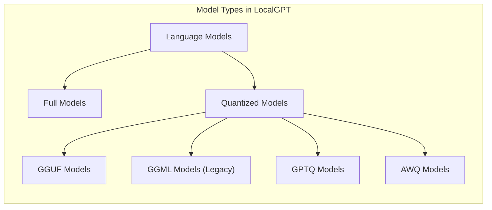
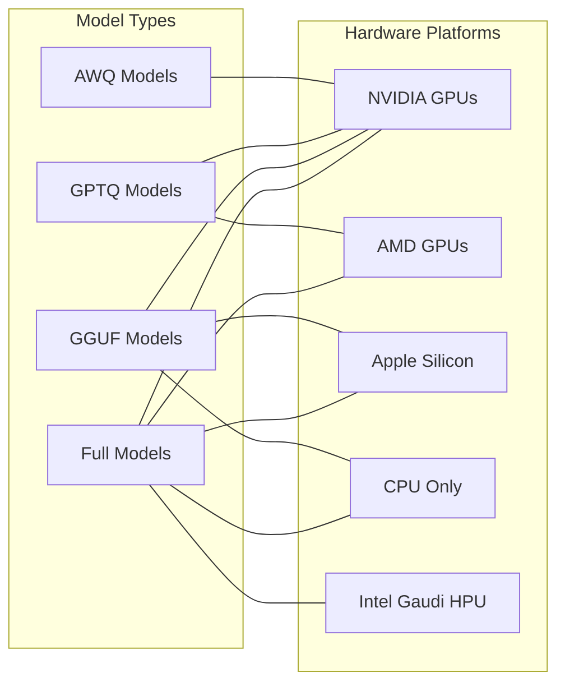
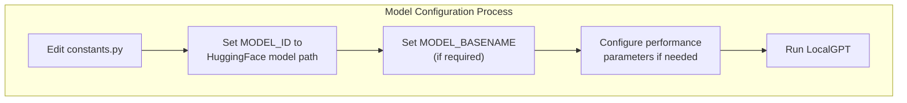
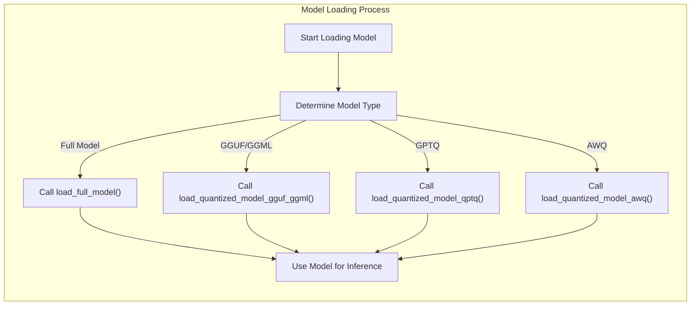

<!-- source: DeepWiki mcp.deepwiki.com · repo PromtEngineer/localGPT · page 4.1 System Configuration · fetched 2026-10-26 -->

# Model Selection

<details>
<summary>Relevant source files</summary>

The following files were used as context for generating this wiki page:

- [README.md](README.md)
- [backend/ollama_client.py](backend/ollama_client.py)
- [backend/test_ollama_connectivity.py](backend/test_ollama_connectivity.py)
- [docker-compose.yml](docker-compose.yml)
- [docker.env](docker.env)

</details>


## Purpose and Scope

This document provides a comprehensive guide to selecting and configuring different language models in the LocalGPT system. It covers the types of models supported, hardware requirements, configuration parameters, and recommended setups based on your available hardware. For information about embedding models specifically, see [Embedding Models](#4.2).

## Types of Language Models Supported

LocalGPT supports several types of language models, each with different characteristics, performance profiles, and hardware requirements.



Sources: [constants.py:80-203](). [load_models.py:15-213]()

### Full Models

Full models are unquantized models that retain their original precision. They provide the highest quality output but require the most memory.

- **Advantages**: Maximum quality and performance
- **Disadvantages**: Requires significant VRAM/RAM
- **Loading Function**: `load_full_model` in [load_models.py:115-177]()
- **Example models**: LLaMA 3, Mistral, other HuggingFace models

### GGUF/GGML Quantized Models

GGUF (GPT-Generated Unified Format) and GGML (older format) models are quantized to run efficiently on CPUs and GPUs with limited memory.

- **Advantages**: Works on most hardware including CPU, Apple Silicon (MPS), and CUDA
- **Disadvantages**: Slightly lower quality than full models
- **Loading Function**: `load_quantized_model_gguf_ggml` in [load_models.py:15-60]()
- **Note**: GGML support is being phased out in favor of GGUF

### GPTQ Quantized Models

GPTQ models use a specific quantization method optimized for GPU inference.

- **Advantages**: Good balance of performance and memory usage
- **Disadvantages**: Only supports NVIDIA CUDA, AMD ROCm, and Linux CPU
- **Loading Function**: `load_quantized_model_qptq` in [load_models.py:63-112]()
- **Platform Restrictions**: Does not work on macOS

### AWQ Quantized Models

AWQ (Activation-aware Weight Quantization) models offer another approach to model quantization.

- **Advantages**: Efficient GPU usage
- **Disadvantages**: Only supports NVIDIA GPUs
- **Loading Function**: `load_quantized_model_awq` in [load_models.py:180-213]()
- **Platform Restrictions**: Does not work on macOS

Sources: [load_models.py:15-213]()

## Hardware Support Matrix



Sources: [constants.py:84-92](), [load_models.py:87-90](), [load_models.py:197-199]()

## VRAM Requirements

The VRAM requirements depend on the model size (number of parameters) and the quantization method used. The constants.py file includes helpful comments about VRAM requirements:

| Model Size | Float32 | Float16 | GPTQ 8-bit | GPTQ 4-bit |
|------------|---------|---------|------------|------------|
| 7B         | 28 GB   | 14 GB   | 7-9 GB     | 3.5-5 GB   |
| 13B        | 52 GB   | 26 GB   | 13-15 GB   | 6.5-8 GB   |
| 32B        | 130 GB  | 65 GB   | 32.5-35 GB | 16.25-19 GB|
| 65B        | 260.8 GB| 130.4 GB| 65.2-67 GB | 32.6-35 GB |

Note: These requirements are for the LLM models only and do not include VRAM used by embedding models, which can use an additional 2-7GB depending on the model.

Sources: [constants.py:84-92]()

## Configuring Model Selection

To select a model, you need to modify two main variables in the `constants.py` file:

1. `MODEL_ID`: The HuggingFace model identifier or repo path
2. `MODEL_BASENAME`: The specific model file to load (for some model types)



Sources: [constants.py:80-203]()

### Performance Configuration Parameters

Besides selecting the model, you can also configure the following parameters to optimize performance:

- `CONTEXT_WINDOW_SIZE`: Maximum context window size (default: 8096) [constants.py:32]()
- `MAX_NEW_TOKENS`: Maximum number of tokens to generate [constants.py:33]()
- `N_GPU_LAYERS`: Number of layers to offload to GPU [constants.py:37]()
- `N_BATCH`: Batch size for inference [constants.py:38]()

If you encounter "not enough space in the buffer" errors, you may need to reduce these values as suggested in the comments in `constants.py`.

Sources: [constants.py:31-42]()

## Selecting Models Based on Hardware

### For High-End GPUs (48GB VRAM)

These configurations are suitable for RTX 6000, RTX A6000, and other 48GB VRAM GPUs:

```python
# 65B GPTQ LLM Models for 48GB GPUs
MODEL_ID = "TheBloke/guanaco-65B-GPTQ"
MODEL_BASENAME = "model.safetensors"
```

Sources: [constants.py:144-154]()

### For Mid-Range GPUs (24GB VRAM)

Suitable for RTX 3090, RTX 4090, RTX A5000, RTX A5500:

```python
# 13B GPTQ Models for 24GB GPUs
MODEL_ID = "TheBloke/vicuna-13B-v1.5-GPTQ"
MODEL_BASENAME = "model.safetensors"
```

For 30B models on 24GB GPUs, you'll need to use a smaller embedding model:

```python
# 30B GPTQ Models for 24GB GPUs
MODEL_ID = "TheBloke/Wizard-Vicuna-30B-Uncensored-GPTQ"
MODEL_BASENAME = "Wizard-Vicuna-30B-Uncensored-GPTQ-4bit--1g.act.order.safetensors"
```

Sources: [constants.py:156-172]()

### For Lower-End GPUs (8-10GB VRAM)

Suitable for RTX 3080, RTX 3070 Ti, RTX 3060 Ti, RTX 2000 Series:

```python
# 7B GPTQ Models for 8GB GPUs
MODEL_ID = "TheBloke/Wizard-Vicuna-7B-Uncensored-GPTQ"
MODEL_BASENAME = "Wizard-Vicuna-7B-Uncensored-GPTQ-4bit-128g.no-act.order.safetensors"
```

Sources: [constants.py:173-183]()

### For Apple Silicon (M1/M2/M3)

```python
# LLAMA 3 # use for Apple Silicon
MODEL_ID = "meta-llama/Meta-Llama-3-8B-Instruct"
MODEL_BASENAME = None
```

Sources: [constants.py:112-114]()

### For NVIDIA GPUs (using 4-bit quantization)

```python
# LLAMA 3 # use for NVIDIA GPUs
MODEL_ID = "unsloth/llama-3-8b-bnb-4bit"
MODEL_BASENAME = None
```

Sources: [constants.py:116-118]()

## Model Loading Process

The model loading process in LocalGPT depends on the type of model selected:



Each loading function has specific considerations:

1. **Full Models**: Uses `AutoModelForCausalLM` with different settings based on the device
   - Apple Silicon and CPU use `torch.bfloat16` precision
   - NVIDIA GPUs use 4-bit quantization via BitsAndBytes

2. **GGUF/GGML Models**: Uses `LlamaCpp` with specific parameters
   - `n_gpu_layers` is set based on device type
   - `n_batch` controls batch size for inference
   - `max_tokens` limits token generation

3. **GPTQ Models**: Uses `AutoGPTQForCausalLM.from_quantized` for loading
   - Not supported on macOS
   - Supports different quantization precisions

4. **AWQ Models**: Uses `AutoModelForCausalLM` with specific settings
   - Only supports NVIDIA GPUs
   - Not supported on macOS

Sources: [load_models.py:15-213]()

## Troubleshooting Model Selection

If you encounter issues when loading models, consider the following:

1. **CUDA Out of Memory Errors**: 
   - Reduce `N_GPU_LAYERS` and `N_BATCH` in [constants.py:37-38]()
   - Try a smaller model or more efficient quantization

2. **Not Enough Space in Buffer Errors**:
   - Reduce the values of `CONTEXT_WINDOW_SIZE` and `MAX_NEW_TOKENS` in [constants.py:32-33]()

3. **Platform Compatibility Issues**:
   - GPTQ and AWQ models don't work on macOS
   - For Apple Silicon, use GGUF models or full models

Sources: [constants.py:35-42](), [load_models.py:87-90](), [load_models.py:197-199]()

## Summary

LocalGPT provides a flexible model selection system that supports various types of models and hardware configurations. By understanding the different model types, their hardware requirements, and how to configure them, you can optimize the system for your specific needs and hardware constraints.

---

