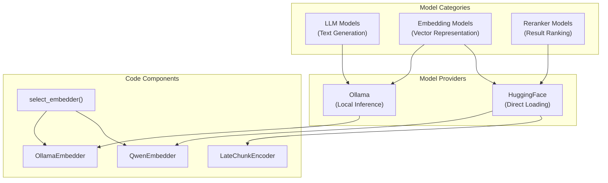
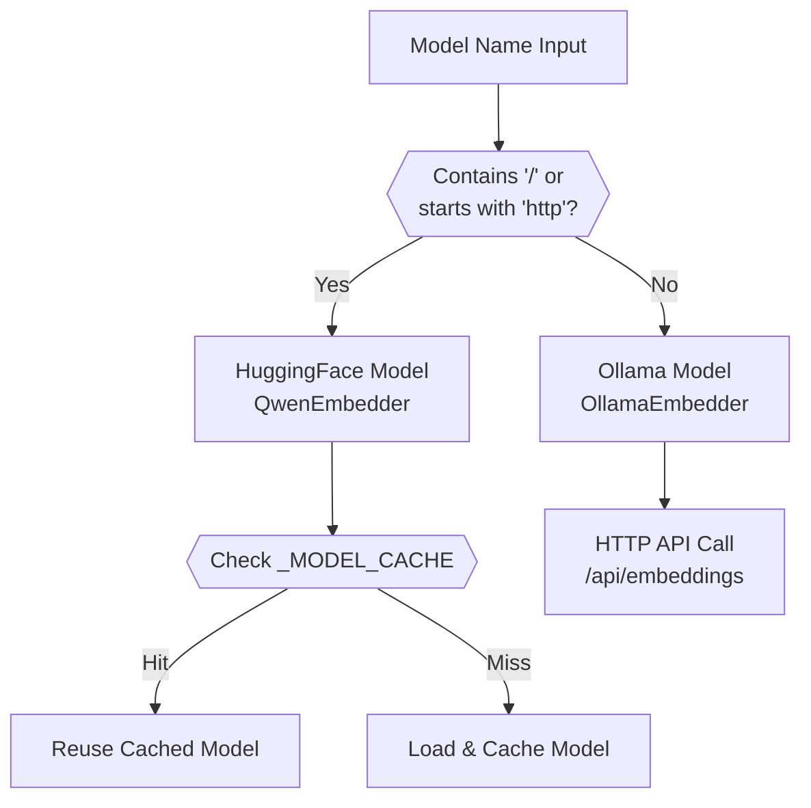
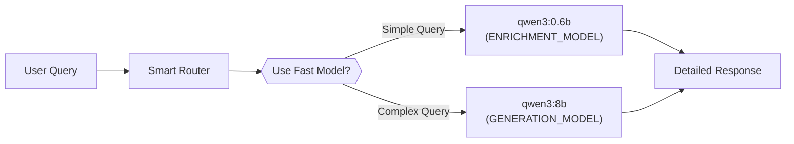
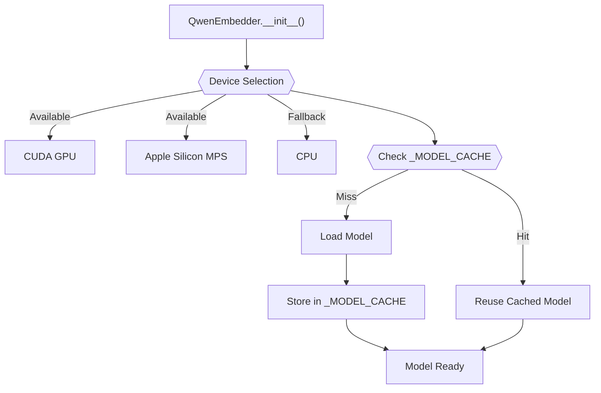
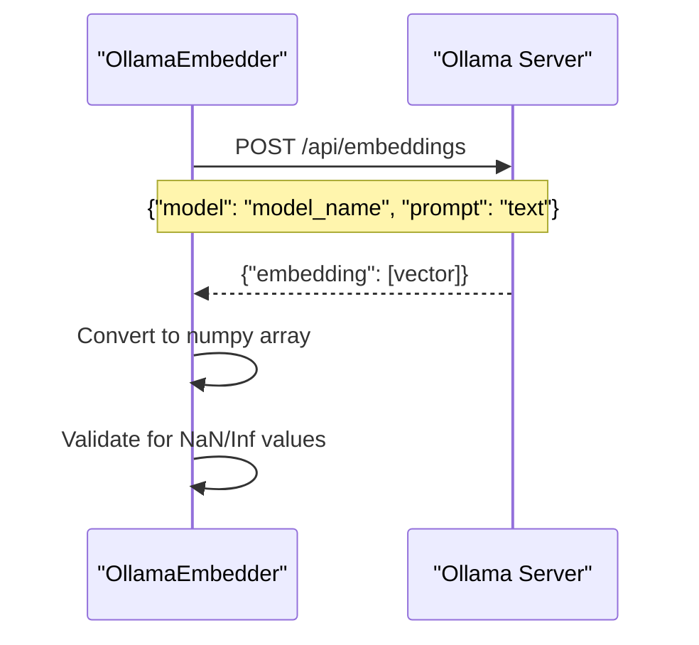
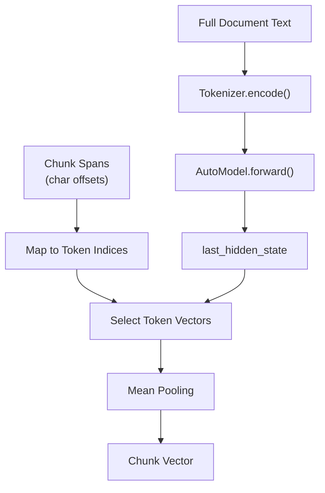
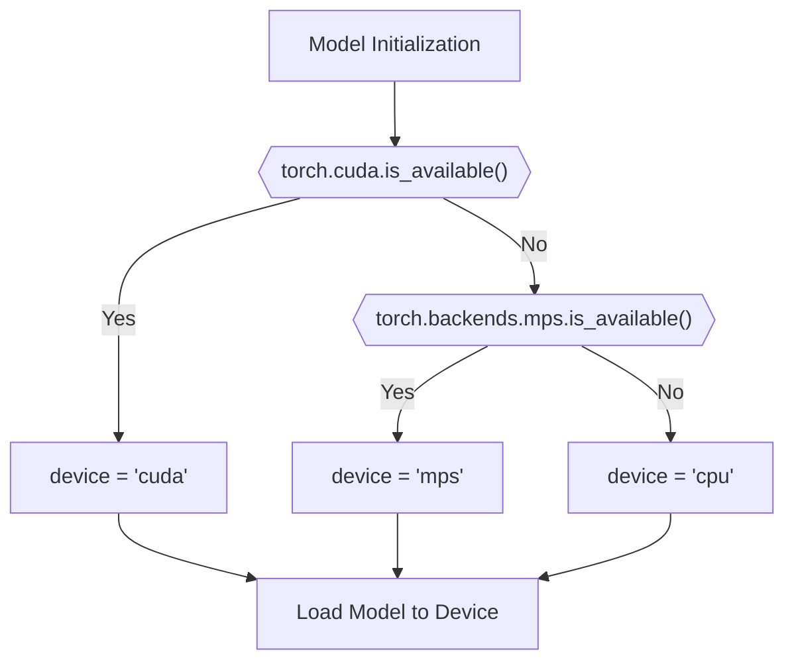

<!-- source: DeepWiki mcp.deepwiki.com · repo PromtEngineer/localGPT · page 4.2 Model Configuration · fetched 2026-10-26 -->

# Model Configuration

<details>
<summary>Relevant source files</summary>

The following files were used as context for generating this wiki page:

- [README.md](README.md)
- [rag_system/indexing/embedders.py](rag_system/indexing/embedders.py)
- [rag_system/indexing/latechunk.py](rag_system/indexing/latechunk.py)
- [rag_system/indexing/representations.py](rag_system/indexing/representations.py)

</details>


This document covers the configuration of AI models used by LocalGPT, including LLM models, embedding models, and rerankers. It explains how to select, configure, and optimize different model types for your use case. 

For general system configuration like ports and database paths, see [System Configuration](#4.1). For document processing and indexing parameters, see [Indexing Configuration](#4.3).

## Model Types Overview

LocalGPT uses three primary categories of AI models, each serving distinct purposes in the RAG pipeline:



**Model Selection Flow**


Sources: [rag_system/indexing/representations.py:145-151](), [README.md:388-405]()

## LLM Models (Ollama)

LocalGPT uses Ollama for Large Language Model inference, supporting both generation and lightweight routing tasks.

### Configuration

| Parameter | Environment Variable | Default | Purpose |
|-----------|---------------------|---------|---------|
| Ollama Host | `OLLAMA_HOST` | `http://localhost:11434` | Ollama server endpoint |
| Generation Model | `GENERATION_MODEL` | `qwen3:8b` | Primary text generation |
| Enrichment Model | `ENRICHMENT_MODEL` | `qwen3:0.6b` | Fast routing and enrichment |

### Supported Models

The system is tested with Qwen3 models but supports any Ollama-compatible model:

```bash
# Install recommended models
ollama pull qwen3:0.6b    # Fast, lightweight model
ollama pull qwen3:8b      # High-quality generation model
```

### Model Selection Strategy



Sources: [README.md:241-249](), [README.md:275-278]()

## Embedding Models

Embedding models convert text into vector representations for similarity search. LocalGPT supports both HuggingFace transformers and Ollama embedding models.

### HuggingFace Embedder (QwenEmbedder)

The `QwenEmbedder` class handles local transformer models with automatic device selection and model caching.



**Key Configuration Options:**

| Parameter | Default | Description |
|-----------|---------|-------------|
| `model_name` | `"Qwen/Qwen3-Embedding-0.6B"` | HuggingFace model identifier |
| `torch_dtype` | `torch.float16` (GPU) / `None` (CPU) | Model precision |
| `trust_remote_code` | `True` | Required for Qwen models |

Sources: [rag_system/indexing/representations.py:15-44]()

### Ollama Embedder (OllamaEmbedder)

The `OllamaEmbedder` class calls Ollama's embedding API endpoint for each text input.

**Configuration Parameters:**

| Parameter | Environment Variable | Default | Description |
|-----------|---------------------|---------|-------------|
| `model_name` | - | Required | Ollama model tag |
| `host` | `OLLAMA_HOST` | `http://localhost:11434` | Ollama server URL |
| `timeout` | - | `60` | Request timeout in seconds |

**API Interaction Flow:**


Sources: [rag_system/indexing/representations.py:106-143]()

### Model Selection Function

The `select_embedder()` function automatically chooses the appropriate embedder based on model name format:

```python
def select_embedder(model_name: str, ollama_host: str | None = None):
    if "/" in model_name or model_name.startswith("http"):
        # HuggingFace model path
        return QwenEmbedder(model_name=model_name)
    # Ollama model tag
    return OllamaEmbedder(model_name=model_name, host=ollama_host)
```

Sources: [rag_system/indexing/representations.py:145-151]()

## Late Chunking Models

The `LateChunkEncoder` class implements late chunking for improved context preservation in embeddings.

### Architecture



**Key Features:**
- Processes entire document context
- Maps character spans to token indices
- Mean-pools token vectors within spans
- Handles NaN/Inf validation

**Configuration:**

| Parameter | Default | Description |
|-----------|---------|-------------|
| `model_name` | `"Qwen/Qwen3-Embedding-0.6B"` | Embedding model |
| `max_tokens` | `8192` | Maximum token length |
| Device selection | Auto (CUDA > MPS > CPU) | Compute device |

Sources: [rag_system/indexing/latechunk.py:21-88]()

## Reranker Models

Reranker models improve search result quality by re-ranking retrieved documents based on query relevance.

### Supported Models

| Model Name | Provider | Type | Description |
|------------|----------|------|-------------|
| `answerdotai/answerai-colbert-small-v1` | HuggingFace | ColBERT | Default reranker |
| `BAAI/bge-reranker-base` | HuggingFace | BGE | Fallback reranker |
| `naver/provence-reranker-debertav3-v1` | HuggingFace | DeBERTa | Context pruning |

### Configuration

Rerankers are configured in the pipeline configuration:

```json
{
  "reranker": {
    "enabled": true,
    "type": "ai",
    "strategy": "rerankers-lib",
    "model_name": "answerdotai/answerai-colbert-small-v1",
    "top_k": 10
  }
}
```

Sources: [README.md:400-404](), [README.md:430-433]()

## Model Caching and Memory Management

### Global Model Cache

The system uses a global `_MODEL_CACHE` dictionary to avoid reloading models:

```python
_MODEL_CACHE = {}  # model_name -> (tokenizer, model)
```

**Cache Behavior:**
- Models are cached by `model_name` key
- First load prints "first load" message
- Subsequent loads print "Reusing cached" message
- Cache persists for application lifetime

### Device Selection Priority



### Error Handling

All embedding models include validation for NaN and infinite values:

```python
if np.isnan(embeddings_np).any():
    print(f"⚠️ Warning: NaN values detected in embeddings")
    embeddings_np = np.nan_to_num(embeddings_np, nan=0.0, posinf=0.0, neginf=0.0)
```

Sources: [rag_system/indexing/representations.py:11-12](), [rag_system/indexing/representations.py:21-28](), [rag_system/indexing/representations.py:59-71]()

## Environment Configuration

### Required Environment Variables

```bash
# Ollama connection
OLLAMA_HOST=http://localhost:11434

# Model overrides (optional)
GENERATION_MODEL=qwen3:8b
ENRICHMENT_MODEL=qwen3:0.6b
EMBEDDING_MODEL=Qwen/Qwen3-Embedding-0.6B
RERANKER_MODEL=answerdotai/answerai-colbert-small-v1
```

### Pipeline-Specific Configuration

Models can be configured per pipeline in the configuration files:

```json
{
  "default": {
    "models": {
      "embedding_model": "Qwen/Qwen3-Embedding-0.6B",
      "generation_model": "qwen3:8b",
      "reranker_model": "answerdotai/answerai-colbert-small-v1"
    }
  }
}
```

Sources: [README.md:262-280](), [README.md:412-438]()

---

