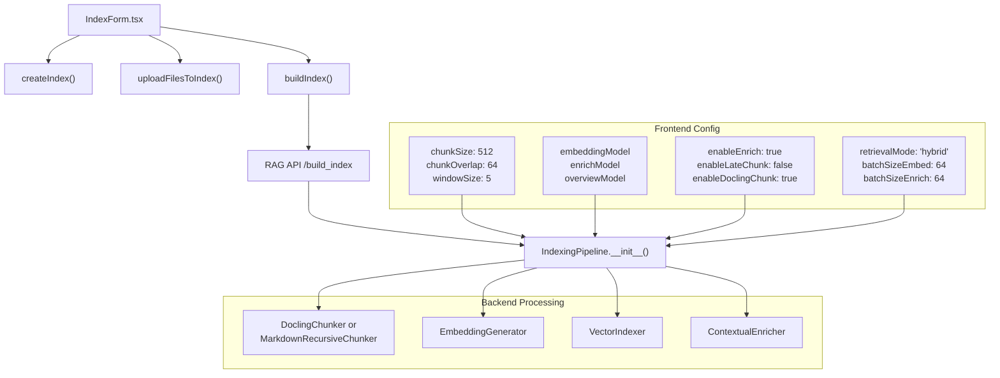
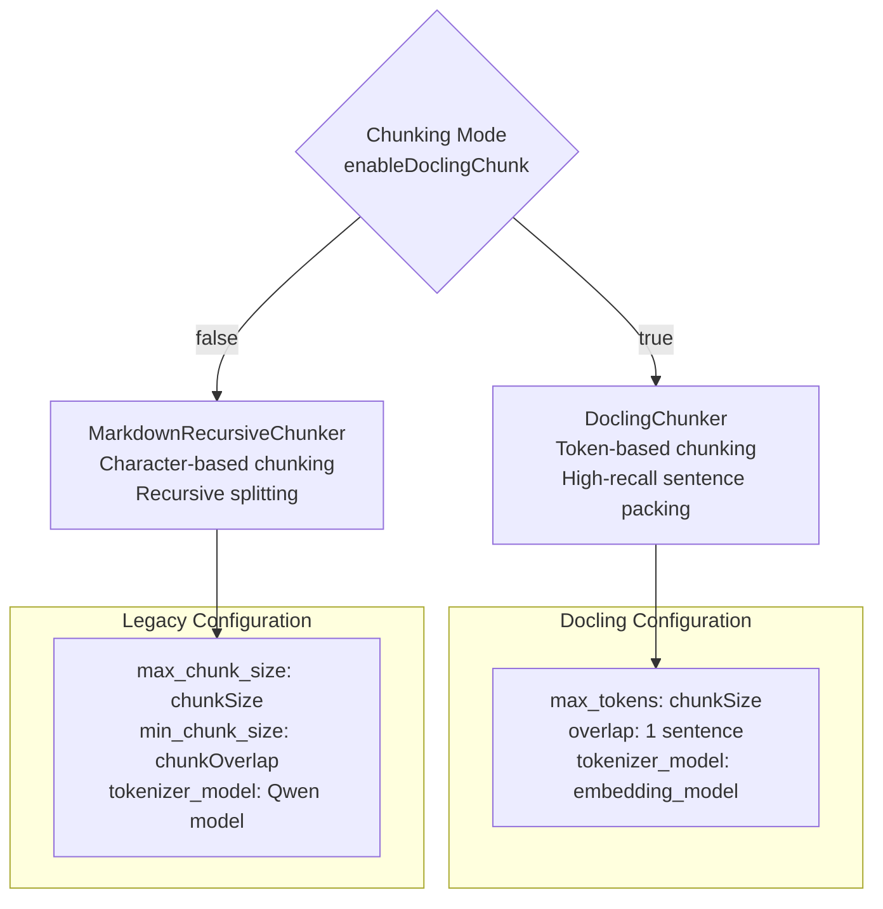
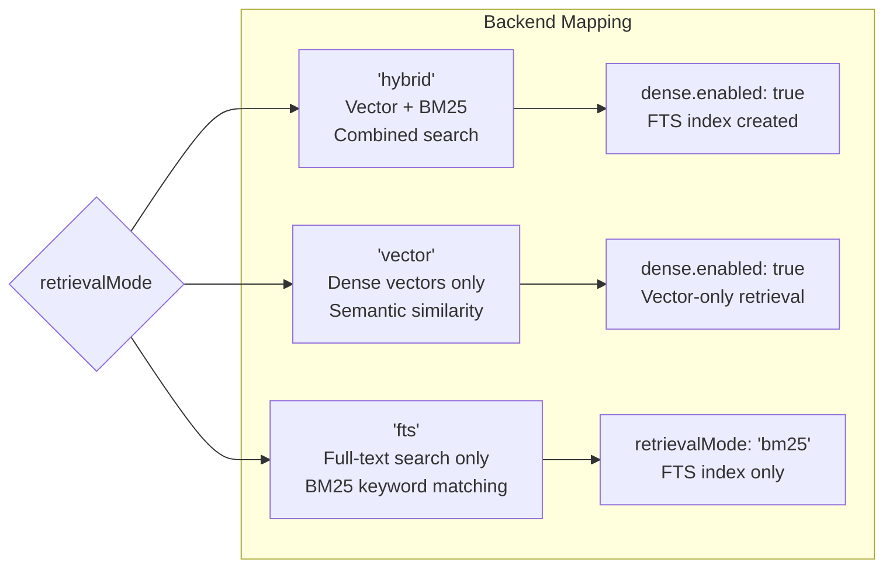
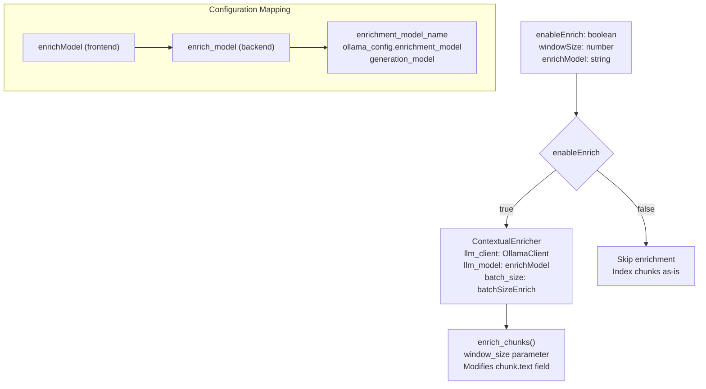
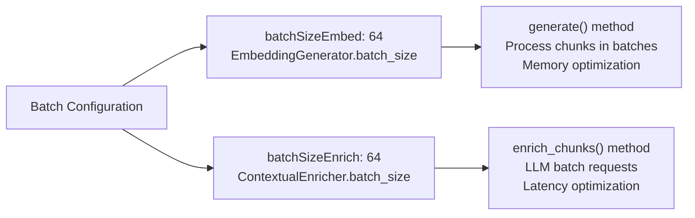

<!-- source: DeepWiki mcp.deepwiki.com · repo PromtEngineer/localGPT · page 4.3 Indexing Configuration · fetched 2026-10-26 -->

# Indexing Configuration

<details>
<summary>Relevant source files</summary>

The following files were used as context for generating this wiki page:

- [rag_system/pipelines/indexing_pipeline.py](rag_system/pipelines/indexing_pipeline.py)
- [src/components/IndexForm.tsx](src/components/IndexForm.tsx)

</details>


This document covers the configuration options for document processing, chunking strategies, embedding generation, and indexing settings in LocalGPT. These configurations control how documents are converted, chunked, enriched, and stored in the vector database during the indexing pipeline.

For information about using the web interface to create indexes, see [Web Interface](#5.2). For details about the RAG system architecture, see [RAG System Architecture](#3.2).

## Configuration Overview

LocalGPT's indexing pipeline supports extensive configuration through both the frontend `IndexForm` component and the backend `IndexingPipeline` class. Configuration options control document processing, chunking strategies, embedding generation, retrieval modes, and advanced features.

## IndexForm Configuration Flow



*Sources: [src/components/IndexForm.tsx:33-70](), [rag_system/pipelines/indexing_pipeline.py:14-130]()*

## Document Processing Configuration

### File Upload Settings

The system supports multiple document formats through the `DocumentConverter` class:

| Format | Extension | Processing |
|--------|-----------|------------|
| PDF | `.pdf` | Docling conversion to markdown |
| Word | `.docx`, `.doc` | Docling conversion to markdown |
| HTML | `.html`, `.htm` | Direct processing |
| Markdown | `.md` | Direct processing |
| Text | `.txt` | Direct processing |

### Chunking Configuration

The pipeline supports two chunking strategies controlled by the `enableDoclingChunk` toggle:



*Sources: [rag_system/pipelines/indexing_pipeline.py:19-50](), [src/components/IndexForm.tsx:121-123]()*

#### Chunking Parameters

| Parameter | Default | Description |
|-----------|---------|-------------|
| `chunkSize` | 512 | Maximum tokens per chunk (both modes now use token-based sizing) |
| `chunkOverlap` | 64 | Tokens reused between adjacent chunks |
| `overlap_sentences` | 1 | Sentence overlap for Docling chunker |

## Retrieval Mode Configuration

The `retrievalMode` setting controls how the system performs document retrieval:



*Sources: [src/components/IndexForm.tsx:22, 49](), [rag_system/pipelines/indexing_pipeline.py:61-78]()*

## Advanced Features Configuration

### Late Chunking

The `enableLateChunk` option enables late-chunk vector encoding for improved recall:

| Setting | Backend Implementation |
|---------|----------------------|
| `enableLateChunk: true` | Initializes `LateChunkEncoder` with embedding model |
| Table name | `{table_name}_lc` for late-chunk vectors |
| Processing | Sub-vectors created from document spans |

### Contextual Enrichment

Contextual enrichment adds neighbor chunks and LLM enhancement to improve semantic continuity:



*Sources: [src/components/IndexForm.tsx:164-184](), [rag_system/pipelines/indexing_pipeline.py:93-107, 218-244]()*

## Model Configuration

### Embedding Models

The `embeddingModel` selection controls vector generation:

| Frontend Parameter | Backend Implementation |
|-------------------|----------------------|
| `embeddingModel` | `select_embedder()` function call |
| Model types | Qwen3-Embedding-0.6B, Ollama models |
| Batch processing | `EmbeddingGenerator` with `batchSizeEmbed` |

### LLM Model Configuration

Multiple LLM models can be configured for different purposes:

| Purpose | Frontend Parameter | Backend Usage |
|---------|-------------------|---------------|
| Contextual enrichment | `enrichModel` | `ContextualEnricher.llm_model` |
| Document overviews | `overviewModel` | `OverviewBuilder.model` |
| Default fallback | `DEFAULT_LLM: 'qwen3:0.6b'` | Various components |

*Sources: [src/components/IndexForm.tsx:23-26, 144-160](), [rag_system/pipelines/indexing_pipeline.py:78-116]()*

## Batch Processing Configuration

Performance optimization through configurable batch sizes:



*Sources: [src/components/IndexForm.tsx:27-28, 188-207](), [rag_system/pipelines/indexing_pipeline.py:56-58, 82-85, 104-106]()*

## Storage Configuration

The indexing pipeline creates multiple storage components based on configuration:

| Component | Configuration | Implementation |
|-----------|---------------|---------------|
| Vector storage | `lancedb_path` or `db_path` | `LanceDBManager` initialization |
| Text table | `text_table_name` | Vector embeddings storage |
| FTS index | Automatic creation | `create_fts_index("text")` |
| Late-chunk table | `{table_name}_lc` | Optional late-chunk vectors |
| Overview storage | `overview_path` | Document summary storage |

## Complete Configuration Schema

The complete configuration object passed from frontend to backend:

```typescript
interface IndexBuildConfig {
  latechunk: boolean;           // enableLateChunk
  doclingChunk: boolean;        // enableDoclingChunk
  chunkSize: number;            // Token-based chunk size
  chunkOverlap: number;         // Token overlap between chunks
  retrievalMode: string;        // 'hybrid' | 'vector' | 'bm25'
  windowSize: number;           // Context window for enrichment
  enableEnrich: boolean;        // Contextual enrichment toggle
  embeddingModel?: string;      // Embedding model selection
  enrichModel: string;          // LLM for enrichment
  overviewModel: string;        // LLM for document overviews
  batchSizeEmbed: number;       // Embedding batch size
  batchSizeEnrich: number;      // Enrichment batch size
}
```

*Sources: [src/components/IndexForm.tsx:44-57](), [rag_system/pipelines/indexing_pipeline.py:22-130]()*

---

