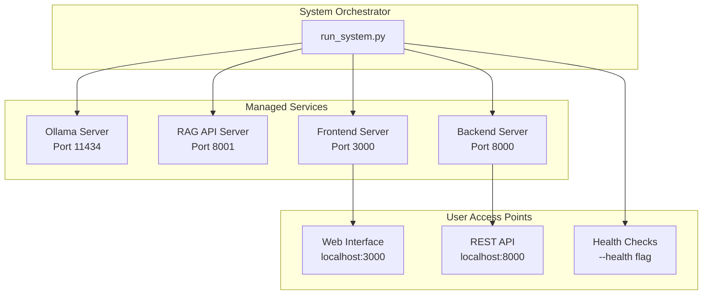
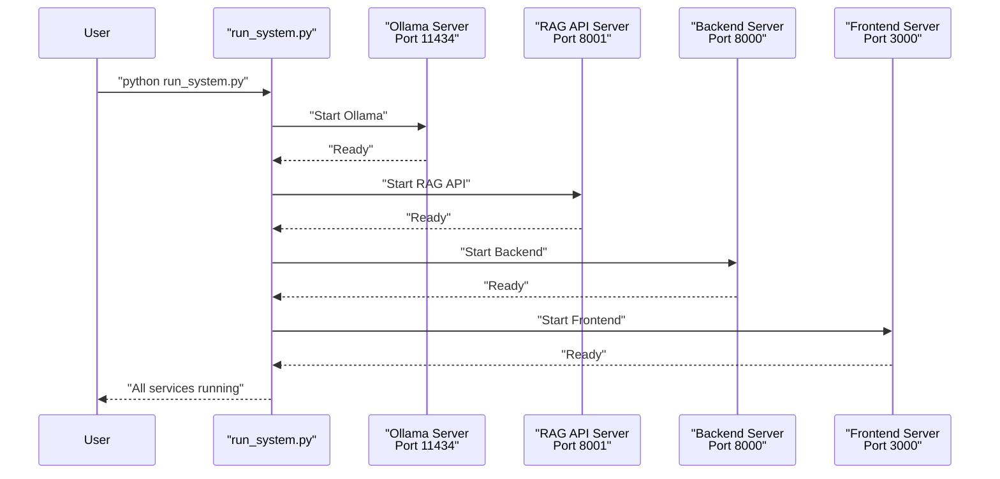
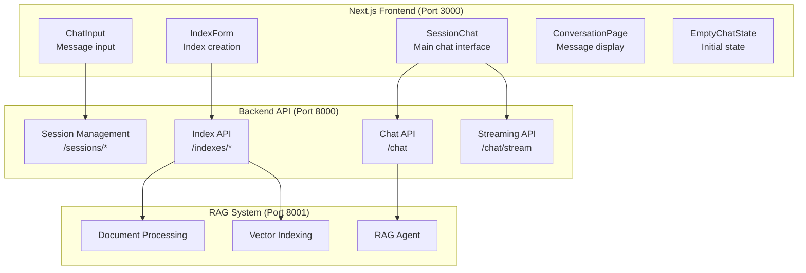
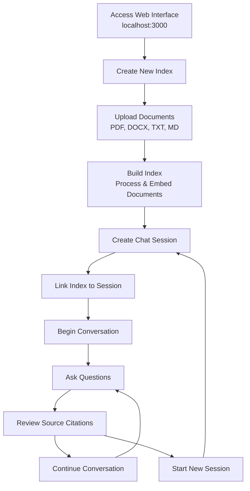
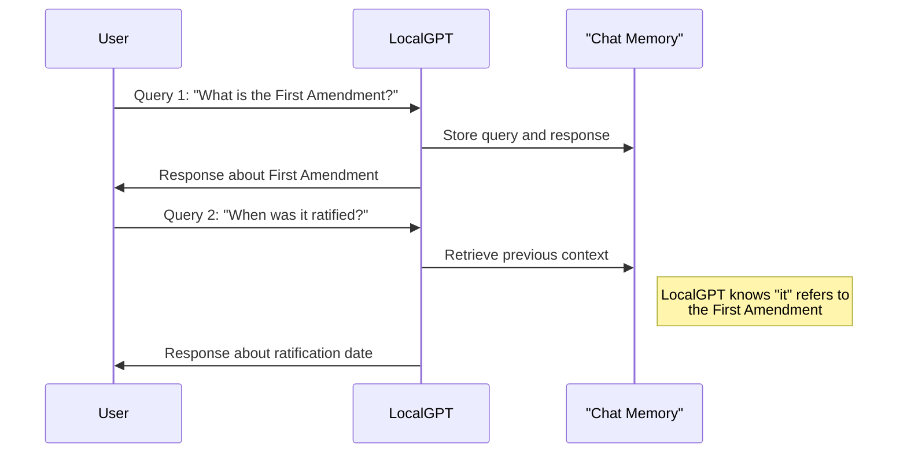
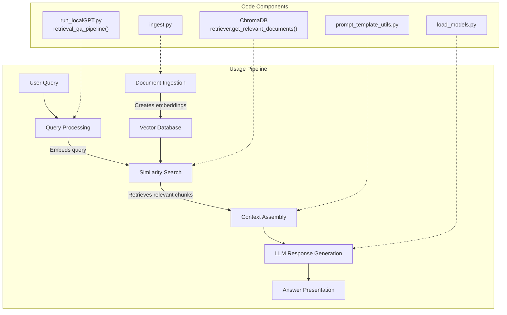

<!-- source: DeepWiki mcp.deepwiki.com · repo PromtEngineer/localGPT · page 5 Usage · fetched 2026-10-26 -->

# Usage

<details>
<summary>Relevant source files</summary>

The following files were used as context for generating this wiki page:

- [README.md](README.md)

</details>


This page details how to use LocalGPT through its various interfaces and management tools. LocalGPT provides system management through `run_system.py`, a modern web interface, and comprehensive REST APIs for programmatic access. For initial setup, see [Installation & Setup](#2).

## Overview of Usage Options

LocalGPT offers three primary methods for interaction:

1. **System Management**: Control all services through `run_system.py`
2. **Web Interface**: Modern Next.js frontend for document management and chat
3. **API Access**: REST endpoints for programmatic integration

System Management with run_system.py


Sources: [README.md:163-188](), [README.md:192-196]()

## System Management

The `run_system.py` orchestrator manages all LocalGPT services and provides comprehensive system management capabilities.

### Basic System Startup

To start all LocalGPT services:

```bash
python run_system.py
```

This initializes and manages four key services in the correct order:
1. Ollama Server (port 11434) - AI model serving
2. RAG API Server (port 8001) - Document processing and retrieval
3. Backend Server (port 8000) - Session management and API endpoints  
4. Frontend Server (port 3000) - React/Next.js web interface

Service Startup Sequence


Sources: [README.md:163-166](), [README.md:192-196]()

### System Management Commands

LocalGPT provides extensive system management options through `run_system.py`:

| Command | Description | Usage Example |
|---------|-------------|---------------|
| `--health` | Check service status and health | `python run_system.py --health` |
| `--mode prod` | Start in production mode | `python run_system.py --mode prod` |
| `--no-frontend` | Skip frontend (backend + RAG API only) | `python run_system.py --no-frontend` |
| `--logs-only` | View aggregated logs | `python run_system.py --logs-only` |
| `--stop` | Stop all services | `python run_system.py --stop` |

### System Health Monitoring

Check comprehensive system diagnostics:

```bash
# Comprehensive system health check
python system_health_check.py

# Quick service status check
python run_system.py --health
```

The health check validates:
- Service availability and ports
- Database connectivity
- Model loading status  
- Resource utilization

Sources: [README.md:171-188](), [README.md:285-296]()

### Production Deployment

For production environments:

```bash
# Production mode with optimized settings
python run_system.py --mode prod

# Backend-only deployment (no frontend)
python run_system.py --no-frontend
```

Sources: [README.md:177-181]()

## Web Interface

LocalGPT provides a modern Next.js web interface for document management, chat sessions, and index creation.

### Accessing the Web Interface

Once the system is running via `run_system.py`, access the web interface at:

```
http://localhost:3000
```

The interface is automatically available when all services are started through the system orchestrator.

### Web Interface Architecture

Frontend Component Structure


Sources: [README.md:38-41](), Frontend architecture from system diagrams

### Core Web Interface Features

#### 1. Session Management
- **Create New Sessions**: Start conversations with custom titles and model selection
- **Session History**: Access previous conversations with persistent context
- **Session-Document Linking**: Associate specific indexes with chat sessions

#### 2. Index Management  
- **Index Creation**: Build document collections with configurable processing options
- **Document Upload**: Support for PDF, DOCX, TXT, and Markdown files
- **Index Building**: Process documents with AI-powered chunking and embedding generation
- **Index Overview**: View document summaries and processing status

#### 3. Interactive Chat
- **Natural Language Queries**: Ask questions about your documents in plain English
- **Streaming Responses**: Real-time answer generation with immediate feedback  
- **Source Attribution**: Every answer includes references to source documents
- **Smart Routing**: Automatic selection between RAG and direct LLM responses

#### 4. Advanced Features
- **Hybrid Search**: Combines vector similarity and keyword matching
- **Answer Verification**: Independent accuracy checking for generated responses
- **Query Decomposition**: Breaks complex questions into sub-queries for better answers
- **Contextual Enrichment**: Enhanced document understanding with AI-generated context

Sources: [README.md:42-78](), [README.md:306-345]()

### Web Interface Workflow

Typical User Journey


Sources: [README.md:302-345]()

## Streamlit Interface Usage

The Streamlit interface provides an alternative web-based interface with a focus on simplicity.

### Starting the Streamlit Interface

To start the Streamlit interface:

```bash
streamlit run streamlit_app.py
```

This will launch the Streamlit server and automatically open the interface in your web browser.

Sources: System architecture diagrams

### Streamlit Interface Features

The Streamlit interface offers:
- Document uploads
- Question input
- Viewing source documents for answers

## Using Chat History

Chat history allows LocalGPT to maintain context from previous interactions in a session. This feature can be enabled using the `--use_history` flag in the CLI or through the appropriate option in the web interfaces.



Sources: [run_localGPT.py:162-170](), [README.md:210-214]()

## Viewing Source Documents

LocalGPT can display the source documents used to generate answers. This helps users verify the information and understand where answers are coming from.

In the CLI, use the `--show_sources` flag:
```bash
python run_localGPT.py --show_sources
```

In the web interfaces, there are typically buttons or toggles to view the source documents for each answer.

Sources: [run_localGPT.py:286-292](), [README.md:204-208]()

## Saving Question and Answer Pairs

LocalGPT can save all questions and answers to a CSV file for later reference or analysis.

Enable this feature in the CLI with:
```bash
python run_localGPT.py --save_qa
```

This will save all Q&A pairs to `/local_chat_history/qa_log.csv`.

Sources: [run_localGPT.py:294-296](), [README.md:216-220]()

## Usage with Different Hardware

LocalGPT can utilize various hardware accelerators to improve performance:

| Hardware | CLI Option | Notes |
|----------|------------|-------|
| NVIDIA GPU | `--device_type cuda` | Default if CUDA is available |
| CPU | `--device_type cpu` | Works on all systems but slower |
| Apple Silicon | `--device_type mps` | For Mac M1/M2 systems |
| Intel Gaudi | `--device_type hpu` | For systems with Intel Gaudi accelerators |

Sources: [run_localGPT.py:189-213](), [README.md:148-184]()

## Advanced Usage Pipeline



Sources: [run_localGPT.py:114-183]()

This diagram shows the complete usage pipeline from document ingestion to answer presentation, with connections to the relevant code components that implement each stage.

## Typical Usage Workflow

1. **Prepare Documents**: Place your documents in the `SOURCE_DOCUMENTS` folder
2. **Ingest Documents**: Run `python ingest.py` with appropriate options
3. **Query Documents**: Use one of the interfaces (CLI, Web, or Streamlit)
4. **Review Answers**: Examine the responses and source documents
5. **Iterate**: Ask follow-up questions, add more documents, or refine your queries

Sources: [README.md:110-165]()

---

