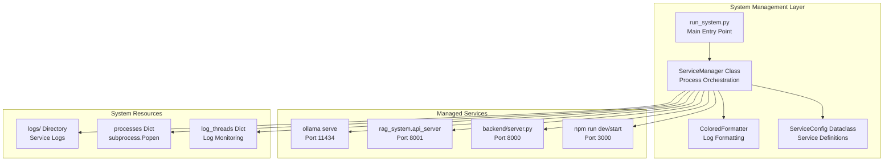
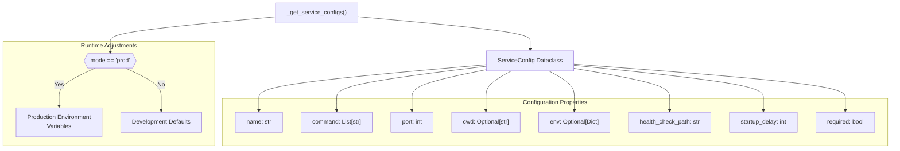
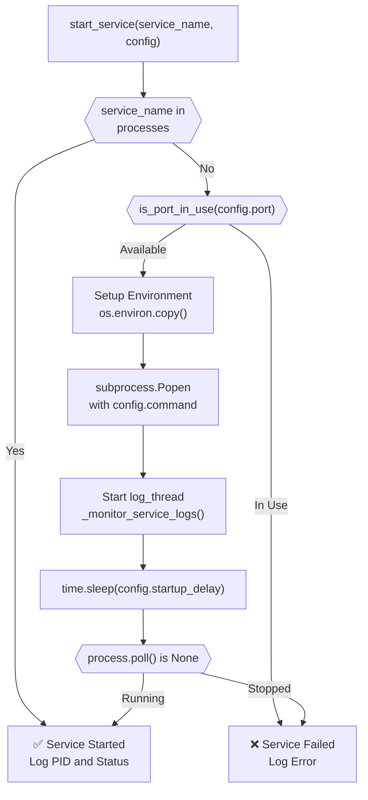
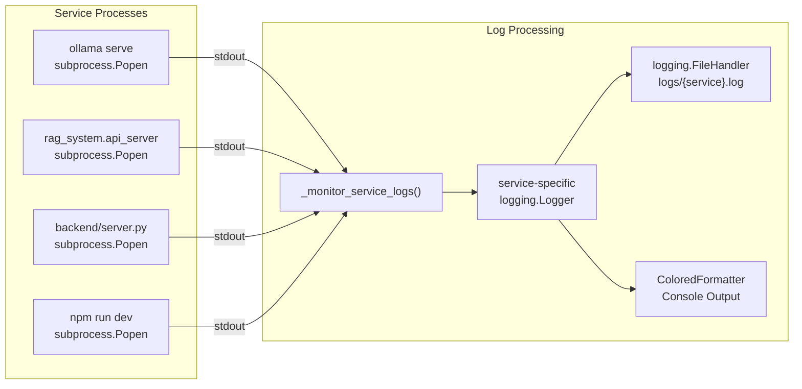
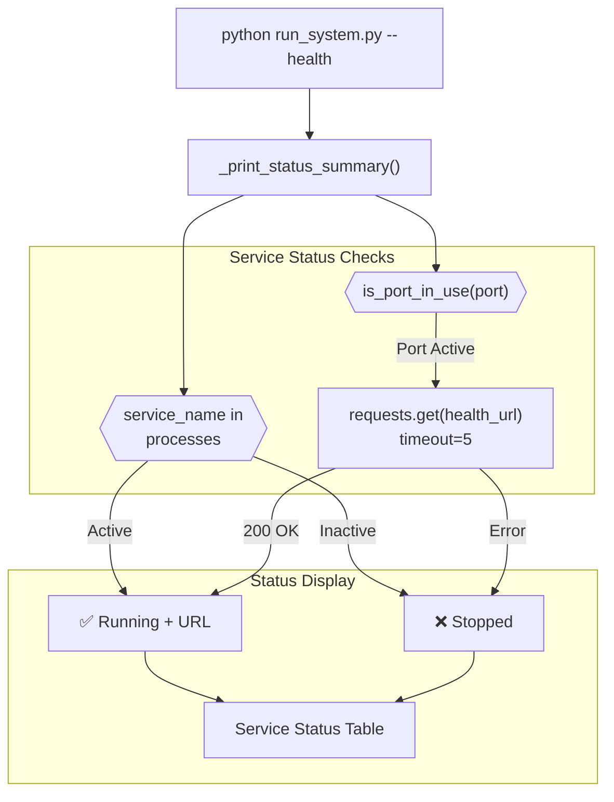
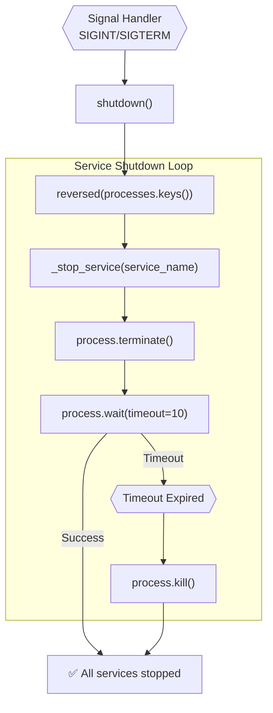
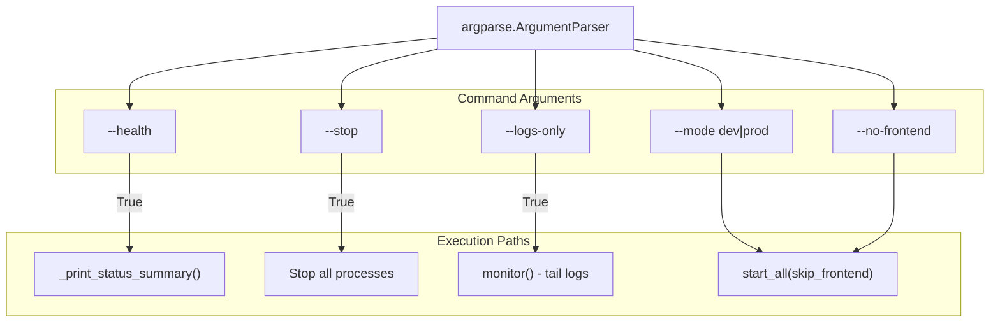

<!-- source: DeepWiki mcp.deepwiki.com · repo PromtEngineer/localGPT · page 5.1 System Management · fetched 2026-10-26 -->

# System Management

<details>
<summary>Relevant source files</summary>

The following files were used as context for generating this wiki page:

- [README.md](README.md)
- [run_system.py](run_system.py)
- [src/components/ui/conversation-page.tsx](src/components/ui/conversation-page.tsx)
- [src/components/ui/session-chat.tsx](src/components/ui/session-chat.tsx)
- [src/utils/textNormalization.ts](src/utils/textNormalization.ts)
- [test_markdown_streaming.js](test_markdown_streaming.js)

</details>


This page covers the system orchestration and lifecycle management of LocalGPT using the `run_system.py` script. This script serves as the unified launcher that starts, monitors, and manages all system services including Ollama, RAG API, Backend, and Frontend components.

For configuration of individual services and models, see [System Configuration](#4.1). For API-level system interactions, see [API Reference](#5.3).

## Overview

The `run_system.py` script is LocalGPT's primary system orchestrator, implementing a comprehensive service management framework through the `ServiceManager` class. It provides unified control over the multi-service architecture with features including real-time log aggregation, health monitoring, graceful shutdown, and production deployment support.

**System Architecture - Service Management Layer**



Sources: [run_system.py:85-106](), [run_system.py:39-48](), [run_system.py:125-166]()

## Basic Usage

### Starting the System

The most common usage is to start all services in development mode:

```bash
# Start all services in development mode
python run_system.py

# Start in production mode
python run_system.py --mode prod

# Skip frontend (backend + RAG API only)
python run_system.py --no-frontend
```

### Monitoring and Health Checking

```bash
# Check system health and service status
python run_system.py --health

# View aggregated logs from running services
python run_system.py --logs-only

# Stop all services
python run_system.py --stop
```

The system also provides comprehensive health checking through the `system_health_check.py` script:

```bash
# Run full system diagnostics
python system_health_check.py
```

Sources: [README.md:169-189](), [run_system.py:491-539]()

## Service Configuration and Management

### Service Definitions

The `ServiceManager` class manages services through `ServiceConfig` dataclass instances that define each service's runtime parameters:

| Service | Command | Port | Startup Delay | Health Check |
|---------|---------|------|---------------|--------------|
| `ollama` | `['ollama', 'serve']` | 11434 | 5s | `/api/tags` |
| `rag-api` | `[sys.executable, '-m', 'rag_system.api_server']` | 8001 | 3s | `/health` |
| `backend` | `[sys.executable, 'backend/server.py']` | 8000 | 2s | `/health` |
| `frontend` | `['npm', 'run', 'dev']` | 3000 | 5s | N/A |

**Service Configuration Flow**



Sources: [run_system.py:39-48](), [run_system.py:125-166]()

### Service Lifecycle Management

The `ServiceManager.start_service()` method implements a comprehensive service startup process:

**Service Startup Process**



Sources: [run_system.py:248-303]()

## Logging and Monitoring

### Log Aggregation System

The system implements comprehensive logging through the `ColoredFormatter` class and service-specific log monitoring:

```bash
# Log directory structure
logs/
├── system.log          # Main system events
├── ollama.log          # Ollama server logs  
├── rag-api.log         # RAG API processing logs
├── backend.log         # Backend server logs
└── frontend.log        # Frontend build/runtime logs
```

**Log Monitoring Architecture**



Sources: [run_system.py:50-83](), [run_system.py:305-335](), [README.md:521-537]()

### Health Check System

The system provides multiple levels of health checking through the `health_check()` method and external diagnostics:

```bash
# Service health endpoints
curl http://localhost:8000/health    # Backend health
curl http://localhost:8001/health    # RAG API health  
curl http://localhost:11434/api/tags # Ollama models list
```

**Health Check Implementation**



Sources: [run_system.py:337-344](), [run_system.py:406-427](), [run_system.py:174-185]()

## Process Management

### Graceful Shutdown

The system implements comprehensive shutdown handling through signal handlers and the `shutdown()` method:



Sources: [run_system.py:428-467](), [run_system.py:168-172](), [run_system.py:442-467]()

### Prerequisites Checking

The system validates required dependencies through `check_prerequisites()`:

| Tool | Check Method | Required | Fallback |
|------|--------------|----------|----------|
| `ollama` | `ollama --version` | Yes | Startup failure |
| `python`/`python3` | `python --version` | Yes | Startup failure |
| `npm` | `npm --version` | No | Frontend disabled |

Sources: [run_system.py:187-221]()

## Command Line Interface

### Available Arguments

The `run_system.py` script supports the following command-line arguments:

| Argument | Type | Default | Description |
|----------|------|---------|-------------|
| `--mode` | `choices=['dev', 'prod']` | `dev` | Run mode (affects npm command and env vars) |
| `--logs-only` | `action='store_true'` | `False` | Only show aggregated logs from running services |
| `--no-frontend` | `action='store_true'` | `False` | Skip frontend startup |
| `--health` | `action='store_true'` | `False` | Check health of running services |
| `--stop` | `action='store_true'` | `False` | Stop all running services |

**Command Processing Flow**



Sources: [run_system.py:493-505](), [run_system.py:510-538]()

## Integration with Other Components

The system management layer integrates with other LocalGPT components through well-defined interfaces:

### Frontend Integration

The `SessionChat` component interacts with the managed backend services through API calls:

```typescript
// SessionChat component makes API calls to managed services
const apiService = chatAPI  // Connects to backend:8000
const response = await apiService.sendSessionMessage(...)  // Routes to RAG API:8001
```

### Service Dependencies

The startup sequence respects service dependencies:

1. **Ollama Server** (`port 11434`) - Must start first, provides LLM inference
2. **RAG API Server** (`port 8001`) - Depends on Ollama, handles document processing
3. **Backend Server** (`port 8000`) - Orchestrates between frontend and RAG API
4. **Frontend Server** (`port 3000`) - Provides user interface, connects to backend

Sources: [run_system.py:357-382](), [src/components/ui/session-chat.tsx:70-71]()

---

