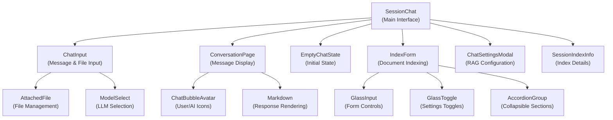
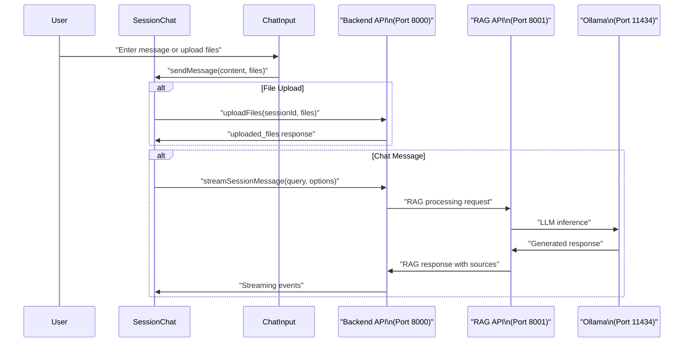
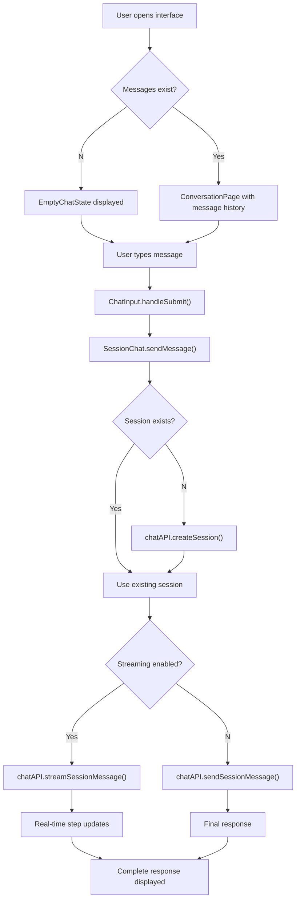
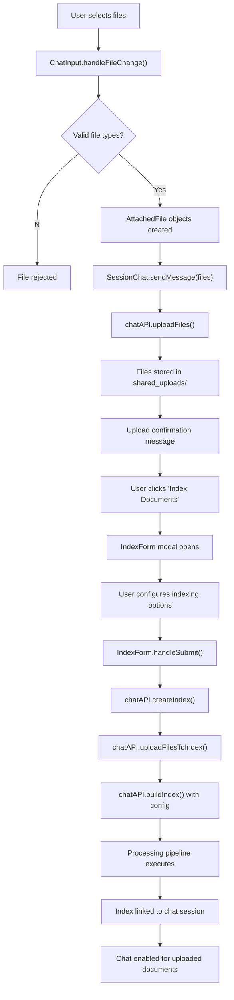
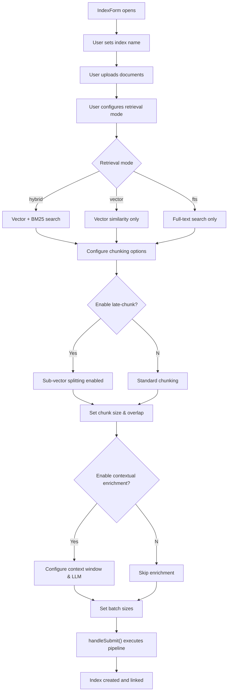

<!-- source: DeepWiki mcp.deepwiki.com · repo PromtEngineer/localGPT · page 5.2 Web Interface · fetched 2026-10-26 -->

# Web Interface

<details>
<summary>Relevant source files</summary>

The following files were used as context for generating this wiki page:

- [run_system.py](run_system.py)
- [src/components/IndexForm.tsx](src/components/IndexForm.tsx)
- [src/components/ui/chat-input.tsx](src/components/ui/chat-input.tsx)
- [src/components/ui/conversation-page.tsx](src/components/ui/conversation-page.tsx)
- [src/components/ui/empty-chat-state.tsx](src/components/ui/empty-chat-state.tsx)
- [src/components/ui/session-chat.tsx](src/components/ui/session-chat.tsx)
- [src/utils/textNormalization.ts](src/utils/textNormalization.ts)
- [test_markdown_streaming.js](test_markdown_streaming.js)

</details>


The LocalGPT Web Interface is a modern React-based frontend built with Next.js that provides an interactive chat experience for document-based question answering. The interface supports real-time streaming responses, document upload and indexing, and advanced RAG configuration options.

## Overview

The Web Interface is implemented as a Next.js application that communicates with the LocalGPT backend services. Key capabilities include:

- **Interactive Chat**: Real-time conversation with streaming response visualization
- **Document Management**: Upload, index, and manage document collections
- **Advanced Configuration**: Granular control over RAG pipeline parameters
- **Session Management**: Persistent chat sessions with history
- **File Upload**: Support for PDF, DOCX, HTML, Markdown, and text files

The interface runs on port 3000 by default and integrates with the backend API server (port 8000) and RAG processing service (port 8001).

Sources: [src/components/ui/session-chat.tsx:1-681](), [src/components/IndexForm.tsx:1-223](), [run_system.py:149-155]()

## Component Architecture

### Frontend Component Hierarchy

The React frontend follows a hierarchical component structure with clear separation of concerns:



Sources: [src/components/ui/session-chat.tsx:1-40](), [src/components/IndexForm.tsx:10-32](), [src/components/ui/chat-input.tsx:8-27]()

### System Integration Flow



Sources: [src/components/ui/session-chat.tsx:131-498](), [src/components/ui/chat-input.tsx:34-54]()

## Core Components

### SessionChat Component

The `SessionChat` component serves as the main interface controller, managing chat sessions, message flow, and component orchestration.

**Key Responsibilities:**
- Session management and persistence
- Message sending and streaming response handling  
- File upload coordination
- Settings and configuration management
- Integration with backend APIs

**State Management:**
- `messages`: Chat message history
- `currentSession`: Active chat session details
- `isLoading`: UI loading states
- `uploadedFiles`: File upload tracking
- `currentIndexId/currentIndexName`: Linked document index information

Sources: [src/components/ui/session-chat.tsx:34-100](), [src/components/ui/session-chat.tsx:131-198]()

### ChatInput Component  

The `ChatInput` component handles user input for both text messages and file uploads with support for drag-and-drop functionality.

**Features:**
- Multi-line text input with auto-resize
- File upload with type validation (PDF, DOCX, HTML, MD, TXT)
- Drag-and-drop file support
- Settings and index management buttons
- Real-time loading states

**File Type Support:**
- `application/pdf`
- `application/vnd.openxmlformats-officedocument.wordprocessingml.document`
- `text/html`, `text/markdown`, `text/plain`

Sources: [src/components/ui/chat-input.tsx:74-123](), [src/components/ui/chat-input.tsx:91-104]()

### IndexForm Component

The `IndexForm` component provides comprehensive document indexing configuration with advanced RAG pipeline options.

**Configuration Categories:**
1. **Basic Settings**: Index name, file upload, retrieval mode
2. **Chunking Options**: Chunk size, overlap, late-chunk vectors, high-recall chunking
3. **Model Selection**: Embedding models, overview LLMs, enrichment models  
4. **Advanced Features**: Contextual retrieval, batch size optimization

**Indexing Pipeline Steps:**
1. `createIndex()` - Create index record
2. `uploadFilesToIndex()` - Upload files to index
3. `buildIndex()` - Run processing pipeline with configuration
4. `createSession()` - Create linked chat session

Sources: [src/components/IndexForm.tsx:33-70](), [src/components/IndexForm.tsx:82-184]()

## User Interface Features

### Real-time Streaming Responses

The interface provides visual feedback during RAG processing through a step-by-step streaming display:

**Processing Steps Visualization:**
1. `analyze` - Analyzing user question
2. `decompose` - Generating sub-queries (if enabled)  
3. `retrieval` - Retrieving relevant documents
4. `rerank` - Reranking results with AI reranker
5. `expand` - Expanding context window
6. `answer` - Answering sub-queries
7. `synthesize` - Putting everything together
8. `final` - Final answer delivery

Each step shows progress indicators and status updates in real-time.

Sources: [src/components/ui/session-chat.tsx:212-222](), [src/components/ui/session-chat.tsx:256-453]()

### Advanced Configuration Settings

The interface exposes granular RAG pipeline controls through the `ChatSettingsModal`:

**General Settings:**
- Query decomposition toggle
- Sub-answer composition
- Answer verification  
- Streaming phases display

**Retrieval Configuration:**
- Search type: `hybrid`, `vector_only`, `bm25_only`
- Retrieval chunk count (5-50)
- AI reranker toggle
- Reranker top-k (3-20)
- Context window expansion
- Context window size (0-5 chunks)

**Advanced Options:**
- Provence pruning for irrelevant sentences
- Force document search toggle
- LLM model selection

Sources: [src/components/ui/session-chat.tsx:637-661]()

### Document Index Management

Users can create sophisticated document indexes through the `IndexForm` with options for:

**Chunking Strategies:**
- `enableLateChunk`: Split chunks into sub-vectors for improved recall
- `enableDoclingChunk`: High-recall sentence-level packing with Docling features
- Token-based sizing for both strategies

**Retrieval Modes:**
- `hybrid`: Combines vector similarity with full-text search
- `vector`: Pure dense vector similarity  
- `fts`: Full-text search only

**Contextual Enrichment:**
- Window-based context inclusion from neighboring chunks
- LLM-based enrichment for semantic continuity
- Configurable batch sizes for performance optimization

Sources: [src/components/IndexForm.tsx:107-184](), [src/components/IndexForm.tsx:43-57]()

## User Interaction Flows

### Chat Interaction Flow

The chat interface supports both empty state and active conversation modes:



Sources: [src/components/ui/session-chat.tsx:131-498](), [src/components/ui/empty-chat-state.tsx:91-98]()

### File Upload and Indexing Flow

File upload triggers a multi-step process for document processing and indexing:



Sources: [src/components/ui/chat-input.tsx:78-123](), [src/components/IndexForm.tsx:33-70](), [src/components/ui/session-chat.tsx:163-186]()

### Index Creation and Configuration Flow

The `IndexForm` provides comprehensive configuration for document processing:



Sources: [src/components/IndexForm.tsx:107-125](), [src/components/IndexForm.tsx:163-184]()

## Text Processing and Display

### Streaming Response Normalization

The interface includes sophisticated text normalization to handle streaming markdown responses and prevent visual formatting issues:

**Normalization Functions:**
- `normalizeWhitespace()`: Removes excessive whitespace and line breaks
- `normalizeStreamingToken()`: Handles real-time token accumulation  
- `hasExcessiveWhitespace()`: Detects when normalization is needed

**Processing Rules:**
- Multiple consecutive newlines (`\n{3,}`) reduced to double newlines
- Excessive spaces (`[ \t]{3,}`) collapsed to single spaces
- Trailing whitespace removed from line endings
- Complex whitespace patterns normalized for clean display

Sources: [src/utils/textNormalization.ts:6-40](), [src/utils/textNormalization.ts:45-63]()

### Conversation Display Features

The `ConversationPage` component provides rich message rendering with:

**Message Types:**
- User messages with avatar display
- AI responses with step-by-step streaming
- Structured responses with sub-queries and citations
- Loading indicators and error states

**Citation System:**
- Expandable source document references
- Relevance scoring display (`rerank_score`, `score`, `_distance`)
- Preview text with full content toggle
- Organized citation blocks per response

**Interactive Elements:**
- Copy, regenerate, like/dislike actions
- Text-to-speech capability
- Scroll-to-bottom functionality
- Auto-scroll during streaming

Sources: [src/components/ui/conversation-page.tsx:32-68](), [src/components/ui/conversation-page.tsx:120-198](), [src/components/ui/conversation-page.tsx:253-293]()

## 6. Starting and Configuring the Web Interface

To use the Web Interface, you need to start both the API server and the Web UI server.

### 6.1 Starting the API Server

```
python run_localGPT_API.py [--port PORT] [--host HOST]
```

Default configuration:
- Port: 5110
- Host: 127.0.0.1 (localhost)

Sources: [run_localGPT_API.py:190-206]()

### 6.2 Starting the Web UI Server

```
python localGPTUI/localGPTUI.py [--port PORT] [--host HOST]
```

Default configuration:
- Port: 5111
- Host: 127.0.0.1 (localhost)

Sources: [localGPTUI/localGPTUI.py:60-72]()

### 6.3 Configuration Options

Both the API server and Web UI server support the following command-line arguments:

| Argument | Description | Default Value |
|----------|-------------|---------------|
| `--port` | Port to run the server on | 5110 (API), 5111 (Web UI) |
| `--host` | Host to bind the server to | 127.0.0.1 |

Setting the host to `0.0.0.0` makes the interface accessible from other devices on the network.

Sources: [run_localGPT_API.py:191-200](), [localGPTUI/localGPTUI.py:61-70]()

## 7. Internal Implementation Details

### 7.1 API Server Implementation

The API server is implemented as a Flask application in `run_localGPT_API.py`. It initializes the LLM and embedding models, sets up the vector database connection, and defines the API endpoints.

Key components:
- Flask application setup
- Model initialization (LLM, embeddings)
- Vector database connection (ChromaDB)
- API endpoint definitions
- Request handling with thread locking for concurrent requests

Sources: [run_localGPT_API.py:22-82](), [run_localGPT_API.py:161-187]()

### 7.2 Web UI Implementation

The Web UI is implemented as a Flask application in `localGPTUI/localGPTUI.py`. It serves the HTML template and handles form submissions, communicating with the API server to process requests.

Key components:
- Flask application setup
- HTML template rendering
- Form submission handling
- API communication using the `requests` library

Sources: [localGPTUI/localGPTUI.py:10-57]()

### 7.3 Front-end Implementation

The front-end is implemented in HTML with JavaScript for interactivity. It includes:
- A chat-like interface with search bar
- Modals for various states (response, uploading, processing)
- JavaScript for form submission and modal control

Sources: [localGPTUI/templates/home.html:1-790]()

This comprehensive documentation should provide users with a clear understanding of how to use and interact with the localGPT Web Interface.

---

