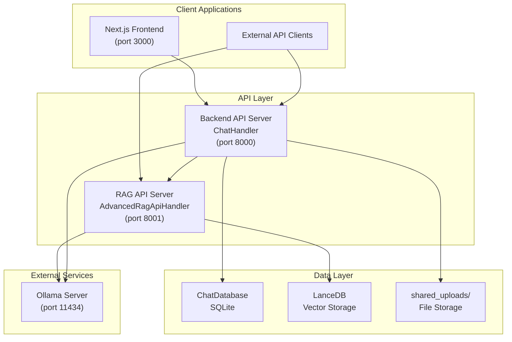
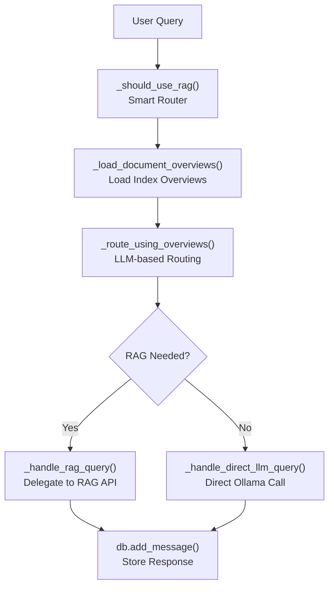
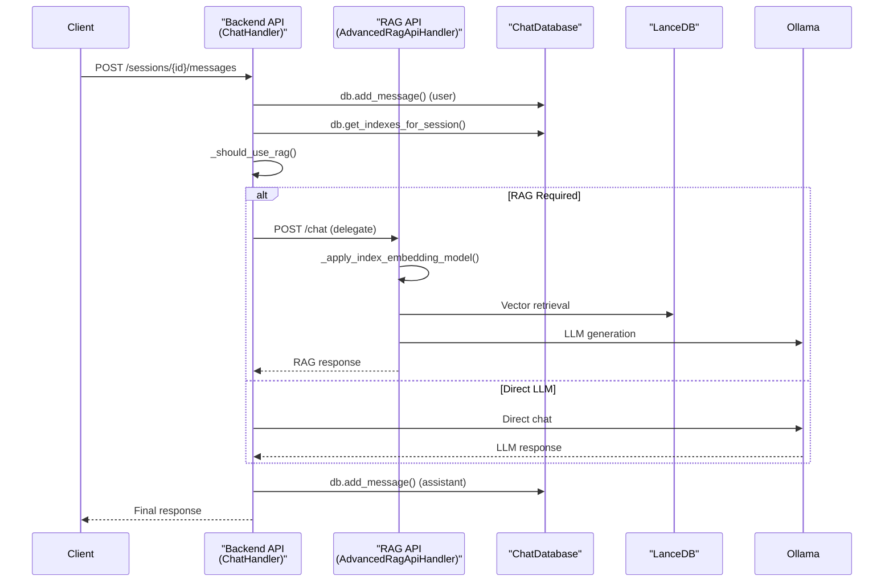

<!-- source: DeepWiki mcp.deepwiki.com · repo PromtEngineer/localGPT · page 5.3 API Reference · fetched 2026-10-26 -->

# API Reference

<details>
<summary>Relevant source files</summary>

The following files were used as context for generating this wiki page:

- [Dockerfile.backend](Dockerfile.backend)
- [README.md](README.md)
- [backend/database.py](backend/database.py)
- [backend/server.py](backend/server.py)
- [rag_system/api_server.py](rag_system/api_server.py)

</details>


This document provides a comprehensive reference for LocalGPT's REST APIs. LocalGPT exposes two primary API services: the Backend API (port 8000) for session management and general operations, and the RAG API (port 8001) for document processing and intelligent retrieval.

For system configuration and deployment, see [Configuration](#4). For usage through the web interface, see [Web Interface](#5.2).

## API Architecture Overview

LocalGPT implements a multi-service API architecture with clear separation of concerns between session management and RAG processing.



**Sources:** [backend/server.py:36-1141](), [rag_system/api_server.py:115-757](), [backend/database.py:7-667]()

## Backend API Server (Port 8000)

The primary API server handles session management, file uploads, index management, and intelligent routing between direct LLM and RAG responses.

### Session Management

| Method | Endpoint | Description | Handler |
|--------|----------|-------------|---------|
| `POST` | `/sessions` | Create new chat session | `handle_create_session` |
| `GET` | `/sessions` | List all sessions | `handle_get_sessions` |
| `GET` | `/sessions/{id}` | Get session details | `handle_get_session` |
| `DELETE` | `/sessions/{id}` | Delete session | `handle_delete_session` |
| `POST` | `/sessions/{id}/rename` | Rename session | `handle_rename_session` |

#### Create Session

```http
POST /sessions
Content-Type: application/json

{
  "title": "My Research Session",
  "model": "qwen3:8b"
}
```

**Response:**
```json
{
  "session": {
    "id": "uuid-string",
    "title": "My Research Session",
    "created_at": "2024-01-01T00:00:00",
    "model_used": "qwen3:8b",
    "message_count": 0
  },
  "session_id": "uuid-string"
}
```

**Sources:** [backend/server.py:245-270]()

### Chat Operations

| Method | Endpoint | Description | Handler |
|--------|----------|-------------|---------|
| `POST` | `/sessions/{id}/messages` | Send message in session | `handle_session_chat` |
| `POST` | `/chat` | Legacy chat endpoint | `handle_chat` |

The session chat endpoint implements intelligent routing using the `_should_use_rag` method to decide between direct LLM responses and RAG pipeline processing based on document overviews and query analysis.



**Sources:** [backend/server.py:272-341](), [backend/server.py:342-505]()

### File and Document Management

| Method | Endpoint | Description | Handler |
|--------|----------|-------------|---------|
| `POST` | `/sessions/{id}/upload` | Upload files to session | `handle_file_upload` |
| `POST` | `/sessions/{id}/index` | Index session documents | `handle_index_documents` |
| `GET` | `/sessions/{id}/documents` | Get session documents | `handle_get_session_documents` |

File uploads are stored in `shared_uploads/` with UUID-prefixed names and tracked in the `session_documents` table via `ChatDatabase.add_document_to_session`.

**Sources:** [backend/server.py:658-696](), [backend/server.py:698-731](), [backend/database.py:302-324]()

### Index Management

| Method | Endpoint | Description | Handler |
|--------|----------|-------------|---------|
| `POST` | `/indexes` | Create new index | `handle_create_index` |
| `GET` | `/indexes` | List all indexes | `handle_get_indexes` |
| `GET` | `/indexes/{id}` | Get index details | `handle_get_index` |
| `DELETE` | `/indexes/{id}` | Delete index | `handle_delete_index` |
| `POST` | `/indexes/{id}/upload` | Upload files to index | `handle_index_file_upload` |
| `POST` | `/indexes/{id}/build` | Build/process index | `handle_build_index` |
| `POST` | `/sessions/{id}/indexes/{index_id}` | Link index to session | `handle_link_index_to_session` |
| `GET` | `/sessions/{id}/indexes` | Get session indexes | `handle_get_session_indexes` |

Index creation supports comprehensive metadata tracking including chunking parameters, embedding models, and processing configurations.

**Sources:** [backend/server.py:801-840](), [backend/server.py:863-986](), [backend/database.py:328-426]()

### System Operations

| Method | Endpoint | Description | Response |
|--------|----------|-------------|----------|
| `GET` | `/health` | System health check | Ollama status, models, DB stats |
| `GET` | `/models` | Available AI models | Generation and embedding models |
| `GET` | `/sessions/cleanup` | Clean empty sessions | Cleanup count |

**Sources:** [backend/server.py:53-59](), [backend/server.py:746-782]()

## RAG API Server (Port 8001)

The specialized RAG server handles document processing, intelligent retrieval, and answer generation using the `AdvancedRagApiHandler`.

### Chat Processing

| Method | Endpoint | Description | Handler |
|--------|----------|-------------|---------|
| `POST` | `/chat` | Process RAG query | `handle_chat` |
| `POST` | `/chat/stream` | Streaming chat with SSE | `handle_chat_stream` |

#### RAG Chat Request

```http
POST /chat
Content-Type: application/json

{
  "query": "What are the key findings?",
  "session_id": "uuid-string",
  "search_type": "hybrid",
  "retrieval_k": 20,
  "reranker_top_k": 10,
  "context_window_size": 5,
  "ai_rerank": true,
  "verify": true,
  "query_decompose": true,
  "compose_sub_answers": true,
  "provence_prune": true,
  "provence_threshold": 0.8,
  "force_rag": false
}
```

The RAG API supports extensive configuration parameters for fine-tuning retrieval and generation behavior.

**Sources:** [rag_system/api_server.py:145-302]()

### Document Indexing

| Method | Endpoint | Description | Handler |
|--------|----------|-------------|---------|
| `POST` | `/index` | Process document indexing | `handle_index` |

#### Indexing Request

```http
POST /index
Content-Type: application/json

{
  "file_paths": ["/path/to/doc1.pdf", "/path/to/doc2.pdf"],
  "session_id": "uuid-string",
  "chunk_size": 512,
  "chunk_overlap": 64,
  "retrieval_mode": "hybrid",
  "window_size": 2,
  "enable_enrich": true,
  "enable_latechunk": true,
  "enable_docling_chunk": true,
  "embedding_model": "Qwen/Qwen3-Embedding-0.6B",
  "enrich_model": "qwen3:0.6b",
  "batch_size_embed": 50,
  "batch_size_enrich": 25
}
```

**Sources:** [rag_system/api_server.py:501-690]()

### Model Discovery

| Method | Endpoint | Description | Handler |
|--------|----------|-------------|---------|
| `GET` | `/models` | Available models by type | `handle_models` |

**Response:**
```json
{
  "generation_models": ["qwen3:8b", "qwen3:0.6b", "llama3.2:latest"],
  "embedding_models": ["Qwen/Qwen3-Embedding-0.6B", "BAAI/bge-base-en-v1.5"]
}
```

**Sources:** [rag_system/api_server.py:692-732]()

## Request Flow Architecture

The following diagram shows how requests flow between the API services and data stores:



**Sources:** [backend/server.py:272-341](), [rag_system/api_server.py:145-302](), [rag_system/api_server.py:42-70]()

## Error Handling and CORS

Both API servers implement comprehensive CORS support and structured error responses:

| Status Code | Description | Example Response |
|-------------|-------------|------------------|
| `200` | Success | `{"response": "...", "source_documents": [...]}` |
| `400` | Bad Request | `{"error": "Query is required"}` |
| `404` | Not Found | `{"error": "Session not found"}` |
| `500` | Server Error | `{"error": "Server error: ..."}` |
| `503` | Service Unavailable | `{"error": "Ollama is not running"}` |

CORS headers are automatically added by `send_json_response` methods in both servers.

**Sources:** [backend/server.py:1059-1076](), [rag_system/api_server.py:734-741](), [rag_system/api_server.py:116-122]()

## Database Integration

The APIs integrate with `ChatDatabase` for persistent storage:

| Table | Purpose | Key Methods |
|-------|---------|-------------|
| `sessions` | Chat session metadata | `create_session`, `get_sessions` |
| `messages` | Chat message history | `add_message`, `get_messages` |
| `indexes` | Document index registry | `create_index`, `list_indexes` |
| `index_documents` | Index file mappings | `add_document_to_index` |
| `session_indexes` | Session-index relationships | `link_index_to_session` |
| `session_documents` | Session file uploads | `add_document_to_session` |

**Sources:** [backend/database.py:20-442]()

---

