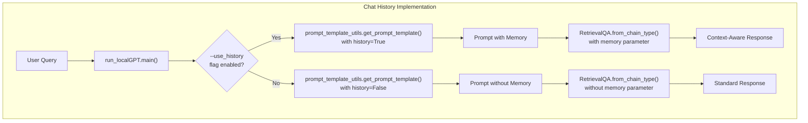
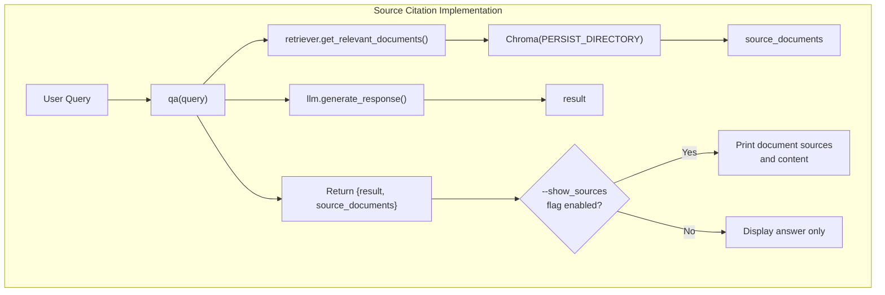
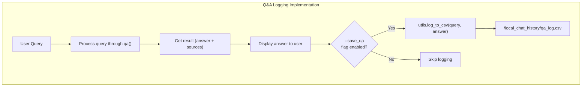
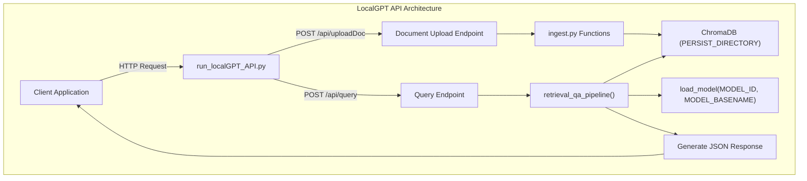
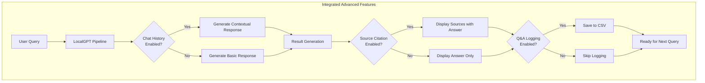

<!-- source: DeepWiki mcp.deepwiki.com · repo PromtEngineer/localGPT · page 6 Advanced Features · fetched 2026-10-26 -->

# Advanced Features

<details>
<summary>Relevant source files</summary>

The following files were used as context for generating this wiki page:

- [README.md](README.md)

</details>


## Purpose and Scope

This document describes the advanced capabilities of localGPT beyond basic question-answering functionality. These features enhance usability, transparency, and integration options. For basic setup and standard usage information, please refer to [Overview](#1) and [Usage](#5).

The advanced features covered in this document include:
- Chat History for context-aware conversations
- Source Citation for result transparency
- Q&A Logging for persistent record-keeping
- API Usage for integration with other applications

## Chat History

### Overview

Chat History allows localGPT to remember previous interactions within a session, enabling context-aware conversations. By default, this feature is disabled to maximize the context window available for document content.

### Technical Implementation



When the `--use_history` flag is set, localGPT initializes a memory component that stores previous questions and answers. This memory is then passed to the RetrievalQA chain, allowing it to incorporate conversation history into its responses.

The implementation differentiates between memory-enabled and standard mode:

```python
# With history enabled
qa = RetrievalQA.from_chain_type(
    llm=llm,
    chain_type="stuff",
    retriever=retriever,
    return_source_documents=True,
    callbacks=callback_manager,
    chain_type_kwargs={"prompt": prompt, "memory": memory},
)

# Without history
qa = RetrievalQA.from_chain_type(
    llm=llm,
    chain_type="stuff",
    retriever=retriever,
    return_source_documents=True,
    callbacks=callback_manager,
    chain_type_kwargs={"prompt": prompt},
)
```

### Enabling Chat History

To enable chat history, use the `--use_history` or `-h` flag:

```bash
python run_localGPT.py --use_history
```

**Note**: Using chat history consumes part of the context window, which may reduce the amount of document content that can be processed for each query.

Sources: [run_localGPT.py:157-181](), [run_localGPT.py:224-227]()

## Source Citation

### Overview

The Source Citation feature increases transparency by showing users which document chunks were used to generate an answer. This helps users verify the accuracy and relevance of responses.

### Technical Implementation



The implementation:
1. Always retrieves source documents from the vector database
2. Includes these documents in the response object
3. Only displays them to the user if the `--show_sources` flag is enabled

```python
# Get the answer from the chain
res = qa(query)
answer, docs = res["result"], res["source_documents"]

# Print the result
print("\n\n> Question:")
print(query)
print("\n> Answer:")
print(answer)

if show_sources:  # this is a flag that you can set to disable showing answers.
    # Print the relevant sources used for the answer
    print("----------------------------------SOURCE DOCUMENTS---------------------------")
    for document in docs:
        print("\n> " + document.metadata["source"] + ":")
        print(document.page_content)
    print("----------------------------------SOURCE DOCUMENTS---------------------------")
```

### Enabling Source Citation

To enable source citation, use the `--show_sources` or `-s` flag:

```bash
python run_localGPT.py --show_sources
```

Sources: [run_localGPT.py:217-221](), [run_localGPT.py:286-292]()

## Q&A Logging

### Overview

The Q&A Logging feature saves all interactions to a CSV file, creating a persistent record that can be used for analysis, auditing, or training purposes.

### Technical Implementation



When the `--save_qa` flag is enabled, localGPT calls `utils.log_to_csv()` after each interaction to save the question and answer to a CSV file:

```python
# After displaying the answer
if save_qa:
    utils.log_to_csv(query, answer)
```

The resulting CSV file contains all interactions, allowing users to maintain a record across multiple sessions.

### Enabling Q&A Logging

To enable Q&A logging, use the `--save_qa` flag:

```bash
python run_localGPT.py --save_qa
```

Sources: [run_localGPT.py:237-240](), [run_localGPT.py:294-296]()

## API Usage

### Overview

LocalGPT provides an API that enables integration with other applications. This allows developers to incorporate localGPT's RAG capabilities into custom solutions.

### Technical Implementation



The API is implemented using Flask and provides endpoints for document upload, querying, and managing the document database. This enables:
- Integration with custom UIs
- Programmatic access to localGPT's capabilities
- Building of multi-application workflows

### Using the API

1. Set your desired LLM in `constants.py`
2. Start the API server:
   ```bash
   python run_localGPT_API.py
   ```
3. The API will be available at `http://localhost:5110/`

### Web UI

LocalGPT includes a web UI that interacts with the API:

1. Ensure the API is running
2. Start the web UI:
   ```bash
   cd localGPTUI
   python localGPTUI.py
   ```
3. Access the UI at `http://localhost:5111/`

Sources: [run_localGPT_API.py]()

## Combining Advanced Features

LocalGPT's advanced features can be used in combination to create a comprehensive solution:



All features can be enabled simultaneously:

```bash
python run_localGPT.py --use_history --show_sources --save_qa
```

## Feature Comparison

| Feature | Purpose | Command Flag | Default | Implementation File |
|---------|---------|-------------|---------|---------------------|
| Chat History | Enable context-aware conversations | `--use_history` / `-h` | Disabled | run_localGPT.py, prompt_template_utils.py |
| Source Citation | Show source documents used for answers | `--show_sources` / `-s` | Disabled | run_localGPT.py |
| Q&A Logging | Save interactions to CSV | `--save_qa` | Disabled | run_localGPT.py, utils.py |
| API | Enable programmatic access | N/A (separate script) | N/A | run_localGPT_API.py |
| Model Selection | Choose different LLM types | `--model_type` | llama3 | run_localGPT.py |

Sources: [run_localGPT.py:186-240]()

## Summary

The advanced features of localGPT enhance its core RAG capabilities by adding:
- Contextual awareness through chat history
- Transparency through source citation
- Persistence through Q&A logging
- Integration capabilities through the API

These features can be used individually or in combination to tailor localGPT to specific use cases, from simple document querying to sophisticated, context-aware conversational systems.

---

