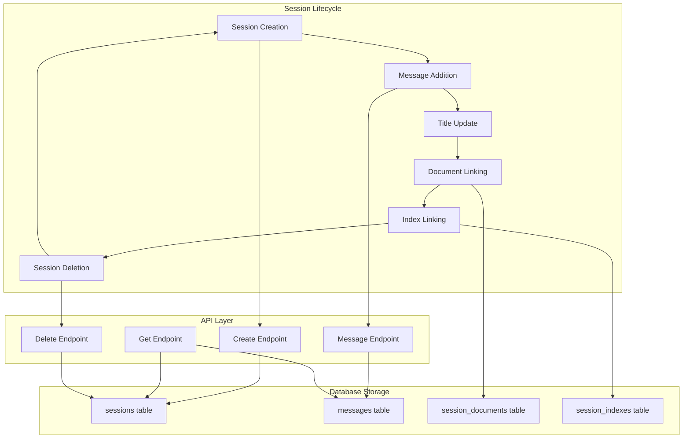
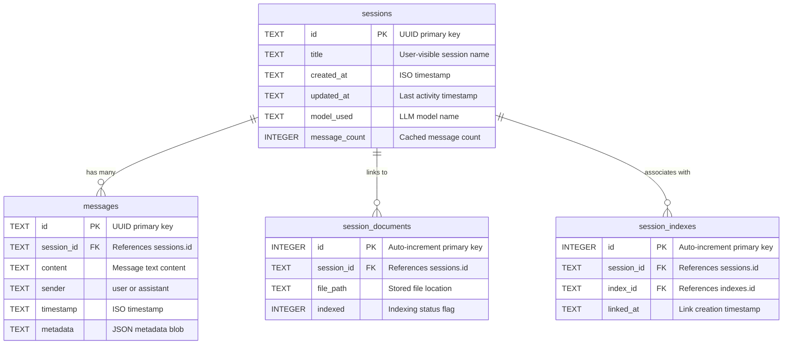
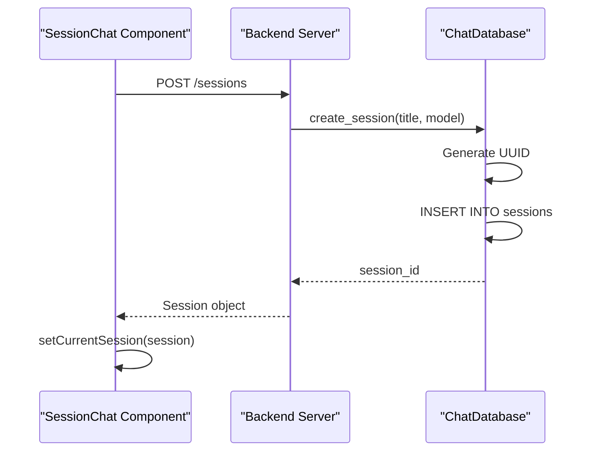
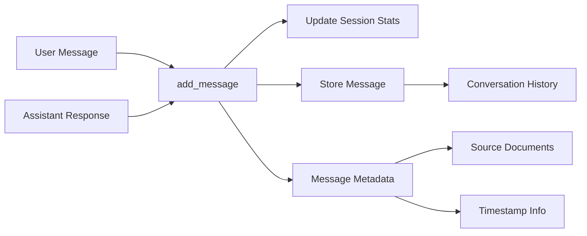
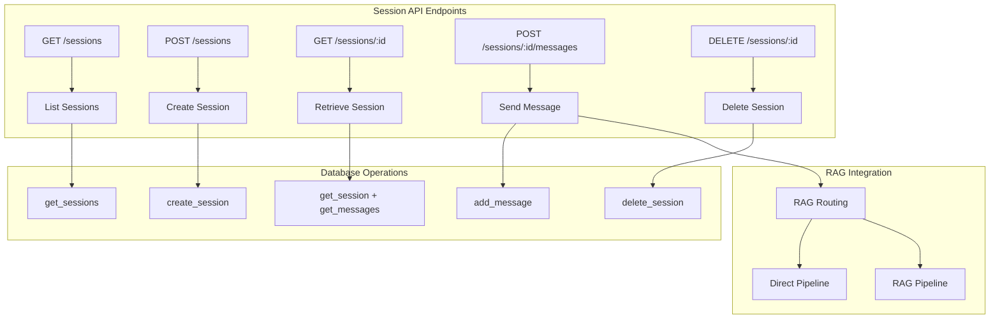
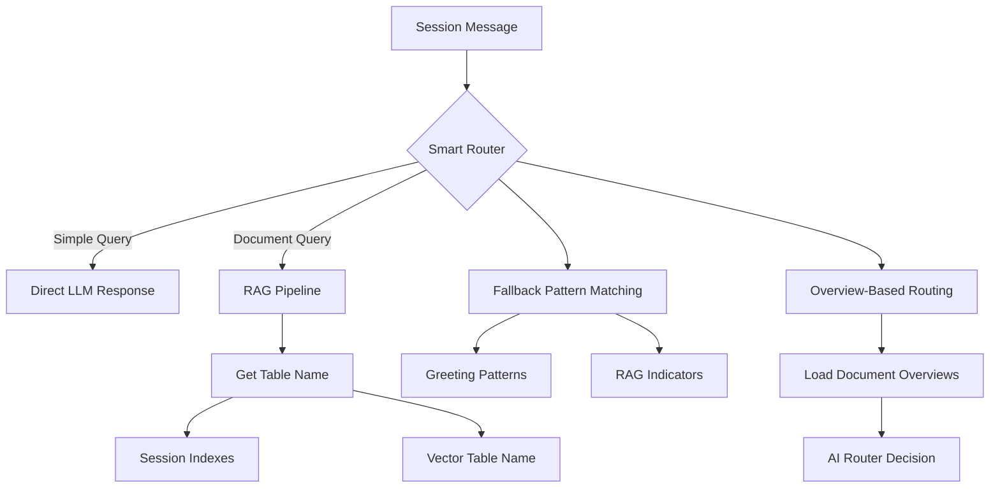
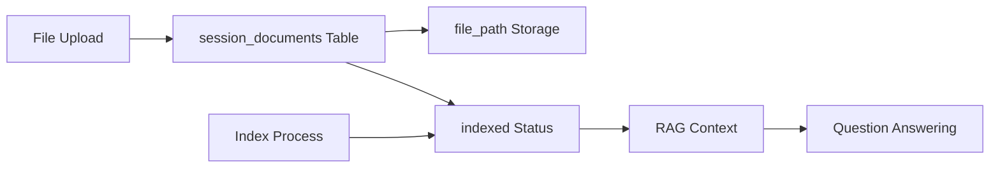
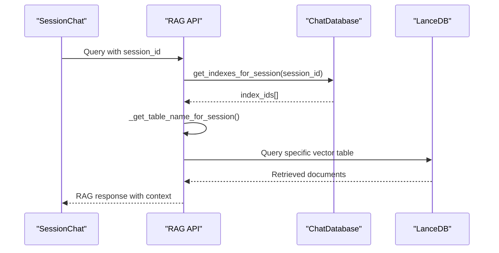
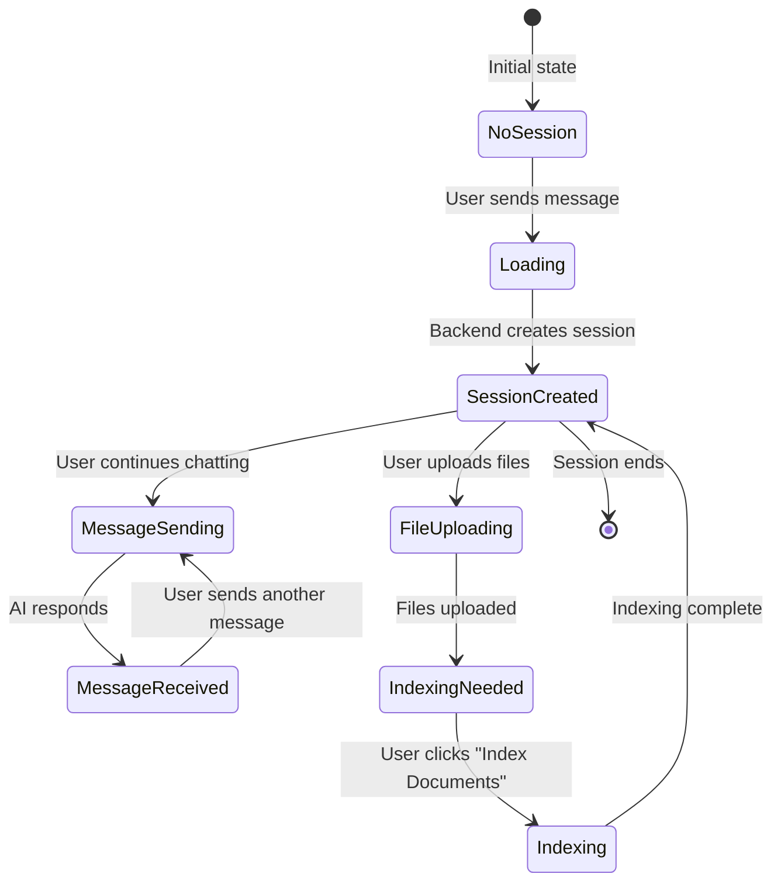

<!-- source: DeepWiki mcp.deepwiki.com · repo PromtEngineer/localGPT · page 6.1 Session Management · fetched 2026-10-26 -->

# Session Management

<details>
<summary>Relevant source files</summary>

The following files were used as context for generating this wiki page:

- [Dockerfile.backend](Dockerfile.backend)
- [backend/database.py](backend/database.py)
- [backend/server.py](backend/server.py)
- [rag_system/api_server.py](rag_system/api_server.py)
- [run_system.py](run_system.py)
- [src/components/ui/conversation-page.tsx](src/components/ui/conversation-page.tsx)
- [src/components/ui/session-chat.tsx](src/components/ui/session-chat.tsx)
- [src/utils/textNormalization.ts](src/utils/textNormalization.ts)
- [test_markdown_streaming.js](test_markdown_streaming.js)

</details>


This document covers LocalGPT's session management system, which provides persistent chat conversations with message history, document linking, and index association. Session management enables users to maintain context across multiple interactions and associate specific document collections with individual conversations.

For information about creating and managing document indexes, see [Index Management](#6.2). For details on the chat interface and user experience, see [Web Interface](#5.2).

## Overview

LocalGPT's session management system provides persistent conversation contexts that maintain chat history, track document associations, and preserve user preferences across interactions. Each session represents an independent conversation thread with its own message history, linked documents, and associated indexes.



**Session Management Architecture**

Sources: [backend/database.py:7-106](), [backend/server.py:245-270](), [src/components/ui/session-chat.tsx:18-39]()

## Database Schema

The session management system uses four primary database tables to store conversation data and relationships:

| Table | Purpose | Key Fields |
|-------|---------|------------|
| `sessions` | Core session metadata | `id`, `title`, `created_at`, `updated_at`, `model_used`, `message_count` |
| `messages` | Individual chat messages | `id`, `session_id`, `content`, `sender`, `timestamp`, `metadata` |
| `session_documents` | Document-session associations | `session_id`, `file_path`, `indexed` |
| `session_indexes` | Index-session associations | `session_id`, `index_id`, `linked_at` |



**Database Schema for Session Management**

Sources: [backend/database.py:28-102]()

## Session Lifecycle Management

### Session Creation

New sessions are created through the `ChatDatabase.create_session()` method, which generates a unique UUID identifier and initializes session metadata:



**Session Creation Flow**

The `generate_session_title()` function automatically creates meaningful session titles from the user's first message, removing common prefixes and limiting length for display purposes.

Sources: [backend/database.py:108-122](), [backend/database.py:639-664](), [backend/server.py:245-270]()

### Message Storage

Messages are stored using the `add_message()` method, which maintains conversation history and updates session metadata:



**Message Storage Process**

Each message includes metadata such as source documents for RAG responses, timestamps, and message type classifications for proper UI rendering.

Sources: [backend/database.py:157-182](), [backend/database.py:206-217]()

### Session Cleanup

The system provides automatic cleanup capabilities through `cleanup_empty_sessions()`, which removes sessions without any messages to maintain database hygiene:

Sources: [backend/database.py:243-270]()

## API Integration

### REST Endpoints

The backend server exposes several session management endpoints:

| Method | Endpoint | Purpose | Handler Function |
|--------|----------|---------|------------------|
| GET | `/sessions` | List all sessions | `handle_get_sessions` |
| POST | `/sessions` | Create new session | `handle_create_session` |
| GET | `/sessions/{id}` | Get session details | `handle_get_session` |
| POST | `/sessions/{id}/messages` | Send message | `handle_session_chat` |
| DELETE | `/sessions/{id}` | Delete session | `handle_delete_session` |



**Session API Architecture**

Sources: [backend/server.py:49-133](), [backend/server.py:177-270]()

### Smart Routing Integration

Session messages integrate with LocalGPT's smart routing system, which determines whether to use direct LLM responses or RAG pipeline based on conversation context and linked indexes:



**Smart Routing for Session Messages**

The routing system uses document overviews and pattern matching to intelligently decide between fast direct responses and comprehensive RAG processing.

Sources: [backend/server.py:299-552](), [rag_system/api_server.py:71-113]()

## Document and Index Association

### Session-Document Linking

Sessions can have documents uploaded and associated with them through the `session_documents` table:



**Document Association Flow**

Sources: [backend/database.py:302-324](), [backend/server.py:108-113]()

### Session-Index Linking  

Sessions are linked to specific indexes through the `session_indexes` table, enabling targeted document retrieval:



**Session-Index Integration**

The `_get_table_name_for_session()` function maps session IDs to specific vector table names, ensuring queries only search relevant document collections.

Sources: [backend/database.py:380-391](), [rag_system/api_server.py:71-113]()

## Frontend Session Management

### SessionChat Component

The `SessionChat` component manages session state and user interactions:



**SessionChat Component State Machine**

Sources: [src/components/ui/session-chat.tsx:40-69](), [src/components/ui/session-chat.tsx:131-498]()

### Session State Management

The frontend maintains session state through React hooks and API integration:

- `currentSession` - Active session metadata
- `messages` - Message history array  
- `uploadedFiles` - Session document associations
- `currentIndexId` - Linked index identifier

The component automatically handles session creation, title updates, and message persistence through API calls.

Sources: [src/components/ui/session-chat.tsx:42-69](), [src/components/ui/session-chat.tsx:102-129]()

## Message Metadata and Context

### Message Structure

Messages in the system support rich metadata for enhanced functionality:

```json
{
  "id": "uuid",
  "session_id": "session-uuid",
  "content": "message content",
  "sender": "user|assistant", 
  "timestamp": "ISO-8601",
  "metadata": {
    "message_type": "in_progress|complete|sub_answer",
    "source_documents": [...],
    "retrieval_stats": {...}
  }
}
```

The metadata enables features like source document display, streaming progress tracking, and response provenance.

Sources: [backend/database.py:157-182](), [src/components/ui/session-chat.tsx:213-253]()

### Conversation History Format

The `get_conversation_history()` method formats messages for LLM consumption, converting from database format to the expected `{role, content}` structure used by language models.

Sources: [backend/database.py:206-217]()

## Performance and Optimization

### Database Indexing

The session management system includes optimized database indexes for efficient querying:

- `idx_messages_session_id` - Message lookups by session
- `idx_messages_timestamp` - Chronological message ordering  
- `idx_sessions_updated_at` - Recent session retrieval
- `idx_session_documents_session_id` - Document association queries

These indexes ensure fast session loading and message retrieval even with large conversation histories.

Sources: [backend/database.py:53-68]()

### Memory Management

The frontend implements efficient message loading and state management to handle long conversations without performance degradation. Streaming responses use incremental updates rather than full message replacement.

Sources: [src/components/ui/session-chat.tsx:256-454]()

---

