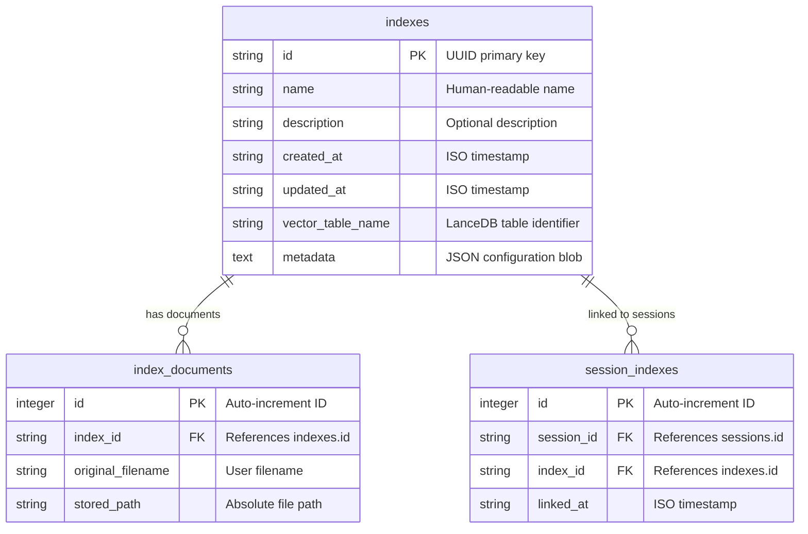
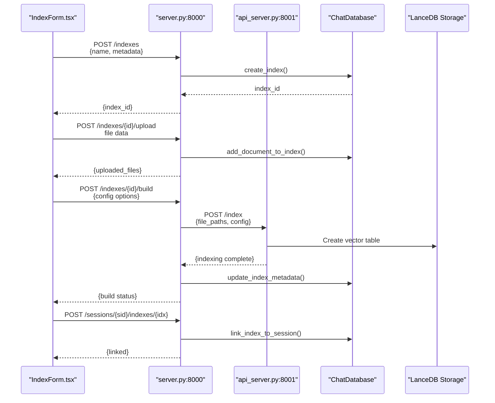

<!-- source: DeepWiki mcp.deepwiki.com · repo PromtEngineer/localGPT · page 6.2 Index Management · fetched 2026-10-26 -->

# Index Management

<details>
<summary>Relevant source files</summary>

The following files were used as context for generating this wiki page:

- [Dockerfile.backend](Dockerfile.backend)
- [backend/database.py](backend/database.py)
- [backend/server.py](backend/server.py)
- [rag_system/api_server.py](rag_system/api_server.py)
- [src/components/IndexForm.tsx](src/components/IndexForm.tsx)
- [src/components/IndexWizard.tsx](src/components/IndexWizard.tsx)

</details>


Index management in LocalGPT handles the creation, configuration, building, and lifecycle management of document indexes. These indexes store processed documents as vectorized chunks that enable efficient retrieval during RAG operations. This page covers the index creation workflow, configuration options, database schema, and API operations.

For information about the retrieval process using these indexes, see [Hybrid Search & Retrieval](#6.3). For session-based document linking, see [Session Management](#6.1).

## Index Lifecycle Overview

The index management system follows a four-stage lifecycle: creation, file upload, building, and session linking. Each stage involves coordination between the frontend, backend database, and RAG processing pipeline.

```mermaid
graph TD
    Create["`create_index()`<br/>Database Record"] --> Upload["`handle_index_file_upload()`<br/>File Storage"]
    Upload --> Build["`handle_build_index()`<br/>RAG Processing"]
    Build --> Link["`link_index_to_session()`<br/>Session Association"]
    
    Create --> CreateDB["`indexes` table<br/>`index_documents` table"]
    Upload --> UploadStore["`shared_uploads/`<br/>File System"]
    Build --> BuildStore["`LanceDB` Vector Table<br/>`overviews/*.jsonl`"]
    Link --> LinkDB["`session_indexes` table"]

    subgraph "Frontend"
        IndexForm["`IndexForm.tsx`<br/>Configuration UI"]
    end
    
    subgraph "Backend API"
        BackendAPI["`server.py`<br/>REST Endpoints"]
    end
    
    subgraph "RAG System"
        RAGAPI["`api_server.py`<br/>Processing Pipeline"]
    end
    
    IndexForm --> BackendAPI
    BackendAPI --> RAGAPI
```

**Index Lifecycle Stages**
- **Create**: Database record creation with metadata
- **Upload**: Document file storage and database linking
- **Build**: Vector processing and index construction
- **Link**: Association with chat sessions for retrieval

Sources: [src/components/IndexForm.tsx:33-70](), [backend/server.py:801-840](), [backend/database.py:328-341]()

## Database Schema

The index management system uses three interconnected database tables to track indexes, their associated documents, and session relationships.



**Key Database Operations**
- `create_index()`: Creates new index record with unique vector table name
- `add_document_to_index()`: Links uploaded files to index
- `link_index_to_session()`: Associates index with chat session
- `update_index_metadata()`: Stores configuration and processing status

Sources: [backend/database.py:71-102](), [backend/database.py:328-392]()

## Configuration Options

Index configuration is handled through the `IndexForm` component and stored in the database metadata field. The system supports comprehensive configuration of chunking, embedding, and retrieval parameters.

| Configuration Category | Options | Default Values |
|------------------------|---------|----------------|
| **Chunking** | `chunk_size`, `chunk_overlap` | 512 tokens, 64 overlap |
| **Retrieval Mode** | `hybrid`, `vector`, `bm25` | `hybrid` |
| **Models** | `embedding_model`, `enrich_model`, `overview_model` | Qwen models |
| **Contextual Enrichment** | `enable_enrich`, `window_size` | `true`, 5 chunks |
| **Advanced Features** | `enable_late_chunk`, `enable_docling_chunk` | `false`, `true` |
| **Batch Processing** | `batch_size_embed`, `batch_size_enrich` | 64, 64 |

```mermaid
flowchart LR
    subgraph "IndexForm Configuration"
        ChunkConfig["Chunk Size: 512<br/>Chunk Overlap: 64"]
        RetrievalConfig["Retrieval Mode: hybrid<br/>Late Chunk: enabled"]
        ModelConfig["Embedding: Qwen3-0.6B<br/>Enrich: qwen3:0.6b"]
        EnrichConfig["Enable Enrich: true<br/>Window Size: 5"]
    end
    
    subgraph "Database Storage"
        MetadataJSON["`metadata` JSON field<br/>in `indexes` table"]
    end
    
    subgraph "RAG Pipeline"
        ConfigOverride["`config_override` object<br/>in indexing pipeline"]
    end
    
    ChunkConfig --> MetadataJSON
    RetrievalConfig --> MetadataJSON
    ModelConfig --> MetadataJSON
    EnrichConfig --> MetadataJSON
    
    MetadataJSON --> ConfigOverride
```

Sources: [src/components/IndexForm.tsx:15-32](), [rag_system/api_server.py:514-595](), [backend/server.py:886-905]()

## API Workflow

Index management involves multiple API calls coordinating between the frontend, backend server, and RAG processing system. The workflow demonstrates separation of concerns between data management and document processing.



**API Endpoints**
- `POST /indexes` - Create index record ([server.py:801-840]())
- `POST /indexes/{id}/upload` - Upload documents ([server.py:842-861]())
- `POST /indexes/{id}/build` - Build vector index ([server.py:863-986]())
- `POST /sessions/{sid}/indexes/{idx}` - Link to session ([server.py:988-993]())

Sources: [src/components/IndexForm.tsx:37-62](), [backend/server.py:801-986](), [rag_system/api_server.py:501-690]()

## Index Building Process

The index building process transforms uploaded documents into searchable vector representations through a comprehensive processing pipeline. This involves document conversion, chunking, embedding generation, and storage in LanceDB.

```mermaid
flowchart TD
    subgraph "Input Processing"
        FileUpload["Document Files<br/>PDF, DOCX, TXT, MD"]
        DocConverter["Document Converter<br/>Docling Integration"]
    end
    
    subgraph "Chunking Pipeline"
        ChunkStrategy{"`chunker_mode`<br/>docling vs legacy"}
        DoclingChunker["`DoclingChunker`<br/>High-recall chunking"]
        LegacyChunker["`MarkdownRecursiveChunker`<br/>Traditional chunking"]
    end
    
    subgraph "Enrichment Pipeline"
        EnrichCheck{"`enable_enrich`"}
        ContextualEnrich["`ContextualEnricher`<br/>Window-based context"]
        EmbedGen["`EmbeddingGenerator`<br/>Batch processing"]
    end
    
    subgraph "Storage Layer"
        VectorTable["`text_pages_{index_id}`<br/>LanceDB Table"]
        BM25Index["BM25 Full-text Index"]
        OverviewFile["`index_store/overviews/{index_id}.jsonl`"]
    end
    
    FileUpload --> DocConverter
    DocConverter --> ChunkStrategy
    ChunkStrategy -->|docling| DoclingChunker
    ChunkStrategy -->|legacy| LegacyChunker
    
    DoclingChunker --> EnrichCheck
    LegacyChunker --> EnrichCheck
    EnrichCheck -->|enabled| ContextualEnrich
    EnrichCheck -->|disabled| EmbedGen
    ContextualEnrich --> EmbedGen
    
    EmbedGen --> VectorTable
    VectorTable --> BM25Index
    DocConverter --> OverviewFile
```

**Processing Configuration**
- `enable_docling_chunk`: High-recall sentence-level chunking
- `enable_enrich`: Contextual enrichment with neighboring chunks
- `window_size`: Number of surrounding chunks for context
- `batch_size_embed`: Chunks processed per embedding batch

Sources: [rag_system/api_server.py:540-661](), [backend/server.py:917-944]()

## Metadata Management

Index metadata tracks configuration parameters, processing status, and system information. The system supports both explicit configuration storage and automatic metadata inference for legacy indexes.

```mermaid
flowchart LR
    subgraph "Metadata Sources"
        UserConfig["User Configuration<br/>from IndexForm"]
        SystemDefaults["System Defaults<br/>from PIPELINE_CONFIGS"]
        InferredMeta["Inferred Metadata<br/>from LanceDB inspection"]
    end
    
    subgraph "Database Storage"
        MetadataBlob["`metadata` JSON column<br/>in indexes table"]
    end
    
    subgraph "Runtime Usage"
        EmbeddingModel["`embedding_model`<br/>for retrieval pipeline"]
        ConfigOverride["`config_override`<br/>for indexing pipeline"]
        StatusTracking["Processing status<br/>and diagnostics"]
    end
    
    UserConfig --> MetadataBlob
    SystemDefaults --> MetadataBlob
    InferredMeta --> MetadataBlob
    
    MetadataBlob --> EmbeddingModel
    MetadataBlob --> ConfigOverride
    MetadataBlob --> StatusTracking
```

**Metadata Fields**
- `embedding_model`: Model used for vector generation
- `chunk_size`, `chunk_overlap`: Chunking parameters
- `retrieval_mode`: Search strategy (hybrid, vector, bm25)
- `status`: Processing state (created, building, functional)
- `vector_dimensions`: Embedding vector size

Sources: [backend/database.py:428-442](), [backend/database.py:443-637](), [backend/server.py:815-835]()

## Session Integration

Indexes integrate with chat sessions through the `session_indexes` linking table, enabling session-specific document retrieval and maintaining conversation context across multiple indexes.

```mermaid
graph LR
    subgraph "Chat Session"
        SessionRecord["`sessions` table<br/>session metadata"]
        MessageHistory["`messages` table<br/>conversation history"]
    end
    
    subgraph "Index Linking"
        SessionIndexes["`session_indexes` table<br/>many-to-many relationship"]
        IndexRecords["`indexes` table<br/>index metadata"]
    end
    
    subgraph "Retrieval Context"
        TableName["`_get_table_name_for_session()`<br/>vector table resolution"]
        EmbeddingSync["`_apply_index_embedding_model()`<br/>model synchronization"]
        OverviewPath["`index_store/overviews/{session_id}.jsonl`"]
    end
    
    SessionRecord --> SessionIndexes
    IndexRecords --> SessionIndexes
    SessionIndexes --> TableName
    SessionIndexes --> EmbeddingSync
    SessionRecord --> OverviewPath
```

**Session-Index Operations**
- `link_index_to_session()`: Create association between session and index
- `get_indexes_for_session()`: Retrieve all linked indexes
- Table name resolution uses first linked index's vector table
- Embedding model synchronization ensures retrieval consistency

Sources: [backend/database.py:380-392](), [rag_system/api_server.py:71-113](), [rag_system/api_server.py:42-70]()

---

