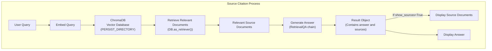
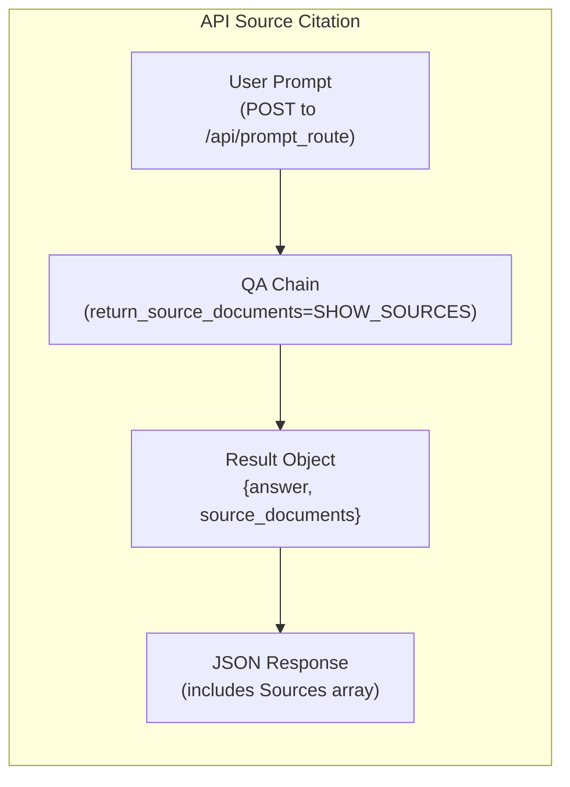
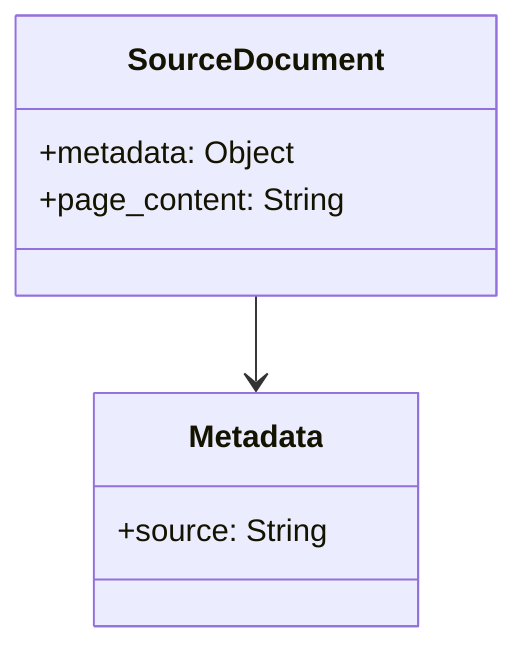
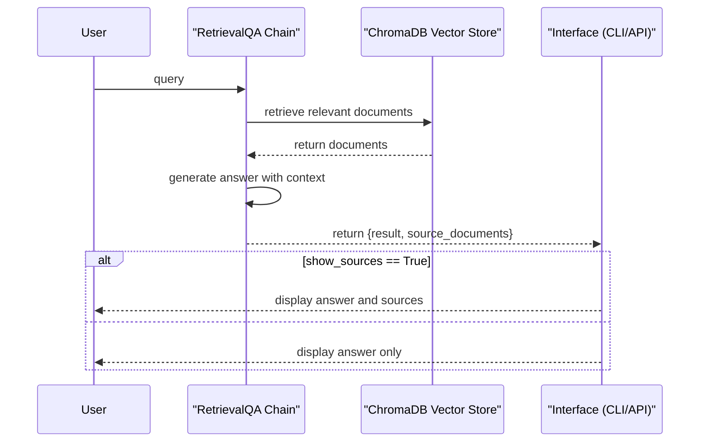

<!-- source: DeepWiki mcp.deepwiki.com · repo PromtEngineer/localGPT · page 6.3 Hybrid Search & Retrieval · fetched 2026-10-26 -->

# Source Citation

<details>
<summary>Relevant source files</summary>

The following files were used as context for generating this wiki page:

- [README.md](README.md)
- [rag_system/indexing/embedders.py](rag_system/indexing/embedders.py)
- [rag_system/indexing/latechunk.py](rag_system/indexing/latechunk.py)
- [rag_system/indexing/representations.py](rag_system/indexing/representations.py)

</details>


## Overview

This document explains how LocalGPT implements source citation - the feature that allows users to view the original document sources used to generate answers. Source citation enhances transparency, builds trust in answers, and helps users verify information. 

For information about the API usage related to source citation, see [API Usage](#6.3).

## Purpose of Source Citation

Source citation in LocalGPT enables users to:

1. Verify the accuracy of responses by examining original sources
2. Trace the provenance of information
3. Access additional context beyond what's included in the answer
4. Evaluate the relevance and reliability of source materials

## How Source Citation Works

When enabled, LocalGPT displays the source documents that were retrieved from the vector database and used by the Large Language Model to generate its response.



Sources: [run_localGPT.py:173-181](), [run_localGPT.py:276-292](), [run_localGPT_API.py:78]()

## Enabling Source Citation

LocalGPT provides several ways to enable source citation, depending on which interface you're using.

### Command Line Interface

In the command line interface, source citation is enabled using the `--show_sources` or `-s` flag:

```bash
python run_localGPT.py --show_sources
```

The source documents will be displayed after each answer.

Sources: [run_localGPT.py:216-221]()

### Web API

In the API version of LocalGPT, source citation is enabled by default with the `SHOW_SOURCES` variable set to `True`:



The API response includes a `Sources` array that contains tuples of document filenames and their content.

Sources: [run_localGPT_API.py:35](), [run_localGPT_API.py:78](), [run_localGPT_API.py:179-183]()

## Source Document Structure

Each source document returned by the system contains:

1. **Metadata**: Information about the document, including its filename/path
2. **Page Content**: The actual text content from the document that was used



Sources: [run_localGPT.py:288-291](), [run_localGPT_API.py:180-183]()

## Source Display Implementation

### Command Line Interface

In the CLI, sources are displayed in a formatted block:

```
----------------------------------SOURCE DOCUMENTS---------------------------
> document_filename.pdf:
Document content text goes here...
----------------------------------SOURCE DOCUMENTS---------------------------
```

Sources: [run_localGPT.py:286-292]()

### API Interface

In the API, sources are formatted as part of the JSON response:

```json
{
  "Prompt": "user question here",
  "Answer": "generated answer here",
  "Sources": [
    ["document1.pdf", "Content from document 1..."],
    ["document2.txt", "Content from document 2..."]
  ]
}
```

Sources: [run_localGPT_API.py:174-183]()

## Technical Implementation

The source citation feature is implemented through several key components:

1. **Configuration**: The `return_source_documents` parameter in the RetrievalQA chain
2. **Retrieval**: Relevant documents are fetched from the ChromaDB vector store
3. **Result Processing**: The QA chain returns both the answer and source documents
4. **Display**: Interface-specific code displays the sources appropriately



Sources: [run_localGPT.py:163-181](), [run_localGPT_API.py:73-82]()

## Code Details

The core implementation of source citation is in the following code segments:

1. In `run_localGPT.py`, the RetrievalQA chain is configured with the `return_source_documents` parameter:

```python
qa = RetrievalQA.from_chain_type(
    llm=llm,
    chain_type="stuff",
    retriever=retriever,
    return_source_documents=True,  # Enable source documents in response
    callbacks=callback_manager,
    chain_type_kwargs={"prompt": prompt},
)
```

2. The main loop extracts and displays these sources:

```python
res = qa(query)
answer, docs = res["result"], res["source_documents"]

# Print the answer
print("\n> Answer:")
print(answer)

if show_sources:
    # Print the sources
    print("----------------------------------SOURCE DOCUMENTS---------------------------")
    for document in docs:
        print("\n> " + document.metadata["source"] + ":")
        print(document.page_content)
    print("----------------------------------SOURCE DOCUMENTS---------------------------")
```

Sources: [run_localGPT.py:173-181](), [run_localGPT.py:276-292](), [run_localGPT_API.py:171-183]()

## Best Practices

When working with source citation in LocalGPT:

1. **Enable for verification**: Always enable source citation when accuracy is critical
2. **Review sources**: Review source documents to verify that the answer correctly represents the source material
3. **Document quality**: High-quality source documents lead to more accurate citations
4. **Parsing considerations**: Be aware that some document formats may affect how source content is displayed

## Limitations

The source citation feature has a few limitations:

1. Only shows documents retrieved from the vector database, not all documents in the system
2. Limited to the number of documents retrieved by the retriever (typically the top-k most relevant)
3. May not include all sections of a document that influenced the answer
4. The quality of source citations depends on the quality of document chunking during ingestion

## Summary

Source citation is a powerful feature in LocalGPT that enhances transparency and trust in the system's responses. By enabling users to view the original sources used to generate answers, it provides a clear connection between user queries, source documents, and generated responses.

---

