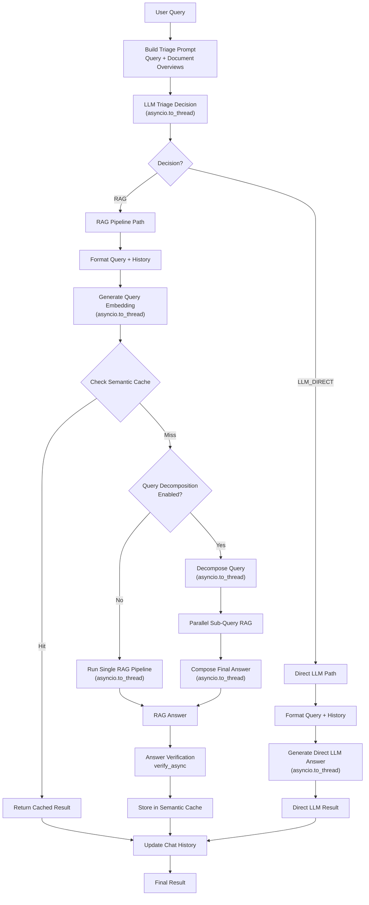
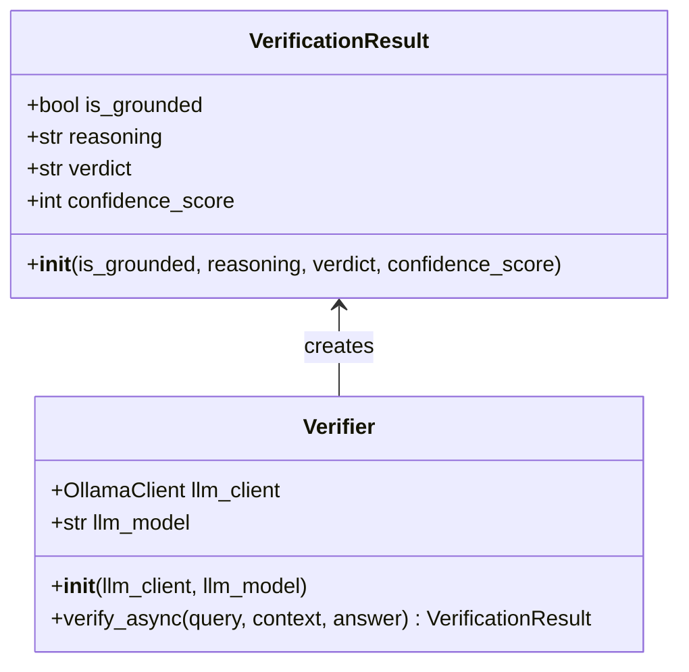
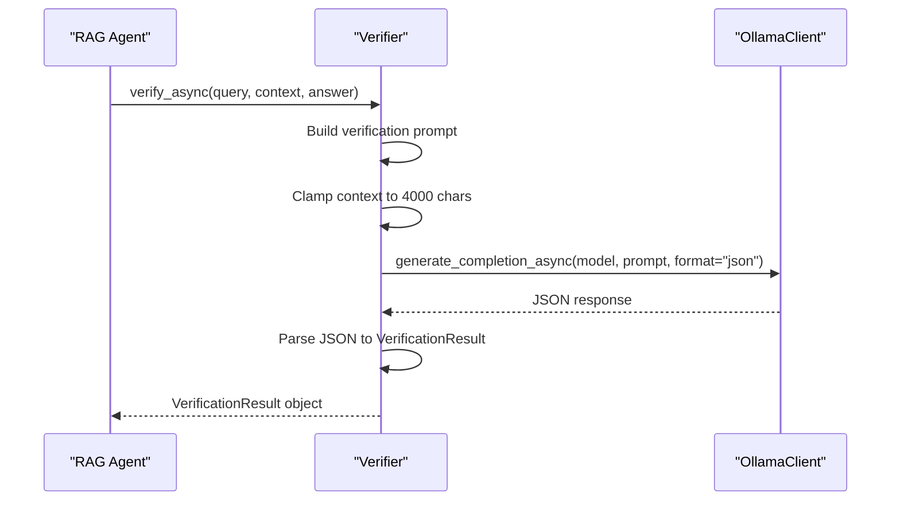
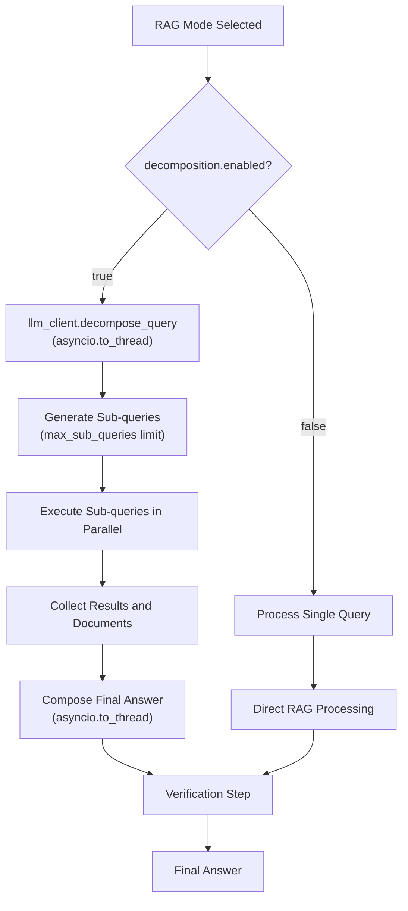
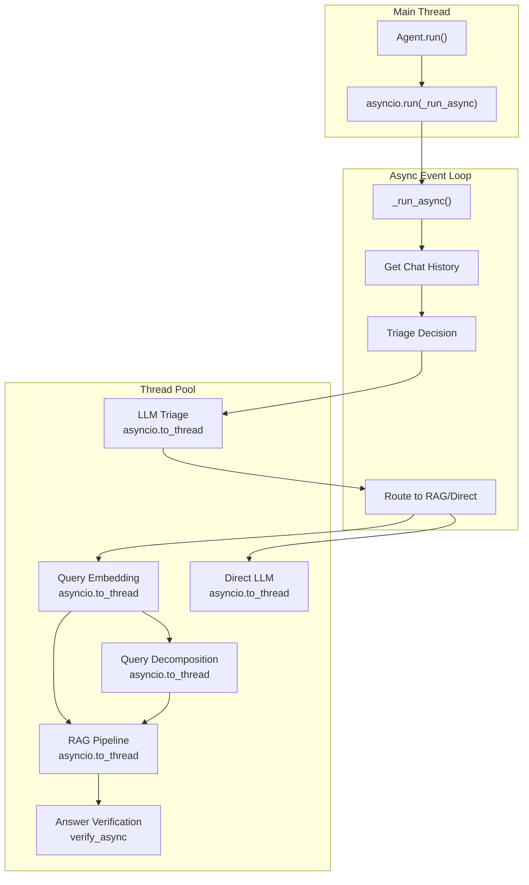

<!-- source: DeepWiki mcp.deepwiki.com · repo PromtEngineer/localGPT · page 6.4 Smart Routing & Verification · fetched 2026-10-26 -->

# Smart Routing & Verification

Relevant source files

The following files were used as context for generating this wiki page:

- [README.md](README.md)
- [backend/simple_pdf_processor.py](backend/simple_pdf_processor.py)
- [backend/test_backend.py](backend/test_backend.py)
- [rag_system/agent/verifier.py](rag_system/agent/verifier.py)

This document covers LocalGPT's intelligent query routing and answer verification systems. These components automatically determine when to use RAG retrieval versus direct LLM responses, and provide quality assurance through independent verification. For information about the retrieval pipeline itself, see [Hybrid Search & Retrieval](#6.3). For session-level chat management, see [Session Management](#6.1).

## Overview

LocalGPT implements a multi-layered decision-making system that optimizes response quality and speed through:

- **Smart Routing**: Automatic triage between RAG and direct LLM modes based on query analysis
- **Answer Verification**: Independent grounding verification using the `Verifier` class
- **Query Decomposition**: Complex query breakdown for enhanced retrieval accuracy
- **Semantic Caching**: TTL-based response caching with similarity matching

## Smart Routing System

### Triage Decision Flow

The smart routing system performs query analysis to determine the optimal response strategy. The triage process evaluates document relevance and query complexity to route between RAG and direct LLM modes.

Sources: [README.md:776-826]()

### Implementation Architecture

The routing system integrates multiple components through asynchronous processing:

| Component | Purpose | Implementation |
|-----------|---------|----------------|
| Triage Prompt Builder | Constructs context for routing decision | Document overviews + query analysis |
| LLM Triage | Makes RAG vs Direct decision | Ollama model via `asyncio.to_thread` |
| Semantic Cache | Stores and retrieves similar responses | TTL-based with similarity matching |
| Query Decomposer | Breaks complex queries into sub-queries | Optional parallel processing |

The system uses document overviews during triage to determine whether the available documents contain relevant information for the query. This prevents unnecessary RAG processing for queries that would be better served by direct LLM responses.

Sources: [README.md:31-32](), [README.md:60-61]()

## Answer Verification System

### VerificationResult Class

The verification system uses structured result objects to track grounding quality:

Sources: [rag_system/agent/verifier.py:4-10](), [rag_system/agent/verifier.py:11-18]()

### Verification Process

The `Verifier` class implements asynchronous fact-checking through structured prompting:

**Verification Verdicts:**
- `SUPPORTED`: Answer fully grounded in context
- `NOT_SUPPORTED`: Answer contains unsupported claims  
- `NEEDS_CLARIFICATION`: Answer partially supported but incomplete

The verification prompt includes multiple examples and requests JSON-formatted responses with reasoning and confidence scores. The system clamps context to 4000 characters to prevent oversized prompts.

Sources: [rag_system/agent/verifier.py:23-96]()

### Verification Prompt Structure

The verification system uses few-shot prompting with structured examples:

| Example Type | Context | Answer Assessment | Verdict |
|--------------|---------|------------------|---------|
| Fully Supported | "Sky appears blue due to Rayleigh scattering" | "Sky is blue during the day" | `SUPPORTED` |
| Partially Supported | "Apples grown in orchards" | "Apples in orchards, oranges in groves" | `NOT_SUPPORTED` |
| Incomplete | "Step 1: 3 days, Step 2: 5 days" | "Process takes 3 days" | `NEEDS_CLARIFICATION` |

The prompt format includes XML-style tags for clear structure and requests specific JSON fields: `verdict`, `is_grounded`, `reasoning`, and `confidence_score`.

Sources: [rag_system/agent/verifier.py:25-85]()

## Query Decomposition Integration

### Decomposition Decision Logic

Query decomposition enhances routing by breaking complex queries into manageable sub-queries when RAG mode is selected:

Sources: [README.md:61-62](), [README.md:434-435]()

### Configuration Parameters

The decomposition system uses configurable limits to prevent excessive sub-query generation:

| Parameter | Default Value | Purpose |
|-----------|---------------|---------|
| `enabled` | `true` | Enable/disable query decomposition |
| `max_sub_queries` | `3` | Maximum number of sub-queries to generate |

These parameters are part of the pipeline configuration system and can be adjusted per index or session.

Sources: [README.md:434-435]()

## System Integration

### Async Processing Architecture

The routing and verification systems integrate through asynchronous processing patterns:

Sources: [README.md:776-826]()

### Cache Integration

The semantic cache system optimizes performance by storing verification results with TTL-based expiration:

| Cache Operation | Implementation | Purpose |
|-----------------|----------------|---------|
| Cache Check | Similarity matching against query embeddings | Avoid redundant processing |
| Cache Store | Store final verified results with TTL | Reuse high-quality responses |
| Cache Invalidation | TTL-based automatic expiration | Maintain result freshness |

The cache operates at the embedding level, allowing similar queries to reuse previously verified results even with slight variations in wording.

Sources: [README.md:62-63]()

---

