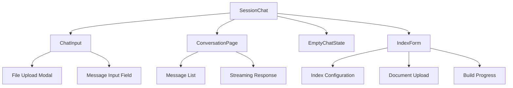
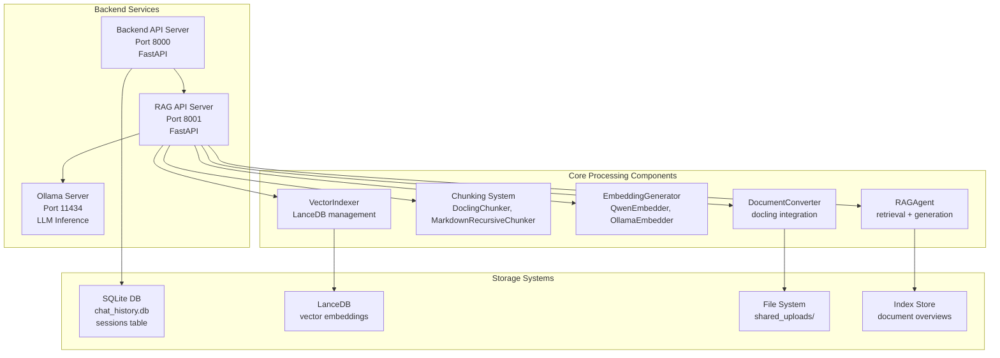
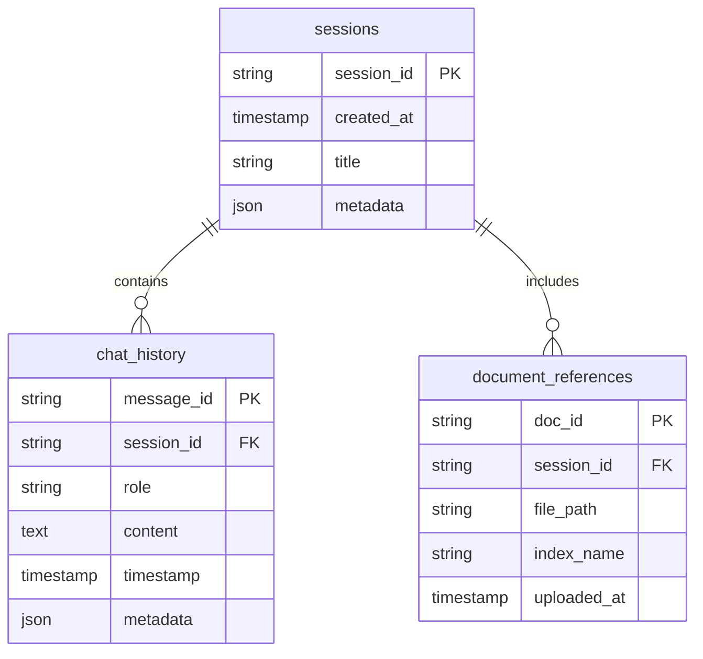
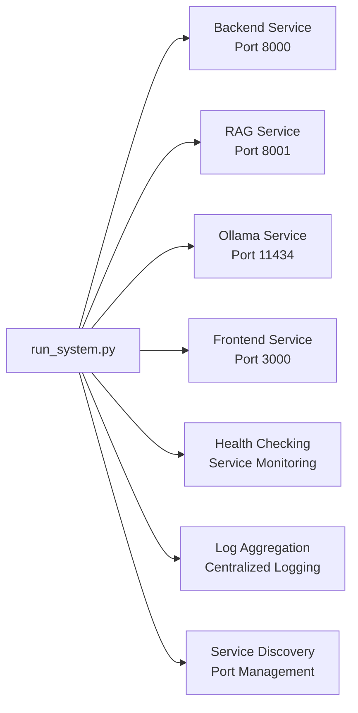
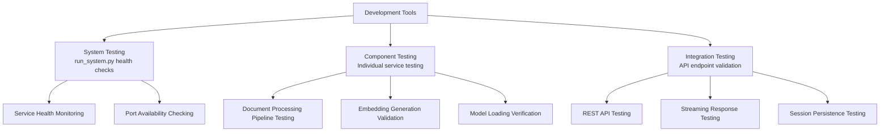
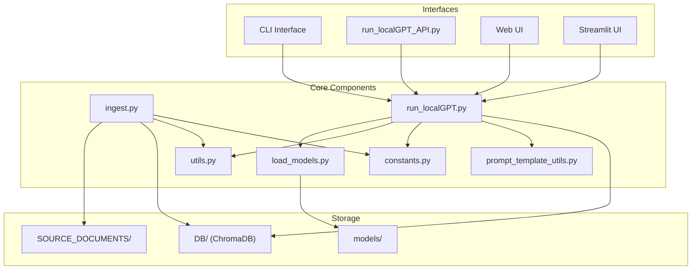
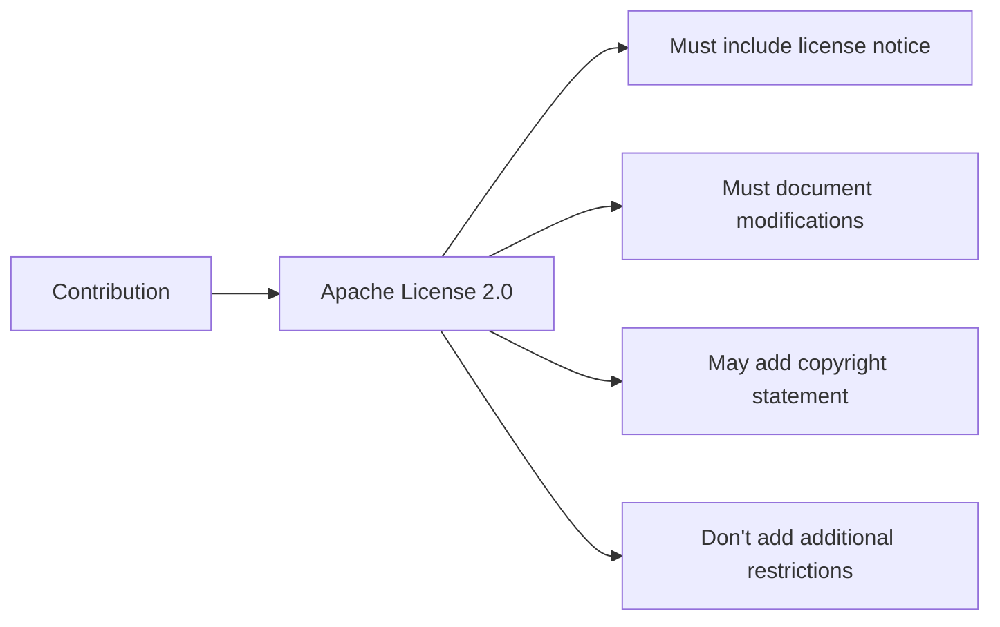

<!-- source: DeepWiki mcp.deepwiki.com · repo PromtEngineer/localGPT · page 7 Development · fetched 2026-10-26 -->

# Development

Relevant source files

The following files were used as context for generating this wiki page:

- [requirements.txt](requirements.txt)

This document provides technical information for developers who want to understand or extend LocalGPT's architecture. It covers the frontend and backend service architectures, development tools, and key code entities that developers need to know when working with the codebase.

LocalGPT follows a modern multi-service architecture with clear separation between frontend, backend API gateway, RAG processing service, and AI inference components. Understanding these architectural boundaries is essential for effective development.

## 7.1 Frontend Architecture

The frontend is built with Next.js and React, providing a modern web interface for document chat and index management. The component hierarchy centers around session-based conversations with document context.

### Core Frontend Components

**SessionChat Component Architecture**

The `SessionChat` component serves as the main container, managing chat state and routing between different UI modes. `ChatInput` handles user interactions including file uploads and message sending. `ConversationPage` displays the conversation history with streaming response support.

### Frontend Service Integration

The frontend communicates with backend services through REST APIs and WebSocket connections for real-time updates:

| Component | Backend Integration | Purpose |
|-----------|-------------------|---------|
| `SessionChat` | Session API (port 8000) | Session persistence, chat history |
| `ChatInput` | Chat API + Streaming | Message sending, real-time responses |  
| `IndexForm` | Index API (port 8001) | Document processing, index creation |
| File Upload | Upload API | Document attachment to sessions |

### State Management Patterns

The frontend uses React hooks and context for state management:
- Session state managed through React context
- Chat messages stored in component state with persistence
- File upload progress tracked with local state
- Index building status polled from backend APIs

Sources: Based on system architecture diagrams showing Next.js frontend components and API integration patterns.

## 7.2 Backend Architecture

LocalGPT's backend consists of multiple Python services that handle different responsibilities. The architecture separates concerns between API gateway functions, RAG processing, and AI model inference.

### Service Architecture Overview

**Backend Service Topology**

### Core Backend Classes and Responsibilities

| Service Component | Key Classes | Responsibilities |
|------------------|-------------|------------------|
| Backend API Server | `SessionManager`, `ChatHandler` | Session persistence, request routing, file upload |
| RAG API Server | `RAGAgent`, `DocumentProcessor`, `IndexBuilder` | Document processing, retrieval, answer generation |
| Document Processing | `DocumentConverter`, `DoclingChunker` | File conversion, text chunking |
| Embedding System | `QwenEmbedder`, `OllamaEmbedder`, `EmbeddingGenerator` | Text embedding generation |
| Vector Storage | `VectorIndexer`, `LanceDBManager` | Vector database operations |

### Database Schema and Storage

**SQLite Schema Structure**

The SQLite database stores chat sessions and history, while LanceDB handles vector embeddings for document retrieval. File uploads are stored in the `shared_uploads/` directory with references tracked in the database.

### API Endpoint Structure

The backend exposes RESTful APIs for frontend integration:

**Backend API Server (Port 8000)**
- `/api/sessions` - Session management CRUD operations
- `/api/chat` - Chat message handling with streaming support  
- `/api/upload` - File upload for session-linked documents
- `/api/health` - Service health checking

**RAG API Server (Port 8001)**  
- `/api/index` - Index creation and management
- `/api/query` - Document query and retrieval
- `/api/build` - Index building operations with progress tracking

Sources: Based on multi-service architecture diagrams and backend service descriptions.

## 7.3 Testing & Development Tools

LocalGPT provides several tools and utilities for development, testing, and debugging. The system uses `run_system.py` as the primary orchestration tool for managing development environments.

### Development Environment Setup

**System Orchestration with run_system.py**

The `run_system.py` script serves as the development orchestrator, handling service startup, health monitoring, and coordinated shutdown. It manages port allocation and service dependencies automatically.

### Development Dependencies and Tools

The project uses several categories of dependencies for development and operation:

| Category | Key Dependencies | Purpose |
|----------|-----------------|---------|
| ML/AI Core | `transformers==4.51.0`, `torch==2.4.1`, `sentence_transformers` | Model inference, embeddings |
| Document Processing | `docling`, `PyPDF2`, `PyMuPDF`, `Pillow` | File conversion, text extraction |
| Vector/Search | `lancedb`, `rank_bm25`, `fuzzywuzzy` | Vector storage, hybrid search |
| Web/API | `httpx`, `requests`, `python-dotenv` | HTTP clients, environment config |
| Data Processing | `pandas`, `scikit-learn`, `numpy`, `nltk` | Data manipulation, NLP utilities |

### Testing and Debugging Utilities

**Development Testing Strategy**

### Development Environment Configuration

The system supports both Docker-based and manual development setups:

**Docker Development Setup**
- `docker-compose.yml` orchestrates all services with volume mounts for live development
- Shared volumes for `lancedb/`, `index_store/`, and `shared_uploads/` enable data persistence
- Environment variable configuration through `.env` files

**Manual Development Setup**  
- `run_system.py` manages service startup and dependency coordination
- Individual service testing through direct Python execution
- Environment configuration through `python-dotenv` integration

### Performance Monitoring and Debugging

Key monitoring capabilities include:
- Service health endpoints for each component
- Resource usage monitoring through `psutil` integration  
- Request/response logging for API debugging
- Vector database performance metrics through LanceDB tooling

The development environment provides comprehensive logging aggregation and health checking to facilitate debugging of the distributed service architecture.

Sources: [requirements.txt:1-33]()

## Architecture for Contributors

To effectively contribute to localGPT, understanding the system architecture is essential. The following diagram illustrates the key components and their relationships:

Sources: [.gitignore:1-169]()

### Key Extension Points

When adding new features, consider these primary extension points:

1. **Adding Model Support**
   - Extend the model loading system in `load_models.py`
   - Update constants in `constants.py` if adding configuration options

2. **Enhancing Document Processing**
   - Extend the ingestion pipeline in `ingest.py`
   - Add support for new document types in `utils.py`

3. **Improving Question Answering**
   - Enhance the prompt templates in `prompt_template_utils.py`
   - Optimize retrieval mechanisms in `run_localGPT.py`

4. **Adding New Interfaces**
   - Reference `run_localGPT_API.py` for API-based interfaces
   - Use the core QA functionality from `run_localGPT.py`

## Testing Guidelines

While the project doesn't currently have an extensive test suite, contributors are encouraged to:

1. Manually test changes across different scenarios
2. Test with various document types when modifying the ingestion pipeline
3. Test with different models when changing model-related code
4. Consider adding automated tests for new functionality

## License and Legal Considerations

LocalGPT is licensed under the Apache License 2.0. All contributions must comply with this license.

Key points to remember:

- Include appropriate copyright notices in new files
- Do not incorporate code with incompatible licenses
- Document third-party dependencies appropriately

Sources: [LICENSE:1-202]()

## Getting Help

If you have questions about contributing to localGPT:

1. Review existing issues and pull requests for similar questions
2. Open a new issue to ask for guidance
3. Reach out to the project maintainers

Remember that the localGPT community values:

- Clear communication
- Quality code
- Good documentation
- Respect for other contributors

By following these guidelines, you can help make localGPT better for everyone.

---

