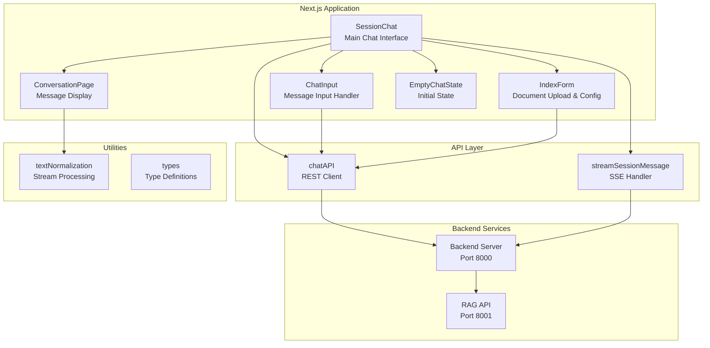
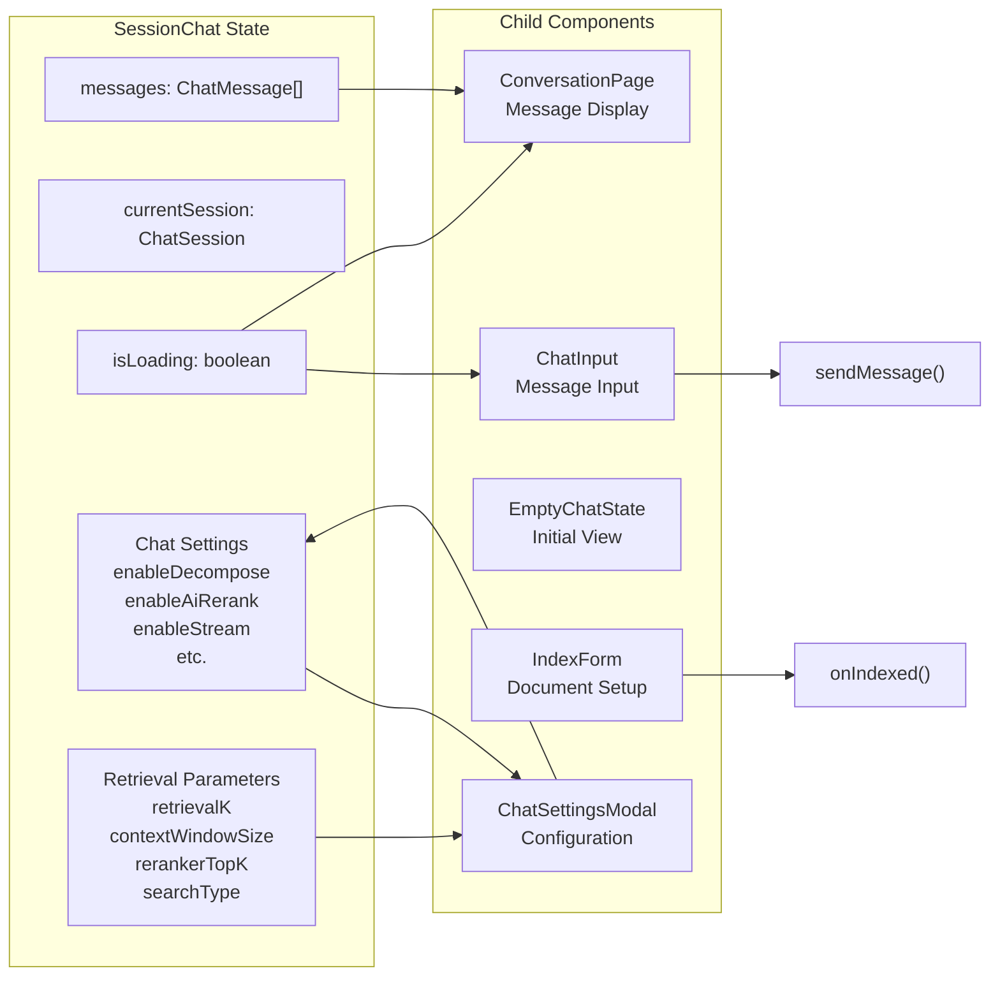
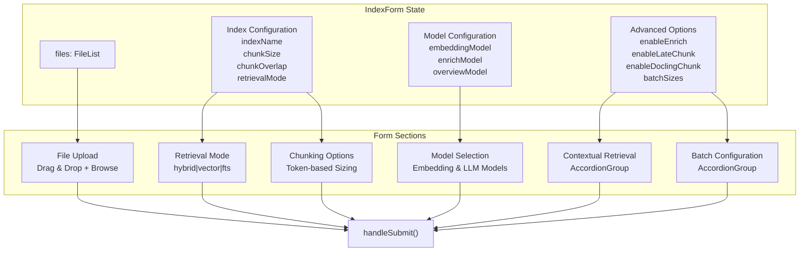
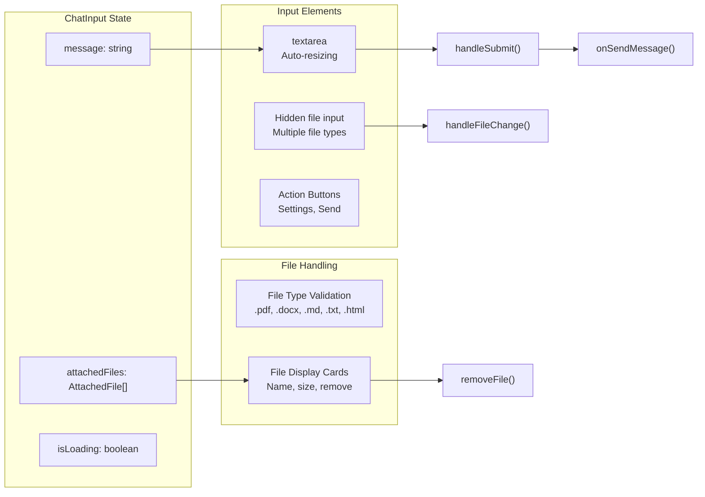
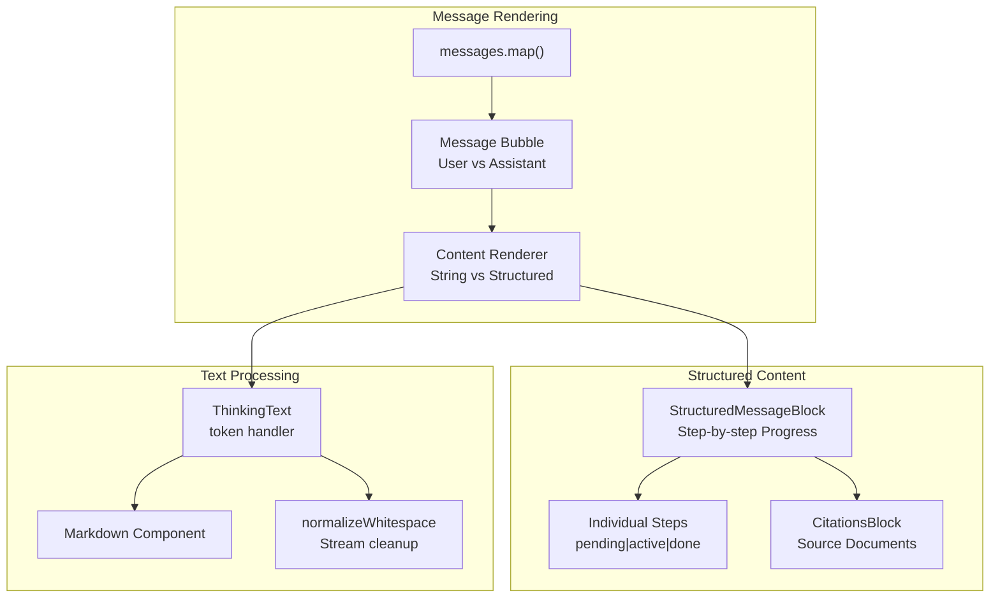
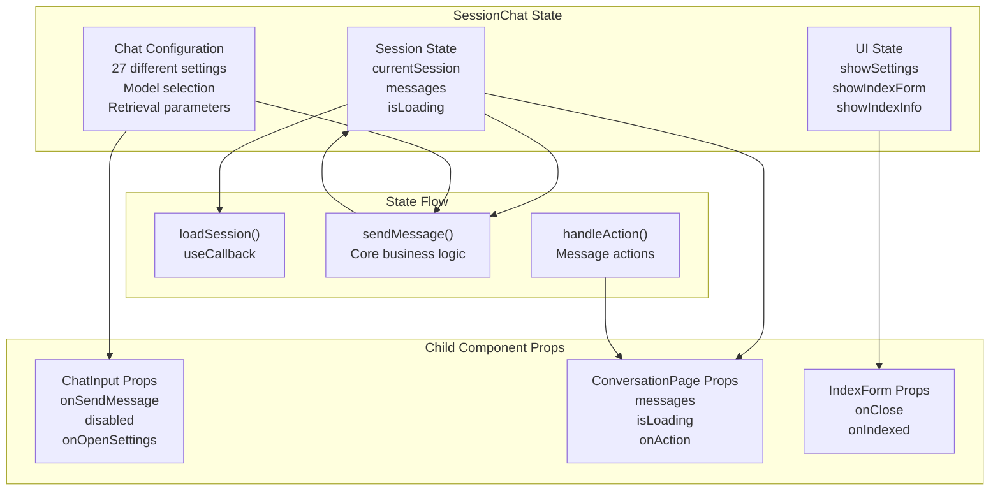
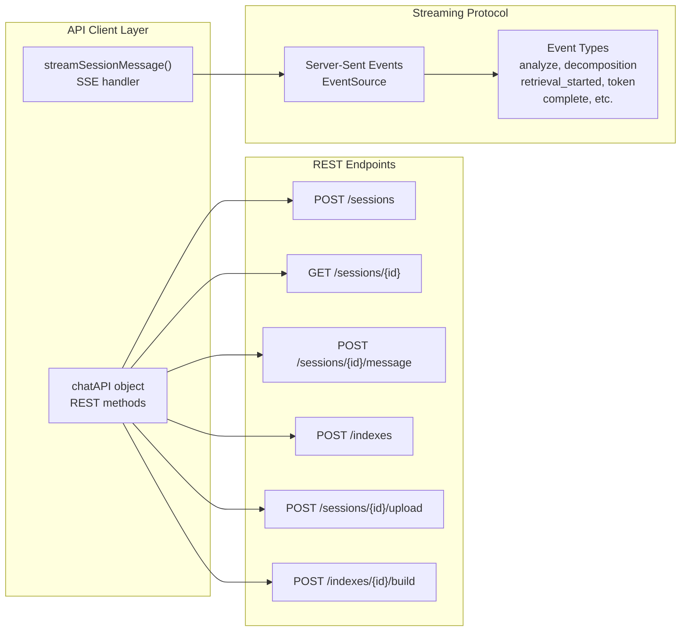
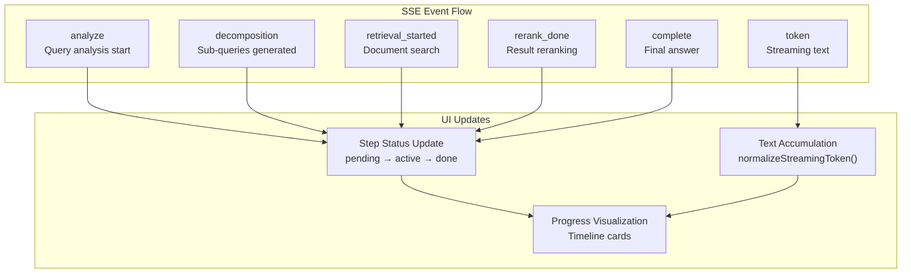
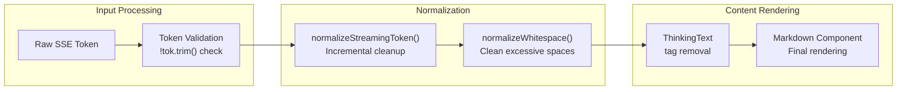

<!-- source: DeepWiki mcp.deepwiki.com · repo PromtEngineer/localGPT · page 7.1 Frontend Architecture · fetched 2026-10-26 -->

# Frontend Architecture

Relevant source files

The following files were used as context for generating this wiki page:

- [run_system.py](run_system.py)
- [src/components/IndexForm.tsx](src/components/IndexForm.tsx)
- [src/components/ui/chat-input.tsx](src/components/ui/chat-input.tsx)
- [src/components/ui/conversation-page.tsx](src/components/ui/conversation-page.tsx)
- [src/components/ui/session-chat.tsx](src/components/ui/session-chat.tsx)
- [src/utils/textNormalization.ts](src/utils/textNormalization.ts)
- [test_markdown_streaming.js](test_markdown_streaming.js)

This document covers the React/Next.js frontend architecture of LocalGPT, including component structure, state management, and communication patterns with the backend services. 

For backend API implementation details, see [Backend Architecture](#7.2). For system configuration and deployment, see [System Configuration](#4.1).

## Architecture Overview

The frontend is built as a Next.js application with TypeScript, using a component-based architecture centered around chat sessions and document indexing. The system maintains real-time communication with backend services through both REST APIs and Server-Sent Events (SSE) for streaming responses.

**Sources:** [src/components/ui/session-chat.tsx:1-683](), [src/components/IndexForm.tsx:1-223](), [src/components/ui/chat-input.tsx:1-214](), [src/lib/api.ts]()

## Core Components

### SessionChat Component

The `SessionChat` component serves as the main orchestrator for chat functionality, managing session state, message flow, and component coordination.

Key responsibilities include:
- **Message Management**: Maintains `messages` array and handles message lifecycle [src/components/ui/session-chat.tsx:40-41]()
- **Session Lifecycle**: Creates, loads, and manages `ChatSession` objects [src/components/ui/session-chat.tsx:72-100]()
- **Streaming Coordination**: Processes SSE events and updates UI progressively [src/components/ui/session-chat.tsx:211-454]()
- **Configuration Management**: Manages chat settings and retrieval parameters [src/components/ui/session-chat.tsx:46-64]()

**Sources:** [src/components/ui/session-chat.tsx:34-681](), [src/lib/api.ts]()

### IndexForm Component

Provides the interface for document upload and index configuration with comprehensive options for chunking, embedding, and retrieval strategies.

The form handles a four-step indexing process:
1. **Index Creation**: Creates index record via `chatAPI.createIndex()` [src/components/IndexForm.tsx:38]()
2. **File Upload**: Uploads files via `chatAPI.uploadFilesToIndex()` [src/components/IndexForm.tsx:41]()
3. **Index Building**: Configures and builds index via `chatAPI.buildIndex()` [src/components/IndexForm.tsx:44-57]()
4. **Session Linking**: Creates session and links index via `chatAPI.linkIndexToSession()` [src/components/IndexForm.tsx:60-61]()

**Sources:** [src/components/IndexForm.tsx:15-222]()

### ChatInput Component

Handles message composition, file attachment, and action controls with support for multi-modal input.

Key features:
- **Auto-resizing Textarea**: Dynamically adjusts height up to 120px [src/components/ui/chat-input.tsx:66-72]()
- **File Type Validation**: Supports PDF, DOCX, HTML, Markdown, and text files [src/components/ui/chat-input.tsx:92-104]()
- **Drag and Drop**: Handles file attachments through drag-and-drop interface [src/components/ui/chat-input.tsx:98]()

**Sources:** [src/components/ui/chat-input.tsx:19-213]()

### ConversationPage Component

Renders chat messages with support for structured content, streaming updates, and citation management.

The component handles two types of message content:
- **String Content**: Plain text messages rendered with `ThinkingText` and `Markdown` [src/components/ui/conversation-page.tsx:330-332]()
- **Structured Content**: Step-by-step progress with `StructuredMessageBlock` [src/components/ui/conversation-page.tsx:120-198]()

**Sources:** [src/components/ui/conversation-page.tsx:200-416](), [src/utils/textNormalization.ts:1-64]()

## State Management Pattern

LocalGPT uses React hooks for state management with a lift-state-up pattern centered around the `SessionChat` component.

Key state management patterns:
- **Centralized Session State**: All chat-related state managed in `SessionChat` [src/components/ui/session-chat.tsx:40-69]()
- **Imperative Handle**: Exposes `sendMessage` function to parent components via `useImperativeHandle` [src/components/ui/session-chat.tsx:530-533]()
- **Callback Dependencies**: Uses `useCallback` for `loadSession` to prevent infinite re-renders [src/components/ui/session-chat.tsx:72-100]()

**Sources:** [src/components/ui/session-chat.tsx:72-100](), [src/components/ui/session-chat.tsx:530-533]()

## API Communication

The frontend communicates with backend services through a dedicated API client with support for both REST calls and streaming responses.

### REST API Pattern

Standard CRUD operations follow a consistent pattern:
- **Session Management**: Create, retrieve, and list chat sessions [src/components/ui/session-chat.tsx:147-153]()
- **File Operations**: Upload files and trigger indexing [src/components/ui/session-chat.tsx:163-178]()
- **Index Management**: Create and build document indexes [src/components/IndexForm.tsx:38-57]()

### Streaming Communication

Real-time updates use Server-Sent Events with structured event types:

The streaming handler processes events through a large switch statement that updates message content progressively [src/components/ui/session-chat.tsx:256-452]().

**Sources:** [src/components/ui/session-chat.tsx:211-454](), [src/lib/api.ts]()

## Text Processing Pipeline

The frontend includes sophisticated text processing to handle streaming content and markdown formatting.

Key processing functions:
- **`normalizeWhitespace()`**: Removes excessive newlines and spaces [src/utils/textNormalization.ts:6-24]()
- **`normalizeStreamingToken()`**: Applies normalization during streaming [src/utils/textNormalization.ts:30-40]()
- **`ThinkingText`**: Extracts and collapsifies `<think>` tokens [src/components/ui/conversation-page.tsx:93-118]()

The system prevents visual artifacts during streaming by normalizing text progressively rather than only at completion.

**Sources:** [src/utils/textNormalization.ts:1-64](), [src/components/ui/conversation-page.tsx:93-118](), [src/components/ui/session-chat.tsx:367-385]()

---

