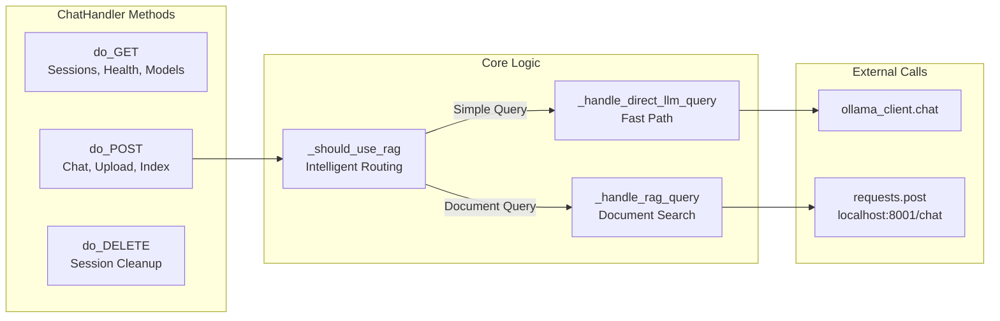
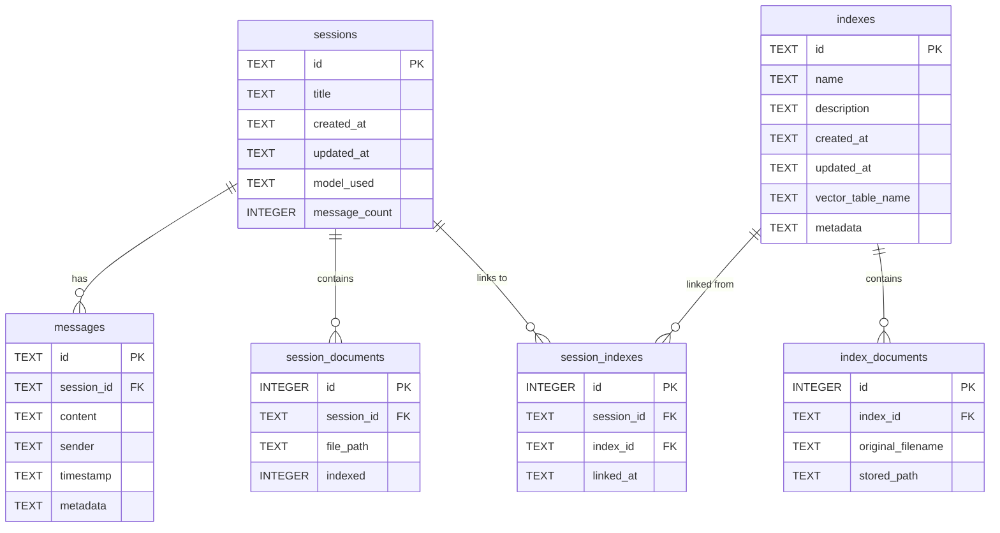
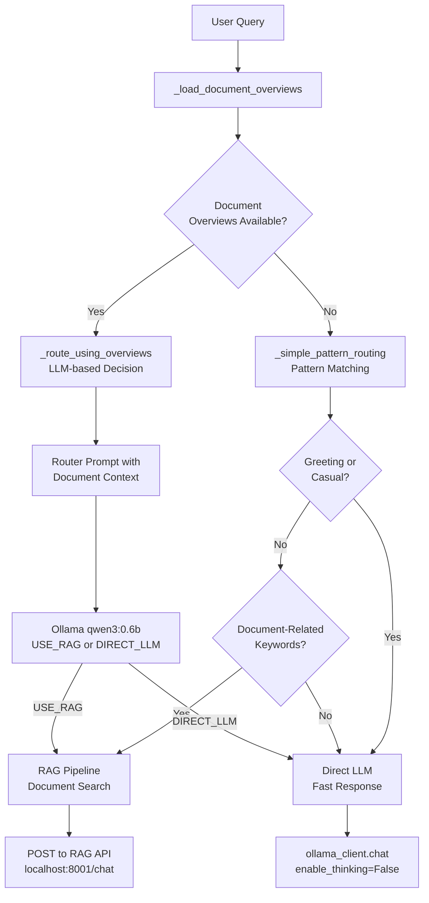
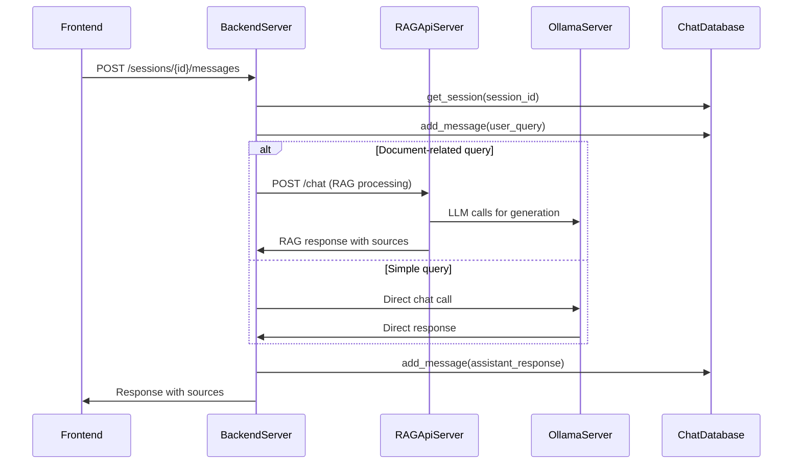
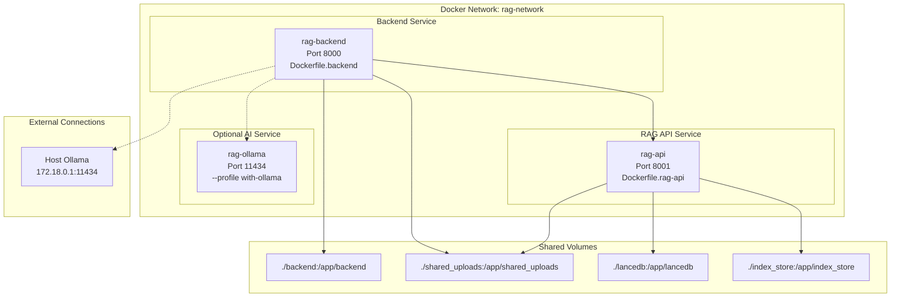

<!-- source: DeepWiki mcp.deepwiki.com · repo PromtEngineer/localGPT · page 7.2 Backend Architecture · fetched 2026-10-26 -->

# Backend Architecture

<details>
<summary>Relevant source files</summary>

The following files were used as context for generating this wiki page:

- [Dockerfile.backend](Dockerfile.backend)
- [backend/database.py](backend/database.py)
- [backend/ollama_client.py](backend/ollama_client.py)
- [backend/server.py](backend/server.py)
- [backend/simple_pdf_processor.py](backend/simple_pdf_processor.py)
- [backend/test_backend.py](backend/test_backend.py)
- [backend/test_ollama_connectivity.py](backend/test_ollama_connectivity.py)
- [docker-compose.yml](docker-compose.yml)
- [docker.env](docker.env)
- [rag_system/agent/verifier.py](rag_system/agent/verifier.py)
- [rag_system/api_server.py](rag_system/api_server.py)

</details>


This page describes the Python backend services that power LocalGPT's document processing, chat management, and LLM integration. The backend consists of multiple cooperating services that handle API routing, database management, and RAG pipeline orchestration.

For frontend component architecture, see [Frontend Architecture](#7.1). For system deployment and configuration, see [System Configuration](#4.1).

## Service Architecture Overview

LocalGPT's backend uses a multi-service architecture with clear separation of concerns:

```mermaid
graph TB
    subgraph "Backend Services (Python)"
        BackendAPI[BackendServer<br/>backend/server.py<br/>Port 8000]
        RAGAPI[RAGApiServer<br/>rag_system/api_server.py<br/>Port 8001]
        Database[(ChatDatabase<br/>backend/database.py<br/>SQLite)]
    end
    
    subgraph "External Services"
        Ollama[OllamaServer<br/>Port 11434<br/>LLM Inference]
        Frontend[Frontend<br/>Port 3000<br/>Next.js]
    end
    
    subgraph "Storage Systems"
        SQLiteDB[(chat_data.db<br/>Sessions & Messages)]
        LanceDB[(lancedb/<br/>Vector Storage)]
        FileSystem[shared_uploads/<br/>Document Files)]
    end
    
    Frontend --> BackendAPI
    BackendAPI --> RAGAPI
    BackendAPI --> Database
    BackendAPI --> Ollama
    RAGAPI --> Ollama
    RAGAPI --> LanceDB
    Database --> SQLiteDB
    BackendAPI --> FileSystem
    RAGAPI --> FileSystem
```

**Backend Service Architecture**

The backend implements a layered service architecture where the main backend server (`BackendServer`) acts as an API gateway, routing requests to specialized services like the RAG API server for document processing and maintaining its own database connections for session management.

Sources: [backend/server.py:1-50](), [rag_system/api_server.py:1-50](), [docker-compose.yml:48-74]()

## Core Backend Services

### Main Backend Server (ChatHandler)

The primary backend service runs on port 8000 and implements a custom HTTP server using Python's `http.server` module:

| Component | Responsibility | Key Classes |
|-----------|---------------|-------------|
| Request Handler | HTTP routing and CORS | `ChatHandler` |
| Session Management | Chat session lifecycle | Database methods |
| File Upload | Document processing coordination | Multipart form handling |
| Smart Routing | RAG vs Direct LLM decisions | `_should_use_rag()` |



**Backend Request Processing Flow**

The `ChatHandler` class implements intelligent query routing using document overviews and pattern matching to decide between fast direct LLM responses and comprehensive RAG processing.

Sources: [backend/server.py:36-120](), [backend/server.py:272-341](), [backend/server.py:342-552]()

### RAG API Server (AdvancedRagApiHandler)

The specialized RAG service runs on port 8001 and handles all document processing and retrieval operations:

| Feature | Implementation | Configuration |
|---------|----------------|---------------|
| Document Indexing | `handle_index()` | Chunking, embedding models |
| Chat Processing | `handle_chat()` | Retrieval parameters, reranking |
| Streaming Responses | `handle_chat_stream()` | Server-Sent Events (SSE) |
| Model Management | `handle_models()` | Ollama model listing |

```mermaid
graph TB
    subgraph "RAG API Endpoints"
        ChatEndpoint[/chat<br/>handle_chat]
        StreamEndpoint[/chat/stream<br/>handle_chat_stream]
        IndexEndpoint[/index<br/>handle_index]
        ModelsEndpoint[/models<br/>handle_models]
    end
    
    subgraph "RAG Components"
        RAGAgent[RAG_AGENT<br/>Singleton Instance]
        IndexingPipeline[INDEXING_PIPELINE<br/>Document Processing]
        EmbeddingConfig[_apply_index_embedding_model<br/>Model Switching]
    end
    
    subgraph "Processing Modes"
        ForceRAG[force_rag=true<br/>Direct Retrieval]
        SmartAgent[Agent.run<br/>Full Pipeline]
    end
    
    ChatEndpoint --> RAGAgent
    StreamEndpoint --> RAGAgent
    IndexEndpoint --> IndexingPipeline
    RAGAgent --> ForceRAG
    RAGAgent --> SmartAgent
    RAGAgent --> EmbeddingConfig
```

**RAG API Service Architecture**

The RAG API maintains singleton instances of the RAG agent and indexing pipeline to avoid reloading models on each request, with dynamic configuration switching based on session-linked indexes.

Sources: [rag_system/api_server.py:23-37](), [rag_system/api_server.py:145-302](), [rag_system/api_server.py:501-677]()

## Database Schema and Storage

### SQLite Database Schema

The `ChatDatabase` class manages a comprehensive SQLite schema supporting sessions, messages, documents, and indexes:



**Database Schema Relationships**

The schema supports complex relationships between chat sessions, document uploads, and searchable indexes, enabling session-specific document contexts and index management.

Sources: [backend/database.py:20-106](), [backend/database.py:328-391]()

### Database Operations

Key database operations are implemented as methods on the `ChatDatabase` class:

| Operation Category | Methods | Purpose |
|-------------------|---------|---------|
| Session Management | `create_session()`, `get_sessions()`, `delete_session()` | Chat lifecycle |
| Message Storage | `add_message()`, `get_messages()`, `get_conversation_history()` | Chat persistence |
| Document Tracking | `add_document_to_session()`, `get_documents_for_session()` | File associations |
| Index Management | `create_index()`, `list_indexes()`, `link_index_to_session()` | Search index lifecycle |
| Metadata Inspection | `inspect_and_populate_index_metadata()` | Legacy index analysis |

The database automatically handles environment detection for Docker vs local development:

```python
# Auto-detect environment and set appropriate path
if os.path.exists("/app"):  # Docker environment
    self.db_path = "/app/backend/chat_data.db"
else:  # Local development environment
    self.db_path = "backend/chat_data.db"
```

Sources: [backend/database.py:8-18](), [backend/database.py:108-270](), [backend/database.py:328-442]()

## API Layer and Routing

### REST API Endpoints

The backend exposes a comprehensive REST API with clear endpoint patterns:

| Endpoint Pattern | HTTP Method | Handler Method | Purpose |
|------------------|-------------|----------------|---------|
| `/health` | GET | N/A | System health check |
| `/sessions` | GET, POST | `handle_get_sessions()`, `handle_create_session()` | Session management |
| `/sessions/{id}` | GET, DELETE | `handle_get_session()`, `handle_delete_session()` | Session operations |
| `/sessions/{id}/messages` | POST | `handle_session_chat()` | Chat within session |
| `/sessions/{id}/upload` | POST | `handle_file_upload()` | Document upload |
| `/sessions/{id}/indexes` | GET | `handle_get_session_indexes()` | Index associations |
| `/indexes` | GET, POST | `handle_get_indexes()`, `handle_create_index()` | Index management |
| `/indexes/{id}` | GET, DELETE | `handle_get_index()`, `handle_delete_index()` | Index operations |

### Smart Query Routing Logic

The backend implements intelligent routing between direct LLM responses and RAG processing:



**Intelligent Query Routing System**

The routing system uses document overviews to make LLM-powered decisions about whether queries require document search, falling back to pattern matching when overviews are unavailable.

Sources: [backend/server.py:342-552](), [backend/server.py:440-505]()

## Service Integration and Communication

### Inter-Service Communication

Services communicate via HTTP APIs with specific integration patterns:



**Service Communication Flow**

The backend server acts as an orchestrator, managing database state while delegating specialized processing to the RAG API server for document-related queries.

### Ollama Client Integration

The `OllamaClient` class provides a unified interface to the Ollama LLM server:

| Method | Purpose | Configuration |
|--------|---------|---------------|
| `is_ollama_running()` | Health checking | Timeout handling |
| `list_models()` | Model discovery | Error resilience |
| `chat()` | Synchronous inference | Thinking token control |
| `chat_stream()` | Streaming responses | SSE event generation |

The client automatically detects the Ollama host via environment variables and handles both containerized and host-based deployments.

Sources: [backend/ollama_client.py:6-56](), [backend/ollama_client.py:57-167](), [backend/server.py:554-580]()

## Deployment Architecture

### Docker Multi-Service Setup

The backend services are orchestrated via Docker Compose with specific service definitions:



**Docker Service Architecture**

The deployment supports flexible Ollama integration, allowing either containerized or host-based LLM inference with shared volume mounts for data persistence and service communication.

### Environment Configuration

Backend services use environment variables for deployment flexibility:

| Service | Key Variables | Purpose |
|---------|---------------|---------|
| Backend | `OLLAMA_HOST`, `RAG_API_URL` | Service discovery |
| RAG API | `LANCEDB_PATH`, `RAG_CONFIG_MODE` | Storage and configuration |
| Both | `NODE_ENV` | Development vs production |

The services automatically detect Docker vs local environments and adjust file paths accordingly.

Sources: [docker-compose.yml:48-74](), [backend/database.py:8-18](), [docker.env:1-12]()

---

