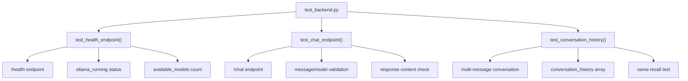
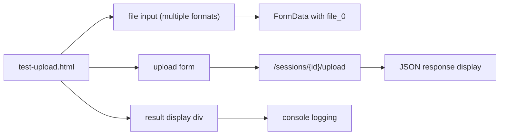
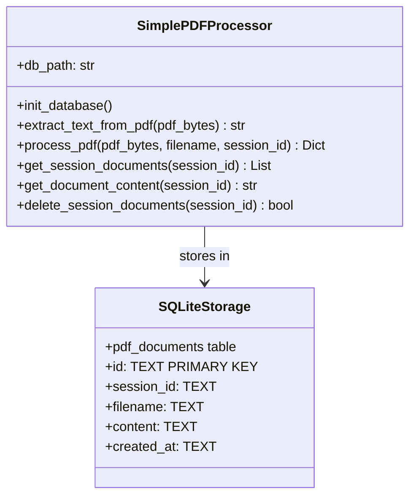
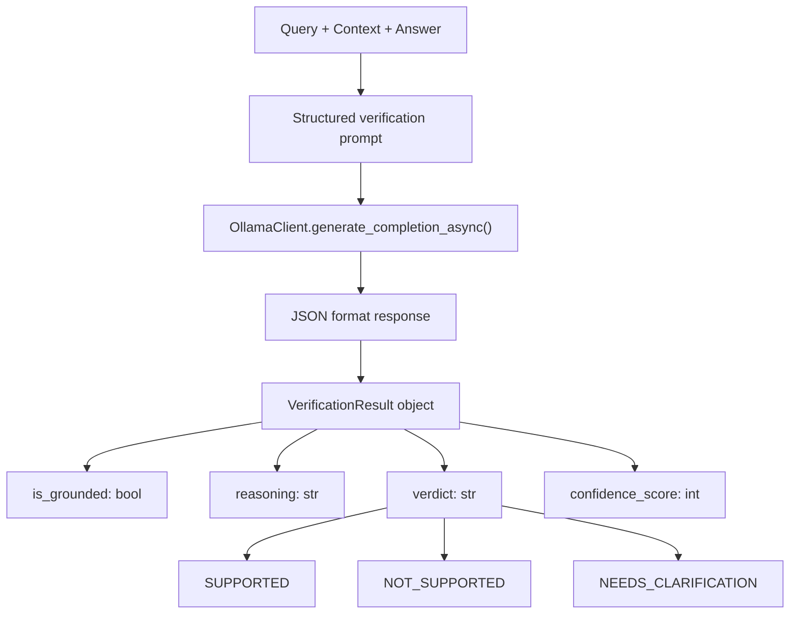
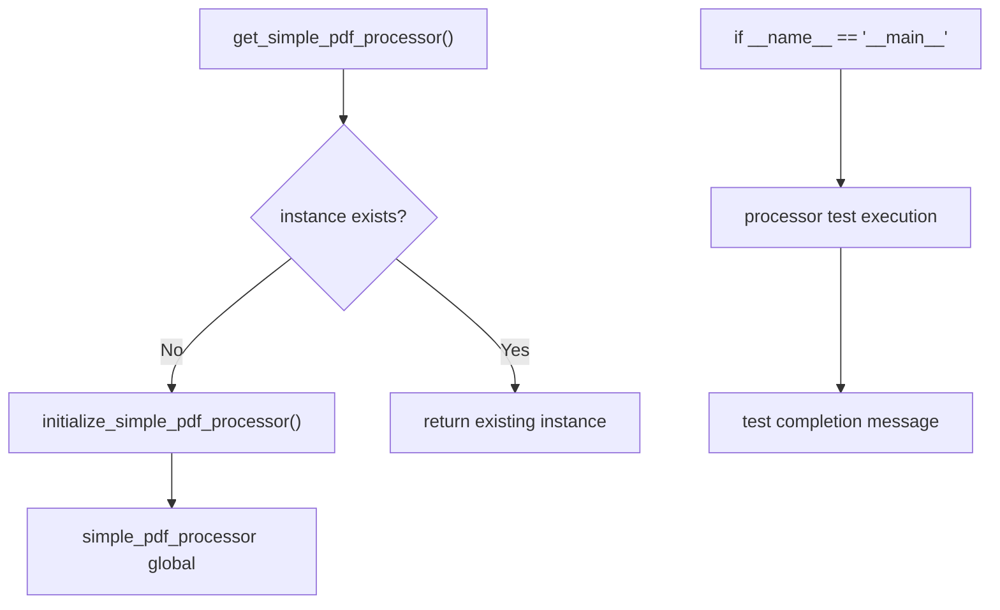

<!-- source: DeepWiki mcp.deepwiki.com · repo PromtEngineer/localGPT · page 7.3 Testing & Development Tools · fetched 2026-10-26 -->

# Testing & Development Tools

Relevant source files

The following files were used as context for generating this wiki page:

- [backend/simple_pdf_processor.py](backend/simple_pdf_processor.py)
- [backend/test_backend.py](backend/test_backend.py)
- [rag_system/agent/verifier.py](rag_system/agent/verifier.py)
- [src/test-upload.html](src/test-upload.html)

This document covers the testing utilities, development tools, and debugging resources available for LocalGPT development and maintenance. It includes automated testing scripts, manual testing interfaces, verification tools, and development utilities that help developers test, debug, and extend the system.

For information about the overall development architecture, see [Frontend Architecture](#7.1) and [Backend Architecture](#7.2). For system deployment and configuration, see [Installation & Setup](#2).

## Backend Testing Infrastructure

LocalGPT provides comprehensive backend testing through the `test_backend.py` script, which validates core system functionality including health checks, chat endpoints, and conversation management.

### Test Backend Script

The primary testing tool is `test_backend.py`, which provides automated validation of backend services:

**Testing Functions**:

| Function | Purpose | Validates |
|----------|---------|-----------|
| `test_health_endpoint()` | System health validation | Ollama connection, model availability |
| `test_chat_endpoint()` | Basic chat functionality | Message processing, response generation |
| `test_conversation_history()` | Conversation memory | History tracking, context retention |

**Sources**: [backend/test_backend.py:8-24](), [backend/test_backend.py:26-57](), [backend/test_backend.py:59-122]()

### Health Check Validation

The health endpoint testing validates critical system components:

- **Ollama Service Status**: Verifies `ollama_running` field in health response
- **Model Availability**: Checks `available_models` count
- **Response Format**: Validates JSON structure and required fields

**Sources**: [backend/test_backend.py:12-18]()

### Chat Functionality Testing

Chat endpoint testing includes:

- **Message Processing**: Sends structured message with `message` and `model` fields
- **Response Validation**: Checks `model`, `response`, and `message_count` in response
- **Timeout Handling**: 30-second timeout for LLM responses
- **Error Handling**: HTTP status code validation and error message capture

**Sources**: [backend/test_backend.py:30-53]()

## Frontend Testing Tools

### Manual File Upload Testing

The system includes a dedicated HTML testing interface for file upload functionality:

**Supported File Types**:
- PDF (`.pdf`)
- Word Documents (`.docx`, `.doc`) 
- HTML (`.html`, `.htm`)
- Markdown (`.md`)
- Plain Text (`.txt`)

**Features**:
- File metadata logging (name, size, type, lastModified)
- FormData construction with `file_0` key
- POST request to session-specific upload endpoint
- JSON response formatting and display
- Error handling and console logging

**Sources**: [src/test-upload.html:8-11](), [src/test-upload.html:27-32](), [src/test-upload.html:34-44]()

## Document Processing Testing

### Simple PDF Processor

The `SimplePDFProcessor` class provides a lightweight testing alternative for document processing:

**Key Features**:

| Method | Purpose | Returns |
|--------|---------|---------|
| `extract_text_from_pdf()` | PyPDF2-based text extraction | Extracted text string |
| `process_pdf()` | Full PDF processing pipeline | Success/error response dict |
| `get_session_documents()` | Session document listing | Document metadata list |
| `get_document_content()` | Combined session content | Concatenated document text |

**Testing Database Schema**:
- Table: `pdf_documents`
- Session-based document isolation
- Text content storage for RAG context
- Metadata tracking (filename, timestamps)

**Sources**: [backend/simple_pdf_processor.py:13-18](), [backend/simple_pdf_processor.py:20-34](), [backend/simple_pdf_processor.py:66-112]()

## Verification and Validation Tools

### Answer Verification System

The `Verifier` class provides automated validation of RAG-generated responses:

**Verification Components**:

| Component | Type | Purpose |
|-----------|------|---------|
| `VerificationResult` | Data class | Structured verification output |
| `Verifier.verify_async()` | Async method | LLM-based answer validation |
| Confidence scoring | Integer (0-100) | Verification certainty level |
| Verdict categories | Enum-like strings | Classification of verification result |

**Prompt Engineering**:
- Example-driven prompt structure
- Context length limiting (4000 characters)
- JSON output format enforcement
- Error handling for malformed responses

**Sources**: [rag_system/agent/verifier.py:4-10](), [rag_system/agent/verifier.py:23-96]()

## Development Utilities

### Global Service Initialization

The system provides global initialization patterns for testing components:

**Initialization Pattern**:
- Global instance management
- Lazy initialization on first access
- Error handling during initialization
- Test execution when run as main module

**Sources**: [backend/simple_pdf_processor.py:192-214]()

### Logging and Debugging

The testing infrastructure includes comprehensive logging:

**Logging Patterns**:
- Status indicators: ✅ (success), ❌ (error), ⚠️ (warning), 🔍 (testing)
- Progress tracking with emojis: 📄 (documents), 💾 (storage), 🗑️ (deletion)
- Error type reporting and stack trace information
- Response timing and payload size logging

**Console Output Examples**:
- `"✅ Health check passed"`
- `"📄 Processing page 1 of 3"`
- `"❌ Error extracting text from PDF: {error}"`

**Sources**: [backend/test_backend.py:10-24](), [backend/simple_pdf_processor.py:39-64]()

### Test Execution Patterns

The system follows consistent test execution patterns:

1. **Service Validation**: Health checks before functional testing
2. **Progressive Testing**: Basic functionality before complex scenarios
3. **Error Reporting**: Detailed failure analysis with suggestions
4. **Success Confirmation**: Clear indication of test completion status

**Sources**: [backend/test_backend.py:124-151]()

---

