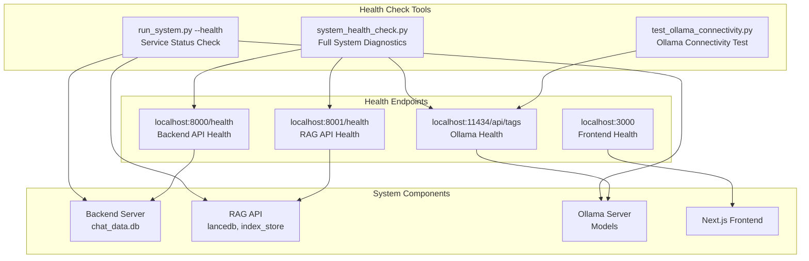
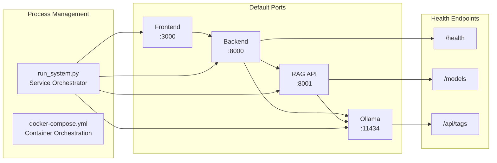
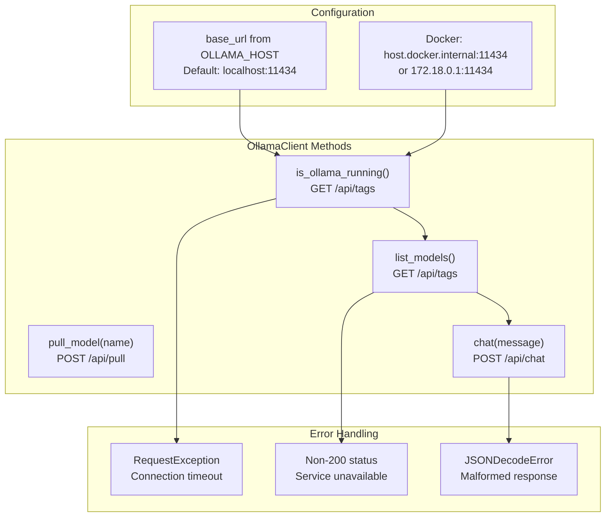
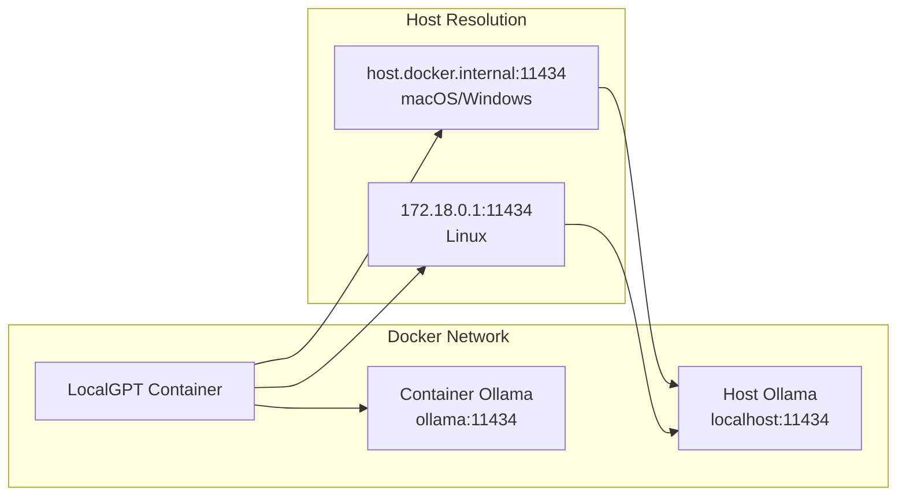
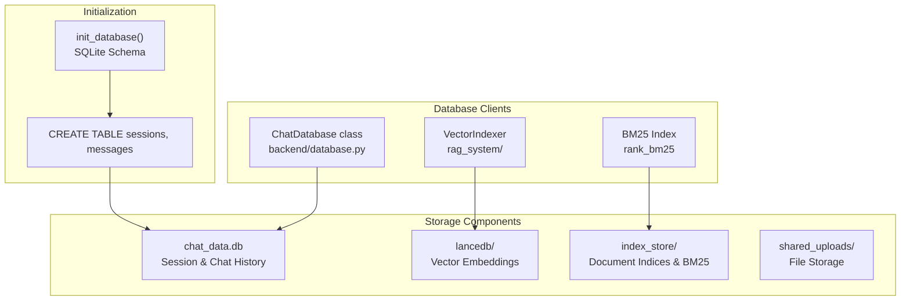
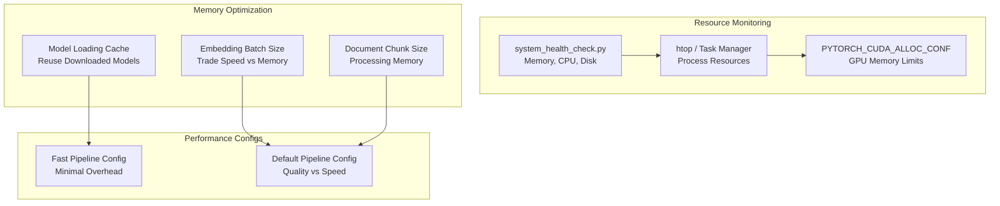
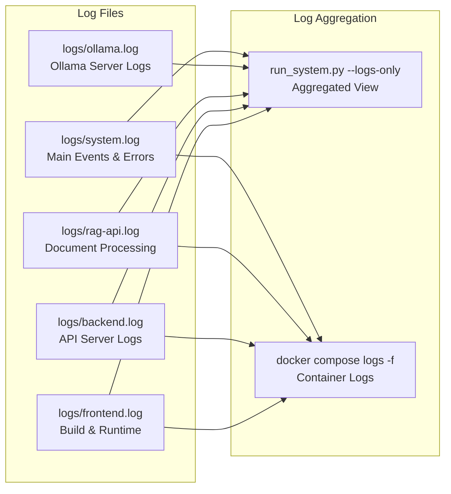

<!-- source: DeepWiki mcp.deepwiki.com · repo PromtEngineer/localGPT · page 8 Troubleshooting · fetched 2026-10-26 -->

# Troubleshooting

Relevant source files

The following files were used as context for generating this wiki page:

- [README.md](README.md)
- [backend/ollama_client.py](backend/ollama_client.py)
- [backend/test_ollama_connectivity.py](backend/test_ollama_connectivity.py)
- [docker-compose.yml](docker-compose.yml)
- [docker.env](docker.env)

This page provides diagnostic procedures and solutions for common issues in LocalGPT. It covers system health checking, service connectivity problems, model loading issues, and performance optimization. For installation problems, see [Installation & Setup](#2). For configuration issues, see [Configuration](#4).

## System Health Diagnostics

LocalGPT provides comprehensive health checking through multiple diagnostic tools and endpoints.

### Health Check Architecture

**Sources:** [README.md:529-537](), [backend/test_ollama_connectivity.py:6-37](), [docker-compose.yml:12-16]()

### Running System Diagnostics

Use these commands to check system health:

| Command | Purpose | Scope |
|---------|---------|-------|
| `python system_health_check.py` | Full system diagnostics | All components |
| `python run_system.py --health` | Service status check | Running services |
| `python backend/test_ollama_connectivity.py` | Ollama connectivity | Ollama server only |

**Sources:** [README.md:171-175](), [README.md:529-532]()

## Service Connectivity Issues

### Port and Service Mapping

**Sources:** [README.md:192-196](), [docker-compose.yml:6-7](), [docker-compose.yml:29-30](), [docker-compose.yml:54-55](), [docker-compose.yml:81-82]()

### Service Dependency Chain

Services must start in the correct order due to dependencies:

1. **Ollama Server** (`ollama serve`) - Must be running first
2. **RAG API Server** - Depends on Ollama for embeddings and generation
3. **Backend Server** - Depends on RAG API for document processing
4. **Frontend Server** - Depends on Backend for API calls

**Sources:** [docker-compose.yml:63-65](), [docker-compose.yml:86-88]()

### Common Connectivity Problems

| Issue | Symptom | Solution |
|-------|---------|----------|
| Port already in use | `Address already in use` error | Check `lsof -i :PORT` and kill conflicting processes |
| Service not responding | Connection refused errors | Verify service is running with health endpoints |
| Cross-service communication | 502/503 HTTP errors | Check service URLs in environment variables |

## Ollama Server Issues

### Ollama Connectivity Testing

The `OllamaClient` class provides comprehensive connectivity testing:

**Sources:** [backend/ollama_client.py:7-19](), [backend/ollama_client.py:21-31](), [backend/ollama_client.py:57-109]()

### Model Management Issues

Common model-related problems:

| Problem | Code Reference | Solution |
|---------|----------------|----------|
| Model not found | [ollama_client.py:186-194]() | Use `pull_model()` to download |
| Model loading timeout | [ollama_client.py:89]() | Increase timeout or check system resources |
| Thinking tokens in output | [ollama_client.py:96-102]() | Set `enable_thinking=False` |

### Docker Ollama Configuration

Docker environments require special Ollama host configuration:

**Sources:** [docker-compose.yml:33](), [docker.env:4](), [docker.env:7]()

## Database and Storage Issues

### Database Architecture

**Sources:** [README.md:267-268](), [README.md:288-289](), [docker-compose.yml:36-38](), [docker-compose.yml:61-62]()

### Database Recovery

| Issue | Diagnostic | Recovery |
|-------|------------|----------|
| SQLite corruption | `python -c "from backend.database import ChatDatabase; ChatDatabase()"` | Delete `chat_data.db`, run `init_database()` |
| LanceDB corruption | Check `lancedb/` directory permissions | Delete vector database, rebuild indexes |
| Missing indexes | Check `index_store/` contents | Recreate indexes through web interface |

**Sources:** [README.md:500-504]()

## Performance Issues

### Memory and Resource Monitoring

**Sources:** [README.md:509-517](), [README.md:441-455]()

### Pipeline Performance Tuning

| Configuration | Fast Pipeline | Default Pipeline |
|---------------|---------------|------------------|
| Search Type | `vector_only` | `hybrid` |
| Late Chunking | `disabled` | `enabled` |
| Reranking | `disabled` | `ai reranker` |
| Query Decomposition | `disabled` | `enabled` |
| Verification | `disabled` | `enabled` |

**Sources:** [README.md:441-455]()

## Log Analysis and Debugging

### Log File Structure

LocalGPT generates structured logs in the `logs/` directory:

**Sources:** [README.md:521-526](), [README.md:183-184](), [README.md:127-132]()

### Health Check Commands Summary

| Command | Purpose | Exit Code |
|---------|---------|-----------|
| `python system_health_check.py` | Full diagnostics | 0=healthy, 1=issues |
| `python run_system.py --health` | Service status | Shows running services |
| `curl http://localhost:8000/health` | Backend health | 200=healthy |
| `curl http://localhost:8001/health` | RAG API health | 200=healthy |
| `curl http://localhost:11434/api/tags` | Ollama health | 200=healthy |

**Sources:** [README.md:534-537](), [docker-compose.yml:67](), [docker-compose.yml:40](), [docker-compose.yml:13]()

---

