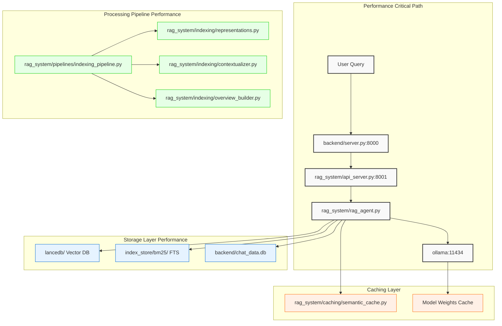
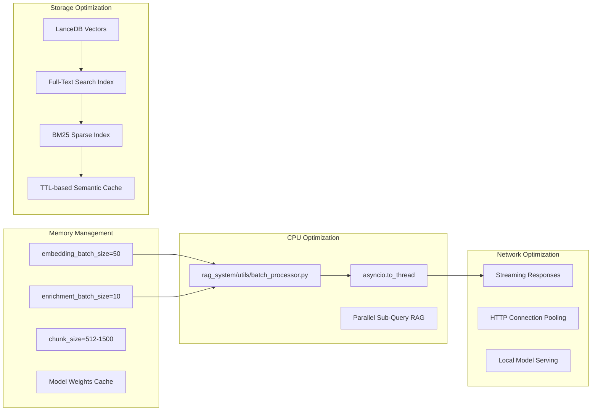
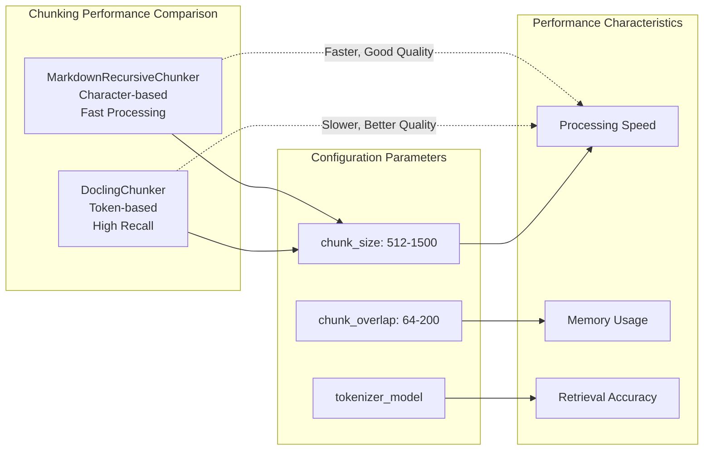
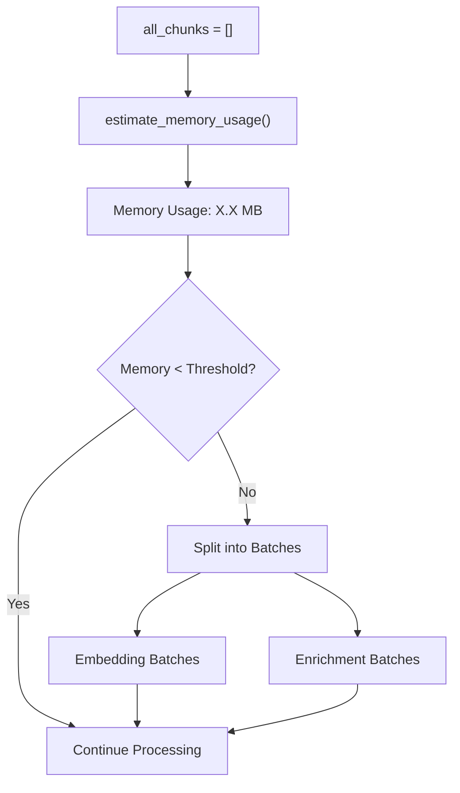
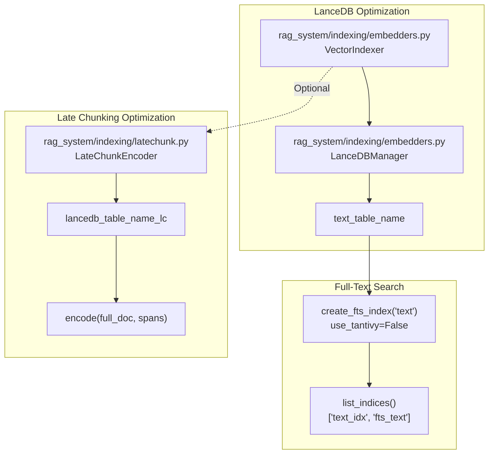
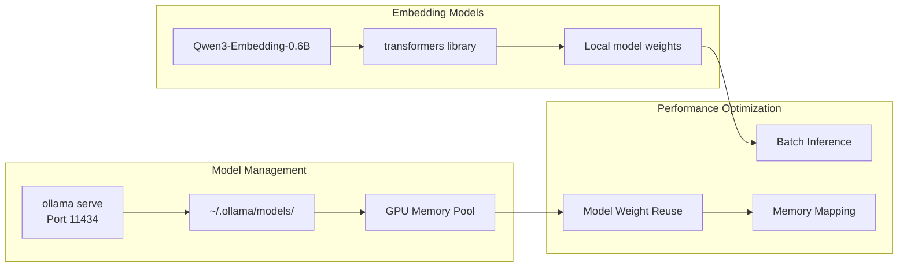
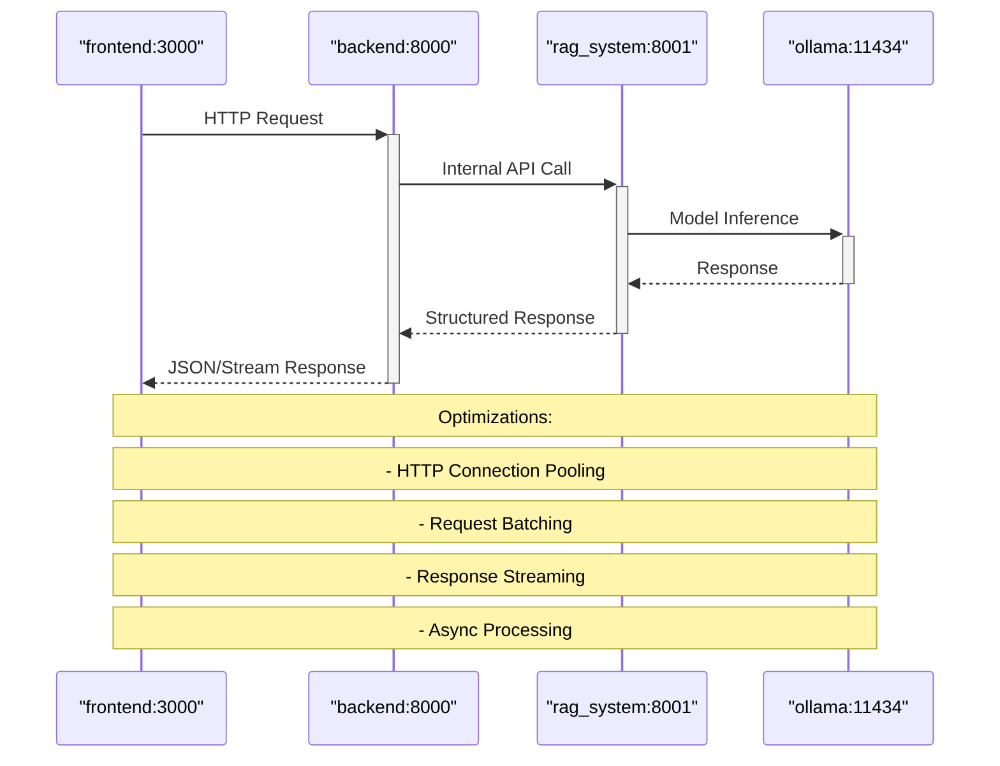
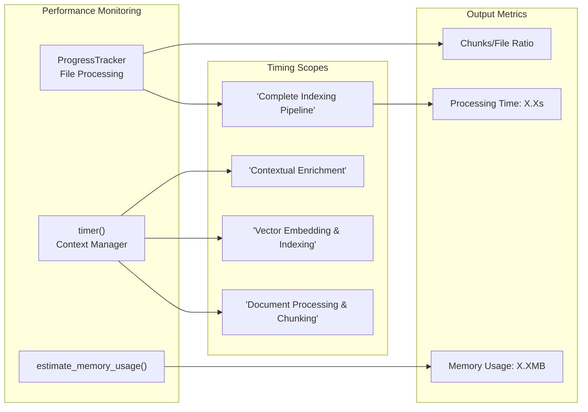

<!-- source: DeepWiki mcp.deepwiki.com · repo PromtEngineer/localGPT · page 9 Performance & Optimization · fetched 2026-10-26 -->

# Performance & Optimization

<details>
<summary>Relevant source files</summary>

The following files were used as context for generating this wiki page:

- [README.md](README.md)
- [rag_system/pipelines/indexing_pipeline.py](rag_system/pipelines/indexing_pipeline.py)

</details>


This document covers performance tuning, optimization strategies, and scaling considerations for LocalGPT. It focuses on system-level optimizations, resource management, and configuration tuning for both development and production environments.

For basic system configuration, see [Configuration](#4). For troubleshooting performance issues, see [Troubleshooting](#8). For development-specific optimization techniques, see [Development](#7).

## System Performance Architecture

LocalGPT's multi-service architecture provides several optimization opportunities through service isolation, resource allocation, and pipeline configuration.

### Service Performance Topology



**Performance Bottleneck Analysis**

The critical path typically follows: `backend/server.py` → `rag_system/api_server.py` → `rag_system/rag_agent.py` → `ollama:11434`. Performance optimization should focus on reducing latency at each hop and optimizing concurrent request handling.

Sources: [README.md:192-196](), [rag_system/pipelines/indexing_pipeline.py:1-359]()

### Resource Allocation Strategy



Sources: [rag_system/pipelines/indexing_pipeline.py:55-59](), [rag_system/pipelines/indexing_pipeline.py:82-85](), [README.md:60-65]()

## Processing Pipeline Optimization

### Batch Processing Configuration

The `IndexingPipeline` class implements configurable batch processing to optimize memory usage and processing speed:

| Parameter | Default | Purpose | Performance Impact |
|-----------|---------|---------|-------------------|
| `embedding_batch_size` | 50 | Embedding generation batch size | Higher = more memory, faster processing |
| `enrichment_batch_size` | 10 | Contextual enrichment batch size | Lower due to LLM memory requirements |
| `enable_progress_tracking` | true | Progress monitoring overhead | Minimal impact, useful for debugging |

The batch sizes are configured in [rag_system/pipelines/indexing_pipeline.py:55-59]():

```python
indexing_config = self.config.get("indexing", {})
self.embedding_batch_size = indexing_config.get("embedding_batch_size", 50)
self.enrichment_batch_size = indexing_config.get("enrichment_batch_size", 10)
```

### Chunking Strategy Performance



The chunker selection logic in [rag_system/pipelines/indexing_pipeline.py:19-50]() provides fallback from DoclingChunker to MarkdownRecursiveChunker for performance reliability.

Sources: [rag_system/pipelines/indexing_pipeline.py:19-50]()

## Memory Management

### Memory Usage Estimation

The indexing pipeline includes memory estimation functionality:



Memory usage is estimated in [rag_system/pipelines/indexing_pipeline.py:204-205]():

```python
memory_mb = estimate_memory_usage(all_chunks)
print(f"📊 Estimated memory usage: {memory_mb:.1f}MB")
```

Sources: [rag_system/pipelines/indexing_pipeline.py:204-205]()

### Pipeline Configuration Optimization

LocalGPT provides two main pipeline configurations optimized for different performance requirements:

#### Production Pipeline (default)
- **Target**: Maximum accuracy with reasonable performance
- **Features**: Hybrid search, AI reranking, verification, contextual enrichment
- **Memory**: Higher usage due to multiple models and processing steps
- **Latency**: Higher due to comprehensive processing

#### Fast Pipeline
- **Target**: Minimum latency with acceptable accuracy
- **Features**: Vector-only search, no reranking, no verification
- **Memory**: Lower usage with simplified processing
- **Latency**: Optimized for speed

Sources: [README.md:412-454]()

## Storage Optimization

### Vector Database Performance



The FTS index creation is optimized to avoid duplicate indices in [rag_system/pipelines/indexing_pipeline.py:266-278]():

```python
existing_indices = [idx.name for idx in tbl.list_indices()]
if not any(name in existing_indices for name in ("text_idx", "fts_text")):
    tbl.create_fts_index("text", use_tantivy=False, replace=False)
```

Sources: [rag_system/pipelines/indexing_pipeline.py:258-278](), [rag_system/pipelines/indexing_pipeline.py:283-320]()

## Model Optimization

### Multi-Model Performance Strategy

LocalGPT uses different models for different tasks to optimize performance:

| Task | Default Model | Purpose | Performance Impact |
|------|---------------|---------|-------------------|
| Text Generation | `qwen3:8b` | High-quality responses | High memory, slower |
| Routing/Enrichment | `qwen3:0.6b` | Fast decision making | Low memory, faster |
| Embeddings | `Qwen/Qwen3-Embedding-0.6B` | Vector representations | GPU accelerated |
| Reranking | `answerdotai/answerai-colbert-small-v1` | Result reordering | CPU efficient |

### Model Loading and Caching



Sources: [README.md:389-405](), [rag_system/pipelines/indexing_pipeline.py:94-101]()

## Network and Deployment Optimization

### Service Communication Optimization

The multi-service architecture allows for several optimization strategies:



### Docker Performance Configuration

For containerized deployments, several performance optimizations are available:

- **Resource Limits**: Configure memory and CPU limits in `docker-compose.yml`
- **Volume Optimization**: Use bind mounts for data persistence to avoid overlay filesystem overhead
- **Network Optimization**: Use bridge networks for inter-service communication

Sources: [README.md:101-133]()

## Monitoring and Profiling

### Progress Tracking and Timing

The system includes comprehensive timing and progress tracking utilities:



Performance monitoring is implemented throughout the indexing pipeline in [rag_system/pipelines/indexing_pipeline.py:146-359]().

Sources: [rag_system/pipelines/indexing_pipeline.py:146-148](), [rag_system/pipelines/indexing_pipeline.py:341-359]()

## Configuration Tuning

### Environment-Specific Optimization

Different deployment environments require different optimization strategies:

#### Development Environment
```bash
# Optimized for fast iteration
python run_system.py --mode dev
export PYTORCH_CUDA_ALLOC_CONF=max_split_size_mb:512
```

#### Production Environment
```bash
# Optimized for stability and performance
python run_system.py --mode prod
```

### Hardware-Specific Tuning

| Hardware Type | Recommended Configuration | Performance Impact |
|---------------|--------------------------|-------------------|
| CPU Only | `embedding_batch_size=20`, `chunk_size=512` | Lower memory usage |
| GPU Available | `embedding_batch_size=100`, `chunk_size=1024` | Higher throughput |
| High Memory | `embedding_batch_size=200`, enable all features | Maximum accuracy |
| Low Memory | `embedding_batch_size=10`, fast pipeline | Minimum requirements |

Sources: [README.md:507-517](), [README.md:175-189]()

## Performance Monitoring Commands

### System Health Checking

```bash
# Comprehensive system diagnostics
python system_health_check.py

# Service-specific health checks
python run_system.py --health

# Resource monitoring
python run_system.py --logs-only
```

### Performance Profiling Endpoints

The system provides several endpoints for performance monitoring:

- **Backend Health**: `http://localhost:8000/health`
- **RAG API Health**: `http://localhost:8001/health`
- **Ollama Status**: `http://localhost:11434/api/tags`

Sources: [README.md:529-537]()