# Page: Overview

# Overview

<details>
<summary>Relevant source files</summary>

The following files were used as context for generating this wiki page:

- [README.md](README.md)

</details>


## Purpose and Scope

This document provides a comprehensive overview of LocalGPT, a private, on-premise Document Intelligence platform that enables users to query and analyze their documents using AI without data leaving their infrastructure. LocalGPT implements a sophisticated Retrieval-Augmented Generation (RAG) system with hybrid search capabilities, smart routing, and modular architecture.

For detailed installation procedures, see [Installation & Setup](#2). For specific component deep-dives, see [Core Components](#3). For usage instructions and API documentation, see [Usage](#5).

## Core Capabilities

LocalGPT provides a complete document intelligence solution with the following key capabilities:

| Feature Category | Capabilities |
|------------------|--------------|
| **Document Processing** | Multi-format support (PDF, DOCX, TXT, Markdown), contextual enrichment, batch processing |
| **Search & Retrieval** | Hybrid search (vector + BM25), late chunking, AI-powered reranking, semantic caching |
| **AI Integration** | Multiple model support via Ollama, HuggingFace embeddings, smart routing between RAG/direct LLM |
| **User Experience** | Web interface, session management, streaming responses, real-time progress tracking |
| **Privacy & Security** | Fully on-premise operation, no external data transmission, local model storage |
| **Developer Tools** | RESTful APIs, flexible configuration, extensible architecture, comprehensive health monitoring |

The system supports advanced features including query decomposition for complex questions, answer verification for accuracy, and contextual enrichment for better document understanding.

**Sources:** [README.md:27-79]()

## System Architecture

LocalGPT implements a multi-service architecture orchestrated by the `run_system.py` script. The system consists of four primary services that communicate through well-defined APIs:

### High-Level Service Architecture

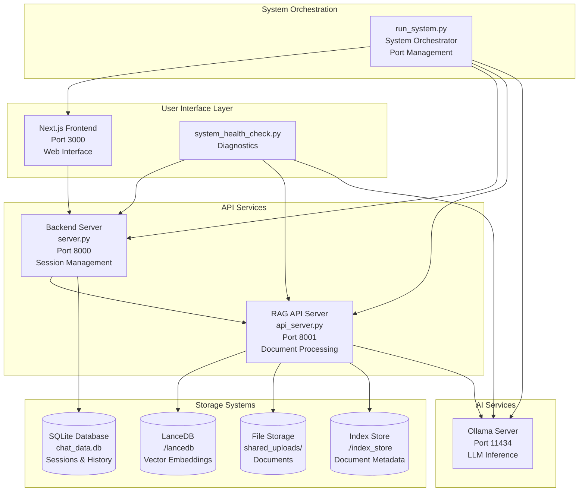

The `run_system.py` orchestrator manages service lifecycle, health monitoring, and graceful shutdown across all components. Each service operates independently with clearly defined responsibilities and can be started manually for development purposes.

**Sources:** [README.md:191-197](), [README.md:198-214]()

### Core Components and Code Entities

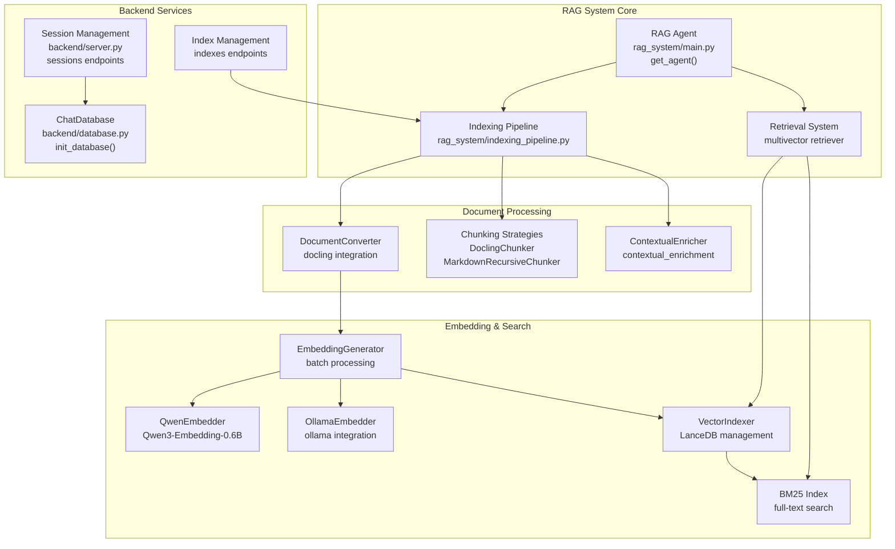

The system's modular design allows for flexible configuration and component swapping. The `RAG Agent` serves as the central orchestrator, coordinating between document processing, retrieval, and generation pipelines.

**Sources:** [README.md:290-296](), [README.md:385-455]()

## Data Flow and Processing Pipeline

LocalGPT processes documents through a sophisticated pipeline that transforms raw files into queryable knowledge bases:

### Document Processing and RAG Pipeline

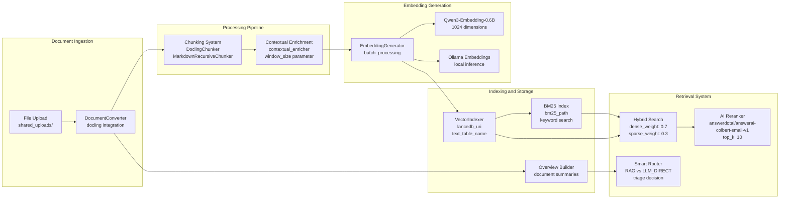

The pipeline supports two main configuration modes: a production-ready "default" configuration with full hybrid search and verification, and a speed-optimized "fast" configuration with minimal overhead.

**Sources:** [README.md:410-455](), [README.md:52-66]()

## Deployment Options

LocalGPT provides flexible deployment options to accommodate different use cases and environments:

| Deployment Method | Use Case | Key Files |
|------------------|----------|-----------|
| **Docker Compose** | Production deployment | `docker-compose.yml`, `start-docker.sh` |
| **System Orchestrator** | Development and testing | `run_system.py`, automated service management |
| **Manual Component Startup** | Development and debugging | Individual service scripts |

The Docker deployment creates isolated containers for each service with shared volumes for data persistence, while the system orchestrator provides integrated logging and health monitoring across all components.

### Configuration Management

The system uses centralized configuration through environment variables and configuration files:

- **Environment Configuration**: `.env` file with service ports, model settings, and database paths
- **Pipeline Configuration**: JSON-based pipeline definitions for different use cases
- **Model Configuration**: Support for Ollama local models and HuggingFace external models
- **Search Configuration**: Hybrid search parameters, reranking settings, and retrieval options

**Sources:** [README.md:101-133](), [README.md:135-189](), [README.md:261-280]()

---

# Page: Key Features

# Key Features

<details>
<summary>Relevant source files</summary>

The following files were used as context for generating this wiki page:

- [README.md](README.md)

</details>


This page provides a comprehensive overview of LocalGPT's core capabilities and technical features. It covers the system's privacy-focused design, advanced retrieval mechanisms, document processing pipeline, and integration capabilities. For installation and setup procedures, see [Installation & Setup](#2). For detailed technical architecture information, see [System Architecture](#1.2).

## Privacy & Local Processing

LocalGPT operates as a fully **on-premise Document Intelligence platform** where all data processing occurs locally without external API dependencies. The system ensures complete data privacy by keeping documents, embeddings, chat history, and model inference entirely within your infrastructure.

| Privacy Feature | Implementation | Technical Details |
|------------------|----------------|-------------------|
| **Local Model Inference** | Ollama integration | Models served via `http://localhost:11434` |
| **Local Vector Storage** | LanceDB database | Stored in `./lancedb` directory |
| **Local Chat History** | SQLite database | Stored in `./backend/chat_data.db` |
| **Local Document Storage** | File system | Documents stored in `shared_uploads/` |

The system supports multiple hardware platforms including **GPU (CUDA)**, **CPU**, **HPU (Intel® Gaudi®)**, and **MPS (Apple Silicon)** for flexible deployment across different infrastructure environments.

**Sources:** [README.md:44-50]()

## Advanced Retrieval System

LocalGPT implements a sophisticated **hybrid search architecture** that combines multiple retrieval strategies for optimal document discovery and context extraction.

### Hybrid Search Architecture

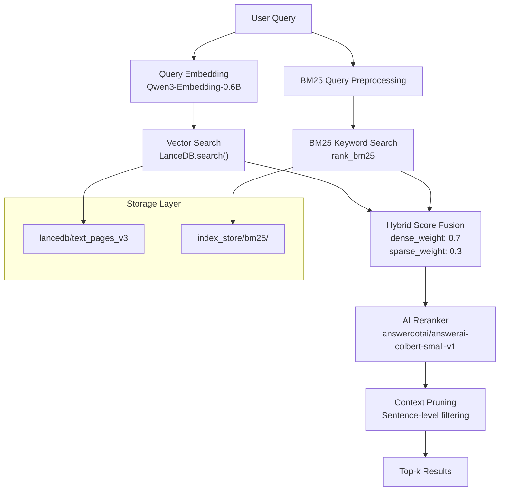

### Late Chunking Implementation

The system implements **Late Chunking** methodology for enhanced context preservation:

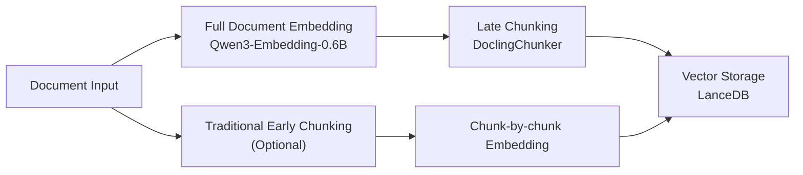

**Key Technical Features:**
- **Vector Similarity Search**: Dense embeddings via `Qwen/Qwen3-Embedding-0.6B` model
- **BM25 Keyword Search**: Sparse retrieval using `rank_bm25` library  
- **ColBERT Reranking**: Neural reranking with `answerdotai/answerai-colbert-small-v1`
- **Configurable Weights**: `dense_weight: 0.7`, `sparse_weight: 0.3` in hybrid mode
- **Retrieval Parameters**: `retrieval_k: 20`, `reranker_top_k: 10`

**Sources:** [README.md:31](), [README.md:461-467](), [README.md:423-427]()

## Smart Query Processing

LocalGPT features an intelligent **query routing system** that automatically determines the optimal processing strategy for each user query.

### Query Processing Flow

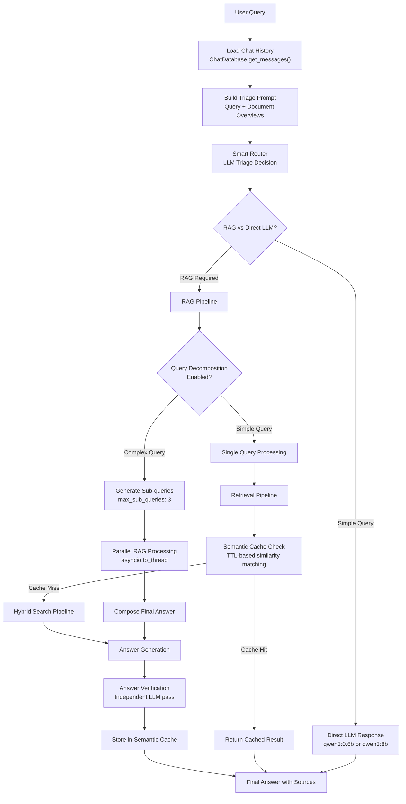

**Advanced Processing Features:**

| Feature | Technical Implementation | Configuration |
|---------|------------------------|---------------|
| **Smart Routing** | LLM-based triage using document overviews | Automatic RAG vs Direct decision |
| **Query Decomposition** | Complex queries split into sub-questions | `max_sub_queries: 3` |
| **Semantic Caching** | TTL-based similarity matching | Embedding-based cache lookup |
| **Answer Verification** | Independent verification pass | Separate LLM model validation |
| **Parallel Processing** | `asyncio.to_thread` for concurrent operations | Sub-query parallel execution |

**Sources:** [README.md:60-64](), [README.md:434](), [README.md:648-659]()

## Document Processing Pipeline

The document processing system transforms raw documents into searchable, contextually-enriched knowledge bases through a multi-stage pipeline.

### Processing Architecture

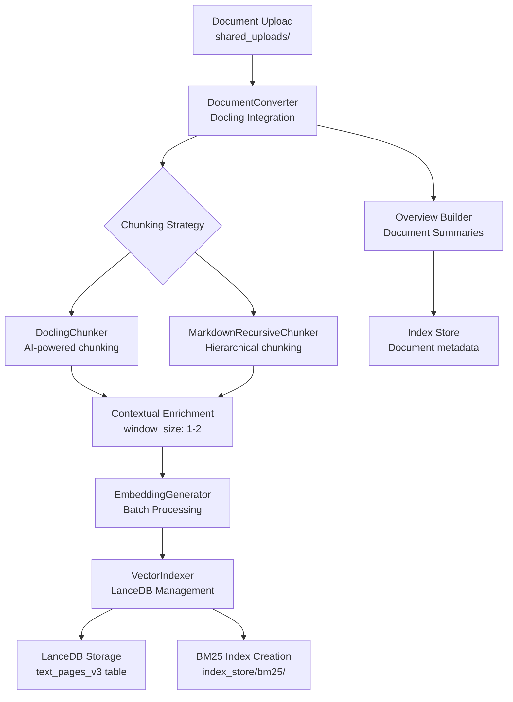

### Contextual Enrichment Process

The system implements **Contextual Enrichment** inspired by Anthropic's contextual retrieval methodology:

| Processing Stage | Technical Details | Configuration |
|------------------|-------------------|---------------|
| **Document Conversion** | Docling-based conversion for PDF, DOCX, TXT, MD | `enable_docling: true` |
| **Chunk Generation** | Configurable chunk sizes and overlap | `chunk_size: 512`, `chunk_overlap: 64` |
| **Context Generation** | AI-generated contextual descriptions | `enable_enrich: true`, `window_size: 2` |
| **Embedding Generation** | Batch embedding processing | `Qwen/Qwen3-Embedding-0.6B` |
| **Index Building** | Vector and keyword index creation | Parallel processing enabled |

**Sources:** [README.md:52-55](), [README.md:673-681](), [README.md:716-726]()

## Model Integration & Flexibility

LocalGPT supports multiple AI model providers and configurations for different processing requirements.

### Model Configuration Matrix

| Model Type | Primary Model | Alternative Models | Usage |
|------------|---------------|-------------------|-------|
| **Generation Models** | `qwen3:8b` | `qwen3:0.6b` | Main text generation |
| **Enrichment Models** | `qwen3:0.6b` | `qwen3:8b` | Lightweight routing/enrichment |
| **Embedding Models** | `Qwen/Qwen3-Embedding-0.6B` | `Qwen/Qwen3-Embedding-4B` | Vector embeddings (1024 dim) |
| **Reranker Models** | `answerdotai/answerai-colbert-small-v1` | `BAAI/bge-reranker-base` | ColBERT reranking |

### Pipeline Configurations

The system provides pre-configured pipelines optimized for different use cases:

**Default Pipeline (Production)**
```json
{
  "retrieval": {
    "search_type": "hybrid",
    "late_chunking": {"enabled": true},
    "dense": {"weight": 0.7},
    "bm25": {"enabled": true}
  },
  "reranker": {"enabled": true, "top_k": 10},
  "query_decomposition": {"enabled": true},
  "verification": {"enabled": true},
  "contextual_enricher": {"enabled": true}
}
```

**Fast Pipeline (Speed-Optimized)**
```json
{
  "retrieval": {
    "search_type": "vector_only",
    "late_chunking": {"enabled": false}
  },
  "reranker": {"enabled": false},
  "query_decomposition": {"enabled": false},
  "verification": {"enabled": false}
}
```

**Sources:** [README.md:388-404](), [README.md:412-438](), [README.md:441-454]()

## User Interface & Developer Experience

LocalGPT provides both intuitive web interfaces and comprehensive API access for different user types and integration scenarios.

### Multi-Interface Architecture

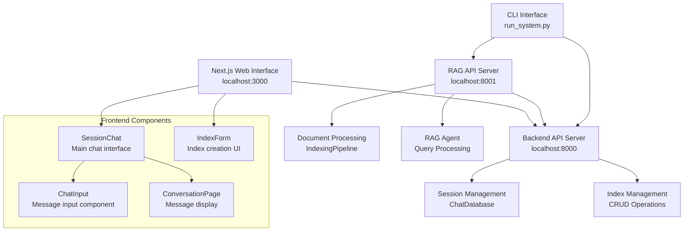

### API Capabilities

| API Category | Key Endpoints | Functionality |
|--------------|---------------|---------------|
| **Chat API** | `POST /sessions/{id}/chat` | Session-based chat with streaming |
| **Index Management** | `POST /indexes`, `GET /indexes/{id}` | CRUD operations for document collections |
| **Session Management** | `POST /sessions`, `GET /sessions` | Conversation persistence and organization |
| **Document Upload** | `POST /indexes/{id}/upload` | Multi-file document processing |
| **Health Monitoring** | `GET /health`, `GET /api/tags` | System diagnostics and status |

**Key Developer Features:**
- **RESTful API Design**: Complete programmatic access
- **Streaming Responses**: Real-time chat feedback via `POST /chat/stream`
- **Batch Processing**: Multi-document indexing via `demo_batch_indexing.py`
- **System Orchestration**: Single-command startup via `run_system.py`
- **Health Monitoring**: Comprehensive diagnostics via `system_health_check.py`

**Sources:** [README.md:68-78](), [README.md:547-645](), [README.md:691-701]()

## System Architecture Features

LocalGPT implements a **modular, multi-service architecture** that supports flexible deployment and scaling strategies.

### Service Orchestration

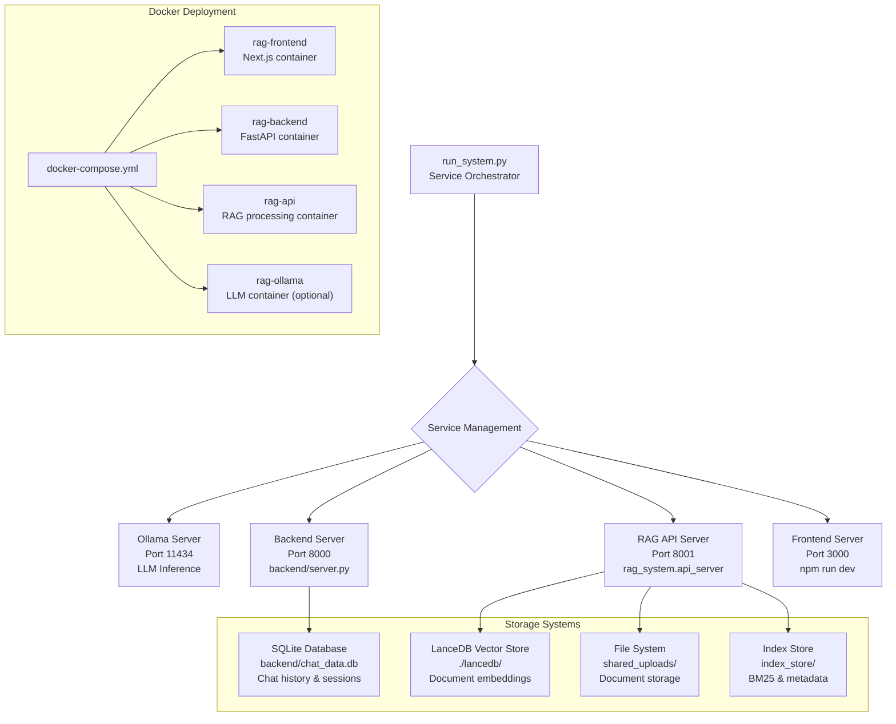

### Deployment Flexibility

| Deployment Mode | Command | Use Case |
|-----------------|---------|----------|
| **Development Mode** | `python run_system.py --mode dev` | Local development with hot reload |
| **Production Mode** | `python run_system.py --mode prod` | Production deployment |
| **Docker Mode** | `./start-docker.sh` | Containerized multi-service deployment |
| **Backend Only** | `python run_system.py --no-frontend` | API-only deployment |
| **Manual Services** | Individual service startup | Fine-grained control |

**Key Architectural Benefits:**
- **Service Independence**: Each component can be scaled or replaced independently
- **Flexible Deployment**: Docker, manual, or orchestrated startup options
- **Health Monitoring**: Built-in health checks and diagnostics
- **State Persistence**: Separate data storage for different system components
- **Resource Optimization**: Optional services based on deployment requirements

**Sources:** [README.md:191-214](), [README.md:169-189](), [README.md:750-772]()

---

# Page: System Architecture

# System Requirements

<details>
<summary>Relevant source files</summary>

The following files were used as context for generating this wiki page:

- [.gitignore](.gitignore)
- [README.md](README.md)
- [backend/ollama_client.py](backend/ollama_client.py)
- [backend/test_ollama_connectivity.py](backend/test_ollama_connectivity.py)
- [docker-compose.yml](docker-compose.yml)
- [docker.env](docker.env)

</details>


This page details the hardware and software requirements needed to run localGPT effectively. It covers the necessary computing resources, supported platforms, and dependency requirements to ensure optimal performance. For installation instructions, see [Installation](#2).

## Hardware Requirements

LocalGPT's hardware requirements vary based on the language models you intend to use and your performance expectations. The system can run on a variety of hardware configurations, from basic CPU setups to specialized accelerators.

### Minimum Requirements

- **CPU-only setup**: 
  - Modern multi-core processor (8+ cores recommended)
  - 16GB RAM minimum (32GB+ recommended)
  - 10GB+ free disk space for models and database storage

- **GPU-accelerated setup (recommended)**:
  - NVIDIA GPU with 4GB+ VRAM (larger models require more VRAM)
  - CUDA-compatible GPU for optimal performance
  - 16GB system RAM

Sources: [README.md:268-277]()

### Hardware Platform Support

LocalGPT provides explicit support for multiple computing platforms, allowing model loading and inference on different hardware accelerators.

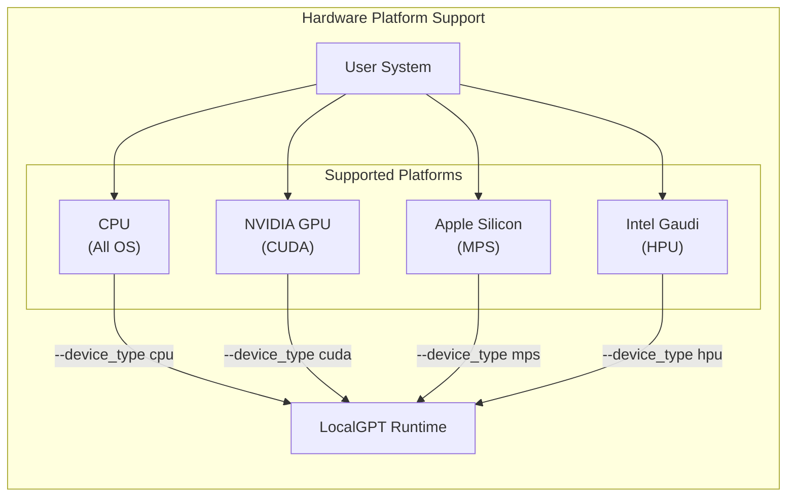

Sources: [README.md:155-183](), [README.md:268-277]()

## VRAM Requirements by Model Size

LLM performance is directly tied to available VRAM. Below are the approximate VRAM requirements for different model sizes and quantization levels. Note that embedding models require additional VRAM (2-7GB depending on the model).

| Model Size (B) | float32 | float16 | GPTQ 8bit | GPTQ 4bit |
|----------------|---------|---------|-----------|-----------|
| 7B             | 28 GB   | 14 GB   | 7-9 GB    | 3.5-5 GB  |
| 13B            | 52 GB   | 26 GB   | 13-15 GB  | 6.5-8 GB  |
| 32B            | 130 GB  | 65 GB   | 32.5-35 GB| 16.25-19 GB|
| 65B            | 260.8 GB| 130.4 GB| 65.2-67 GB| 32.6-35 GB|

Sources: [README.md:268-277]()

## Software Requirements

### Python Version

LocalGPT requires **Python 3.10 or later**. Earlier versions are not compatible and will cause compilation errors.

### Operating System Compatibility

LocalGPT is compatible with:
- Windows 10/11
- Linux distributions (Ubuntu recommended)
- macOS (including Apple Silicon)

### C++ Compiler Requirements

A C++ compiler is required to build certain dependencies during installation:

- **Windows**: Visual Studio 2022 with "Universal Windows Platform development" and "C++ CMake tools for Windows" components, plus MinGW with GCC component
- **Linux**: GCC/G++ compiler suite (typically installed via build-essential package)
- **macOS**: Xcode Command Line Tools

Sources: [README.md:282-301]()

## Installation Dependencies

LocalGPT has numerous Python package dependencies that handle different system functions.

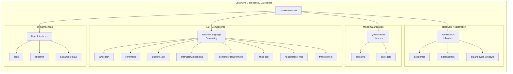

Sources: [requirements.txt:1-34]()

### Special Installation Considerations

#### CUDA Support

For NVIDIA GPU acceleration:
- Install appropriate NVIDIA drivers for your GPU
- Use CUDA-enabled installations for certain packages:
  ```
  CMAKE_ARGS="-DLLAMA_CUBLAS=on" FORCE_CMAKE=1 pip install llama-cpp-python --no-cache-dir
  ```

#### Apple Silicon (M1/M2) Support

For Apple Silicon acceleration:
- Use MPS-enabled installations:
  ```
  CMAKE_ARGS="-DLLAMA_METAL=on" FORCE_CMAKE=1 pip install llama-cpp-python --no-cache-dir
  ```

Sources: [README.md:75-94]()

## Runtime Requirements Model

The following diagram shows how different system requirements map to LocalGPT's runtime components:

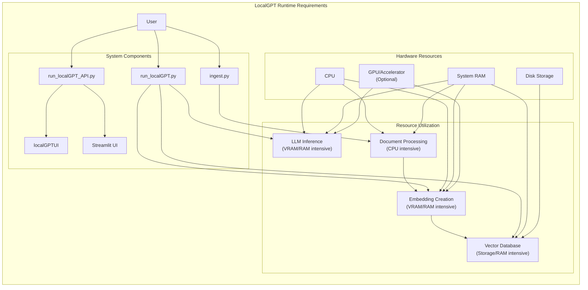

Sources: [README.md:31-38](), [README.md:268-277]()

## Common Hardware-Related Issues

Users may encounter these common hardware-related issues:

1. **CUDA compatibility issues**
   - Check if PyTorch is compatible with your CUDA version
   - Verify with `nvcc --version` and `nvidia-smi`
   - May require reinstalling PyTorch:
     ```
     pip uninstall torch
     pip cache purge
     pip install torch -f https://download.pytorch.org/whl/torch_stable.html
     ```

2. **C++ compilation errors during installation**
   - Ensure appropriate C++ compiler is installed
   - On Windows, verify Visual Studio components
   - On Linux, install required development packages

3. **Memory errors**
   - Occur when models exceed available VRAM/RAM
   - Solution: Use smaller models or more quantized versions (GPTQ 4-bit)
   - Consider models with fewer parameters (7B instead of 13B)

Sources: [README.md:313-340](), [README.md:268-277]()

## Docker Alternative

For users who want to avoid potential compiler conflicts or ensure a consistent environment, LocalGPT provides Docker support:

- Requires Docker, BuildKit, NVIDIA GPU drivers, and NVIDIA container toolkit
- Build with: `docker build -t localgpt .`
- Run with: `docker run -it --mount src="$HOME/.cache",target=/root/.cache,type=bind --gpus=all localgpt`

For Intel Gaudi HPU support, use the Dockerfile_hpu file.

Sources: [README.md:96-104]()

---

# Page: Installation & Setup

# Installation & Setup

<details>
<summary>Relevant source files</summary>

The following files were used as context for generating this wiki page:

- [README.md](README.md)
- [backend/ollama_client.py](backend/ollama_client.py)
- [backend/test_ollama_connectivity.py](backend/test_ollama_connectivity.py)
- [docker-compose.yml](docker-compose.yml)
- [docker.env](docker.env)

</details>


This page covers the installation methods and initial setup procedures for LocalGPT. It provides an overview of deployment options and system initialization steps required to get LocalGPT running on your machine.

For detailed Docker containerization steps, see [Docker Installation](#2.1). For manual Python environment setup, see [Manual Installation](#2.2). For hardware and software prerequisites, see [System Requirements](#2.3).

## Installation Overview

LocalGPT supports multiple deployment approaches, each managed through different orchestration mechanisms. The system consists of four core services that must be running simultaneously for full functionality.

### Deployment Options

LocalGPT provides three primary installation methods:

| Method | Orchestrator | Use Case | Complexity |
|--------|-------------|----------|------------|
| **Docker Compose** | `docker-compose.yml` | Production deployment | Low |
| **System Launcher** | `run_system.py` | Development and testing | Medium |
| **Manual Services** | Individual terminals | Debugging and development | High |

The Docker approach uses containerized services defined in [docker-compose.yml:1-104](), while the system launcher approach uses the Python orchestrator in [run_system.py:163]() to manage local processes.

### Service Architecture

The following diagram shows the core services and their relationships during installation:

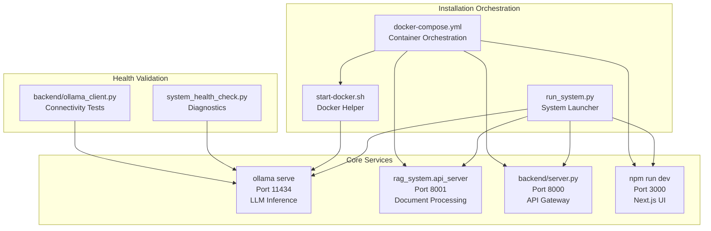

Sources: [README.md:192-197](), [docker-compose.yml:1-104](), [backend/ollama_client.py:13-19]()

### Configuration and Environment Setup

The installation process requires environment configuration through multiple files:

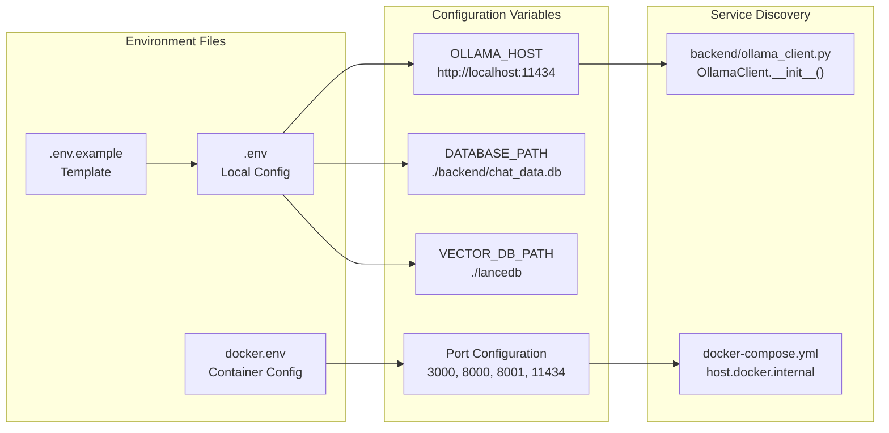

Sources: [README.md:254-280](), [docker.env:1-12](), [backend/ollama_client.py:7-12]()

## Prerequisites

Before installation, ensure the following dependencies are available:

### System Requirements
- **Python**: 3.8+ (tested with 3.11.5) as specified in [README.md:87]()
- **Node.js**: 16+ and npm (tested with 23.10.0, npm 10.9.2) from [README.md:88]()
- **Docker**: Optional for containerized deployment [README.md:89]()
- **Memory**: 8GB+ RAM (16GB+ recommended) per [README.md:90]()

### Model Dependencies
- **Ollama**: Required for both Docker and manual deployment [README.md:91]()
- **AI Models**: `qwen3:0.6b` and `qwen3:8b` as referenced in [README.md:110-111]()

The `OllamaClient` class in [backend/ollama_client.py:33-55]() provides automated model pulling functionality through the `pull_model()` method.

## Quick Validation

### Health Check System
LocalGPT includes comprehensive health monitoring through multiple validation layers:

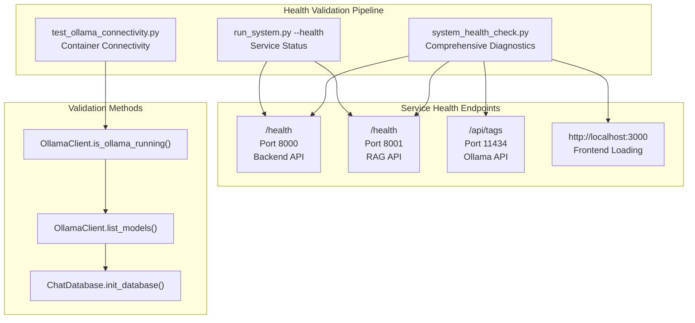

Sources: [README.md:171-175](), [README.md:284-296](), [backend/ollama_client.py:13-31](), [backend/test_ollama_connectivity.py:6-33]()

### Validation Commands

After installation, run these validation steps to confirm system readiness:

```bash
# Comprehensive system diagnostics
python system_health_check.py

# Service health verification  
python run_system.py --health

# Database connectivity test
python -c "from backend.database import ChatDatabase; ChatDatabase().init_database()"

# RAG system validation
python -c "from rag_system.main import get_agent; print('✅ Installation successful!')"
```

The validation process uses the `is_ollama_running()` method from [backend/ollama_client.py:13-19]() to verify Ollama connectivity and the `list_models()` method from [backend/ollama_client.py:21-31]() to confirm model availability.

## Installation Method Selection

Choose your installation approach based on your deployment requirements:

- **For production deployment**: Use [Docker Installation](#2.1) with `docker-compose.yml`
- **For development work**: Use [Manual Installation](#2.2) with `run_system.py` 
- **For debugging or custom setups**: Use individual service startup as documented in [README.md:200-214]()

Each method will result in the same four-service architecture running on ports 3000, 8000, 8001, and 11434 respectively.

Sources: [README.md:101-134](), [README.md:135-189](), [README.md:200-214]()

---

# Page: Docker Installation

# Docker Installation

<details>
<summary>Relevant source files</summary>

The following files were used as context for generating this wiki page:

- [README.md](README.md)
- [backend/ollama_client.py](backend/ollama_client.py)
- [backend/test_ollama_connectivity.py](backend/test_ollama_connectivity.py)
- [docker-compose.yml](docker-compose.yml)
- [docker.env](docker.env)

</details>


This page covers the containerized deployment of LocalGPT using Docker Compose. This approach packages the entire system into isolated containers with automated service orchestration and dependency management. For manual installation using `run_system.py`, see [Manual Installation](#2.2). For system requirements and hardware specifications, see [System Requirements](#2.3).

## Overview

Docker deployment creates a multi-service architecture with four main containers: `rag-frontend`, `rag-backend`, `rag-api`, and optionally `rag-ollama`. The system uses Docker Compose to orchestrate service startup, networking, and volume management.

## Prerequisites

### Required Software

| Component | Version | Purpose |
|-----------|---------|---------|
| Docker | 20.10+ | Container runtime |
| Docker Compose | 2.0+ | Service orchestration |
| Ollama | Latest | LLM inference (must run on host) |
| Git | Any | Repository cloning |

### Hardware Requirements

- **Memory**: 8GB+ RAM (16GB+ recommended for production)
- **Storage**: 10GB+ available disk space
- **Network**: Internet connection for model downloads

Sources: [README.md:86-91]()

## Architecture Overview

The Docker deployment creates a networked environment where services communicate through the `rag-network` bridge network.

### Service Architecture Diagram

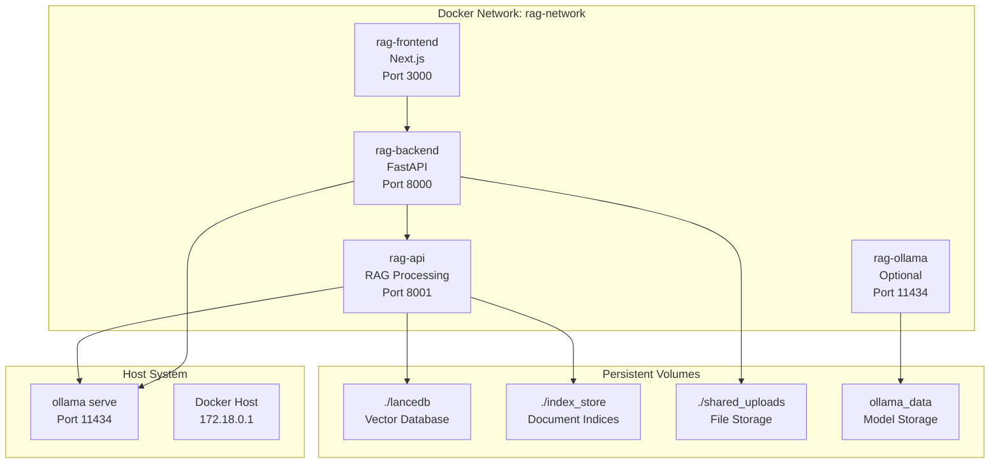

### Container Dependencies

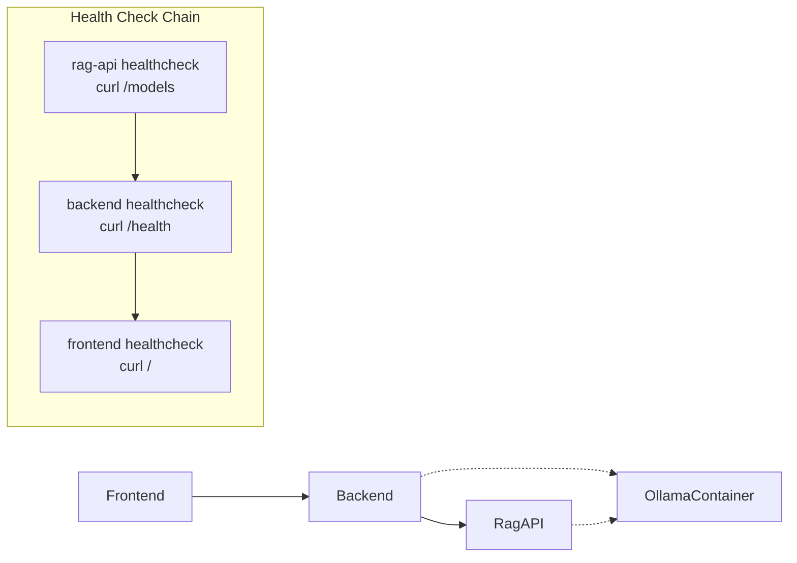

Sources: [docker-compose.yml:1-104]()

## Installation Steps

### Step 1: Repository Setup

```bash
# Clone the repository
git clone https://github.com/PromtEngineer/localGPT.git
cd localGPT
```

### Step 2: Ollama Installation and Setup

Ollama must be installed and running on the host system before starting Docker containers:

```bash
# Install Ollama
curl -fsSL https://ollama.ai/install.sh | sh

# Pull required models
ollama pull qwen3:0.6b
ollama pull qwen3:8b

# Start Ollama server
ollama serve
```

The `OllamaClient` class in the backend connects to Ollama via the `OLLAMA_HOST` environment variable.

Sources: [README.md:108-114](), [backend/ollama_client.py:7-11]()

### Step 3: Docker Container Launch

```bash
# Start all services with Docker Compose
./start-docker.sh

# Access the application
open http://localhost:3000
```

The `start-docker.sh` script manages the Docker Compose deployment with proper environment configuration.

Sources: [README.md:117-120]()

## Service Configuration

### Environment Variables

The Docker deployment uses environment variables to configure service connectivity:

| Variable | Default | Purpose |
|----------|---------|---------|
| `OLLAMA_HOST` | `http://host.docker.internal:11434` | Ollama server URL |
| `RAG_API_URL` | `http://rag-api:8001` | Internal RAG API endpoint |
| `NEXT_PUBLIC_API_URL` | `http://localhost:8000` | Public backend API URL |
| `NODE_ENV` | `production` | Application environment |

Sources: [docker-compose.yml:32-34](), [docker-compose.yml:57-59](), [docker.env:1-12]()

### Volume Mappings

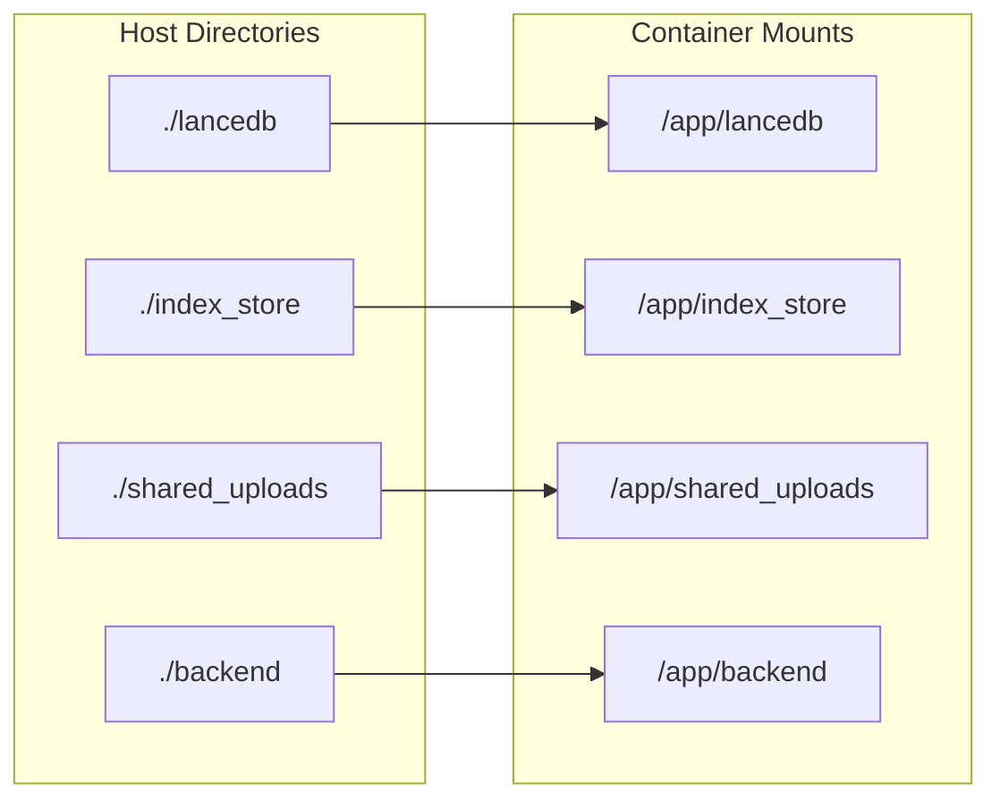

Sources: [docker-compose.yml:35-38](), [docker-compose.yml:60-62]()

## Service Specifications

### rag-api Service

The `rag-api` container handles document processing and retrieval operations:

```yaml
# From docker-compose.yml:24-46
build:
  context: .
  dockerfile: Dockerfile.rag-api
environment:
  - OLLAMA_HOST=http://host.docker.internal:11434
healthcheck:
  test: ["CMD", "curl", "-f", "http://localhost:8001/models"]
```

### rag-backend Service

The `rag-backend` container manages sessions and API routing:

```yaml
# From docker-compose.yml:49-73
build:
  context: .
  dockerfile: Dockerfile.backend
environment:
  - RAG_API_URL=http://rag-api:8001
depends_on:
  rag-api:
    condition: service_healthy
```

### rag-frontend Service

The `rag-frontend` container serves the Next.js web application:

```yaml
# From docker-compose.yml:76-96
build:
  context: .
  dockerfile: Dockerfile.frontend
environment:
  - NEXT_PUBLIC_API_URL=http://localhost:8000
depends_on:
  backend:
    condition: service_healthy
```

Sources: [docker-compose.yml:24-96]()

## Health Checks and Monitoring

### Health Check Endpoints

Each service implements health check endpoints that Docker Compose monitors:

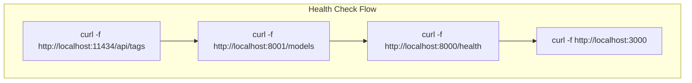

### Container Status Monitoring

```bash
# Check container status
docker compose ps

# View service logs
docker compose logs -f

# View specific service logs
docker compose logs rag-api
docker compose logs backend
docker compose logs frontend
```

Sources: [README.md:124-133](), [docker-compose.yml:40-43](), [docker-compose.yml:66-70](), [docker-compose.yml:89-93]()

## Ollama Connectivity

### Host vs Container Ollama

The system supports two Ollama deployment modes:

1. **Host Ollama** (Default): Ollama runs on host system
2. **Container Ollama** (Optional): Ollama runs in Docker container

```mermaid
graph TB
    subgraph "Host Ollama Mode"
        HostOllamaService["ollama serve<br/>Host Port 11434"]
        DockerGateway["Docker Gateway<br/>172.18.0.1:11434"]
        
        HostOllamaService --> DockerGateway
    end
    
    subgraph "Container Ollama Mode" 
        ContainerOllama["rag-ollama<br/>Container Port 11434"]
        OllamaNetwork["ollama:11434<br/>Internal Network"]
        
        ContainerOllama --> OllamaNetwork
    end
    
    subgraph "Service Configuration"
        RagAPIConfig["`OLLAMA_HOST`<br/>Environment Variable"]
        BackendConfig["`OllamaClient`<br/>Connection Logic"]
    end
    
    DockerGateway --> RagAPIConfig
    OllamaNetwork --> RagAPIConfig
    RagAPIConfig --> BackendConfig
```

The `OllamaClient.is_ollama_running()` method tests connectivity using the configured `OLLAMA_HOST`:

Sources: [docker-compose.yml:3-21](), [docker.env:2-7](), [backend/ollama_client.py:13-19]()

### Connectivity Testing

The system includes connectivity testing capabilities via `test_ollama_connectivity.py`:

```python
# Key functionality from test_ollama_connectivity.py
def test_ollama_connectivity():
    ollama_host = os.getenv('OLLAMA_HOST', 'Not set')
    client = OllamaClient()
    is_running = client.is_ollama_running()
    if is_running:
        models = client.list_models()
```

Sources: [backend/test_ollama_connectivity.py:6-33]()

## Management Commands

### Starting and Stopping

```bash
# Start all services
./start-docker.sh

# Stop all services  
./start-docker.sh stop

# Start with containerized Ollama
docker compose --profile with-ollama up -d

# Stop all containers
docker compose down
```

### Service Management

```bash
# Restart specific service
docker compose restart rag-api

# Scale services (if supported)
docker compose up --scale backend=2

# Remove all containers and volumes
docker compose down -v
```

### Log Management

```bash
# Follow logs for all services
docker compose logs -f

# Follow logs for specific service
docker compose logs -f rag-api

# View last 100 lines
docker compose logs --tail=100 backend
```

Sources: [README.md:124-133]()

## Troubleshooting

### Common Issues

#### Ollama Connection Failures

```bash
# Check if Ollama is accessible from container
docker exec rag-api curl -f http://host.docker.internal:11434/api/tags

# Test environment variables
docker exec rag-backend env | grep OLLAMA_HOST

# Run connectivity test
docker exec rag-backend python test_ollama_connectivity.py
```

#### Port Conflicts

If ports 3000, 8000, 8001, or 11434 are already in use:

```bash
# Check port usage
netstat -tulpn | grep -E ":(3000|8000|8001|11434) "

# Modify port mappings in docker-compose.yml
ports:
  - "3001:3000"  # Frontend on port 3001
  - "8002:8000"  # Backend on port 8002
```

#### Volume Permission Issues

```bash
# Fix volume permissions
sudo chown -R $USER:$USER ./lancedb ./index_store ./shared_uploads

# Check volume mounts
docker compose exec rag-api ls -la /app/lancedb
```

### Service Health Verification

```bash
# Check all service health
curl http://localhost:8000/health    # Backend
curl http://localhost:8001/models    # RAG API  
curl http://localhost:3000           # Frontend
curl http://localhost:11434/api/tags # Ollama
```

Sources: [backend/test_ollama_connectivity.py:6-37](), [docker-compose.yml:40-43](), [docker-compose.yml:66-70]()

---

# Page: Manual Installation

# Manual Installation

<details>
<summary>Relevant source files</summary>

The following files were used as context for generating this wiki page:

- [README.md](README.md)
- [requirements.txt](requirements.txt)

</details>


This document covers manual installation of LocalGPT using direct Python environment setup and the `run_system.py` orchestrator. This approach provides more control over individual components and is recommended for development environments.

For containerized deployment, see [Docker Installation](#2.1). For system requirements and hardware specifications, see [System Requirements](#2.3).

## Prerequisites

Manual installation requires Python 3.8+, Node.js 16+, and Ollama for AI model serving. The system has been tested primarily on macOS with the following versions:

| Component | Tested Version | Minimum |
|-----------|----------------|---------|
| Python | 3.11.5 | 3.8+ |
| Node.js | 23.10.0 | 16+ |
| npm | 10.9.2 | - |
| RAM | 16GB | 8GB |

**Sources:** [README.md:86-91]()

## System Dependencies

Install system-level dependencies based on your operating system:

**Ubuntu/Debian:**
```bash
sudo apt update
sudo apt install python3.8 python3-pip nodejs npm docker.io docker-compose
```

**macOS:**
```bash
brew install python@3.8 node npm docker docker-compose
```

**Windows:**
```bash
# Install Python 3.8+, Node.js, and Docker Desktop
# Then use PowerShell or WSL2
```

**Sources:** [README.md:222-237]()

## Python Dependencies Installation

The system requires specific AI and data processing libraries defined in `requirements.txt`:

```bash
# Install Python dependencies
pip install -r requirements.txt
```

### Key Dependencies by Category

| Category | Libraries | Purpose |
|----------|-----------|---------|
| **AI Models** | `torch==2.4.1`, `transformers==4.51.0` | PyTorch and HuggingFace model support |
| **Vector Database** | `lancedb` | Vector storage and similarity search |
| **Search Algorithms** | `rank_bm25`, `fuzzywuzzy` | BM25 keyword search and fuzzy matching |
| **Embeddings** | `sentence_transformers`, `rerankers` | Text embeddings and result reranking |
| **Document Processing** | `docling`, `PyPDF2`, `PyMuPDF` | Document conversion and text extraction |
| **Multimodal** | `colpali-engine` | Multimodal processing (future support) |

**Sources:** [README.md:145-151](), [requirements.txt:1-33]()

## Node.js Dependencies Installation

Install frontend dependencies for the React/Next.js interface:

```bash
# Install Node.js dependencies
npm install
```

**Sources:** [README.md:153-154]()

## AI Model Setup

LocalGPT requires Ollama for LLM inference and embedding generation:

### Ollama Installation

```bash
# Install Ollama
curl -fsSL https://ollama.ai/install.sh | sh

# Pull recommended models
ollama pull qwen3:0.6b          # Fast generation model
ollama pull qwen3:8b            # High-quality generation model

# Start Ollama server
ollama serve
```

The Ollama server runs on port 11434 and provides the AI inference backend for the RAG system.

**Sources:** [README.md:156-160](), [README.md:242-249]()

## System Orchestration Architecture

### Service Architecture with Module Names

```mermaid
graph TB
    subgraph "System Orchestrator"
        RunSystem["run_system.py<br/>Port Management<br/>Process Orchestration"]
    end
    
    subgraph "Core Services"
        OllamaServer["ollama serve<br/>Port: 11434<br/>LLM Inference"]
        RAGAPIServer["rag_system.api_server<br/>Port: 8001<br/>Document Processing"]
        BackendServer["backend/server.py<br/>Port: 8000<br/>Session Management"]
        FrontendServer["npm run dev<br/>Port: 3000<br/>Next.js Interface"]
    end
    
    subgraph "Storage Components"
        ChatDB["backend/chat_data.db<br/>SQLite Database<br/>Chat History"]
        VectorDB["./lancedb/<br/>LanceDB Tables<br/>Vector Embeddings"]
        IndexStore["./index_store/<br/>BM25 Indexes<br/>Document Overviews"]
        SharedUploads["./shared_uploads/<br/>File Storage<br/>Document Cache"]
    end
    
    RunSystem --> OllamaServer
    RunSystem --> RAGAPIServer
    RunSystem --> BackendServer
    RunSystem --> FrontendServer
    
    BackendServer --> ChatDB
    RAGAPIServer --> VectorDB
    RAGAPIServer --> IndexStore
    BackendServer --> SharedUploads
    
    BackendServer --> RAGAPIServer
    BackendServer --> OllamaServer
    RAGAPIServer --> OllamaServer
```

**Sources:** [README.md:191-196](), [README.md:200-214]()

## System Orchestration with run_system.py

The `run_system.py` script provides centralized management of all LocalGPT services:

### Basic System Start

```bash
# Start all services with default configuration
python run_system.py

# Access the application
open http://localhost:3000
```

### System Management Commands

```bash
# Check service status and health
python run_system.py --health

# Start in production mode
python run_system.py --mode prod

# Skip frontend (backend + RAG API only)
python run_system.py --no-frontend

# View aggregated logs
python run_system.py --logs-only

# Stop all services
python run_system.py --stop
```

### Service Orchestration Process

The orchestrator manages four key services with automatic dependency handling:

1. **Ollama Server** (port 11434): Started first for model serving
2. **RAG API Server** (port 8001): Document processing and retrieval
3. **Backend Server** (port 8000): Session management and API endpoints  
4. **Frontend Server** (port 3000): React/Next.js web interface

**Sources:** [README.md:162-189]()

## Manual Component Startup

For advanced users or debugging purposes, services can be started individually:

### Individual Service Commands

```bash
# Terminal 1: Start Ollama
ollama serve

# Terminal 2: Start RAG API
python -m rag_system.api_server

# Terminal 3: Start Backend
cd backend && python server.py

# Terminal 4: Start Frontend
npm run dev

# Access at http://localhost:3000
```

### Manual Startup Flow

```mermaid
graph TD
    Start["Manual Component Startup"] --> CheckOllama["1. Check Ollama Status<br/>curl http://localhost:11434/api/tags"]
    CheckOllama --> StartOllama["2. Start Ollama Server<br/>ollama serve"]
    StartOllama --> StartRAG["3. Start RAG API<br/>python -m rag_system.api_server"]
    StartRAG --> StartBackend["4. Start Backend<br/>cd backend && python server.py"]
    StartBackend --> StartFrontend["5. Start Frontend<br/>npm run dev"]
    StartFrontend --> VerifyServices["6. Verify All Services<br/>Health Check Endpoints"]
    
    VerifyServices --> HealthCheck1["backend: localhost:8000/health"]
    VerifyServices --> HealthCheck2["rag-api: localhost:8001/health"]  
    VerifyServices --> HealthCheck3["ollama: localhost:11434/api/tags"]
    VerifyServices --> HealthCheck4["frontend: localhost:3000"]
```

**Sources:** [README.md:200-214]()

## Environment Configuration

### Configuration File Setup

```bash
# Copy environment template
cp .env.example .env

# Edit configuration
nano .env
```

### Key Configuration Variables

The system uses environment variables for service configuration:

```env
# AI Models (referenced in rag_system/main.py)
OLLAMA_HOST=http://localhost:11434

# Database Paths (used by backend and RAG system)
DATABASE_PATH=./backend/chat_data.db
VECTOR_DB_PATH=./lancedb

# Server Settings (used by run_system.py)
BACKEND_PORT=8000
FRONTEND_PORT=3000
RAG_API_PORT=8001

# Optional: Override default models
GENERATION_MODEL=qwen3:8b
ENRICHMENT_MODEL=qwen3:0.6b
EMBEDDING_MODEL=Qwen/Qwen3-Embedding-0.6B
RERANKER_MODEL=answerdotai/answerai-colbert-small-v1
```

**Sources:** [README.md:253-280]()

## System Initialization and Verification

### Database Initialization

```bash
# Initialize chat database
python -c "from backend.database import ChatDatabase; ChatDatabase().init_database()"

# Test RAG system installation
python -c "from rag_system.main import get_agent; print('✅ Installation successful!')"
```

### Health Verification Commands

```bash
# Comprehensive system diagnostics
python system_health_check.py

# Service health check via run_system.py
python run_system.py --health

# Individual service health endpoints
curl http://localhost:8000/health    # Backend health
curl http://localhost:8001/health    # RAG API health
curl http://localhost:11434/api/tags # Ollama status
```

### Validation Checklist

| Component | Validation Command | Expected Result |
|-----------|-------------------|----------------|
| **Python Environment** | `python --version` | Python 3.8+ |
| **Dependencies** | `pip list \| grep -E "(torch\|transformers\|lancedb)"` | All packages installed |
| **Ollama Models** | `ollama list` | qwen3:0.6b, qwen3:8b listed |
| **Database Connection** | `python -c "from backend.database import ChatDatabase; db = ChatDatabase(); print('✅ Database OK')"` | Database OK |
| **RAG System** | `python -c "from rag_system.main import get_agent; print('✅ RAG OK')"` | RAG OK |

**Sources:** [README.md:284-296](), [README.md:528-533]()

## Troubleshooting Manual Installation

### Common Installation Issues

**Dependency Conflicts:**
```bash
# Check Python version compatibility
python --version  # Should be 3.8+

# Force reinstall dependencies
pip install -r requirements.txt --force-reinstall
```

**Model Loading Issues:**
```bash
# Verify Ollama installation
ollama list
curl http://localhost:11434/api/tags

# Pull missing models
ollama pull qwen3:0.6b
ollama pull qwen3:8b
```

**Service Startup Issues:**
```bash
# Check port availability
netstat -tulpn | grep -E ":(3000|8000|8001|11434)"

# Kill existing processes
pkill -f "ollama serve"
pkill -f "python.*run_system"
```

### Log File Locations

The system creates structured logs for debugging:

- `logs/system.log`: Main system events and errors
- `logs/ollama.log`: Ollama server logs  
- `logs/rag-api.log`: RAG API processing logs
- `logs/backend.log`: Backend server logs
- `logs/frontend.log`: Frontend build and runtime logs

**Sources:** [README.md:476-532]()

---

# Page: System Requirements

# System Requirements

<details>
<summary>Relevant source files</summary>

The following files were used as context for generating this wiki page:

- [README.md](README.md)
- [requirements.txt](requirements.txt)

</details>


This document outlines the hardware, software, and system requirements needed to run LocalGPT effectively. It covers minimum and recommended specifications, platform compatibility, and dependency requirements for all deployment modes.

For installation procedures, see [Docker Installation](#2.1) and [Manual Installation](#2.2). For performance optimization guidance, see [Performance & Optimization](#9).

## Hardware Requirements

### Minimum System Specifications

| Component | Minimum | Recommended | Notes |
|-----------|---------|-------------|-------|
| **RAM** | 8GB | 16GB+ | Vector embeddings and model loading require substantial memory |
| **Storage** | 10GB free | 50GB+ | Models, indexes, and document storage |
| **CPU** | 4 cores | 8+ cores | Multi-threaded document processing and embedding generation |
| **GPU** | None | CUDA-compatible | Optional but significantly improves performance |

### Hardware Platform Support

LocalGPT supports multiple hardware acceleration platforms:

```mermaid
graph TB
    LocalGPT["LocalGPT System"] --> PlatformLayer["Hardware Platform Layer"]
    
    PlatformLayer --> CUDA["CUDA GPU Support"]
    PlatformLayer --> CPU["CPU Processing"]
    PlatformLayer --> HPU["Intel Gaudi HPU"]
    PlatformLayer --> MPS["Apple Metal (MPS)"]
    
    CUDA --> PyTorch["torch==2.4.1"]
    CPU --> PyTorch
    HPU --> PyTorch
    MPS --> PyTorch
    
    PyTorch --> ModelLayer["Model Execution Layer"]
    ModelLayer --> OllamaServer["ollama serve (port 11434)"]
    ModelLayer --> TransformersModels["transformers==4.51.0"]
    
    TransformersModels --> EmbeddingModels["sentence_transformers"]
    TransformersModels --> RerankerModels["rerankers"]
```

**Hardware Platform Detection**
```mermaid
graph LR
    SystemCheck["system_health_check.py"] --> HardwareDetection["Hardware Detection"]
    
    HardwareDetection --> GPUCheck["GPU Availability Check"]
    HardwareDetection --> MemoryCheck["Memory Analysis"]
    HardwareDetection --> StorageCheck["Storage Assessment"]
    
    GPUCheck --> CUDAAvailable{"CUDA Available?"}
    CUDAAvailable -->|Yes| CUDAConfig["CUDA Configuration"]
    CUDAAvailable -->|No| CPUFallback["CPU Fallback"]
    
    MemoryCheck --> MemoryOptimization["PYTORCH_CUDA_ALLOC_CONF"]
    StorageCheck --> PathValidation["Database Path Validation"]
```

Sources: [README.md:50-50](), [README.md:86-91](), [README.md:515-517]()

## Software Dependencies

### Core Runtime Requirements

#### Python Environment
- **Python Version**: 3.8+ (tested with 3.11.5)
- **Package Manager**: pip for Python dependencies
- **Virtual Environment**: Recommended for isolation

#### Node.js Environment  
- **Node.js Version**: 16+ (tested with 23.10.0)
- **Package Manager**: npm (tested with 10.9.2)
- **Purpose**: Next.js frontend compilation and runtime

#### AI Model Serving
- **Ollama**: Required for LLM inference
- **Installation**: `curl -fsSL https://ollama.ai/install.sh | sh`
- **Models**: `qwen3:0.6b` (fast), `qwen3:8b` (high-quality)

Sources: [README.md:87-88](), [README.md:241-249]()

### Python Dependencies Analysis

```mermaid
graph TB
    subgraph "Core AI Dependencies"
        PyTorch["torch==2.4.1<br/>torchvision==0.19.1<br/>torchaudio"]
        Transformers["transformers==4.51.0"]
        SentenceTransformers["sentence_transformers"]
    end
    
    subgraph "Vector Storage & Search"
        LanceDB["lancedb"]
        BM25["rank_bm25"]
        FuzzySearch["fuzzywuzzy<br/>python-Levenshtein"]
    end
    
    subgraph "Document Processing"
        Docling["docling"]
        PyPDF["PyPDF2"]
        PyMuPDF["PyMuPDF"]
        Pillow["Pillow"]
    end
    
    subgraph "Specialized AI Components"
        Rerankers["rerankers"]
        ColPali["colpali-engine"]
        Accelerate["accelerate"]
        NLTK["nltk"]
    end
    
    subgraph "System & Utilities"
        Requests["requests<br/>httpx"]
        DotEnv["python-dotenv"]
        Cachetools["cachetools"]
        Psutil["psutil"]
    end
    
    PyTorch --> ModelExecution["Model Execution"]
    Transformers --> EmbeddingGeneration["EmbeddingGenerator"]
    LanceDB --> VectorIndexer["VectorIndexer"] 
    Docling --> DocumentConverter["DocumentConverter"]
    Rerankers --> AIReranker["AI Reranker Pipeline"]
```

**Dependency Categories:**

| Category | Purpose | Key Components |
|----------|---------|----------------|
| **AI Models** | Neural network inference | `torch`, `transformers`, `sentence_transformers` |
| **Vector Search** | Similarity search and ranking | `lancedb`, `rank_bm25`, `fuzzywuzzy` |
| **Document Processing** | File parsing and conversion | `docling`, `PyPDF2`, `PyMuPDF` |
| **Reranking** | Result refinement | `rerankers`, `colpali-engine` |
| **System Utilities** | Configuration and monitoring | `psutil`, `cachetools`, `python-dotenv` |

Sources: [requirements.txt:1-33](), [README.md:145-151]()

## Platform Compatibility

### Operating System Support

| OS | Status | Installation Method | Notes |
|----|--------|-------------------|-------|
| **macOS** | ✅ Fully Tested | `brew install python@3.8 node npm docker` | Primary development platform |
| **Ubuntu/Debian** | ✅ Supported | `apt install python3.8 python3-pip nodejs npm docker.io` | Production deployment tested |
| **Windows** | ⚠️ Limited Testing | PowerShell or WSL2 recommended | Requires Docker Desktop |

### Container Platform Support

```mermaid
graph TB
    ContainerPlatform["Container Deployment"] --> DockerCompose["docker-compose.yml"]
    
    DockerCompose --> Frontend["rag-frontend<br/>Next.js (port 3000)"]
    DockerCompose --> Backend["rag-backend<br/>FastAPI (port 8000)"]
    DockerCompose --> RAGAPI["rag-api<br/>RAG Processing (port 8001)"]
    DockerCompose --> OllamaContainer["rag-ollama<br/>LLM Inference (port 11434)"]
    
    subgraph "Shared Volumes"
        LanceData["lancedb/<br/>Vector Database"]
        IndexStore["index_store/<br/>Document Indices"]
        Uploads["shared_uploads/<br/>File Storage"]
        OllamaData["ollama_data/<br/>Model Storage"]
    end
    
    Frontend --> LanceData
    Backend --> Uploads
    RAGAPI --> LanceData
    RAGAPI --> IndexStore
    OllamaContainer --> OllamaData
```

**Docker Requirements:**
- **Docker Engine**: 20.10+
- **Docker Compose**: 2.0+
- **Container Resources**: 4GB RAM minimum per container
- **Volume Storage**: Persistent volumes for data retention

Sources: [README.md:222-237](), [README.md:101-133]()

## Performance Considerations

### Memory Requirements by Component

```mermaid
graph LR
    MemoryAllocation["System Memory Allocation"] --> OllamaRAM["Ollama Models<br/>4-8GB"]
    MemoryAllocation --> VectorDB["LanceDB Vectors<br/>1-4GB"]
    MemoryAllocation --> ProcessingRAM["Document Processing<br/>1-2GB"]
    MemoryAllocation --> SystemRAM["System Overhead<br/>2GB"]
    
    OllamaRAM --> ModelSize["Model Size Dependent<br/>qwen3:0.6b = ~1GB<br/>qwen3:8b = ~8GB"]
    VectorDB --> IndexSize["Index Size Dependent<br/>~1MB per 1000 chunks"]
    ProcessingRAM --> BatchSize["Batch Processing Size"]
```

### Performance Optimization Settings

| Component | Setting | Default | Optimization |
|-----------|---------|---------|-------------|
| **PyTorch CUDA** | `PYTORCH_CUDA_ALLOC_CONF` | None | `max_split_size_mb:512` |
| **Ollama Concurrency** | Concurrent requests | 1 | Limited by GPU memory |
| **Vector Search** | `retrieval_k` | 20 | Adjust based on document corpus |
| **Batch Processing** | Document batch size | 10 | Reduce for low-memory systems |

**System Health Monitoring:**
- `system_health_check.py` provides comprehensive diagnostics
- `run_system.py --health` checks service status
- Memory usage monitoring via `psutil`

Sources: [README.md:515-517](), [README.md:529-532]()

## Database Requirements

### Storage Backend Specifications

```mermaid
graph TB
    StorageLayer["Storage Layer"] --> SQLiteDB["SQLite Database<br/>chat_data.db"]
    StorageLayer --> LanceDBStorage["LanceDB Vector Store<br/>./lancedb/"]
    StorageLayer --> BM25Index["BM25 Index Store<br/>./index_store/bm25/"]
    StorageLayer --> FileSystem["File System Storage<br/>shared_uploads/"]
    
    SQLiteDB --> SessionData["Chat Sessions<br/>Conversation History"]
    LanceDBStorage --> VectorData["Document Embeddings<br/>text_pages_v3 table"]
    BM25Index --> KeywordData["Keyword Search Index"]
    FileSystem --> DocumentFiles["Uploaded Documents<br/>PDF, DOCX, TXT"]
    
    subgraph "Database Paths Configuration"
        DBConfig["Environment Variables"]
        DBConfig --> DBPath["DATABASE_PATH=./backend/chat_data.db"]
        DBConfig --> VectorPath["VECTOR_DB_PATH=./lancedb"]
    end
```

**Database Initialization:**
- SQLite database auto-created on first run
- LanceDB tables created during first indexing
- File system directories created automatically
- Database health checks via `ChatDatabase().init_database()`

Sources: [README.md:267-268](), [README.md:288-289](), [README.md:498-504]()

## Optional Components

### Enhanced Features Dependencies

| Feature | Dependencies | Purpose | Performance Impact |
|---------|-------------|---------|-------------------|
| **AI Reranking** | `rerankers`, ColBERT models | Improved search quality | +2-3s per query |
| **Contextual Enrichment** | Additional LLM calls | Enhanced document understanding | +30% indexing time |
| **Late Chunking** | Extended embedding models | Better context preservation | +20% memory usage |
| **Query Decomposition** | Sub-query generation | Complex query handling | +5-10s per complex query |
| **Answer Verification** | Secondary LLM validation | Improved accuracy | +3-5s per response |

### External Service Integration

```mermaid
graph TB
    ExternalServices["External Service Options"] --> OllamaExternal["External Ollama<br/>(Host System)"]
    ExternalServices --> HuggingFaceModels["HuggingFace Models<br/>(Direct Download)"]
    
    OllamaExternal --> ModelManagement["Model Management<br/>ollama pull qwen3:8b"]
    HuggingFaceModels --> EmbeddingDownload["Embedding Model Download<br/>Qwen/Qwen3-Embedding-0.6B"]
    HuggingFaceModels --> RerankerDownload["Reranker Model Download<br/>answerdotai/answerai-colbert-small-v1"]
    
    ModelManagement --> SystemIntegration["System Integration"]
    EmbeddingDownload --> SystemIntegration
    RerankerDownload --> SystemIntegration
    
    SystemIntegration --> ConfigValidation["Configuration Validation<br/>run_system.py --health"]
```

**External Dependencies:**
- **Internet Connection**: Required for initial model downloads
- **Model Storage**: 5-50GB depending on selected models  
- **API Rate Limits**: None for self-hosted Ollama
- **External Services**: Optional HuggingFace model hub access

Sources: [README.md:241-249](), [README.md:398-405](), [README.md:529-537]()

---

# Page: Core Components

# Core Components

<details>
<summary>Relevant source files</summary>

The following files were used as context for generating this wiki page:

- [Dockerfile.backend](Dockerfile.backend)
- [README.md](README.md)
- [backend/database.py](backend/database.py)
- [backend/server.py](backend/server.py)
- [rag_system/api_server.py](rag_system/api_server.py)

</details>


This document provides a detailed technical overview of LocalGPT's core architectural components and their interactions. It covers the document processing pipeline, RAG system architecture, database and storage systems, and model integration layers that form the foundation of the system.

For information about system installation and deployment, see [Installation & Setup](#2). For usage instructions and API details, see [Usage](#5).

## Document Processing Pipeline

The document processing pipeline transforms uploaded documents into searchable, contextually-enriched chunks stored in vector databases. This pipeline supports multiple document formats and provides configurable chunking strategies.

### Pipeline Architecture

```mermaid
flowchart TB
    subgraph "Document Input"
        Upload["File Upload<br/>shared_uploads/"]
        Formats["PDF, DOCX, TXT, MD"]
    end
    
    subgraph "Conversion Layer"  
        DocumentConverter["DocumentConverter<br/>Docling Integration"]
        ParsedContent["Parsed Content<br/>Text + Structure"]
    end
    
    subgraph "Chunking Layer"
        ChunkRouter["Chunking Router"]
        DoclingChunker["DoclingChunker<br/>Structure-Aware"]
        MarkdownChunker["MarkdownRecursiveChunker<br/>Markdown-Optimized"]
        DefaultChunker["Default Chunker<br/>Token-Based"]
    end
    
    subgraph "Enrichment Layer"
        ContextualEnricher["ContextualEnricher<br/>AI-Generated Context"]
        WindowExpander["Context Window<br/>Expansion"]
    end
    
    subgraph "Embedding Layer"
        EmbeddingGenerator["EmbeddingGenerator<br/>Batch Processing"]
        QwenEmbedder["QwenEmbedder<br/>Qwen3-Embedding-0.6B"]
        OllamaEmbedder["OllamaEmbedder<br/>Local Models"]
    end
    
    Upload --> Formats
    Formats --> DocumentConverter
    DocumentConverter --> ParsedContent
    ParsedContent --> ChunkRouter
    ChunkRouter --> DoclingChunker
    ChunkRouter --> MarkdownChunker  
    ChunkRouter --> DefaultChunker
    DoclingChunker --> ContextualEnricher
    MarkdownChunker --> ContextualEnricher
    DefaultChunker --> ContextualEnricher
    ContextualEnricher --> WindowExpander
    WindowExpander --> EmbeddingGenerator
    EmbeddingGenerator --> QwenEmbedder
    EmbeddingGenerator --> OllamaEmbedder
```

The pipeline processes documents through multiple configurable stages, with chunking strategy determined by the `chunker_mode` configuration in [rag_system/api_server.py:557](). The contextual enrichment step can be enabled or disabled via the `enable_enrich` parameter in [rag_system/api_server.py:560-562]().

### Configuration Parameters

| Parameter | Default | Description | Location |
|-----------|---------|-------------|----------|
| `chunk_size` | 512 | Token count per chunk | [rag_system/api_server.py:518]() |
| `chunk_overlap` | 64 | Overlap between chunks | [rag_system/api_server.py:519]() |
| `enable_enrich` | true | Enable contextual enrichment | [rag_system/api_server.py:522]() |
| `window_size` | 2 | Context window for enrichment | [rag_system/api_server.py:521]() |
| `batch_size_embed` | 50 | Embedding batch size | [rag_system/api_server.py:526]() |
| `batch_size_enrich` | 25 | Enrichment batch size | [rag_system/api_server.py:527]() |

**Sources:** [rag_system/api_server.py:501-690](), [README.md:52-56]()

## RAG System Architecture

The RAG system coordinates intelligent retrieval and generation through multiple specialized components. The system employs smart routing to decide between direct LLM responses and document-based retrieval.

### Core RAG Components

```mermaid
graph TB
    subgraph "Query Processing"
        UserQuery["User Query"]
        SmartRouter["SmartRouter<br/>_should_use_rag()"]
        QueryDecomp["Query Decomposition<br/>Optional Sub-queries"]
    end
    
    subgraph "Retrieval Pipeline"
        HybridSearch["HybridRetriever<br/>Vector + BM25"]
        VectorSearch["VectorSearch<br/>LanceDB"]
        BM25Search["BM25Search<br/>Full-text Index"]
        LateChunking["LateChunking<br/>Post-embedding Chunking"]
    end
    
    subgraph "Reranking Layer"
        AIReranker["AIReranker<br/>ColBERT Model"]
        AnswerAIColbert["answerdotai/answerai-colbert-small-v1"]
        ProvenceReranker["ProvenceReranker<br/>Sentence-level Pruning"]
    end
    
    subgraph "Generation Layer"
        RAGAgent["RAGAgent<br/>get_agent()"]
        OllamaClient["OllamaClient<br/>LLM Generation"]
        VerificationPass["Verification Pass<br/>Answer Accuracy Check"]
    end
    
    UserQuery --> SmartRouter
    SmartRouter --> QueryDecomp
    QueryDecomp --> HybridSearch
    HybridSearch --> VectorSearch
    HybridSearch --> BM25Search
    VectorSearch --> LateChunking
    BM25Search --> LateChunking
    LateChunking --> AIReranker
    AIReranker --> AnswerAIColbert
    AIReranker --> ProvenceReranker
    ProvenceReranker --> RAGAgent
    RAGAgent --> OllamaClient
    OllamaClient --> VerificationPass
```

### Smart Routing Logic

The system implements intelligent query routing through the `_should_use_rag()` function in [backend/server.py:342-366](). The routing decision process follows this hierarchy:

1. **Document Overview Analysis** - Uses AI to compare query against document summaries
2. **Pattern Matching Fallback** - Simple keyword-based routing when overviews unavailable  
3. **Default Behavior** - Conservative approach favoring document search when uncertain

```mermaid
flowchart LR
    Query["User Query"] --> HasIndexes{"Has Linked<br/>Indexes?"}
    HasIndexes -->|No| DirectLLM["Direct LLM<br/>OllamaClient"]
    HasIndexes -->|Yes| LoadOverviews["_load_document_overviews()"]
    LoadOverviews --> OverviewsExist{"Overviews<br/>Available?"}
    OverviewsExist -->|Yes| AIRouting["_route_using_overviews()<br/>LLM-based Decision"]
    OverviewsExist -->|No| PatternRouting["_simple_pattern_routing()<br/>Keyword Matching"]
    AIRouting --> UseRAG["Use RAG Pipeline"]
    AIRouting --> DirectLLM
    PatternRouting --> UseRAG
    PatternRouting --> DirectLLM
```

**Sources:** [backend/server.py:342-552](), [rag_system/api_server.py:20-36](), [README.md:30-31]()

## Database & Storage

LocalGPT employs a multi-tier storage architecture combining relational data for session management, vector storage for semantic search, and file storage for document persistence.

### Storage Architecture

```mermaid
graph TB
    subgraph "SQLite Database"
        ChatDatabase["ChatDatabase<br/>backend/chat_data.db"]
        SessionsTable["sessions<br/>Session Metadata"]
        MessagesTable["messages<br/>Chat History"]
        IndexesTable["indexes<br/>Index Registry"]
        IndexDocsTable["index_documents<br/>Document Links"]
        SessionIndexTable["session_indexes<br/>Session-Index Links"]
    end
    
    subgraph "Vector Storage"
        LanceDBManager["LanceDBManager<br/>lancedb/"]
        TextPagesTable["text_pages_v3<br/>Default Vector Table"]
        IndexVectorTables["text_pages_{index_id}<br/>Per-Index Tables"]
        BM25Index["BM25Index<br/>index_store/bm25/"]
    end
    
    subgraph "File Storage"
        SharedUploads["shared_uploads/<br/>Document Files"]
        IndexStore["index_store/<br/>Index Metadata"]
        OverviewsStore["index_store/overviews/<br/>Document Summaries"]
    end
    
    ChatDatabase --> SessionsTable
    ChatDatabase --> MessagesTable  
    ChatDatabase --> IndexesTable
    IndexesTable --> IndexDocsTable
    SessionsTable --> SessionIndexTable
    
    LanceDBManager --> TextPagesTable
    LanceDBManager --> IndexVectorTables
    LanceDBManager --> BM25Index
    
    IndexStore --> OverviewsStore
```

### Database Schema

The `ChatDatabase` class in [backend/database.py:7-668]() manages all SQLite operations with the following core tables:

| Table | Primary Key | Purpose | Key Relations |
|-------|-------------|---------|---------------|
| `sessions` | `id` (TEXT) | Chat session metadata | ↔ `messages.session_id` |
| `messages` | `id` (TEXT) | Individual chat messages | → `sessions.id` |
| `indexes` | `id` (TEXT) | Document index registry | ↔ `index_documents.index_id` |
| `index_documents` | `id` (INTEGER) | Document-to-index mapping | → `indexes.id` |
| `session_indexes` | `id` (INTEGER) | Session-to-index linking | → `sessions.id`, `indexes.id` |

### Vector Database Integration

Vector storage is managed through LanceDB with table naming conventions that link to SQLite metadata:

- **Default Table**: `text_pages_v3` for system-wide documents
- **Index Tables**: `text_pages_{index_id}` for isolated document collections
- **Table Resolution**: Handled by `_get_table_name_for_session()` in [rag_system/api_server.py:71-114]()

**Sources:** [backend/database.py:20-106](), [rag_system/api_server.py:71-114](), [README.md:266-274]()

## Model Integration

LocalGPT integrates multiple AI model types through a flexible provider system supporting both local and cloud-based models.

### Model Provider Architecture

```mermaid
graph TB
    subgraph "Generation Models"
        OllamaModels["Ollama Models<br/>qwen3:0.6b, qwen3:8b"]
        OllamaClient["OllamaClient<br/>backend/ollama_client.py"]
        GenerationConfig["Generation Config<br/>OLLAMA_CONFIG"]
    end
    
    subgraph "Embedding Models"  
        QwenEmbedding["Qwen/Qwen3-Embedding-0.6B<br/>HuggingFace Direct"]
        OllamaEmbedding["Ollama Embedding Models<br/>Local Inference"]
        EmbeddingGenerator["EmbeddingGenerator<br/>Batch Processing"]
    end
    
    subgraph "Reranking Models"
        ColBERTReranker["answerdotai/answerai-colbert-small-v1<br/>Primary Reranker"]
        BGEReranker["BAAI/bge-reranker-base<br/>Fallback Reranker"]
        AIReranker["AIReranker Component"]
    end
    
    subgraph "Model Configuration"
        PipelineConfigs["PIPELINE_CONFIGS<br/>Model Selection"]
        RuntimeOverrides["Runtime Model Updates<br/>update_embedding_model()"]
        ModelValidation["Model Availability Check"]
    end
    
    OllamaClient --> OllamaModels
    GenerationConfig --> OllamaClient
    EmbeddingGenerator --> QwenEmbedding
    EmbeddingGenerator --> OllamaEmbedding
    AIReranker --> ColBERTReranker
    AIReranker --> BGEReranker
    PipelineConfigs --> RuntimeOverrides
    RuntimeOverrides --> ModelValidation
```

### Model Configuration System

Model selection and configuration is handled through multiple layers:

1. **System Defaults**: Defined in `PIPELINE_CONFIGS` with fallback models
2. **Index-Specific**: Stored in database metadata via `update_index_metadata()` 
3. **Runtime Overrides**: Applied per-request through `_apply_index_embedding_model()`

The model resolution process in [rag_system/api_server.py:42-70]() ensures embedding model consistency:

```mermaid
flowchart LR
    SessionQuery["Session Query"] --> GetIndexes["db.get_indexes_for_session()"]
    GetIndexes --> ExtractModel["Extract embedding_model<br/>from metadata"]
    ExtractModel --> UpdatePipeline["retrieval_pipeline.update_embedding_model()"]
    UpdatePipeline --> ProcessQuery["Execute Retrieval"]
```

### Supported Model Types

| Model Type | Purpose | Examples | Configuration Location |
|------------|---------|----------|----------------------|
| Generation | Text completion, chat | `qwen3:0.6b`, `qwen3:8b` | [README.md:391-395]() |
| Embedding | Vector representation | `Qwen/Qwen3-Embedding-0.6B` | [README.md:401-404]() |
| Reranking | Result refinement | `answerdotai/answerai-colbert-small-v1` | [README.md:427-433]() |
| Enrichment | Context generation | `qwen3:0.6b` (lightweight) | [rag_system/api_server.py:524]() |

**Sources:** [rag_system/api_server.py:42-70](), [rag_system/api_server.py:692-732](), [README.md:385-406](), [backend/server.py:746-782]()

---

# Page: Document Processing Pipeline

# Document Processing Pipeline

<details>
<summary>Relevant source files</summary>

The following files were used as context for generating this wiki page:

- [rag_system/ingestion/chunking.py](rag_system/ingestion/chunking.py)
- [rag_system/ingestion/docling_chunker.py](rag_system/ingestion/docling_chunker.py)
- [rag_system/ingestion/document_converter.py](rag_system/ingestion/document_converter.py)
- [rag_system/pipelines/indexing_pipeline.py](rag_system/pipelines/indexing_pipeline.py)

</details>


This document explains LocalGPT's document processing pipeline, which converts raw documents into searchable text chunks with embeddings. This pipeline handles document format conversion, text chunking, embedding generation, and optional enhancements like contextual enrichment. For information about the retrieval and search processes that use these processed documents, see [RAG System Architecture](#3.2). For database storage details, see [Database & Storage](#3.3).

## Pipeline Overview

The document processing pipeline is orchestrated by the `IndexingPipeline` class, which coordinates multiple processing stages to transform uploaded documents into searchable knowledge.

### Document Processing Flow

```mermaid
flowchart TD
    Upload["File Upload<br/>(PDF, DOCX, HTML, TXT, MD)"] --> Converter["DocumentConverter<br/>docling integration"]
    Converter --> ChunkerSelect{Chunker Selection}
    ChunkerSelect -->|"chunker_mode=docling"| DoclingChunker["DoclingChunker<br/>Token-aware chunking"]
    ChunkerSelect -->|"chunker_mode=legacy"| MarkdownChunker["MarkdownRecursiveChunker<br/>Character-based chunking"]
    
    DoclingChunker --> ChunkList["Text Chunks<br/>with metadata"]
    MarkdownChunker --> ChunkList
    
    ChunkList --> EnrichCheck{Contextual<br/>Enrichment?}
    EnrichCheck -->|"enabled=true"| ContextualEnricher["ContextualEnricher<br/>LLM-based context injection"]
    EnrichCheck -->|"enabled=false"| EmbedGen["EmbeddingGenerator<br/>Vector generation"]
    ContextualEnricher --> EmbedGen
    
    EmbedGen --> VectorIndexer["VectorIndexer<br/>LanceDB storage"]
    
    Converter --> OverviewBuilder["OverviewBuilder<br/>Document summaries"]
    OverviewBuilder --> IndexStore[("index_store/<br/>overview files")]
    VectorIndexer --> LanceDB[("LanceDB<br/>vector embeddings")]
    VectorIndexer --> FTSIndex["FTS Index<br/>keyword search"]
```

Sources: [rag_system/pipelines/indexing_pipeline.py:131-339]()

## Document Conversion

The `DocumentConverter` class handles multiple input formats using the Docling library for structured document parsing.

### Supported Document Formats

| Format | Extension | Processing Method |
|--------|-----------|------------------|
| PDF | `.pdf` | Docling with OCR detection |
| Word | `.docx` | Docling converter |
| HTML | `.html`, `.htm` | Docling converter |
| Markdown | `.md` | Docling converter |
| Text | `.txt` | Direct text reading |

### PDF Processing Strategy

```mermaid
flowchart TD
    PDFInput["PDF Input"] --> TextCheck{"PDF has<br/>text layer?"}
    TextCheck -->|"Yes"| NoOCR["converter_no_ocr<br/>Fast processing"]
    TextCheck -->|"No"| OCREnabled["converter_ocr<br/>Full OCR enabled"]
    
    NoOCR --> DoclingResult["DoclingDocument<br/>structured output"]
    OCREnabled --> DoclingResult
    
    DoclingResult --> MarkdownExport["export_to_markdown()"]
    MarkdownExport --> ChunkingPhase["Chunking Phase"]
```

The converter uses PyMuPDF to detect if a PDF already contains a text layer [rag_system/ingestion/document_converter.py:80-88](), avoiding unnecessary OCR processing for performance optimization.

Sources: [rag_system/ingestion/document_converter.py:54-135](), [rag_system/ingestion/document_converter.py:77-95]()

## Chunking Strategies

LocalGPT supports two chunking approaches, selected via the `chunker_mode` configuration parameter.

### DoclingChunker (Token-Aware)

The `DoclingChunker` provides intelligent chunking based on document structure and token limits:

```mermaid
flowchart TD
    DoclingDoc["DoclingDocument<br/>structured input"] --> ElementWalk["Element Tree Walk<br/>doc.texts iteration"]
    
    ElementWalk --> RoleCheck{"Text Role?"}
    RoleCheck -->|"heading"| HeadingPath["Update heading_path<br/>breadcrumb tracking"]
    RoleCheck -->|"paragraph"| TokenBuffer["Token Buffer<br/>max_tokens limit"]
    RoleCheck -->|"table"| AtomicChunk["Atomic Table Chunk<br/>export_to_markdown()"]
    
    HeadingPath --> NextElement["Next Element"]
    TokenBuffer --> BufferFull{"Buffer > max_tokens?"}
    BufferFull -->|"Yes"| FlushBuffer["Flush Buffer<br/>create chunk"]
    BufferFull -->|"No"| AccumulateText["Accumulate Text"]
    AccumulateText --> NextElement
    FlushBuffer --> NextElement
    AtomicChunk --> NextElement
    NextElement --> ElementWalk
```

Key features:
- **Token-based limits**: Uses `max_tokens` instead of character counts [rag_system/ingestion/docling_chunker.py:20-21]()
- **Sentence overlap**: Configurable overlap between chunks [rag_system/ingestion/docling_chunker.py:22]()
- **Breadcrumb metadata**: Maintains `heading_path` for context [rag_system/ingestion/docling_chunker.py:71-72]()
- **Atomic elements**: Tables and figures preserved as single chunks [rag_system/ingestion/docling_chunker.py:154-160]()

Sources: [rag_system/ingestion/docling_chunker.py:88-246]()

### MarkdownRecursiveChunker (Legacy)

The legacy chunker uses hierarchical markdown splitting:

- **Split priority**: Headers (`## `, `### `), code blocks (``` ), paragraphs (`\n\n`) [rag_system/ingestion/chunking.py:14]()
- **Size constraints**: `max_chunk_size` and `min_chunk_size` parameters [rag_system/ingestion/chunking.py:11-12]()
- **Token estimation**: Uses Hugging Face tokenizers or character approximation [rag_system/ingestion/chunking.py:29-34]()

Sources: [rag_system/ingestion/chunking.py:5-126]()

## Embedding Generation

The `EmbeddingGenerator` creates vector embeddings for text chunks using configurable embedding models.

### Embedding Process

```mermaid
flowchart TD
    ChunkBatch["Text Chunks<br/>batch_size=50"] --> ModelSelect["select_embedder()<br/>model selection"]
    ModelSelect --> EmbedType{"Embedding Model Type"}
    
    EmbedType -->|"Qwen/local model"| QwenEmbedder["QwenEmbedder<br/>local inference"]
    EmbedType -->|"Ollama model"| OllamaEmbedder["OllamaEmbedder<br/>ollama_client"]
    
    QwenEmbedder --> VectorOutput["Vector Embeddings<br/>numpy arrays"]
    OllamaEmbedder --> VectorOutput
    
    VectorOutput --> VectorIndexer["VectorIndexer.index()<br/>LanceDB storage"]
    VectorIndexer --> TableStorage["LanceDB Table<br/>text_table_name"]
```

Configuration parameters:
- `embedding_batch_size`: Batch size for processing (default: 50) [rag_system/pipelines/indexing_pipeline.py:57]()
- `embedding_model_name`: Model identifier [rag_system/pipelines/indexing_pipeline.py:79]()

Sources: [rag_system/pipelines/indexing_pipeline.py:78-85](), [rag_system/pipelines/indexing_pipeline.py:246-256]()

## Optional Enhancements

### Contextual Enrichment

The `ContextualEnricher` augments chunks with surrounding context using an LLM:

```mermaid
flowchart TD
    OriginalChunks["Original Text Chunks"] --> WindowBuilder["Context Window Builder<br/>window_size parameter"]
    WindowBuilder --> ContextWindow["Contextual Window<br/>surrounding chunks"]
    
    ContextWindow --> LLMEnrich["LLM Enrichment<br/>enrich_model"]
    LLMEnrich --> EnrichedText["Enriched Chunk Text<br/>modified 'text' field"]
    
    EnrichedText --> EmbeddingGen["Embedding Generation<br/>enriched content"]
```

Configuration:
- `enabled`: Boolean flag [rag_system/pipelines/indexing_pipeline.py:93]()
- `window_size`: Context window size [rag_system/pipelines/indexing_pipeline.py:220]()
- `enrich_model`: LLM model name [rag_system/pipelines/indexing_pipeline.py:95-99]()
- `enrichment_batch_size`: Processing batch size [rag_system/pipelines/indexing_pipeline.py:58]()

Sources: [rag_system/pipelines/indexing_pipeline.py:93-107](), [rag_system/pipelines/indexing_pipeline.py:218-244]()

### Document Overview Generation

The `OverviewBuilder` creates document summaries for intelligent routing:

- **Purpose**: Enables smart routing decisions between RAG and direct LLM responses
- **Input**: First N chunks from each document [rag_system/pipelines/indexing_pipeline.py:114]()
- **Output**: Stored in `index_store/` directory [rag_system/pipelines/indexing_pipeline.py:115]()
- **Model**: Configurable overview generation model [rag_system/pipelines/indexing_pipeline.py:113]()

Sources: [rag_system/pipelines/indexing_pipeline.py:109-116](), [rag_system/pipelines/indexing_pipeline.py:181-185]()

## Pipeline Orchestration

### IndexingPipeline Class Structure

```mermaid
classDiagram
    class IndexingPipeline {
        +DocumentConverter document_converter
        +DoclingChunker|MarkdownRecursiveChunker chunker
        +EmbeddingGenerator embedding_generator
        +VectorIndexer vector_indexer
        +ContextualEnricher contextual_enricher
        +OverviewBuilder overview_builder
        +run(file_paths) void
    }
    
    IndexingPipeline --> DocumentConverter
    IndexingPipeline --> DoclingChunker
    IndexingPipeline --> MarkdownRecursiveChunker
    IndexingPipeline --> EmbeddingGenerator
    IndexingPipeline --> VectorIndexer
    IndexingPipeline --> ContextualEnricher
    IndexingPipeline --> OverviewBuilder
    
    class DocumentConverter {
        +converter_no_ocr DoclingConverter
        +converter_ocr DoclingConverter 
        +convert_to_markdown(file_path) List
    }
    
    class DoclingChunker {
        +max_tokens int
        +overlap int
        +tokenizer AutoTokenizer
        +chunk_document(doc) List
    }
    
    class MarkdownRecursiveChunker {
        +max_chunk_size int
        +min_chunk_size int
        +chunk(text, doc_id) List
    }
```

### Processing Statistics and Monitoring

The pipeline includes comprehensive progress tracking:

- **File-level tracking**: `ProgressTracker` for document processing [rag_system/pipelines/indexing_pipeline.py:153]()
- **Memory estimation**: `estimate_memory_usage()` for chunk collections [rag_system/pipelines/indexing_pipeline.py:204-205]()
- **Timing information**: `timer()` context manager for performance monitoring [rag_system/pipelines/indexing_pipeline.py:148]()
- **Final statistics**: Processing summary with component status [rag_system/pipelines/indexing_pipeline.py:341-358]()

Sources: [rag_system/pipelines/indexing_pipeline.py:13-17](), [rag_system/pipelines/indexing_pipeline.py:146-198](), [rag_system/pipelines/indexing_pipeline.py:341-358]()

---

# Page: RAG System Architecture

# RAG System Architecture

<details>
<summary>Relevant source files</summary>

The following files were used as context for generating this wiki page:

- [Dockerfile.backend](Dockerfile.backend)
- [README.md](README.md)
- [backend/database.py](backend/database.py)
- [backend/server.py](backend/server.py)
- [rag_system/api_server.py](rag_system/api_server.py)

</details>


This document describes the core Retrieval-Augmented Generation (RAG) system architecture within LocalGPT, focusing on how queries are processed, documents are retrieved, and responses are generated. It covers the RAG agent, smart routing logic, retrieval pipeline, and the integration between different system components.

For general system architecture and service orchestration, see [System Architecture](#1.2). For document processing and indexing details, see [Document Processing Pipeline](#3.1). For database schema and storage systems, see [Database & Storage](#3.3).

## RAG Agent Core Architecture

The RAG system centers around a singleton `RAG_AGENT` instance that orchestrates all retrieval-augmented generation operations. This agent provides intelligent routing between direct LLM responses and document-based retrieval.

```mermaid
graph TB
    subgraph "RAG API Server (port 8001)"
        Handler["AdvancedRagApiHandler"]
        Agent["RAG_AGENT (singleton)"]
        IndexPipeline["INDEXING_PIPELINE"]
    end
    
    subgraph "Core RAG Components"
        RetrievalPipeline["retrieval_pipeline"]
        SmartRouter["Smart Router"]
        SessionManager["Session Manager"]
        EmbeddingManager["Embedding Model Manager"]
    end
    
    subgraph "Storage Systems"
        LanceDB[("LanceDB\n(vectors)")]
        SQLite[("ChatDatabase\n(metadata)")]
        OverviewStore[("Overview Store\n(JSONL files)")]
    end
    
    Handler --> Agent
    Agent --> RetrievalPipeline
    Agent --> SmartRouter
    Agent --> SessionManager
    RetrievalPipeline --> EmbeddingManager
    SessionManager --> SQLite
    RetrievalPipeline --> LanceDB
    SmartRouter --> OverviewStore
```

**RAG Agent Initialization and Management**

Sources: [rag_system/api_server.py:26-37]()

The `RAG_AGENT` is initialized once when the API server starts and remains resident in memory to avoid reloading models on each request. The agent mode is configurable via the `RAG_CONFIG_MODE` environment variable, supporting different pipeline configurations like "default", "fast", and "react".

## Smart Routing System

LocalGPT implements intelligent query routing that decides whether to use the RAG pipeline or direct LLM generation based on document context and query analysis.

```mermaid
graph LR
    Query["User Query"] --> Router["_should_use_rag()"]
    
    Router --> OverviewCheck["_load_document_overviews()"]
    OverviewCheck --> LLMRouting["_route_using_overviews()"]
    LLMRouting --> RAGDecision["USE_RAG"]
    LLMRouting --> DirectDecision["DIRECT_LLM"]
    
    Router --> FallbackCheck["_simple_pattern_routing()"]
    FallbackCheck --> PatternDecision["Pattern Match"]
    
    RAGDecision --> RAGPath["_handle_rag_query()"]
    DirectDecision --> DirectPath["_handle_direct_llm_query()"]
    
    RAGPath --> RAGAPICall["POST /chat (port 8001)"]
    DirectPath --> OllamaCall["ollama_client.chat()"]
```

**Overview-Based Intelligent Routing**

Sources: [backend/server.py:342-505]()

The routing system first attempts to load document overviews for the session's linked indexes using `_load_document_overviews()`. These overviews are aggregated from per-index JSONL files located at `index_store/overviews/{index_id}.jsonl`. The system then uses a fast LLM model (qwen3:0.6b) to analyze the query against document summaries and determine routing.

**Fallback Pattern Matching**

When overview-based routing fails, the system falls back to pattern matching that identifies greeting patterns, document-related keywords, and query characteristics to make routing decisions.

## Retrieval Pipeline Architecture

The retrieval pipeline handles document search, hybrid retrieval, reranking, and answer generation with multiple configurable components.

```mermaid
graph TB
    subgraph "Query Processing"
        QueryInput["Query Input"]
        EmbedGen["Embedding Generation"]
        TableLookup["_get_table_name_for_session()"]
    end
    
    subgraph "Retrieval Strategies"
        HybridSearch["Hybrid Search"]
        VectorSearch["Vector Search (LanceDB)"]
        BM25Search["BM25 Search"]
        LateChunking["Late Chunking"]
    end
    
    subgraph "Post-Processing"
        AIReranker["AI Reranker"]
        ContextEnrich["Contextual Enrichment"]
        ProvencePrune["Provence Sentence Pruning"]
    end
    
    subgraph "Generation"
        LLMGeneration["LLM Answer Generation"]
        Verification["Answer Verification"]
        ResponseFormat["Response Formatting"]
    end
    
    QueryInput --> EmbedGen
    QueryInput --> TableLookup
    EmbedGen --> HybridSearch
    
    HybridSearch --> VectorSearch
    HybridSearch --> BM25Search
    HybridSearch --> LateChunking
    
    VectorSearch --> AIReranker
    BM25Search --> AIReranker
    LateChunking --> AIReranker
    
    AIReranker --> ContextEnrich
    ContextEnrich --> ProvencePrune
    ProvencePrune --> LLMGeneration
    LLMGeneration --> Verification
    Verification --> ResponseFormat
```

**Hybrid Search Implementation**

Sources: [rag_system/api_server.py:218-286]()

The retrieval pipeline supports multiple search strategies configured through runtime parameters:
- `search_type`: "hybrid", "vector_only", "bm25_only"
- `dense_weight`: Weighting for vector vs. BM25 results (default 0.7)
- `retrieval_k`: Number of initial candidates (default 20)
- `reranker_top_k`: Final results after reranking (default 10)

**Table Name Resolution**

Sources: [rag_system/api_server.py:71-113]()

The system uses `_get_table_name_for_session()` to resolve the correct LanceDB table for a session by looking up linked indexes and retrieving their `vector_table_name`. This enables session-specific document retrieval from dedicated vector stores.

## Session and Index Management

LocalGPT implements session-based document management where each chat session can be linked to multiple document indexes, enabling contextual document retrieval.

```mermaid
graph TB
    subgraph "Database Schema (ChatDatabase)"
        Sessions["sessions table"]
        Messages["messages table"] 
        Indexes["indexes table"]
        SessionIndexes["session_indexes table"]
        IndexDocs["index_documents table"]
    end
    
    subgraph "Session Operations"
        CreateSession["create_session()"]
        LinkIndex["link_index_to_session()"]
        GetIndexes["get_indexes_for_session()"]
        LoadOverviews["load_overviews_for_indexes()"]
    end
    
    subgraph "Index Operations"
        CreateIndex["create_index()"]
        BuildIndex["handle_build_index()"]
        ApplyEmbedding["_apply_index_embedding_model()"]
        UpdateMeta["update_index_metadata()"]
    end
    
    Sessions --> Messages
    Indexes --> SessionIndexes
    Sessions --> SessionIndexes
    Indexes --> IndexDocs
    
    CreateSession --> LinkIndex
    LinkIndex --> GetIndexes
    GetIndexes --> LoadOverviews
    
    CreateIndex --> BuildIndex
    BuildIndex --> ApplyEmbedding
    BuildIndex --> UpdateMeta
```

**Session-Index Linking**

Sources: [backend/database.py:380-391](), [backend/server.py:988-993]()

Sessions are linked to indexes through the `session_indexes` table, allowing multiple indexes per session. The `get_indexes_for_session()` method retrieves all linked indexes, while `link_index_to_session()` creates new associations.

**Dynamic Embedding Model Application**

Sources: [rag_system/api_server.py:42-69]()

The `_apply_index_embedding_model()` function ensures the retrieval pipeline uses the correct embedding model for each session by reading the model name from index metadata and updating the pipeline configuration at runtime.

## Data Flow Architecture

The complete RAG system follows a multi-stage data flow from user input to final response, with branching paths for different query types.

```mermaid
sequenceDiagram
    participant U as User
    participant B as Backend (8000)
    participant R as RAG API (8001)
    participant D as ChatDatabase
    participant L as LanceDB
    participant O as Ollama
    
    U->>B: POST /sessions/{id}/messages
    B->>D: get_indexes_for_session()
    B->>B: _should_use_rag()
    
    alt RAG Required
        B->>R: POST /chat
        R->>D: get_index()
        R->>R: _apply_index_embedding_model()
        R->>L: hybrid_search()
        R->>O: generate_answer()
        R->>B: response + sources
    else Direct LLM
        B->>O: chat()
        B->>B: format_response()
    end
    
    B->>D: add_message()
    B->>U: JSON response
```

**Request Processing Flow**

Sources: [backend/server.py:272-341](), [rag_system/api_server.py:145-302]()

1. **Session Chat Handler**: `handle_session_chat()` receives user queries and determines routing
2. **Smart Routing**: Query analysis decides between RAG pipeline or direct LLM
3. **RAG Processing**: Complex queries are forwarded to the RAG API server for document retrieval
4. **Response Storage**: All interactions are stored in the database for session continuity

**Configuration Override System**

Sources: [rag_system/api_server.py:221-236](), [rag_system/api_server.py:401-415]()

Runtime parameters can override default pipeline configuration:
- Retrieval parameters (`retrieval_k`, `reranker_top_k`, `search_type`)
- Processing flags (`provence_prune`, `context_window_size`)
- Model selection (`embedding_model`, `generation_model`)

The system applies these overrides dynamically to the pipeline configuration without requiring restart, enabling flexible per-query optimization.

---

# Page: Database & Storage

# Database & Storage

<details>
<summary>Relevant source files</summary>

The following files were used as context for generating this wiki page:

- [Dockerfile.backend](Dockerfile.backend)
- [backend/database.py](backend/database.py)
- [backend/server.py](backend/server.py)
- [rag_system/api_server.py](rag_system/api_server.py)
- [rag_system/indexing/embedders.py](rag_system/indexing/embedders.py)
- [rag_system/indexing/latechunk.py](rag_system/indexing/latechunk.py)
- [rag_system/indexing/representations.py](rag_system/indexing/representations.py)

</details>


This document covers LocalGPT's multi-layer storage architecture, including SQLite databases for structured data, LanceDB for vector embeddings, and file system storage for documents. It details the database schemas, storage patterns, and data persistence mechanisms across different deployment environments.

For information about model loading and configuration, see [Model Integration](#3.4). For details on indexing and retrieval processes, see [Document Processing Pipeline](#3.1).

## Storage Architecture Overview

LocalGPT uses a multi-tiered storage architecture that separates concerns between relational data, vector embeddings, and file storage:

```mermaid
graph TB
    subgraph "Application Layer"
        BackendServer["backend/server.py<br/>ChatHandler"]
        RAGAPIServer["rag_system/api_server.py<br/>AdvancedRagApiHandler"]
    end
    
    subgraph "Storage Controllers"
        ChatDB["backend/database.py<br/>ChatDatabase"]
        LanceDBMgr["rag_system/indexing/embedders.py<br/>LanceDBManager"]
        VectorIndexer["rag_system/indexing/embedders.py<br/>VectorIndexer"]
    end
    
    subgraph "Storage Persistence"
        SQLiteDB[("chat_data.db<br/>SQLite Database")]
        LanceDB[("lancedb/<br/>Vector Database")]
        FileSystem[("shared_uploads/<br/>File Storage")]
        IndexStore[("index_store/<br/>Document Metadata")]
    end
    
    BackendServer --> ChatDB
    RAGAPIServer --> ChatDB
    RAGAPIServer --> LanceDBMgr
    RAGAPIServer --> VectorIndexer
    
    ChatDB --> SQLiteDB
    LanceDBMgr --> LanceDB
    VectorIndexer --> LanceDB
    BackendServer --> FileSystem
    RAGAPIServer --> IndexStore
```

Sources: [backend/database.py:1-667](), [rag_system/indexing/embedders.py:1-159](), [backend/server.py:1-1070](), [rag_system/api_server.py:1-800]()

## SQLite Database System

The `ChatDatabase` class manages all relational data using SQLite, with automatic environment detection for database placement.

### Database Schema

| Table | Purpose | Key Relationships |
|-------|---------|-------------------|
| `sessions` | Chat session metadata | Primary entity for conversations |
| `messages` | Individual chat messages | Foreign key to `sessions.id` |
| `session_documents` | Document-session associations | Links files to conversations |
| `indexes` | Vector index metadata | Stores index configuration |
| `index_documents` | Document-index associations | Maps files to vector indexes |
| `session_indexes` | Session-index links | Enables multi-index sessions |

### Database Initialization and Location

The database automatically detects the deployment environment:

```mermaid
graph LR
    Init["ChatDatabase.__init__()"] --> Check{"/app exists?"}
    Check -->|Yes| Docker["/app/backend/chat_data.db"]
    Check -->|No| Local["backend/chat_data.db"]
    Docker --> CreateTables["init_database()"]
    Local --> CreateTables
    CreateTables --> EnableFK["PRAGMA foreign_keys = ON"]
    EnableFK --> CreateIndexes["Performance indexes"]
```

Sources: [backend/database.py:8-18](), [backend/database.py:20-106](), [Dockerfile.backend:19-20]()

### Session and Message Management

The database stores conversation state with automatic title generation and message counting:

```python
# Session creation with metadata
session_id = db.create_session("Chat Title", "llama3.2:latest")

# Message storage with relationship tracking
message_id = db.add_message(session_id, content, sender, metadata)
```

Each message includes:
- Content text and sender identification
- Timestamp for chronological ordering
- JSON metadata field for extensible properties
- Automatic session timestamp and counter updates

Sources: [backend/database.py:108-183](), [backend/database.py:639-664]()

### Index Metadata Persistence

The database stores vector index configurations and relationships:

```mermaid
graph TB
    IndexCreation["create_index()"] --> GenerateID["UUID + vector_table_name"]
    GenerateID --> StoreMetadata["Store configuration JSON"]
    StoreMetadata --> LinkDocuments["index_documents table"]
    LinkDocuments --> LinkSessions["session_indexes table"]
    
    InspectMetadata["inspect_and_populate_index_metadata()"] --> CheckLanceDB["Query LanceDB table"]
    CheckLanceDB --> InferConfig["Extract vector dimensions"]
    InferConfig --> UpdateMetadata["update_index_metadata()"]
```

Sources: [backend/database.py:328-427](), [backend/database.py:443-637]()

## Vector Storage System (LanceDB)

LocalGPT uses LanceDB for high-performance vector storage and similarity search operations.

### LanceDB Architecture

```mermaid
graph TB
    subgraph "Vector Pipeline"
        ChunkData["Document Chunks<br/>{text, metadata, chunk_id}"]
        Embeddings["Vector Embeddings<br/>np.ndarray"]
        Combine["Combine + Validate"]
    end
    
    subgraph "LanceDB Operations"
        LanceDBMgr["LanceDBManager<br/>Connection Manager"]
        VectorIndexer["VectorIndexer<br/>Data Indexing"]
        Schema["PyArrow Schema<br/>Definition"]
    end
    
    subgraph "Storage Format"
        Table["LanceDB Table<br/>text_pages_{index_id}"]
        Columns["vector | text | chunk_id<br/>document_id | metadata"]
    end
    
    ChunkData --> Combine
    Embeddings --> Combine
    Combine --> VectorIndexer
    VectorIndexer --> LanceDBMgr
    LanceDBMgr --> Schema
    Schema --> Table
    Table --> Columns
```

### Vector Indexing Process

The `VectorIndexer` class handles embedding storage with data validation:

```python
# Schema definition for vector storage
schema = pa.schema([
    pa.field("vector", pa.list_(pa.float32(), vector_dim)),
    pa.field("text", pa.string(), nullable=False),
    pa.field("chunk_id", pa.string()),
    pa.field("document_id", pa.string()),
    pa.field("chunk_index", pa.int32()),
    pa.field("metadata", pa.string())
])
```

Key validation features:
- **NaN/Infinite Detection**: Filters invalid embedding values
- **Metadata Preservation**: Stores original text in metadata JSON
- **Incremental Indexing**: Appends to existing tables or creates new ones
- **Error Recovery**: Fallback strategies for corrupted embeddings

Sources: [rag_system/indexing/embedders.py:21-119](), [rag_system/indexing/embedders.py:30-86]()

### Database Connection Management

```mermaid
graph LR
    Connect["lancedb.connect(db_path)"] --> CheckTable{Table exists?}
    CheckTable -->|Yes| OpenTable["db.open_table(name)"]
    CheckTable -->|No| CreateTable["db.create_table(name, schema)"]
    OpenTable --> Operations["Query/Insert Operations"]
    CreateTable --> Operations
    
    Operations --> IncrementalAdd["table.add(data, on_bad_vectors='drop')"]
    IncrementalAdd --> FallbackFill["Retry with fill_value=0.0"]
```

Sources: [rag_system/indexing/embedders.py:8-19](), [rag_system/indexing/embedders.py:96-118]()

## File Storage System

LocalGPT manages document files and metadata across multiple storage locations with automatic path resolution.

### File Organization Structure

| Directory | Contents | Access Pattern |
|-----------|----------|----------------|
| `shared_uploads/` | User-uploaded documents | Unique UUID prefixed filenames |
| `index_store/overviews/` | Document summaries | Per-index JSONL files |
| `index_store/lancedb/` | Vector database files | LanceDB internal format |
| `logs/` | System logs | Debug and error tracking |

### File Upload and Storage

Document uploads use UUID-based naming to prevent filename conflicts:

```mermaid
graph TB
    Upload["File Upload Request"] --> ValidateForm["cgi.FieldStorage Parsing"]
    ValidateForm --> GenerateUUID["uuid.uuid4()_{filename}"]
    GenerateUUID --> SaveFile["Write to shared_uploads/"]
    SaveFile --> RecordDB["db.add_document_to_session()"]
    RecordDB --> AbsolutePath["Store absolute path"]
```

Sources: [backend/server.py:658-696](), [backend/server.py:842-861]()

### Overview File Management

Document overviews are stored as JSONL files with index-specific organization:

```python
# Per-index overview files
overview_path = f"index_store/overviews/{index_id}.jsonl"

# Legacy fallback
legacy_path = "index_store/overviews/overviews.jsonl"
```

Each overview record contains:
- Document summary and key topics
- Processing metadata and timestamps
- Configuration parameters used during indexing

Sources: [rag_system/api_server.py:266](), [rag_system/api_server.py:424](), [backend/server.py:368-438]()

## Data Flow Between Storage Systems

The following diagram shows how data moves between the different storage systems during typical operations:

```mermaid
sequenceDiagram
    participant User
    participant BackendServer
    participant ChatDatabase
    participant RAGAPIServer
    participant LanceDBManager
    participant FileSystem
    
    User->>BackendServer: Upload documents
    BackendServer->>FileSystem: Save to shared_uploads/
    BackendServer->>ChatDatabase: add_document_to_session()
    
    User->>BackendServer: Request indexing
    BackendServer->>RAGAPIServer: POST /index
    RAGAPIServer->>FileSystem: Read document files
    RAGAPIServer->>LanceDBManager: Store embeddings
    RAGAPIServer->>FileSystem: Write overviews
    RAGAPIServer->>ChatDatabase: update_index_metadata()
    
    User->>BackendServer: Submit query
    BackendServer->>ChatDatabase: get_indexes_for_session()
    BackendServer->>RAGAPIServer: POST /chat
    RAGAPIServer->>LanceDBManager: Vector similarity search
    RAGAPIServer->>ChatDatabase: add_message() (response)
```

Sources: [backend/server.py:272-341](), [rag_system/api_server.py:145-302](), [backend/database.py:302-391]()

## Configuration and Persistence

Storage configuration adapts to different deployment environments with automatic path detection and fallback mechanisms.

### Environment-Specific Paths

| Environment | Database Path | Vector Storage | File Storage |
|-------------|---------------|----------------|--------------|
| Docker | `/app/backend/chat_data.db` | `/app/rag_system/index_store/lancedb` | `/app/shared_uploads` |
| Local Development | `backend/chat_data.db` | `./rag_system/index_store/lancedb` | `shared_uploads/` |
| Custom | User-specified | `LANCEDB_PATH` environment variable | Configurable upload directory |

### Metadata Schema Evolution

The database includes metadata inspection capabilities to handle schema changes:

```mermaid
graph TB
    CheckMetadata{Metadata exists?} -->|No| InspectTable["inspect_and_populate_index_metadata()"]
    CheckMetadata -->|Yes| UseExisting["Use existing metadata"]
    
    InspectTable --> QueryLanceDB["Check LanceDB table"]
    QueryLanceDB --> ExtractSchema["Infer from vector dimensions"]
    ExtractSchema --> UpdateDB["update_index_metadata()"]
    
    UpdateDB --> StatusComplete["Status: 'functional'"]
    QueryLanceDB -->|Table missing| StatusIncomplete["Status: 'incomplete'"]
    QueryLanceDB -->|No data| StatusEmpty["Status: 'empty'"]
```

This system ensures backward compatibility with indexes created before comprehensive metadata tracking was implemented.

Sources: [backend/database.py:443-637](), [backend/database.py:10-17](), [rag_system/api_server.py:42-69]()

---

# Page: Model Integration

# Model Integration

<details>
<summary>Relevant source files</summary>

The following files were used as context for generating this wiki page:

- [README.md](README.md)
- [backend/ollama_client.py](backend/ollama_client.py)
- [backend/test_ollama_connectivity.py](backend/test_ollama_connectivity.py)
- [docker-compose.yml](docker-compose.yml)
- [docker.env](docker.env)
- [rag_system/indexing/embedders.py](rag_system/indexing/embedders.py)
- [rag_system/indexing/latechunk.py](rag_system/indexing/latechunk.py)
- [rag_system/indexing/representations.py](rag_system/indexing/representations.py)

</details>


This document covers how LocalGPT integrates with various AI models for text generation, embeddings, and document processing. It details the architecture for managing Ollama models, Hugging Face transformers, embedding generation, and model caching strategies.

For information about configuring specific models and their parameters, see [Model Configuration](#4.2). For details about the RAG system architecture that uses these models, see [RAG System Architecture](#3.2).

## Ollama Integration

LocalGPT uses Ollama as the primary interface for local LLM inference. The `OllamaClient` class provides a comprehensive interface for model management and chat operations.

### OllamaClient Architecture

```mermaid
graph TB
    subgraph "OllamaClient Interface"
        OC["OllamaClient"] --> API["api_url: /api"]
        OC --> BaseURL["base_url from OLLAMA_HOST"]
    end
    
    subgraph "Core Operations"
        IsRunning["is_ollama_running()"] --> HealthCheck["/api/tags endpoint"]
        ListModels["list_models()"] --> GetTags["/api/tags"]
        PullModel["pull_model()"] --> PullAPI["/api/pull"]
        Chat["chat()"] --> ChatAPI["/api/chat"]
        ChatStream["chat_stream()"] --> StreamAPI["/api/chat stream=true"]
    end
    
    subgraph "Configuration"
        EnvHost["OLLAMA_HOST env var"] --> DefaultHost["http://localhost:11434"]
        ThinkingControl["enable_thinking parameter"] --> ResponseFilter["thinking token filtering"]
    end
    
    OC --> IsRunning
    OC --> ListModels  
    OC --> PullModel
    OC --> Chat
    OC --> ChatStream
    
    BaseURL --> EnvHost
    Chat --> ThinkingControl
    ChatStream --> ThinkingControl
```

**Sources:** [backend/ollama_client.py:1-202]()

The `OllamaClient` handles connection management, model availability checking, and provides both synchronous and streaming chat interfaces. It includes sophisticated thinking token filtering for models that support internal reasoning.

### Model Pull and Management

The system automatically manages model availability through the pull mechanism:

| Method | Purpose | API Endpoint |
|--------|---------|--------------|
| `is_ollama_running()` | Health check | `GET /api/tags` |
| `list_models()` | Available models | `GET /api/tags` |
| `pull_model()` | Download model | `POST /api/pull` |

**Sources:** [backend/ollama_client.py:13-55]()

### Chat Interface Features

The chat interface supports advanced features including conversation history and thinking token control:

- **Conversation History**: Maintains context across multiple turns via `conversation_history` parameter
- **Thinking Token Control**: `enable_thinking` parameter controls internal reasoning display
- **Streaming Responses**: Real-time response generation via `chat_stream()`
- **Error Handling**: Comprehensive timeout and connection error management

**Sources:** [backend/ollama_client.py:57-167]()

## Embedding Models

LocalGPT supports two primary embedding model architectures: Hugging Face transformers and Ollama-based embeddings.

### Embedding Model Architecture

```mermaid
graph TB
    subgraph "EmbeddingModel Protocol"
        Protocol["EmbeddingModel Protocol"] --> Interface["create_embeddings(texts: List[str]) -> np.ndarray"]
    end
    
    subgraph "QwenEmbedder Implementation"
        QE["QwenEmbedder"] --> HFModel["AutoModel.from_pretrained()"]
        QE --> HFTokenizer["AutoTokenizer.from_pretrained()"]
        QE --> DeviceSelection["Device: CUDA > MPS > CPU"]
        QE --> ModelCache["_MODEL_CACHE[model_name]"]
    end
    
    subgraph "OllamaEmbedder Implementation" 
        OE["OllamaEmbedder"] --> OllamaAPI["/api/embeddings"]
        OE --> OllamaHost["OLLAMA_HOST environment"]
        OE --> SingleEmbed["_embed_single() per text"]
    end
    
    subgraph "EmbeddingGenerator Orchestration"
        EG["EmbeddingGenerator"] --> BatchProcessor["BatchProcessor batch_size=50"]
        EG --> MemoryEstimate["estimate_memory_usage()"]
        EG --> ValidationChecks["NaN/Inf value handling"]
    end
    
    Protocol --> QE
    Protocol --> OE
    QE --> EG
    OE --> EG
```

**Sources:** [rag_system/indexing/representations.py:8-151]()

### QwenEmbedder Features

The `QwenEmbedder` class provides local transformer-based embeddings with advanced optimizations:

- **Device Auto-Selection**: Automatically chooses CUDA > MPS > CPU for optimal performance
- **Model Caching**: Global `_MODEL_CACHE` prevents redundant model loading
- **Memory Optimization**: Uses `torch.float16` on GPU devices, full precision on CPU
- **Pooling Strategy**: Last valid token pooling recommended for Qwen3 models
- **Validation**: Built-in NaN and infinite value detection and replacement

**Sources:** [rag_system/indexing/representations.py:15-72]()

### OllamaEmbedder Integration

The `OllamaEmbedder` provides a lightweight interface to Ollama's embedding API:

```python
# Single text embedding via Ollama API
def _embed_single(self, text: str):
    payload = {"model": self.model_name, "prompt": text}
    r = requests.post(f"{self.host}/api/embeddings", json=payload)
```

**Sources:** [rag_system/indexing/representations.py:106-143]()

## Model Configuration

Model selection and configuration is handled through a centralized selection mechanism and environment-based configuration.

### Model Selection Strategy

```mermaid
graph TD
    SelectEmbedder["select_embedder(model_name, ollama_host)"] --> ModelCheck{"`Contains '/' or starts with 'http'?`"}
    
    ModelCheck -->|Yes| HFPath["Hugging Face Model Path"]
    ModelCheck -->|No| OllamaTag["Ollama Model Tag"]
    
    HFPath --> QwenEmbedder["QwenEmbedder(model_name)"]
    OllamaTag --> OllamaEmbedder["OllamaEmbedder(model_name, host)"]
    
    subgraph "QwenEmbedder Configuration"
        QwenEmbedder --> DefaultQwen["`model_name='Qwen/Qwen3-Embedding-0.6B'`"]
        QwenEmbedder --> AliasMap["Alias mapping for short names"]
        QwenEmbedder --> TrustRemote["trust_remote_code=True"]
    end
    
    subgraph "OllamaEmbedder Configuration"
        OllamaEmbedder --> OllamaHost["host from env OLLAMA_HOST"]
        OllamaEmbedder --> Timeout["timeout=60s default"]
        OllamaEmbedder --> APIEndpoint["/api/embeddings"]
    end
```

**Sources:** [rag_system/indexing/representations.py:145-151]()

### Environment Configuration

The system uses environment variables for model configuration:

| Variable | Purpose | Default |
|----------|---------|---------|
| `OLLAMA_HOST` | Ollama server URL | `http://localhost:11434` |
| `GENERATION_MODEL` | Primary text generation | `qwen3:8b` |
| `ENRICHMENT_MODEL` | Lightweight operations | `qwen3:0.6b` |
| `EMBEDDING_MODEL` | Embedding generation | `Qwen/Qwen3-Embedding-0.6B` |
| `RERANKER_MODEL` | Result reranking | `answerdotai/answerai-colbert-small-v1` |

**Sources:** [README.md:262-279](), [docker.env:1-12]()

## Model Caching and Memory Management

LocalGPT implements sophisticated caching and memory management for optimal performance.

### Global Model Cache

```mermaid
graph TB
    subgraph "Model Cache Architecture"
        GlobalCache["_MODEL_CACHE = {}"] --> CacheKey["model_name as key"]
        CacheKey --> CacheValue["(tokenizer, model) tuple"]
    end
    
    subgraph "Cache Lifecycle"
        FirstLoad["First load: Download & Cache"] --> CacheStore["Store in _MODEL_CACHE"]
        SubsequentLoad["Subsequent loads: Reuse cache"] --> CacheRetrieve["Retrieve from _MODEL_CACHE"]
        
        CacheCheck{"`model_name in _MODEL_CACHE?`"} --> FirstLoad
        CacheCheck --> SubsequentLoad
    end
    
    subgraph "Memory Optimization"
        DeviceOpt["Device-specific optimization"] --> GPUFloat16["GPU: torch.float16"]
        DeviceOpt --> CPUFullPrec["CPU: Full precision"]
        ModelEval["model.eval() mode"] --> InferenceMode["@torch.inference_mode()"]
    end
    
    CacheStore --> DeviceOpt
    CacheRetrieve --> ModelEval
```

**Sources:** [rag_system/indexing/representations.py:11-43]()

### Batch Processing and Memory Estimation

The `EmbeddingGenerator` implements intelligent batch processing with memory estimation:

```python
memory_mb = estimate_memory_usage(chunks)
batch_processor = BatchProcessor(batch_size=self.batch_size)
```

**Sources:** [rag_system/indexing/representations.py:74-104]()

## Late Chunking Embeddings

The `LateChunkEncoder` implements the late chunking strategy for better context preservation in embeddings.

### Late Chunking Architecture

```mermaid
graph TB
    subgraph "LateChunkEncoder Process"
        FullDoc["Full document text"] --> Tokenize["tokenizer(text, return_offsets_mapping=True)"]
        Tokenize --> TruncateCheck["Truncate to max_length=8192"]
        TruncateCheck --> ModelInference["model(**inputs) -> last_hidden_state"]
        ModelInference --> OffsetMapping["offset_mapping: token -> char spans"]
    end
    
    subgraph "Chunk Vector Generation"
        ChunkSpans["chunk_spans: List[Tuple[int, int]]"] --> TokenMapping["Map char spans to token indices"]
        TokenMapping --> TokenGather["Gather tokens for each chunk"]
        TokenGather --> MeanPooling["Mean pool tokens -> chunk vector"]
        MeanPooling --> ValidationCheck["NaN/Inf validation"]
        ValidationCheck --> ChunkVectors["List[np.ndarray] per chunk"]
    end
    
    subgraph "Fallback Handling"
        EmptyTokens["No tokens for span"] --> CLSSEPFallback["Use CLS token [0]"]
        InvalidValues["NaN/Inf detected"] --> ZeroReplacement["np.nan_to_num(nan=0.0)"]
    end
    
    ModelInference --> ChunkSpans
    TokenGather --> EmptyTokens
    ValidationCheck --> InvalidValues
```

**Sources:** [rag_system/indexing/latechunk.py:21-88]()

### Late Chunking Benefits

Late chunking addresses context-loss issues by:

1. **Full Document Context**: Each chunk vector is generated with knowledge of the entire document
2. **Character-Level Precision**: Uses character offsets for precise chunk boundary mapping
3. **Token Alignment**: Maps character spans to tokenizer output for accurate pooling
4. **Fallback Strategies**: Handles edge cases like empty spans or truncation

**Sources:** [rag_system/indexing/latechunk.py:1-13]()

## Vector Indexing and Storage

The `VectorIndexer` manages the storage of embeddings in LanceDB with comprehensive metadata handling.

### Vector Storage Schema

```mermaid
graph TB
    subgraph "LanceDB Schema"
        Schema["pa.schema"] --> VectorField["vector: list_(float32, vector_dim)"]
        Schema --> TextField["text: string (embedded content)"]
        Schema --> ChunkID["chunk_id: string"]
        Schema --> DocumentID["document_id: string"] 
        Schema --> ChunkIndex["chunk_index: int32"]
        Schema --> MetadataField["metadata: string (JSON)"]
    end
    
    subgraph "Data Validation"
        ValidationPipeline["Vector validation"] --> NaNCheck["np.isnan(vector).any()"]
        ValidationPipeline --> InfCheck["np.isinf(vector).any()"]
        ValidationPipeline --> SkipInvalid["Skip invalid vectors"]
        ValidationPipeline --> CountSkipped["Report skipped_count"]
    end
    
    subgraph "Incremental Indexing"
        TableExists{"`table_name in db.table_names()?`"} --> ExistingTable["Append to existing"]
        TableExists --> NewTable["Create new table"]
        ExistingTable --> AddData["tbl.add(data, on_bad_vectors='drop')"]
        NewTable --> CreateTable["create_table(schema, mode='create')"]
        CreateTable --> AddData
    end
    
    VectorField --> ValidationPipeline
    AddData --> ValidationPipeline
```

**Sources:** [rag_system/indexing/embedders.py:21-118]()

The indexing system ensures data integrity through validation, supports incremental updates, and preserves both the original text and enriched content for retrieval operations.

---

# Page: Configuration

# Configuration

<details>
<summary>Relevant source files</summary>

The following files were used as context for generating this wiki page:

- [README.md](README.md)

</details>


This page explains how to configure LocalGPT's multi-service architecture to optimize performance and functionality for your specific needs. The configuration system allows you to customize model selection, pipeline settings, hardware utilization, and service parameters across the frontend, backend, RAG API, and Ollama services.

## Configuration Overview

LocalGPT's configuration is distributed across environment variables, pipeline configurations, and service-specific settings. The system uses a modular approach where each service can be independently configured while maintaining coherent system-wide settings.

```mermaid
flowchart TD
    subgraph "Configuration Sources"
        EnvVars[".env file<br/>Environment Variables"]
        PipelineConfig["Pipeline Configurations<br/>default/fast modes"]
        ModelConfig["Model Configuration<br/>Ollama/HuggingFace"]
    end

    subgraph "System Services"
        RunSystem["run_system.py<br/>System Orchestrator"]
        Backend["Backend Server<br/>Port 8000"]
        RAGAPI["RAG API Server<br/>Port 8001"] 
        Frontend["Frontend Server<br/>Port 3000"]
        Ollama["Ollama Server<br/>Port 11434"]
    end

    EnvVars --> RunSystem
    PipelineConfig --> RAGAPI
    ModelConfig --> RAGAPI
    ModelConfig --> Ollama

    RunSystem --> Backend
    RunSystem --> RAGAPI
    RunSystem --> Frontend
    RunSystem --> Ollama
```

Sources: [README.md:252-296](), [README.md:383-468]()

## System Configuration

LocalGPT's system configuration is managed through environment variables that can be set in a `.env` file. These settings control service ports, database locations, and runtime parameters.

```mermaid
flowchart LR
    subgraph "Environment Variables"
        EnvFile[".env file"]
        
        subgraph "Service Configuration"
            BackendPort["BACKEND_PORT=8000"]
            FrontendPort["FRONTEND_PORT=3000"] 
            RAGPort["RAG_API_PORT=8001"]
            OllamaHost["OLLAMA_HOST=http://localhost:11434"]
        end
        
        subgraph "Storage Configuration"
            DBPath["DATABASE_PATH=./backend/chat_data.db"]
            VectorPath["VECTOR_DB_PATH=./lancedb"]
        end
    end

    subgraph "System Services"
        run_system["run_system.py"]
        backend_server["backend/server.py"]
        rag_api["rag_system.api_server"]
        ollama_service["Ollama Server"]
    end

    BackendPort --> backend_server
    FrontendPort --> run_system
    RAGPort --> rag_api
    OllamaHost --> ollama_service
    DBPath --> backend_server
    VectorPath --> rag_api
```

### Core System Settings

| Environment Variable | Description | Default Value | Used By |
|---------------------|-------------|---------------|---------|
| `BACKEND_PORT` | Backend API server port | `8000` | `run_system.py` |
| `FRONTEND_PORT` | Next.js frontend port | `3000` | `run_system.py` |  
| `RAG_API_PORT` | RAG processing server port | `8001` | `run_system.py` |
| `OLLAMA_HOST` | Ollama server endpoint | `http://localhost:11434` | RAG system |
| `DATABASE_PATH` | SQLite database location | `./backend/chat_data.db` | Backend server |
| `VECTOR_DB_PATH` | LanceDB vector storage | `./lancedb` | RAG system |

### Runtime Configuration

The `run_system.py` orchestrator supports several runtime modes and options:

```bash
# Production mode with optimized settings
python run_system.py --mode prod

# Development mode with debug logging  
python run_system.py --mode dev

# Backend and RAG API only (no frontend)
python run_system.py --no-frontend

# Health check mode
python run_system.py --health
```

Sources: [README.md:252-296](), [README.md:169-196]()

## Model Configuration

LocalGPT supports multiple AI model providers with centralized configuration for generation models, embedding models, and rerankers. The system uses Ollama for local LLM inference and HuggingFace models for embeddings and reranking.

```mermaid
flowchart TB
    subgraph "Model Configuration System"
        ModelConfig["Model Configuration"]
        
        subgraph "Ollama Models (Local Inference)"
            GenModel["GENERATION_MODEL<br/>qwen3:8b"]
            EnrichModel["ENRICHMENT_MODEL<br/>qwen3:0.6b"]
            OllamaHost["OLLAMA_HOST<br/>http://localhost:11434"]
        end
        
        subgraph "HuggingFace Models (External)"
            EmbedModel["EMBEDDING_MODEL<br/>Qwen/Qwen3-Embedding-0.6B"]
            RerankerModel["RERANKER_MODEL<br/>answerdotai/answerai-colbert-small-v1"]
            FallbackReranker["FALLBACK_RERANKER<br/>BAAI/bge-reranker-base"]
        end
    end

    subgraph "Pipeline Components"
        RAGAgent["RAG Agent"]
        EmbeddingGenerator["Embedding Generator"]
        Reranker["AI Reranker"]
        SmartRouter["Smart Router"]
    end

    GenModel --> RAGAgent
    EnrichModel --> SmartRouter
    EmbedModel --> EmbeddingGenerator
    RerankerModel --> Reranker
```

### Ollama Model Configuration

Ollama provides local LLM inference with configurable models for different tasks:

| Configuration | Purpose | Default Model | Performance |
|---------------|---------|---------------|-------------|
| `GENERATION_MODEL` | Main text generation and QA | `qwen3:8b` | High quality |
| `ENRICHMENT_MODEL` | Fast routing and enrichment | `qwen3:0.6b` | High speed |

```bash
# Install recommended models
ollama pull qwen3:0.6b          # Fast generation model  
ollama pull qwen3:8b            # High-quality generation model
```

### HuggingFace Model Configuration

External models are downloaded automatically and used for specialized tasks:

| Model Type | Configuration | Default Model | Dimensions |
|------------|---------------|---------------|------------|
| Embedding | `EMBEDDING_MODEL` | `Qwen/Qwen3-Embedding-0.6B` | 1024 |
| Reranker | `RERANKER_MODEL` | `answerdotai/answerai-colbert-small-v1` | ColBERT |
| Fallback Reranker | `FALLBACK_RERANKER` | `BAAI/bge-reranker-base` | BGE |

### Environment Override Examples

```env
# Override default models in .env file
GENERATION_MODEL=qwen3:8b
ENRICHMENT_MODEL=qwen3:0.6b  
EMBEDDING_MODEL=Qwen/Qwen3-Embedding-0.6B
RERANKER_MODEL=answerdotai/answerai-colbert-small-v1
```

Sources: [README.md:385-405](), [README.md:241-249]()

## Pipeline Configuration

LocalGPT offers configurable processing pipelines that can be optimized for different use cases. The system supports two main pipeline modes: `default` (production-ready) and `fast` (speed-optimized).

```mermaid
flowchart TD
    subgraph "Pipeline Configuration System"
        PipelineSelector["Pipeline Configuration"]
        
        subgraph "Default Pipeline (Production)"
            DefaultDesc["Production-ready with<br/>hybrid search, AI reranking,<br/>and verification"]
            
            subgraph "Default Components"
                HybridSearch["Hybrid Search<br/>Vector + BM25"]
                LateChunk["Late Chunking<br/>Enabled"]
                AIRerank["AI Reranker<br/>ColBERT Model"]
                QueryDecomp["Query Decomposition<br/>Max 3 sub-queries"]
                Verification["Answer Verification<br/>Enabled"]
                ContextEnrich["Contextual Enrichment<br/>Window size: 1"]
            end
        end
        
        subgraph "Fast Pipeline (Speed Optimized)"
            FastDesc["Speed-optimized with<br/>minimal overhead"]
            
            subgraph "Fast Components" 
                VectorOnly["Vector Search Only<br/>No BM25"]
                NoLateChunk["Late Chunking<br/>Disabled"]
                NoRerank["No Reranking"]
                NoDecomp["No Query Decomposition"]
                NoVerify["No Verification"]
                NoEnrich["No Context Enrichment"]
            end
        end
    end
```

### Default Pipeline Configuration

The production-ready pipeline with comprehensive features:

| Component | Setting | Value | Purpose |
|-----------|---------|-------|---------|
| `retriever` | Multi-vector retrieval | `"multivector"` | Comprehensive search |
| `search_type` | Hybrid search | `"hybrid"` | Vector + keyword search |
| `late_chunking.enabled` | Late chunking | `true` | Better context preservation |
| `dense.weight` | Dense search weight | `0.7` | Vector search emphasis |
| `bm25.enabled` | Keyword search | `true` | Full-text search support |
| `reranker.enabled` | AI reranking | `true` | Result quality improvement |
| `reranker.model_name` | ColBERT model | `"answerdotai/answerai-colbert-small-v1"` | Advanced reranking |
| `query_decomposition.enabled` | Sub-query generation | `true` | Complex query handling |
| `verification.enabled` | Answer verification | `true` | Accuracy validation |
| `retrieval_k` | Initial retrieval count | `20` | Comprehensive recall |
| `contextual_enricher.enabled` | Context enrichment | `true` | Enhanced understanding |

### Fast Pipeline Configuration  

Speed-optimized pipeline for performance-critical scenarios:

| Component | Setting | Value | Purpose |
|-----------|---------|-------|---------|
| `search_type` | Vector search only | `"vector_only"` | Fast similarity search |
| `late_chunking.enabled` | Late chunking | `false` | Reduced processing |
| `reranker.enabled` | No reranking | `false` | Skip reranking step |
| `query_decomposition.enabled` | No decomposition | `false` | Single query processing |
| `verification.enabled` | No verification | `false` | Skip verification |
| `retrieval_k` | Reduced retrieval | `10` | Fewer candidates |
| `contextual_enricher.enabled` | No enrichment | `false` | Minimal processing |

### Storage Configuration

Pipeline storage settings define database locations and table names:

```python
"storage": {
    "lancedb_uri": "./lancedb",
    "text_table_name": "text_pages_v3", 
    "bm25_path": "./index_store/bm25"
}
```

Sources: [README.md:407-454]()

## Indexing Configuration

LocalGPT provides extensive configuration options for document processing, chunking strategies, and index building. These settings control how documents are converted, chunked, enriched, and stored in the vector database.

```mermaid
flowchart TB
    subgraph "Document Processing Pipeline Configuration"
        DocumentConfig["Document Processing Config"]
        
        subgraph "Chunking Configuration"
            ChunkSize["chunk_size: 512<br/>Token-based chunking"]
            ChunkOverlap["chunk_overlap: 64<br/>Overlap between chunks"]
            ChunkStrategy["Chunking Strategy<br/>DoclingChunker vs<br/>MarkdownRecursiveChunker"]
        end
        
        subgraph "Processing Options"
            EnableEnrich["enable_enrich: true<br/>Contextual enrichment"]
            EnableLatechunk["enable_latechunk: true<br/>Late chunking processing"]
            EnableDocling["enable_docling: true<br/>Advanced document parsing"]
            WindowSize["window_size: 2<br/>Context window for enrichment"]
        end
        
        subgraph "Model Selection"
            EmbeddingModel["embedding_model<br/>Qwen/Qwen3-Embedding-0.6B"]
            GenerationModel["generation_model<br/>qwen3:0.6b"]
            RetrievalMode["retrieval_mode<br/>hybrid"]
        end
    end

    subgraph "Index Building Components"
        DocumentConverter["DocumentConverter<br/>Docling Integration"]
        Chunkers["DoclingChunker<br/>MarkdownRecursiveChunker"]
        EmbedGen["EmbeddingGenerator<br/>Batch Processing"]
        VectorIndexer["VectorIndexer<br/>LanceDB Management"]
        BM25Indexer["BM25 Index Builder<br/>Full-text Search"]
    end

    ChunkSize --> Chunkers
    ChunkOverlap --> Chunkers
    EnableEnrich --> EmbedGen
    EnableLatechunk --> EmbedGen
    EnableDocling --> DocumentConverter
    EmbeddingModel --> EmbedGen
```

### Document Processing Configuration

Core settings for document ingestion and processing:

| Parameter | Description | Default Value | Impact |
|-----------|-------------|---------------|--------|
| `chunk_size` | Maximum tokens per chunk | `512` | Memory usage, context quality |
| `chunk_overlap` | Token overlap between chunks | `64` | Context continuity |
| `enable_docling` | Advanced document parsing | `true` | PDF processing quality |
| `enable_enrich` | Contextual enrichment | `true` | Understanding quality |
| `enable_latechunk` | Late chunking processing | `true` | Retrieval accuracy |
| `window_size` | Context window for enrichment | `2` | Enrichment context size |

### Index Building API Configuration

Configuration for programmatic index building via API:

```json
{
  "config_mode": "default",
  "enable_enrich": true,
  "chunk_size": 512,
  "chunk_overlap": 64,
  "enable_latechunk": true,
  "enable_docling": true,
  "embedding_model": "Qwen/Qwen3-Embedding-0.6B",
  "generation_model": "qwen3:0.6b",
  "retrieval_mode": "hybrid",
  "window_size": 2
}
```

### Batch Processing Configuration

For batch document processing using `demo_batch_indexing.py`:

```json
{
  "index_name": "Batch Index",
  "index_description": "Batch processed documents",
  "documents": ["./documents/doc1.pdf", "./documents/doc2.pdf"],
  "processing": {
    "chunk_size": 512,
    "chunk_overlap": 64, 
    "enable_enrich": true,
    "enable_latechunk": true,
    "enable_docling": true,
    "embedding_model": "Qwen/Qwen3-Embedding-0.6B",
    "generation_model": "qwen3:0.6b",
    "retrieval_mode": "hybrid",
    "window_size": 2
  }
}
```

### Chunking Strategy Selection

The system supports multiple chunking strategies based on document type:

| Strategy | Use Case | Configuration |
|----------|----------|---------------|
| `DoclingChunker` | PDF documents with complex layout | Default for PDF processing |
| `MarkdownRecursiveChunker` | Markdown and text documents | Hierarchical text splitting |

Sources: [README.md:704-727](), [README.md:598-604]()

## Search and Retrieval Configuration

LocalGPT's search system supports configurable hybrid search combining vector similarity and keyword matching with AI-powered reranking. The search configuration balances accuracy and performance based on your requirements.

```mermaid
flowchart TB
    subgraph "Search Configuration System"
        SearchConfig["Search Configuration"]
        
        subgraph "Hybrid Search Settings"
            DenseWeight["dense_weight: 0.7<br/>Vector search emphasis"]
            SparseWeight["sparse_weight: 0.3<br/>BM25 keyword weight"]
            RetrievalK["retrieval_k: 20<br/>Initial candidates"]
            RerankerTopK["reranker_top_k: 10<br/>Final results after reranking"]
        end
        
        subgraph "Search Types"
            HybridSearch["hybrid<br/>Vector + BM25"]
            VectorOnly["vector_only<br/>Semantic similarity only"]
            BM25Only["bm25_only<br/>Keyword matching only"]
        end
        
        subgraph "Advanced Features"
            SemanticCache["Semantic Cache<br/>TTL-based similarity caching"]
            QueryDecomp["Query Decomposition<br/>Complex query breakdown"]
            SmartRouting["Smart Router<br/>RAG vs Direct LLM"]
        end
    end

    subgraph "Processing Pipeline"
        MultiVectorRetriever["MultiVectorRetriever"]
        BM25Retriever["BM25 Retriever"]
        ColBERTReranker["ColBERT Reranker"]
        AnswerGenerator["Answer Generator"]
    end

    DenseWeight --> MultiVectorRetriever
    SparseWeight --> BM25Retriever
    RetrievalK --> MultiVectorRetriever
    RerankerTopK --> ColBERTReranker
```

### Hybrid Search Configuration

The hybrid search system combines multiple retrieval methods:

| Parameter | Description | Default Value | Purpose |
|-----------|-------------|---------------|---------|
| `dense_weight` | Vector search importance | `0.7` | Semantic similarity emphasis |
| `sparse_weight` | BM25 keyword importance | `0.3` | Keyword matching weight |
| `retrieval_k` | Initial candidate count | `20` | Comprehensive recall |
| `reranker_top_k` | Final result count | `10` | Refined output size |

### Search Type Options

| Search Type | Use Case | Performance | Accuracy |
|-------------|----------|-------------|----------|
| `hybrid` | Balanced semantic + keyword search | Medium | High |
| `vector_only` | Pure semantic similarity | Fast | Good |
| `bm25_only` | Traditional keyword matching | Fast | Moderate |

### Advanced Search Features

The search system includes several advanced capabilities:

```python
# Semantic caching configuration
SEARCH_CONFIG = {
    'semantic_cache': {
        'enabled': True,
        'ttl_seconds': 3600,
        'similarity_threshold': 0.95
    }
}

# Query decomposition settings  
QUERY_DECOMPOSITION = {
    'enabled': True,
    'max_sub_queries': 3,
    'compose_answers': True
}

# Smart routing configuration
SMART_ROUTER = {
    'enabled': True,
    'confidence_threshold': 0.8,
    'fallback_to_llm': True
}
```

Sources: [README.md:455-468](), [README.md:649-659](), [README.md:661-671]()

## Storage Configuration

LocalGPT uses multiple storage systems for different types of data. The storage configuration defines database locations, table names, and persistence settings across SQLite, LanceDB, and file storage systems.

```mermaid
flowchart TB
    subgraph "Storage Configuration System"
        StorageConfig["Storage Configuration"]
        
        subgraph "SQLite Configuration"
            ChatDB["Chat Database<br/>./backend/chat_data.db"]
            SessionSchema["Session Management<br/>Chat History Storage"]
        end
        
        subgraph "LanceDB Configuration" 
            VectorDB["Vector Database<br/>./lancedb"]
            TextTable["Text Table<br/>text_pages_v3"]
            EmbeddingDims["Embedding Dimensions<br/>1024 (Qwen3-Embedding)"]
        end
        
        subgraph "File Storage Configuration"
            SharedUploads["Shared Uploads<br/>./shared_uploads/"]
            IndexStore["Index Store<br/>./index_store/"]
            BM25Path["BM25 Index<br/>./index_store/bm25"]
        end
        
        subgraph "Docker Volume Mapping"
            LanceVolume["lancedb/<br/>Docker volume"]
            IndexVolume["index_store/<br/>Docker volume"]
            UploadVolume["shared_uploads/<br/>Docker volume"]
        end
    end
```

### Database Configuration

| Storage System | Configuration | Default Path | Purpose |
|----------------|---------------|--------------|---------|
| SQLite | `DATABASE_PATH` | `./backend/chat_data.db` | Session and chat history |
| LanceDB | `VECTOR_DB_PATH` | `./lancedb` | Vector embeddings |
| Index Store | `index_store` | `./index_store/` | Document overviews and metadata |
| BM25 Index | `bm25_path` | `./index_store/bm25` | Full-text search index |
| File Storage | `shared_uploads` | `./shared_uploads/` | Document uploads |

### Vector Database Settings

LanceDB configuration for vector storage:

```python
"storage": {
    "lancedb_uri": "./lancedb",
    "text_table_name": "text_pages_v3",
    "bm25_path": "./index_store/bm25"
}
```

| Parameter | Description | Default | Notes |
|-----------|-------------|---------|-------|
| `lancedb_uri` | LanceDB database location | `"./lancedb"` | Vector storage path |
| `text_table_name` | Table for text embeddings | `"text_pages_v3"` | Versioned table schema |
| `bm25_path` | BM25 index location | `"./index_store/bm25"` | Full-text search index |

### Docker Volume Configuration

For containerized deployments, storage is managed through Docker volumes:

```yaml
volumes:
  lancedb:
    driver: local
  index_store:
    driver: local  
  shared_uploads:
    driver: local
  ollama_data:
    driver: local
```

### Storage Initialization

The system automatically initializes storage components:

```bash
# Initialize SQLite database
python -c "from backend.database import ChatDatabase; ChatDatabase().init_database()"

# LanceDB tables are created automatically during first index build
# BM25 indices are built during document processing
```

Sources: [README.md:262-280](), [README.md:415-419]()

## Performance Configuration

LocalGPT's performance can be optimized through configuration settings that balance resource usage, processing speed, and output quality. The system supports various hardware configurations from CPU-only to high-end GPU setups.

```mermaid
flowchart TB
    subgraph "Performance Configuration Areas"
        PerfConfig["Performance Configuration"]
        
        subgraph "Hardware Requirements"
            MinRAM["Minimum: 8GB RAM<br/>Recommended: 16GB+ RAM"]
            VRAMUsage["GPU VRAM Usage<br/>Model dependent"]
            CPUCores["Multi-core CPU<br/>Parallel processing"]
        end
        
        subgraph "Model Performance Settings"
            ModelSize["Model Selection<br/>qwen3:0.6b vs qwen3:8b"]
            EmbedSize["Embedding Model<br/>0.6B vs 4B parameters"]
            RerankerSize["Reranker Model<br/>ColBERT vs BGE"]
        end
        
        subgraph "Processing Performance"
            BatchSize["Batch Processing<br/>Document parallelization"]
            ChunkSize["Chunk Size<br/>512 vs 1024 tokens"]
            CacheSettings["Semantic Cache<br/>TTL and similarity thresholds"]
        end
    end

    subgraph "Hardware Platforms"
        GPUPlatform["NVIDIA GPUs<br/>CUDA Support"]
        ApplePlatform["Apple Silicon<br/>M1/M2/M3 MPS"]
        CPUPlatform["CPU Only<br/>Cross-platform"]
        HPUPlatform["Intel Gaudi<br/>HPU Support"]
    end

    ModelSize --> GPUPlatform
    ModelSize --> ApplePlatform
    ModelSize --> CPUPlatform
    EmbedSize --> GPUPlatform
```

### Hardware Requirements and Optimization

| Component | Minimum | Recommended | High Performance |
|-----------|---------|-------------|------------------|
| RAM | 8GB | 16GB | 32GB+ |
| GPU VRAM | N/A (CPU) | 8GB | 24GB+ |
| CPU Cores | 4 cores | 8 cores | 16+ cores |
| Storage | 10GB free | 50GB free | 100GB+ free |

### Model Performance Trade-offs

| Model Configuration | Performance | Quality | VRAM Usage |
|-------------------|-------------|---------|------------|
| `qwen3:0.6b` + `Qwen3-Embedding-0.6B` | Fast | Good | ~2GB |
| `qwen3:8b` + `Qwen3-Embedding-0.6B` | Medium | High | ~6GB |
| `qwen3:8b` + `Qwen3-Embedding-4B` | Slow | Highest | ~10GB |

### Pipeline Performance Settings

Choose pipeline configuration based on performance requirements:

```python
# Speed-optimized configuration
"fast_pipeline": {
    "search_type": "vector_only",
    "late_chunking": {"enabled": False},
    "reranker": {"enabled": False},
    "query_decomposition": {"enabled": False},
    "verification": {"enabled": False},
    "retrieval_k": 10
}

# Quality-optimized configuration  
"quality_pipeline": {
    "search_type": "hybrid",
    "late_chunking": {"enabled": True},
    "reranker": {"enabled": True, "top_k": 10},
    "query_decomposition": {"enabled": True, "max_sub_queries": 3},
    "verification": {"enabled": True},
    "retrieval_k": 20
}
```

### Performance Monitoring

Monitor system performance using built-in diagnostics:

```bash
# Comprehensive system health check
python system_health_check.py

# Service-specific health monitoring
python run_system.py --health

# Resource monitoring during operation
# Check logs in logs/ directory for performance metrics
```

### Performance Tuning Guidelines

1. **For Speed**: Use `fast` pipeline, smaller models (`qwen3:0.6b`), disable advanced features
2. **For Quality**: Use `default` pipeline, larger models (`qwen3:8b`), enable all features  
3. **For Memory**: Reduce `chunk_size`, `retrieval_k`, disable `late_chunking`
4. **For Accuracy**: Enable `verification`, `query_decomposition`, use AI reranking

Sources: [README.md:86-91](), [README.md:509-517](), [README.md:441-454]()

## Configuration Examples

This section provides practical configuration examples for different deployment scenarios, from development setups to production environments.

```mermaid
flowchart TD
    subgraph "Configuration Scenarios"
        ConfigExamples["Configuration Examples"]
        
        subgraph "Development Setup"
            DevConfig["Development Configuration<br/>Fast iteration, minimal resources"]
            DevSpecs["8GB RAM, No GPU<br/>CPU-only processing"]
        end
        
        subgraph "Production Setup" 
            ProdConfig["Production Configuration<br/>High quality, full features"]
            ProdSpecs["16GB+ RAM, 8GB+ GPU<br/>Optimized for quality"]
        end
        
        subgraph "High-Performance Setup"
            HPConfig["High-Performance Configuration<br/>Maximum quality and speed"]
            HPSpecs["32GB+ RAM, 24GB+ GPU<br/>Enterprise deployment"]
        end
    end

    subgraph "Configuration Components"
        EnvSettings["Environment Variables"]
        ModelSelection["Model Selection"]
        PipelineConfig["Pipeline Configuration"]
        StoragePaths["Storage Paths"]
    end

    DevConfig --> EnvSettings
    ProdConfig --> ModelSelection
    HPConfig --> PipelineConfig
```

### Development Environment Configuration

Optimized for fast iteration and minimal resource usage:

```env
# .env file for development
BACKEND_PORT=8000
FRONTEND_PORT=3000
RAG_API_PORT=8001
OLLAMA_HOST=http://localhost:11434

# Lightweight models
GENERATION_MODEL=qwen3:0.6b
ENRICHMENT_MODEL=qwen3:0.6b
EMBEDDING_MODEL=Qwen/Qwen3-Embedding-0.6B

# Fast pipeline
PIPELINE_MODE=fast

# Local storage paths
DATABASE_PATH=./backend/chat_data.db
VECTOR_DB_PATH=./lancedb
```

Index building configuration for development:
```json
{
  "config_mode": "fast",
  "enable_enrich": false,
  "chunk_size": 256,
  "enable_latechunk": false,
  "enable_docling": true,
  "retrieval_mode": "vector_only"
}
```

### Production Environment Configuration

Balanced configuration for production deployment:

```env
# .env file for production  
BACKEND_PORT=8000
FRONTEND_PORT=3000
RAG_API_PORT=8001
OLLAMA_HOST=http://localhost:11434

# Quality models
GENERATION_MODEL=qwen3:8b
ENRICHMENT_MODEL=qwen3:0.6b
EMBEDDING_MODEL=Qwen/Qwen3-Embedding-0.6B
RERANKER_MODEL=answerdotai/answerai-colbert-small-v1

# Production storage paths
DATABASE_PATH=/data/localgpt/chat_data.db
VECTOR_DB_PATH=/data/localgpt/lancedb
```

Production pipeline configuration:
```json
{
  "config_mode": "default",
  "enable_enrich": true,
  "chunk_size": 512,
  "chunk_overlap": 64,
  "enable_latechunk": true,
  "enable_docling": true,
  "retrieval_mode": "hybrid",
  "window_size": 2
}
```

### High-Performance Enterprise Configuration

Maximum quality configuration for enterprise deployment:

```env
# .env file for high-performance setup
BACKEND_PORT=8000
FRONTEND_PORT=3000  
RAG_API_PORT=8001
OLLAMA_HOST=http://localhost:11434

# High-quality models
GENERATION_MODEL=qwen3:8b
ENRICHMENT_MODEL=qwen3:8b
EMBEDDING_MODEL=Qwen/Qwen3-Embedding-4B
RERANKER_MODEL=answerdotai/answerai-colbert-small-v1
FALLBACK_RERANKER=BAAI/bge-reranker-large

# Enterprise storage
DATABASE_PATH=/enterprise/localgpt/chat_data.db
VECTOR_DB_PATH=/enterprise/localgpt/lancedb
```

Enterprise pipeline with all features enabled:
```json
{
  "config_mode": "default",
  "enable_enrich": true,
  "chunk_size": 1024,
  "chunk_overlap": 128,
  "enable_latechunk": true,
  "enable_docling": true,
  "retrieval_mode": "hybrid",
  "window_size": 3,
  "advanced_features": {
    "query_decomposition": true,
    "verification": true,
    "semantic_cache": true,
    "ai_reranking": true
  }
}
```

### Docker Compose Configuration Examples

Development Docker configuration:
```yaml
# docker-compose.dev.yml
version: '3.8'
services:
  rag-frontend:
    environment:
      - NEXT_PUBLIC_API_URL=http://localhost:8000
  rag-backend:
    environment:
      - GENERATION_MODEL=qwen3:0.6b
      - PIPELINE_MODE=fast
```

Production Docker configuration:
```yaml
# docker-compose.prod.yml  
version: '3.8'
services:
  rag-backend:
    environment:
      - GENERATION_MODEL=qwen3:8b
      - PIPELINE_MODE=default
    deploy:
      resources:
        limits:
          memory: 16G
        reservations:
          memory: 8G
```

Sources: [README.md:252-296](), [README.md:704-727](), [README.md:101-133]()

## Example Configurations

Here are some example configurations for different hardware setups:

### Low-End Setup (8GB VRAM GPU)
```python
# Embedding model with low VRAM usage
EMBEDDING_MODEL_NAME = "all-MiniLM-L6-v2"  # Uses 0.2 GB of VRAM

# 7B GPTQ model for 8GB GPUs
MODEL_ID = "TheBloke/Wizard-Vicuna-7B-Uncensored-GPTQ"
MODEL_BASENAME = "Wizard-Vicuna-7B-Uncensored-GPTQ-4bit-128g.no-act.order.safetensors"

# Reduced GPU layers and batch size
N_GPU_LAYERS = 20
N_BATCH = 256
```

### Mid-Range Setup (24GB VRAM GPU)
```python
# Default embedding model
EMBEDDING_MODEL_NAME = "hkunlp/instructor-large"  # Uses 1.5 GB of VRAM

# 13B GPTQ model
MODEL_ID = "TheBloke/vicuna-13B-v1.5-GPTQ"
MODEL_BASENAME = "model.safetensors"

# Default GPU settings
N_GPU_LAYERS = 100
N_BATCH = 512
```

### High-End Setup (48GB+ VRAM GPU)
```python
# High accuracy embedding model
EMBEDDING_MODEL_NAME = "hkunlp/instructor-xl"  # Uses 5 GB of VRAM

# 65B GPTQ model
MODEL_ID = "TheBloke/Upstage-Llama1-65B-Instruct-GPTQ"
MODEL_BASENAME = "model.safetensors"

# Default GPU settings
N_GPU_LAYERS = 100
N_BATCH = 512
```

Sources: [constants.py:143-184]()

This configuration guide should help you set up LocalGPT according to your specific hardware capabilities and performance requirements. For more detailed information about selecting specific models, refer to [Model Selection](#4.1) and [Embedding Models](#4.2).

---

# Page: System Configuration

# Model Selection

<details>
<summary>Relevant source files</summary>

The following files were used as context for generating this wiki page:

- [README.md](README.md)
- [backend/ollama_client.py](backend/ollama_client.py)
- [backend/test_ollama_connectivity.py](backend/test_ollama_connectivity.py)
- [docker-compose.yml](docker-compose.yml)
- [docker.env](docker.env)

</details>


## Purpose and Scope

This document provides a comprehensive guide to selecting and configuring different language models in the LocalGPT system. It covers the types of models supported, hardware requirements, configuration parameters, and recommended setups based on your available hardware. For information about embedding models specifically, see [Embedding Models](#4.2).

## Types of Language Models Supported

LocalGPT supports several types of language models, each with different characteristics, performance profiles, and hardware requirements.

```mermaid
flowchart TD
    subgraph "Model Types in LocalGPT"
        direction TB
        LLM["Language Models"]
        Full["Full Models"]
        Quantized["Quantized Models"]
        
        GGUF["GGUF Models"]
        GGML["GGML Models (Legacy)"]
        GPTQ["GPTQ Models"]
        AWQ["AWQ Models"]
        
        LLM --> Full
        LLM --> Quantized
        Quantized --> GGUF
        Quantized --> GGML
        Quantized --> GPTQ
        Quantized --> AWQ
    end
```

Sources: [constants.py:80-203](). [load_models.py:15-213]()

### Full Models

Full models are unquantized models that retain their original precision. They provide the highest quality output but require the most memory.

- **Advantages**: Maximum quality and performance
- **Disadvantages**: Requires significant VRAM/RAM
- **Loading Function**: `load_full_model` in [load_models.py:115-177]()
- **Example models**: LLaMA 3, Mistral, other HuggingFace models

### GGUF/GGML Quantized Models

GGUF (GPT-Generated Unified Format) and GGML (older format) models are quantized to run efficiently on CPUs and GPUs with limited memory.

- **Advantages**: Works on most hardware including CPU, Apple Silicon (MPS), and CUDA
- **Disadvantages**: Slightly lower quality than full models
- **Loading Function**: `load_quantized_model_gguf_ggml` in [load_models.py:15-60]()
- **Note**: GGML support is being phased out in favor of GGUF

### GPTQ Quantized Models

GPTQ models use a specific quantization method optimized for GPU inference.

- **Advantages**: Good balance of performance and memory usage
- **Disadvantages**: Only supports NVIDIA CUDA, AMD ROCm, and Linux CPU
- **Loading Function**: `load_quantized_model_qptq` in [load_models.py:63-112]()
- **Platform Restrictions**: Does not work on macOS

### AWQ Quantized Models

AWQ (Activation-aware Weight Quantization) models offer another approach to model quantization.

- **Advantages**: Efficient GPU usage
- **Disadvantages**: Only supports NVIDIA GPUs
- **Loading Function**: `load_quantized_model_awq` in [load_models.py:180-213]()
- **Platform Restrictions**: Does not work on macOS

Sources: [load_models.py:15-213]()

## Hardware Support Matrix

```mermaid
flowchart LR
    subgraph "Hardware Platforms"
        NVIDIA["NVIDIA GPUs"]
        AMD["AMD GPUs"]
        Apple["Apple Silicon"]
        CPU["CPU Only"]
        HPU["Intel Gaudi HPU"]
    end

    subgraph "Model Types"
        Full["Full Models"]
        GGUF["GGUF Models"]
        GPTQ["GPTQ Models"]
        AWQ["AWQ Models"]
    end

    Full --- NVIDIA
    Full --- AMD
    Full --- Apple
    Full --- CPU
    Full --- HPU
    
    GGUF --- NVIDIA
    GGUF --- Apple
    GGUF --- CPU
    
    GPTQ --- NVIDIA
    GPTQ --- AMD
    
    AWQ --- NVIDIA
```

Sources: [constants.py:84-92](), [load_models.py:87-90](), [load_models.py:197-199]()

## VRAM Requirements

The VRAM requirements depend on the model size (number of parameters) and the quantization method used. The constants.py file includes helpful comments about VRAM requirements:

| Model Size | Float32 | Float16 | GPTQ 8-bit | GPTQ 4-bit |
|------------|---------|---------|------------|------------|
| 7B         | 28 GB   | 14 GB   | 7-9 GB     | 3.5-5 GB   |
| 13B        | 52 GB   | 26 GB   | 13-15 GB   | 6.5-8 GB   |
| 32B        | 130 GB  | 65 GB   | 32.5-35 GB | 16.25-19 GB|
| 65B        | 260.8 GB| 130.4 GB| 65.2-67 GB | 32.6-35 GB |

Note: These requirements are for the LLM models only and do not include VRAM used by embedding models, which can use an additional 2-7GB depending on the model.

Sources: [constants.py:84-92]()

## Configuring Model Selection

To select a model, you need to modify two main variables in the `constants.py` file:

1. `MODEL_ID`: The HuggingFace model identifier or repo path
2. `MODEL_BASENAME`: The specific model file to load (for some model types)

```mermaid
flowchart TD
    subgraph "Model Configuration Process"
        Edit["Edit constants.py"]
        SetID["Set MODEL_ID to<br>HuggingFace model path"]
        SetBasename["Set MODEL_BASENAME<br>(if required)"]
        SetParams["Configure performance<br>parameters if needed"]
        Run["Run LocalGPT"]
        
        Edit --> SetID
        SetID --> SetBasename
        SetBasename --> SetParams
        SetParams --> Run
    end
```

Sources: [constants.py:80-203]()

### Performance Configuration Parameters

Besides selecting the model, you can also configure the following parameters to optimize performance:

- `CONTEXT_WINDOW_SIZE`: Maximum context window size (default: 8096) [constants.py:32]()
- `MAX_NEW_TOKENS`: Maximum number of tokens to generate [constants.py:33]()
- `N_GPU_LAYERS`: Number of layers to offload to GPU [constants.py:37]()
- `N_BATCH`: Batch size for inference [constants.py:38]()

If you encounter "not enough space in the buffer" errors, you may need to reduce these values as suggested in the comments in `constants.py`.

Sources: [constants.py:31-42]()

## Selecting Models Based on Hardware

### For High-End GPUs (48GB VRAM)

These configurations are suitable for RTX 6000, RTX A6000, and other 48GB VRAM GPUs:

```python
# 65B GPTQ LLM Models for 48GB GPUs
MODEL_ID = "TheBloke/guanaco-65B-GPTQ"
MODEL_BASENAME = "model.safetensors"
```

Sources: [constants.py:144-154]()

### For Mid-Range GPUs (24GB VRAM)

Suitable for RTX 3090, RTX 4090, RTX A5000, RTX A5500:

```python
# 13B GPTQ Models for 24GB GPUs
MODEL_ID = "TheBloke/vicuna-13B-v1.5-GPTQ"
MODEL_BASENAME = "model.safetensors"
```

For 30B models on 24GB GPUs, you'll need to use a smaller embedding model:

```python
# 30B GPTQ Models for 24GB GPUs
MODEL_ID = "TheBloke/Wizard-Vicuna-30B-Uncensored-GPTQ"
MODEL_BASENAME = "Wizard-Vicuna-30B-Uncensored-GPTQ-4bit--1g.act.order.safetensors"
```

Sources: [constants.py:156-172]()

### For Lower-End GPUs (8-10GB VRAM)

Suitable for RTX 3080, RTX 3070 Ti, RTX 3060 Ti, RTX 2000 Series:

```python
# 7B GPTQ Models for 8GB GPUs
MODEL_ID = "TheBloke/Wizard-Vicuna-7B-Uncensored-GPTQ"
MODEL_BASENAME = "Wizard-Vicuna-7B-Uncensored-GPTQ-4bit-128g.no-act.order.safetensors"
```

Sources: [constants.py:173-183]()

### For Apple Silicon (M1/M2/M3)

```python
# LLAMA 3 # use for Apple Silicon
MODEL_ID = "meta-llama/Meta-Llama-3-8B-Instruct"
MODEL_BASENAME = None
```

Sources: [constants.py:112-114]()

### For NVIDIA GPUs (using 4-bit quantization)

```python
# LLAMA 3 # use for NVIDIA GPUs
MODEL_ID = "unsloth/llama-3-8b-bnb-4bit"
MODEL_BASENAME = None
```

Sources: [constants.py:116-118]()

## Model Loading Process

The model loading process in LocalGPT depends on the type of model selected:

```mermaid
flowchart TD
    subgraph "Model Loading Process"
        direction TB
        Start["Start Loading Model"]
        CheckType["Determine Model Type"]
        
        LoadFull["Call load_full_model()"]
        LoadGGUF["Call load_quantized_model_gguf_ggml()"]
        LoadGPTQ["Call load_quantized_model_qptq()"]
        LoadAWQ["Call load_quantized_model_awq()"]
        
        UseModel["Use Model for Inference"]
        
        Start --> CheckType
        
        CheckType -->|Full Model| LoadFull
        CheckType -->|GGUF/GGML| LoadGGUF
        CheckType -->|GPTQ| LoadGPTQ
        CheckType -->|AWQ| LoadAWQ
        
        LoadFull --> UseModel
        LoadGGUF --> UseModel
        LoadGPTQ --> UseModel
        LoadAWQ --> UseModel
    end
```

Each loading function has specific considerations:

1. **Full Models**: Uses `AutoModelForCausalLM` with different settings based on the device
   - Apple Silicon and CPU use `torch.bfloat16` precision
   - NVIDIA GPUs use 4-bit quantization via BitsAndBytes

2. **GGUF/GGML Models**: Uses `LlamaCpp` with specific parameters
   - `n_gpu_layers` is set based on device type
   - `n_batch` controls batch size for inference
   - `max_tokens` limits token generation

3. **GPTQ Models**: Uses `AutoGPTQForCausalLM.from_quantized` for loading
   - Not supported on macOS
   - Supports different quantization precisions

4. **AWQ Models**: Uses `AutoModelForCausalLM` with specific settings
   - Only supports NVIDIA GPUs
   - Not supported on macOS

Sources: [load_models.py:15-213]()

## Troubleshooting Model Selection

If you encounter issues when loading models, consider the following:

1. **CUDA Out of Memory Errors**: 
   - Reduce `N_GPU_LAYERS` and `N_BATCH` in [constants.py:37-38]()
   - Try a smaller model or more efficient quantization

2. **Not Enough Space in Buffer Errors**:
   - Reduce the values of `CONTEXT_WINDOW_SIZE` and `MAX_NEW_TOKENS` in [constants.py:32-33]()

3. **Platform Compatibility Issues**:
   - GPTQ and AWQ models don't work on macOS
   - For Apple Silicon, use GGUF models or full models

Sources: [constants.py:35-42](), [load_models.py:87-90](), [load_models.py:197-199]()

## Summary

LocalGPT provides a flexible model selection system that supports various types of models and hardware configurations. By understanding the different model types, their hardware requirements, and how to configure them, you can optimize the system for your specific needs and hardware constraints.

---

# Page: Model Configuration

# Model Configuration

<details>
<summary>Relevant source files</summary>

The following files were used as context for generating this wiki page:

- [README.md](README.md)
- [rag_system/indexing/embedders.py](rag_system/indexing/embedders.py)
- [rag_system/indexing/latechunk.py](rag_system/indexing/latechunk.py)
- [rag_system/indexing/representations.py](rag_system/indexing/representations.py)

</details>


This document covers the configuration of AI models used by LocalGPT, including LLM models, embedding models, and rerankers. It explains how to select, configure, and optimize different model types for your use case. 

For general system configuration like ports and database paths, see [System Configuration](#4.1). For document processing and indexing parameters, see [Indexing Configuration](#4.3).

## Model Types Overview

LocalGPT uses three primary categories of AI models, each serving distinct purposes in the RAG pipeline:

```mermaid
graph TB
    subgraph "Model Categories"
        LLM["LLM Models<br/>(Text Generation)"]
        EMB["Embedding Models<br/>(Vector Representation)"]
        RNK["Reranker Models<br/>(Result Ranking)"]
    end
    
    subgraph "Model Providers"
        OLLAMA["Ollama<br/>(Local Inference)"]
        HF["HuggingFace<br/>(Direct Loading)"]
    end
    
    subgraph "Code Components"
        OllamaEmb["OllamaEmbedder"]
        QwenEmb["QwenEmbedder"]
        LateChunk["LateChunkEncoder"]
        SelectEmb["select_embedder()"]
    end
    
    LLM --> OLLAMA
    EMB --> OLLAMA
    EMB --> HF
    RNK --> HF
    
    OLLAMA --> OllamaEmb
    HF --> QwenEmb
    HF --> LateChunk
    
    SelectEmb --> OllamaEmb
    SelectEmb --> QwenEmb
```

**Model Selection Flow**
```mermaid
graph TD
    Start["Model Name Input"] --> Check{{"Contains '/' or<br/>starts with 'http'?"}}
    Check -->|Yes| HF["HuggingFace Model<br/>QwenEmbedder"]
    Check -->|No| OLLAMA["Ollama Model<br/>OllamaEmbedder"]
    
    HF --> Cache{{"Check _MODEL_CACHE"}}
    Cache -->|Hit| Reuse["Reuse Cached Model"]
    Cache -->|Miss| Load["Load & Cache Model"]
    
    OLLAMA --> HTTP["HTTP API Call<br/>/api/embeddings"]
```

Sources: [rag_system/indexing/representations.py:145-151](), [README.md:388-405]()

## LLM Models (Ollama)

LocalGPT uses Ollama for Large Language Model inference, supporting both generation and lightweight routing tasks.

### Configuration

| Parameter | Environment Variable | Default | Purpose |
|-----------|---------------------|---------|---------|
| Ollama Host | `OLLAMA_HOST` | `http://localhost:11434` | Ollama server endpoint |
| Generation Model | `GENERATION_MODEL` | `qwen3:8b` | Primary text generation |
| Enrichment Model | `ENRICHMENT_MODEL` | `qwen3:0.6b` | Fast routing and enrichment |

### Supported Models

The system is tested with Qwen3 models but supports any Ollama-compatible model:

```bash
# Install recommended models
ollama pull qwen3:0.6b    # Fast, lightweight model
ollama pull qwen3:8b      # High-quality generation model
```

### Model Selection Strategy

```mermaid
graph LR
    Query["User Query"] --> Router["Smart Router"]
    Router --> Fast{{"Use Fast Model?"}}
    Fast -->|Simple Query| Light["qwen3:0.6b<br/>(ENRICHMENT_MODEL)"]
    Fast -->|Complex Query| Full["qwen3:8b<br/>(GENERATION_MODEL)"]
    
    Light --> Response["Quick Response"]
    Full --> Response["Detailed Response"]
```

Sources: [README.md:241-249](), [README.md:275-278]()

## Embedding Models

Embedding models convert text into vector representations for similarity search. LocalGPT supports both HuggingFace transformers and Ollama embedding models.

### HuggingFace Embedder (QwenEmbedder)

The `QwenEmbedder` class handles local transformer models with automatic device selection and model caching.

```mermaid
graph TD
    Init["QwenEmbedder.__init__()"] --> Device{{"Device Selection"}}
    Device -->|Available| CUDA["CUDA GPU"]
    Device -->|Available| MPS["Apple Silicon MPS"]
    Device -->|Fallback| CPU["CPU"]
    
    Device --> Cache{{"Check _MODEL_CACHE"}}
    Cache -->|Hit| Reuse["Reuse Cached Model"]
    Cache -->|Miss| Load["Load Model"]
    
    Load --> Store["Store in _MODEL_CACHE"]
    Store --> Ready["Model Ready"]
    Reuse --> Ready
```

**Key Configuration Options:**

| Parameter | Default | Description |
|-----------|---------|-------------|
| `model_name` | `"Qwen/Qwen3-Embedding-0.6B"` | HuggingFace model identifier |
| `torch_dtype` | `torch.float16` (GPU) / `None` (CPU) | Model precision |
| `trust_remote_code` | `True` | Required for Qwen models |

Sources: [rag_system/indexing/representations.py:15-44]()

### Ollama Embedder (OllamaEmbedder)

The `OllamaEmbedder` class calls Ollama's embedding API endpoint for each text input.

**Configuration Parameters:**

| Parameter | Environment Variable | Default | Description |
|-----------|---------------------|---------|-------------|
| `model_name` | - | Required | Ollama model tag |
| `host` | `OLLAMA_HOST` | `http://localhost:11434` | Ollama server URL |
| `timeout` | - | `60` | Request timeout in seconds |

**API Interaction Flow:**
```mermaid
sequenceDiagram
    participant Client as "OllamaEmbedder"
    participant Ollama as "Ollama Server"
    
    Client->>Ollama: POST /api/embeddings
    Note over Client,Ollama: {"model": "model_name", "prompt": "text"}
    Ollama-->>Client: {"embedding": [vector]}
    Client->>Client: Convert to numpy array
    Client->>Client: Validate for NaN/Inf values
```

Sources: [rag_system/indexing/representations.py:106-143]()

### Model Selection Function

The `select_embedder()` function automatically chooses the appropriate embedder based on model name format:

```python
def select_embedder(model_name: str, ollama_host: str | None = None):
    if "/" in model_name or model_name.startswith("http"):
        # HuggingFace model path
        return QwenEmbedder(model_name=model_name)
    # Ollama model tag
    return OllamaEmbedder(model_name=model_name, host=ollama_host)
```

Sources: [rag_system/indexing/representations.py:145-151]()

## Late Chunking Models

The `LateChunkEncoder` class implements late chunking for improved context preservation in embeddings.

### Architecture

```mermaid
graph TD
    Text["Full Document Text"] --> Tokenize["Tokenizer.encode()"]
    Spans["Chunk Spans<br/>(char offsets)"] --> Map["Map to Token Indices"]
    
    Tokenize --> Model["AutoModel.forward()"]
    Model --> Hidden["last_hidden_state"]
    
    Map --> Select["Select Token Vectors"]
    Hidden --> Select
    Select --> Pool["Mean Pooling"]
    Pool --> Vector["Chunk Vector"]
```

**Key Features:**
- Processes entire document context
- Maps character spans to token indices
- Mean-pools token vectors within spans
- Handles NaN/Inf validation

**Configuration:**

| Parameter | Default | Description |
|-----------|---------|-------------|
| `model_name` | `"Qwen/Qwen3-Embedding-0.6B"` | Embedding model |
| `max_tokens` | `8192` | Maximum token length |
| Device selection | Auto (CUDA > MPS > CPU) | Compute device |

Sources: [rag_system/indexing/latechunk.py:21-88]()

## Reranker Models

Reranker models improve search result quality by re-ranking retrieved documents based on query relevance.

### Supported Models

| Model Name | Provider | Type | Description |
|------------|----------|------|-------------|
| `answerdotai/answerai-colbert-small-v1` | HuggingFace | ColBERT | Default reranker |
| `BAAI/bge-reranker-base` | HuggingFace | BGE | Fallback reranker |
| `naver/provence-reranker-debertav3-v1` | HuggingFace | DeBERTa | Context pruning |

### Configuration

Rerankers are configured in the pipeline configuration:

```json
{
  "reranker": {
    "enabled": true,
    "type": "ai",
    "strategy": "rerankers-lib",
    "model_name": "answerdotai/answerai-colbert-small-v1",
    "top_k": 10
  }
}
```

Sources: [README.md:400-404](), [README.md:430-433]()

## Model Caching and Memory Management

### Global Model Cache

The system uses a global `_MODEL_CACHE` dictionary to avoid reloading models:

```python
_MODEL_CACHE = {}  # model_name -> (tokenizer, model)
```

**Cache Behavior:**
- Models are cached by `model_name` key
- First load prints "first load" message
- Subsequent loads print "Reusing cached" message
- Cache persists for application lifetime

### Device Selection Priority

```mermaid
graph TD
    Start["Model Initialization"] --> CUDA{{"torch.cuda.is_available()"}}
    CUDA -->|Yes| UseCUDA["device = 'cuda'"]
    CUDA -->|No| MPS{{"torch.backends.mps.is_available()"}}
    MPS -->|Yes| UseMPS["device = 'mps'"]
    MPS -->|No| UseCPU["device = 'cpu'"]
    
    UseCUDA --> LoadModel["Load Model to Device"]
    UseMPS --> LoadModel
    UseCPU --> LoadModel
```

### Error Handling

All embedding models include validation for NaN and infinite values:

```python
if np.isnan(embeddings_np).any():
    print(f"⚠️ Warning: NaN values detected in embeddings")
    embeddings_np = np.nan_to_num(embeddings_np, nan=0.0, posinf=0.0, neginf=0.0)
```

Sources: [rag_system/indexing/representations.py:11-12](), [rag_system/indexing/representations.py:21-28](), [rag_system/indexing/representations.py:59-71]()

## Environment Configuration

### Required Environment Variables

```bash
# Ollama connection
OLLAMA_HOST=http://localhost:11434

# Model overrides (optional)
GENERATION_MODEL=qwen3:8b
ENRICHMENT_MODEL=qwen3:0.6b
EMBEDDING_MODEL=Qwen/Qwen3-Embedding-0.6B
RERANKER_MODEL=answerdotai/answerai-colbert-small-v1
```

### Pipeline-Specific Configuration

Models can be configured per pipeline in the configuration files:

```json
{
  "default": {
    "models": {
      "embedding_model": "Qwen/Qwen3-Embedding-0.6B",
      "generation_model": "qwen3:8b",
      "reranker_model": "answerdotai/answerai-colbert-small-v1"
    }
  }
}
```

Sources: [README.md:262-280](), [README.md:412-438]()

---

# Page: Indexing Configuration

# Indexing Configuration

<details>
<summary>Relevant source files</summary>

The following files were used as context for generating this wiki page:

- [rag_system/pipelines/indexing_pipeline.py](rag_system/pipelines/indexing_pipeline.py)
- [src/components/IndexForm.tsx](src/components/IndexForm.tsx)

</details>


This document covers the configuration options for document processing, chunking strategies, embedding generation, and indexing settings in LocalGPT. These configurations control how documents are converted, chunked, enriched, and stored in the vector database during the indexing pipeline.

For information about using the web interface to create indexes, see [Web Interface](#5.2). For details about the RAG system architecture, see [RAG System Architecture](#3.2).

## Configuration Overview

LocalGPT's indexing pipeline supports extensive configuration through both the frontend `IndexForm` component and the backend `IndexingPipeline` class. Configuration options control document processing, chunking strategies, embedding generation, retrieval modes, and advanced features.

## IndexForm Configuration Flow

```mermaid
flowchart TD
    IndexForm["IndexForm.tsx"] --> CreateIndex["createIndex()"]
    IndexForm --> UploadFiles["uploadFilesToIndex()"]
    IndexForm --> BuildIndex["buildIndex()"]
    
    subgraph "Frontend Config"
        ChunkConfig["chunkSize: 512<br/>chunkOverlap: 64<br/>windowSize: 5"]
        ModelConfig["embeddingModel<br/>enrichModel<br/>overviewModel"]
        FeatureConfig["enableEnrich: true<br/>enableLateChunk: false<br/>enableDoclingChunk: true"]
        RetrievalConfig["retrievalMode: 'hybrid'<br/>batchSizeEmbed: 64<br/>batchSizeEnrich: 64"]
    end
    
    BuildIndex --> BackendAPI["RAG API /build_index"]
    BackendAPI --> IndexingPipeline["IndexingPipeline.__init__()"]
    
    ChunkConfig --> IndexingPipeline
    ModelConfig --> IndexingPipeline
    FeatureConfig --> IndexingPipeline
    RetrievalConfig --> IndexingPipeline
    
    subgraph "Backend Processing"
        ChunkerInit["DoclingChunker or<br/>MarkdownRecursiveChunker"]
        EmbeddingGen["EmbeddingGenerator"]
        VectorIndexer["VectorIndexer"]
        ContextualEnricher["ContextualEnricher"]
    end
    
    IndexingPipeline --> ChunkerInit
    IndexingPipeline --> EmbeddingGen
    IndexingPipeline --> VectorIndexer
    IndexingPipeline --> ContextualEnricher
```

*Sources: [src/components/IndexForm.tsx:33-70](), [rag_system/pipelines/indexing_pipeline.py:14-130]()*

## Document Processing Configuration

### File Upload Settings

The system supports multiple document formats through the `DocumentConverter` class:

| Format | Extension | Processing |
|--------|-----------|------------|
| PDF | `.pdf` | Docling conversion to markdown |
| Word | `.docx`, `.doc` | Docling conversion to markdown |
| HTML | `.html`, `.htm` | Direct processing |
| Markdown | `.md` | Direct processing |
| Text | `.txt` | Direct processing |

### Chunking Configuration

The pipeline supports two chunking strategies controlled by the `enableDoclingChunk` toggle:

```mermaid
graph TD
    ChunkingMode{"`Chunking Mode
    enableDoclingChunk`"} 
    
    ChunkingMode -->|true| DoclingChunker["DoclingChunker<br/>Token-based chunking<br/>High-recall sentence packing"]
    ChunkingMode -->|false| LegacyChunker["MarkdownRecursiveChunker<br/>Character-based chunking<br/>Recursive splitting"]
    
    subgraph "Docling Configuration"
        DoclingParams["max_tokens: chunkSize<br/>overlap: 1 sentence<br/>tokenizer_model: embedding_model"]
    end
    
    subgraph "Legacy Configuration"
        LegacyParams["max_chunk_size: chunkSize<br/>min_chunk_size: chunkOverlap<br/>tokenizer_model: Qwen model"]
    end
    
    DoclingChunker --> DoclingParams
    LegacyChunker --> LegacyParams
```

*Sources: [rag_system/pipelines/indexing_pipeline.py:19-50](), [src/components/IndexForm.tsx:121-123]()*

#### Chunking Parameters

| Parameter | Default | Description |
|-----------|---------|-------------|
| `chunkSize` | 512 | Maximum tokens per chunk (both modes now use token-based sizing) |
| `chunkOverlap` | 64 | Tokens reused between adjacent chunks |
| `overlap_sentences` | 1 | Sentence overlap for Docling chunker |

## Retrieval Mode Configuration

The `retrievalMode` setting controls how the system performs document retrieval:

```mermaid
graph LR
    RetrievalMode{"`retrievalMode`"} --> Hybrid["'hybrid'<br/>Vector + BM25<br/>Combined search"]
    RetrievalMode --> Vector["'vector'<br/>Dense vectors only<br/>Semantic similarity"]
    RetrievalMode --> FTS["'fts'<br/>Full-text search only<br/>BM25 keyword matching"]
    
    subgraph "Backend Mapping"
        Hybrid --> HybridImpl["dense.enabled: true<br/>FTS index created"]
        Vector --> VectorImpl["dense.enabled: true<br/>Vector-only retrieval"]
        FTS --> FTSImpl["retrievalMode: 'bm25'<br/>FTS index only"]
    end
```

*Sources: [src/components/IndexForm.tsx:22, 49](), [rag_system/pipelines/indexing_pipeline.py:61-78]()*

## Advanced Features Configuration

### Late Chunking

The `enableLateChunk` option enables late-chunk vector encoding for improved recall:

| Setting | Backend Implementation |
|---------|----------------------|
| `enableLateChunk: true` | Initializes `LateChunkEncoder` with embedding model |
| Table name | `{table_name}_lc` for late-chunk vectors |
| Processing | Sub-vectors created from document spans |

### Contextual Enrichment

Contextual enrichment adds neighbor chunks and LLM enhancement to improve semantic continuity:

```mermaid
graph TD
    ContextualConfig["enableEnrich: boolean<br/>windowSize: number<br/>enrichModel: string"]
    
    ContextualConfig --> Enabled{"`enableEnrich`"}
    Enabled -->|true| CreateEnricher["ContextualEnricher<br/>llm_client: OllamaClient<br/>llm_model: enrichModel<br/>batch_size: batchSizeEnrich"]
    Enabled -->|false| Skip["Skip enrichment<br/>Index chunks as-is"]
    
    CreateEnricher --> EnrichProcess["enrich_chunks()<br/>window_size parameter<br/>Modifies chunk.text field"]
    
    subgraph "Configuration Mapping"
        FrontendEnrich["enrichModel (frontend)"] --> BackendEnrich["enrich_model (backend)"]
        BackendEnrich --> FallbackEnrich["enrichment_model_name<br/>ollama_config.enrichment_model<br/>generation_model"]
    end
```

*Sources: [src/components/IndexForm.tsx:164-184](), [rag_system/pipelines/indexing_pipeline.py:93-107, 218-244]()*

## Model Configuration

### Embedding Models

The `embeddingModel` selection controls vector generation:

| Frontend Parameter | Backend Implementation |
|-------------------|----------------------|
| `embeddingModel` | `select_embedder()` function call |
| Model types | Qwen3-Embedding-0.6B, Ollama models |
| Batch processing | `EmbeddingGenerator` with `batchSizeEmbed` |

### LLM Model Configuration

Multiple LLM models can be configured for different purposes:

| Purpose | Frontend Parameter | Backend Usage |
|---------|-------------------|---------------|
| Contextual enrichment | `enrichModel` | `ContextualEnricher.llm_model` |
| Document overviews | `overviewModel` | `OverviewBuilder.model` |
| Default fallback | `DEFAULT_LLM: 'qwen3:0.6b'` | Various components |

*Sources: [src/components/IndexForm.tsx:23-26, 144-160](), [rag_system/pipelines/indexing_pipeline.py:78-116]()*

## Batch Processing Configuration

Performance optimization through configurable batch sizes:

```mermaid
graph LR
    BatchConfig["Batch Configuration"] --> EmbedBatch["batchSizeEmbed: 64<br/>EmbeddingGenerator.batch_size"]
    BatchConfig --> EnrichBatch["batchSizeEnrich: 64<br/>ContextualEnricher.batch_size"]
    
    EmbedBatch --> EmbedProcess["generate() method<br/>Process chunks in batches<br/>Memory optimization"]
    EnrichBatch --> EnrichProcess["enrich_chunks() method<br/>LLM batch requests<br/>Latency optimization"]
```

*Sources: [src/components/IndexForm.tsx:27-28, 188-207](), [rag_system/pipelines/indexing_pipeline.py:56-58, 82-85, 104-106]()*

## Storage Configuration

The indexing pipeline creates multiple storage components based on configuration:

| Component | Configuration | Implementation |
|-----------|---------------|---------------|
| Vector storage | `lancedb_path` or `db_path` | `LanceDBManager` initialization |
| Text table | `text_table_name` | Vector embeddings storage |
| FTS index | Automatic creation | `create_fts_index("text")` |
| Late-chunk table | `{table_name}_lc` | Optional late-chunk vectors |
| Overview storage | `overview_path` | Document summary storage |

## Complete Configuration Schema

The complete configuration object passed from frontend to backend:

```typescript
interface IndexBuildConfig {
  latechunk: boolean;           // enableLateChunk
  doclingChunk: boolean;        // enableDoclingChunk
  chunkSize: number;            // Token-based chunk size
  chunkOverlap: number;         // Token overlap between chunks
  retrievalMode: string;        // 'hybrid' | 'vector' | 'bm25'
  windowSize: number;           // Context window for enrichment
  enableEnrich: boolean;        // Contextual enrichment toggle
  embeddingModel?: string;      // Embedding model selection
  enrichModel: string;          // LLM for enrichment
  overviewModel: string;        // LLM for document overviews
  batchSizeEmbed: number;       // Embedding batch size
  batchSizeEnrich: number;      // Enrichment batch size
}
```

*Sources: [src/components/IndexForm.tsx:44-57](), [rag_system/pipelines/indexing_pipeline.py:22-130]()*

---

# Page: Usage

# Usage

<details>
<summary>Relevant source files</summary>

The following files were used as context for generating this wiki page:

- [README.md](README.md)

</details>


This page details how to use LocalGPT through its various interfaces and management tools. LocalGPT provides system management through `run_system.py`, a modern web interface, and comprehensive REST APIs for programmatic access. For initial setup, see [Installation & Setup](#2).

## Overview of Usage Options

LocalGPT offers three primary methods for interaction:

1. **System Management**: Control all services through `run_system.py`
2. **Web Interface**: Modern Next.js frontend for document management and chat
3. **API Access**: REST endpoints for programmatic integration

System Management with run_system.py
```mermaid
graph TB
    subgraph "System Orchestrator"
        SystemScript["run_system.py"]
    end
    
    subgraph "Managed Services"
        Ollama["Ollama Server<br/>Port 11434"]
        RAGAPI["RAG API Server<br/>Port 8001"]
        Backend["Backend Server<br/>Port 8000"]
        Frontend["Frontend Server<br/>Port 3000"]
    end
    
    subgraph "User Access Points"
        WebUI["Web Interface<br/>localhost:3000"]
        APIEndpoints["REST API<br/>localhost:8000"]
        SystemHealth["Health Checks<br/>--health flag"]
    end
    
    SystemScript --> Ollama
    SystemScript --> RAGAPI
    SystemScript --> Backend
    SystemScript --> Frontend
    
    Frontend --> WebUI
    Backend --> APIEndpoints
    SystemScript --> SystemHealth
```

Sources: [README.md:163-188](), [README.md:192-196]()

## System Management

The `run_system.py` orchestrator manages all LocalGPT services and provides comprehensive system management capabilities.

### Basic System Startup

To start all LocalGPT services:

```bash
python run_system.py
```

This initializes and manages four key services in the correct order:
1. Ollama Server (port 11434) - AI model serving
2. RAG API Server (port 8001) - Document processing and retrieval
3. Backend Server (port 8000) - Session management and API endpoints  
4. Frontend Server (port 3000) - React/Next.js web interface

Service Startup Sequence
```mermaid
sequenceDiagram
    participant User
    participant SystemScript as "run_system.py"
    participant OllamaService as "Ollama Server<br/>Port 11434"
    participant RAGService as "RAG API Server<br/>Port 8001" 
    participant BackendService as "Backend Server<br/>Port 8000"
    participant FrontendService as "Frontend Server<br/>Port 3000"
    
    User->>SystemScript: "python run_system.py"
    SystemScript->>OllamaService: "Start Ollama"
    OllamaService-->>SystemScript: "Ready"
    SystemScript->>RAGService: "Start RAG API"
    RAGService-->>SystemScript: "Ready"
    SystemScript->>BackendService: "Start Backend"
    BackendService-->>SystemScript: "Ready"  
    SystemScript->>FrontendService: "Start Frontend"
    FrontendService-->>SystemScript: "Ready"
    SystemScript-->>User: "All services running"
```

Sources: [README.md:163-166](), [README.md:192-196]()

### System Management Commands

LocalGPT provides extensive system management options through `run_system.py`:

| Command | Description | Usage Example |
|---------|-------------|---------------|
| `--health` | Check service status and health | `python run_system.py --health` |
| `--mode prod` | Start in production mode | `python run_system.py --mode prod` |
| `--no-frontend` | Skip frontend (backend + RAG API only) | `python run_system.py --no-frontend` |
| `--logs-only` | View aggregated logs | `python run_system.py --logs-only` |
| `--stop` | Stop all services | `python run_system.py --stop` |

### System Health Monitoring

Check comprehensive system diagnostics:

```bash
# Comprehensive system health check
python system_health_check.py

# Quick service status check
python run_system.py --health
```

The health check validates:
- Service availability and ports
- Database connectivity
- Model loading status  
- Resource utilization

Sources: [README.md:171-188](), [README.md:285-296]()

### Production Deployment

For production environments:

```bash
# Production mode with optimized settings
python run_system.py --mode prod

# Backend-only deployment (no frontend)
python run_system.py --no-frontend
```

Sources: [README.md:177-181]()

## Web Interface

LocalGPT provides a modern Next.js web interface for document management, chat sessions, and index creation.

### Accessing the Web Interface

Once the system is running via `run_system.py`, access the web interface at:

```
http://localhost:3000
```

The interface is automatically available when all services are started through the system orchestrator.

### Web Interface Architecture

Frontend Component Structure
```mermaid
graph TB
    subgraph "Next.js Frontend (Port 3000)"
        SessionChat["SessionChat<br/>Main chat interface"]
        IndexForm["IndexForm<br/>Index creation"]
        ChatInput["ChatInput<br/>Message input"] 
        ConversationPage["ConversationPage<br/>Message display"]
        EmptyChatState["EmptyChatState<br/>Initial state"]
    end
    
    subgraph "Backend API (Port 8000)"  
        SessionAPI["Session Management<br/>/sessions/*"]
        ChatAPI["Chat API<br/>/chat"]
        IndexAPI["Index API<br/>/indexes/*"]
        StreamingAPI["Streaming API<br/>/chat/stream"]
    end
    
    subgraph "RAG System (Port 8001)"
        DocumentProcessor["Document Processing"]
        VectorIndexer["Vector Indexing"] 
        RAGAgent["RAG Agent"]
    end
    
    SessionChat --> ChatAPI
    SessionChat --> StreamingAPI
    IndexForm --> IndexAPI
    ChatInput --> SessionAPI
    
    ChatAPI --> RAGAgent
    IndexAPI --> DocumentProcessor
    IndexAPI --> VectorIndexer
```

Sources: [README.md:38-41](), Frontend architecture from system diagrams

### Core Web Interface Features

#### 1. Session Management
- **Create New Sessions**: Start conversations with custom titles and model selection
- **Session History**: Access previous conversations with persistent context
- **Session-Document Linking**: Associate specific indexes with chat sessions

#### 2. Index Management  
- **Index Creation**: Build document collections with configurable processing options
- **Document Upload**: Support for PDF, DOCX, TXT, and Markdown files
- **Index Building**: Process documents with AI-powered chunking and embedding generation
- **Index Overview**: View document summaries and processing status

#### 3. Interactive Chat
- **Natural Language Queries**: Ask questions about your documents in plain English
- **Streaming Responses**: Real-time answer generation with immediate feedback  
- **Source Attribution**: Every answer includes references to source documents
- **Smart Routing**: Automatic selection between RAG and direct LLM responses

#### 4. Advanced Features
- **Hybrid Search**: Combines vector similarity and keyword matching
- **Answer Verification**: Independent accuracy checking for generated responses
- **Query Decomposition**: Breaks complex questions into sub-queries for better answers
- **Contextual Enrichment**: Enhanced document understanding with AI-generated context

Sources: [README.md:42-78](), [README.md:306-345]()

### Web Interface Workflow

Typical User Journey
```mermaid
flowchart TD
    Start["Access Web Interface<br/>localhost:3000"] --> CreateIndex["Create New Index"]
    CreateIndex --> UploadDocs["Upload Documents<br/>PDF, DOCX, TXT, MD"]
    UploadDocs --> BuildIndex["Build Index<br/>Process & Embed Documents"]
    BuildIndex --> CreateSession["Create Chat Session"]
    CreateSession --> LinkIndex["Link Index to Session"]  
    LinkIndex --> StartChat["Begin Conversation"]
    StartChat --> QueryDocs["Ask Questions"]
    QueryDocs --> ViewSources["Review Source Citations"]
    ViewSources --> ContinueChat["Continue Conversation"]
    ContinueChat --> QueryDocs
    
    ViewSources --> NewSession["Start New Session"]
    NewSession --> CreateSession
```

Sources: [README.md:302-345]()

## Streamlit Interface Usage

The Streamlit interface provides an alternative web-based interface with a focus on simplicity.

### Starting the Streamlit Interface

To start the Streamlit interface:

```bash
streamlit run streamlit_app.py
```

This will launch the Streamlit server and automatically open the interface in your web browser.

Sources: System architecture diagrams

### Streamlit Interface Features

The Streamlit interface offers:
- Document uploads
- Question input
- Viewing source documents for answers

## Using Chat History

Chat history allows LocalGPT to maintain context from previous interactions in a session. This feature can be enabled using the `--use_history` flag in the CLI or through the appropriate option in the web interfaces.

```mermaid
sequenceDiagram
    participant User
    participant LocalGPT
    participant Memory as "Chat Memory"
    
    User->>LocalGPT: Query 1: "What is the First Amendment?"
    LocalGPT->>Memory: Store query and response
    LocalGPT->>User: Response about First Amendment
    
    User->>LocalGPT: Query 2: "When was it ratified?"
    LocalGPT->>Memory: Retrieve previous context
    Note right of Memory: LocalGPT knows "it" refers to<br>the First Amendment
    LocalGPT->>User: Response about ratification date
```

Sources: [run_localGPT.py:162-170](), [README.md:210-214]()

## Viewing Source Documents

LocalGPT can display the source documents used to generate answers. This helps users verify the information and understand where answers are coming from.

In the CLI, use the `--show_sources` flag:
```bash
python run_localGPT.py --show_sources
```

In the web interfaces, there are typically buttons or toggles to view the source documents for each answer.

Sources: [run_localGPT.py:286-292](), [README.md:204-208]()

## Saving Question and Answer Pairs

LocalGPT can save all questions and answers to a CSV file for later reference or analysis.

Enable this feature in the CLI with:
```bash
python run_localGPT.py --save_qa
```

This will save all Q&A pairs to `/local_chat_history/qa_log.csv`.

Sources: [run_localGPT.py:294-296](), [README.md:216-220]()

## Usage with Different Hardware

LocalGPT can utilize various hardware accelerators to improve performance:

| Hardware | CLI Option | Notes |
|----------|------------|-------|
| NVIDIA GPU | `--device_type cuda` | Default if CUDA is available |
| CPU | `--device_type cpu` | Works on all systems but slower |
| Apple Silicon | `--device_type mps` | For Mac M1/M2 systems |
| Intel Gaudi | `--device_type hpu` | For systems with Intel Gaudi accelerators |

Sources: [run_localGPT.py:189-213](), [README.md:148-184]()

## Advanced Usage Pipeline

```mermaid
flowchart TD
    subgraph "Usage Pipeline"
        direction TB
        A["Document Ingestion"] -->|"Creates embeddings"| B["Vector Database"]
        C["User Query"] --> D["Query Processing"]
        D -->|"Embeds query"| E["Similarity Search"]
        B --> E
        E -->|"Retrieves relevant chunks"| F["Context Assembly"]
        F --> G["LLM Response Generation"]
        G --> H["Answer Presentation"]
    end
    
    subgraph "Code Components"
        direction TB
        I["ingest.py"] -.-> A
        J["run_localGPT.py<br>retrieval_qa_pipeline()"] -.-> D
        K["ChromaDB<br>retriever.get_relevant_documents()"] -.-> E
        L["prompt_template_utils.py"] -.-> F
        M["load_models.py"] -.-> G
    end
```

Sources: [run_localGPT.py:114-183]()

This diagram shows the complete usage pipeline from document ingestion to answer presentation, with connections to the relevant code components that implement each stage.

## Typical Usage Workflow

1. **Prepare Documents**: Place your documents in the `SOURCE_DOCUMENTS` folder
2. **Ingest Documents**: Run `python ingest.py` with appropriate options
3. **Query Documents**: Use one of the interfaces (CLI, Web, or Streamlit)
4. **Review Answers**: Examine the responses and source documents
5. **Iterate**: Ask follow-up questions, add more documents, or refine your queries

Sources: [README.md:110-165]()

---

# Page: System Management

# System Management

<details>
<summary>Relevant source files</summary>

The following files were used as context for generating this wiki page:

- [README.md](README.md)
- [run_system.py](run_system.py)
- [src/components/ui/conversation-page.tsx](src/components/ui/conversation-page.tsx)
- [src/components/ui/session-chat.tsx](src/components/ui/session-chat.tsx)
- [src/utils/textNormalization.ts](src/utils/textNormalization.ts)
- [test_markdown_streaming.js](test_markdown_streaming.js)

</details>


This page covers the system orchestration and lifecycle management of LocalGPT using the `run_system.py` script. This script serves as the unified launcher that starts, monitors, and manages all system services including Ollama, RAG API, Backend, and Frontend components.

For configuration of individual services and models, see [System Configuration](#4.1). For API-level system interactions, see [API Reference](#5.3).

## Overview

The `run_system.py` script is LocalGPT's primary system orchestrator, implementing a comprehensive service management framework through the `ServiceManager` class. It provides unified control over the multi-service architecture with features including real-time log aggregation, health monitoring, graceful shutdown, and production deployment support.

**System Architecture - Service Management Layer**

```mermaid
graph TB
    subgraph "System Management Layer"
        RunSystem["run_system.py<br/>Main Entry Point"]
        ServiceManager["ServiceManager Class<br/>Process Orchestration"]
        ColoredFormatter["ColoredFormatter<br/>Log Formatting"]
        ServiceConfig["ServiceConfig Dataclass<br/>Service Definitions"]
    end
    
    subgraph "Managed Services"
        OllamaService["ollama serve<br/>Port 11434"]
        RAGService["rag_system.api_server<br/>Port 8001"]
        BackendService["backend/server.py<br/>Port 8000"]
        FrontendService["npm run dev/start<br/>Port 3000"]
    end
    
    subgraph "System Resources"
        LogsDir["logs/ Directory<br/>Service Logs"]
        Processes["processes Dict<br/>subprocess.Popen"]
        LogThreads["log_threads Dict<br/>Log Monitoring"]
    end
    
    RunSystem --> ServiceManager
    ServiceManager --> ServiceConfig
    ServiceManager --> ColoredFormatter
    ServiceManager --> OllamaService
    ServiceManager --> RAGService
    ServiceManager --> BackendService
    ServiceManager --> FrontendService
    ServiceManager --> LogsDir
    ServiceManager --> Processes
    ServiceManager --> LogThreads
```

Sources: [run_system.py:85-106](), [run_system.py:39-48](), [run_system.py:125-166]()

## Basic Usage

### Starting the System

The most common usage is to start all services in development mode:

```bash
# Start all services in development mode
python run_system.py

# Start in production mode
python run_system.py --mode prod

# Skip frontend (backend + RAG API only)
python run_system.py --no-frontend
```

### Monitoring and Health Checking

```bash
# Check system health and service status
python run_system.py --health

# View aggregated logs from running services
python run_system.py --logs-only

# Stop all services
python run_system.py --stop
```

The system also provides comprehensive health checking through the `system_health_check.py` script:

```bash
# Run full system diagnostics
python system_health_check.py
```

Sources: [README.md:169-189](), [run_system.py:491-539]()

## Service Configuration and Management

### Service Definitions

The `ServiceManager` class manages services through `ServiceConfig` dataclass instances that define each service's runtime parameters:

| Service | Command | Port | Startup Delay | Health Check |
|---------|---------|------|---------------|--------------|
| `ollama` | `['ollama', 'serve']` | 11434 | 5s | `/api/tags` |
| `rag-api` | `[sys.executable, '-m', 'rag_system.api_server']` | 8001 | 3s | `/health` |
| `backend` | `[sys.executable, 'backend/server.py']` | 8000 | 2s | `/health` |
| `frontend` | `['npm', 'run', 'dev']` | 3000 | 5s | N/A |

**Service Configuration Flow**

```mermaid
graph TD
    GetServiceConfigs["_get_service_configs()"]
    ServiceConfigInstance["ServiceConfig Dataclass"]
    
    subgraph "Configuration Properties"
        Name["name: str"]
        Command["command: List[str]"]
        Port["port: int"]
        CWD["cwd: Optional[str]"]
        Env["env: Optional[Dict]"]
        HealthPath["health_check_path: str"]
        StartupDelay["startup_delay: int"]
        Required["required: bool"]
    end
    
    subgraph "Runtime Adjustments"
        ModeCheck{{"mode == 'prod'"}}
        ProdAdjustments["Production Environment<br/>Variables"]
        DevDefaults["Development Defaults"]
    end
    
    GetServiceConfigs --> ServiceConfigInstance
    ServiceConfigInstance --> Name
    ServiceConfigInstance --> Command
    ServiceConfigInstance --> Port
    ServiceConfigInstance --> CWD
    ServiceConfigInstance --> Env
    ServiceConfigInstance --> HealthPath
    ServiceConfigInstance --> StartupDelay
    ServiceConfigInstance --> Required
    
    GetServiceConfigs --> ModeCheck
    ModeCheck -->|Yes| ProdAdjustments
    ModeCheck -->|No| DevDefaults
```

Sources: [run_system.py:39-48](), [run_system.py:125-166]()

### Service Lifecycle Management

The `ServiceManager.start_service()` method implements a comprehensive service startup process:

**Service Startup Process**

```mermaid
graph TD
    StartService["start_service(service_name, config)"]
    
    CheckRunning{{"service_name in<br/>processes"}}
    CheckPort{{"is_port_in_use(config.port)"}}
    SetupEnv["Setup Environment<br/>os.environ.copy()"]
    StartProcess["subprocess.Popen<br/>with config.command"]
    StartLogThread["Start log_thread<br/>_monitor_service_logs()"]
    WaitStartup["time.sleep(config.startup_delay)"]
    CheckAlive{{"process.poll() is None"}}
    
    Success["✅ Service Started<br/>Log PID and Status"]
    Failure["❌ Service Failed<br/>Log Error"]
    
    StartService --> CheckRunning
    CheckRunning -->|Yes| Success
    CheckRunning -->|No| CheckPort
    CheckPort -->|In Use| Failure
    CheckPort -->|Available| SetupEnv
    SetupEnv --> StartProcess
    StartProcess --> StartLogThread
    StartLogThread --> WaitStartup
    WaitStartup --> CheckAlive
    CheckAlive -->|Running| Success
    CheckAlive -->|Stopped| Failure
```

Sources: [run_system.py:248-303]()

## Logging and Monitoring

### Log Aggregation System

The system implements comprehensive logging through the `ColoredFormatter` class and service-specific log monitoring:

```bash
# Log directory structure
logs/
├── system.log          # Main system events
├── ollama.log          # Ollama server logs  
├── rag-api.log         # RAG API processing logs
├── backend.log         # Backend server logs
└── frontend.log        # Frontend build/runtime logs
```

**Log Monitoring Architecture**

```mermaid
graph LR
    subgraph "Service Processes"
        OllamaProc["ollama serve<br/>subprocess.Popen"]
        RAGProc["rag_system.api_server<br/>subprocess.Popen"]
        BackendProc["backend/server.py<br/>subprocess.Popen"]
        FrontendProc["npm run dev<br/>subprocess.Popen"]
    end
    
    subgraph "Log Processing"
        MonitorLogs["_monitor_service_logs()"]
        ServiceLogger["service-specific<br/>logging.Logger"]
        FileHandler["logging.FileHandler<br/>logs/{service}.log"]
        ColoredFormatter["ColoredFormatter<br/>Console Output"]
    end
    
    OllamaProc -->|stdout| MonitorLogs
    RAGProc -->|stdout| MonitorLogs
    BackendProc -->|stdout| MonitorLogs  
    FrontendProc -->|stdout| MonitorLogs
    
    MonitorLogs --> ServiceLogger
    ServiceLogger --> FileHandler
    ServiceLogger --> ColoredFormatter
```

Sources: [run_system.py:50-83](), [run_system.py:305-335](), [README.md:521-537]()

### Health Check System

The system provides multiple levels of health checking through the `health_check()` method and external diagnostics:

```bash
# Service health endpoints
curl http://localhost:8000/health    # Backend health
curl http://localhost:8001/health    # RAG API health  
curl http://localhost:11434/api/tags # Ollama models list
```

**Health Check Implementation**

```mermaid
graph TD
    HealthCommand["python run_system.py --health"]
    PrintStatus["_print_status_summary()"]
    
    subgraph "Service Status Checks"
        CheckProcesses{{"service_name in<br/>processes"}}
        CheckPorts{{"is_port_in_use(port)"}}
        HTTPCheck["requests.get(health_url)<br/>timeout=5"]
    end
    
    subgraph "Status Display"
        RunningStatus["✅ Running + URL"]
        StoppedStatus["❌ Stopped"]
        ServiceTable["Service Status Table"]
    end
    
    HealthCommand --> PrintStatus
    PrintStatus --> CheckProcesses
    PrintStatus --> CheckPorts
    CheckPorts -->|Port Active| HTTPCheck
    CheckProcesses -->|Active| RunningStatus
    CheckProcesses -->|Inactive| StoppedStatus
    HTTPCheck -->|200 OK| RunningStatus
    HTTPCheck -->|Error| StoppedStatus
    RunningStatus --> ServiceTable
    StoppedStatus --> ServiceTable
```

Sources: [run_system.py:337-344](), [run_system.py:406-427](), [run_system.py:174-185]()

## Process Management

### Graceful Shutdown

The system implements comprehensive shutdown handling through signal handlers and the `shutdown()` method:

```mermaid
graph TD
    ShutdownTrigger{{"Signal Handler<br/>SIGINT/SIGTERM"}}
    ShutdownMethod["shutdown()"]
    
    subgraph "Service Shutdown Loop"
        ReverseOrder["reversed(processes.keys())"]
        StopService["_stop_service(service_name)"]
        ProcessTerminate["process.terminate()"]
        GracefulWait["process.wait(timeout=10)"]
        ForceKill{{"Timeout Expired"}}
        ProcessKill["process.kill()"]
    end
    
    ShutdownComplete["✅ All services stopped"]
    
    ShutdownTrigger --> ShutdownMethod
    ShutdownMethod --> ReverseOrder
    ReverseOrder --> StopService
    StopService --> ProcessTerminate
    ProcessTerminate --> GracefulWait
    GracefulWait -->|Success| ShutdownComplete
    GracefulWait -->|Timeout| ForceKill
    ForceKill --> ProcessKill
    ProcessKill --> ShutdownComplete
```

Sources: [run_system.py:428-467](), [run_system.py:168-172](), [run_system.py:442-467]()

### Prerequisites Checking

The system validates required dependencies through `check_prerequisites()`:

| Tool | Check Method | Required | Fallback |
|------|--------------|----------|----------|
| `ollama` | `ollama --version` | Yes | Startup failure |
| `python`/`python3` | `python --version` | Yes | Startup failure |
| `npm` | `npm --version` | No | Frontend disabled |

Sources: [run_system.py:187-221]()

## Command Line Interface

### Available Arguments

The `run_system.py` script supports the following command-line arguments:

| Argument | Type | Default | Description |
|----------|------|---------|-------------|
| `--mode` | `choices=['dev', 'prod']` | `dev` | Run mode (affects npm command and env vars) |
| `--logs-only` | `action='store_true'` | `False` | Only show aggregated logs from running services |
| `--no-frontend` | `action='store_true'` | `False` | Skip frontend startup |
| `--health` | `action='store_true'` | `False` | Check health of running services |
| `--stop` | `action='store_true'` | `False` | Stop all running services |

**Command Processing Flow**

```mermaid
graph TD
    ArgumentParser["argparse.ArgumentParser"]
    
    subgraph "Command Arguments"
        ModeArg["--mode dev|prod"]
        LogsOnlyArg["--logs-only"]
        NoFrontendArg["--no-frontend"] 
        HealthArg["--health"]
        StopArg["--stop"]
    end
    
    subgraph "Execution Paths"
        HealthCheck["_print_status_summary()"]
        StopServices["Stop all processes"]
        LogsMonitoring["monitor() - tail logs"]
        NormalStartup["start_all(skip_frontend)"]
    end
    
    ArgumentParser --> ModeArg
    ArgumentParser --> LogsOnlyArg
    ArgumentParser --> NoFrontendArg
    ArgumentParser --> HealthArg  
    ArgumentParser --> StopArg
    
    HealthArg -->|True| HealthCheck
    StopArg -->|True| StopServices
    LogsOnlyArg -->|True| LogsMonitoring
    ModeArg --> NormalStartup
    NoFrontendArg --> NormalStartup
```

Sources: [run_system.py:493-505](), [run_system.py:510-538]()

## Integration with Other Components

The system management layer integrates with other LocalGPT components through well-defined interfaces:

### Frontend Integration

The `SessionChat` component interacts with the managed backend services through API calls:

```typescript
// SessionChat component makes API calls to managed services
const apiService = chatAPI  // Connects to backend:8000
const response = await apiService.sendSessionMessage(...)  // Routes to RAG API:8001
```

### Service Dependencies

The startup sequence respects service dependencies:

1. **Ollama Server** (`port 11434`) - Must start first, provides LLM inference
2. **RAG API Server** (`port 8001`) - Depends on Ollama, handles document processing
3. **Backend Server** (`port 8000`) - Orchestrates between frontend and RAG API
4. **Frontend Server** (`port 3000`) - Provides user interface, connects to backend

Sources: [run_system.py:357-382](), [src/components/ui/session-chat.tsx:70-71]()

---

# Page: Web Interface

# Web Interface

<details>
<summary>Relevant source files</summary>

The following files were used as context for generating this wiki page:

- [run_system.py](run_system.py)
- [src/components/IndexForm.tsx](src/components/IndexForm.tsx)
- [src/components/ui/chat-input.tsx](src/components/ui/chat-input.tsx)
- [src/components/ui/conversation-page.tsx](src/components/ui/conversation-page.tsx)
- [src/components/ui/empty-chat-state.tsx](src/components/ui/empty-chat-state.tsx)
- [src/components/ui/session-chat.tsx](src/components/ui/session-chat.tsx)
- [src/utils/textNormalization.ts](src/utils/textNormalization.ts)
- [test_markdown_streaming.js](test_markdown_streaming.js)

</details>


The LocalGPT Web Interface is a modern React-based frontend built with Next.js that provides an interactive chat experience for document-based question answering. The interface supports real-time streaming responses, document upload and indexing, and advanced RAG configuration options.

## Overview

The Web Interface is implemented as a Next.js application that communicates with the LocalGPT backend services. Key capabilities include:

- **Interactive Chat**: Real-time conversation with streaming response visualization
- **Document Management**: Upload, index, and manage document collections
- **Advanced Configuration**: Granular control over RAG pipeline parameters
- **Session Management**: Persistent chat sessions with history
- **File Upload**: Support for PDF, DOCX, HTML, Markdown, and text files

The interface runs on port 3000 by default and integrates with the backend API server (port 8000) and RAG processing service (port 8001).

Sources: [src/components/ui/session-chat.tsx:1-681](), [src/components/IndexForm.tsx:1-223](), [run_system.py:149-155]()

## Component Architecture

### Frontend Component Hierarchy

The React frontend follows a hierarchical component structure with clear separation of concerns:

```mermaid
graph TD
    SessionChat["SessionChat\n(Main Interface)"] --> ChatInput["ChatInput\n(Message & File Input)"]
    SessionChat --> ConversationPage["ConversationPage\n(Message Display)"]
    SessionChat --> EmptyChatState["EmptyChatState\n(Initial State)"]
    SessionChat --> IndexForm["IndexForm\n(Document Indexing)"]
    SessionChat --> ChatSettingsModal["ChatSettingsModal\n(RAG Configuration)"]
    SessionChat --> SessionIndexInfo["SessionIndexInfo\n(Index Details)"]
    
    ConversationPage --> ChatBubbleAvatar["ChatBubbleAvatar\n(User/AI Icons)"]
    ConversationPage --> Markdown["Markdown\n(Response Rendering)"]
    
    ChatInput --> AttachedFile["AttachedFile\n(File Management)"]
    ChatInput --> ModelSelect["ModelSelect\n(LLM Selection)"]
    
    IndexForm --> GlassInput["GlassInput\n(Form Controls)"]
    IndexForm --> GlassToggle["GlassToggle\n(Settings Toggles)"]
    IndexForm --> AccordionGroup["AccordionGroup\n(Collapsible Sections)"]
```

Sources: [src/components/ui/session-chat.tsx:1-40](), [src/components/IndexForm.tsx:10-32](), [src/components/ui/chat-input.tsx:8-27]()

### System Integration Flow

```mermaid
sequenceDiagram
    participant User
    participant SessionChat
    participant ChatInput
    participant BackendAPI as "Backend API\n(Port 8000)"
    participant RAGAPI as "RAG API\n(Port 8001)"
    participant Ollama as "Ollama\n(Port 11434)"
    
    User->>ChatInput: "Enter message or upload files"
    ChatInput->>SessionChat: "sendMessage(content, files)"
    
    alt File Upload
        SessionChat->>BackendAPI: "uploadFiles(sessionId, files)"
        BackendAPI->>SessionChat: "uploaded_files response"
    end
    
    alt Chat Message
        SessionChat->>BackendAPI: "streamSessionMessage(query, options)"
        BackendAPI->>RAGAPI: "RAG processing request"
        RAGAPI->>Ollama: "LLM inference"
        Ollama->>RAGAPI: "Generated response"
        RAGAPI->>BackendAPI: "RAG response with sources"
        BackendAPI->>SessionChat: "Streaming events"
    end
```

Sources: [src/components/ui/session-chat.tsx:131-498](), [src/components/ui/chat-input.tsx:34-54]()

## Core Components

### SessionChat Component

The `SessionChat` component serves as the main interface controller, managing chat sessions, message flow, and component orchestration.

**Key Responsibilities:**
- Session management and persistence
- Message sending and streaming response handling  
- File upload coordination
- Settings and configuration management
- Integration with backend APIs

**State Management:**
- `messages`: Chat message history
- `currentSession`: Active chat session details
- `isLoading`: UI loading states
- `uploadedFiles`: File upload tracking
- `currentIndexId/currentIndexName`: Linked document index information

Sources: [src/components/ui/session-chat.tsx:34-100](), [src/components/ui/session-chat.tsx:131-198]()

### ChatInput Component  

The `ChatInput` component handles user input for both text messages and file uploads with support for drag-and-drop functionality.

**Features:**
- Multi-line text input with auto-resize
- File upload with type validation (PDF, DOCX, HTML, MD, TXT)
- Drag-and-drop file support
- Settings and index management buttons
- Real-time loading states

**File Type Support:**
- `application/pdf`
- `application/vnd.openxmlformats-officedocument.wordprocessingml.document`
- `text/html`, `text/markdown`, `text/plain`

Sources: [src/components/ui/chat-input.tsx:74-123](), [src/components/ui/chat-input.tsx:91-104]()

### IndexForm Component

The `IndexForm` component provides comprehensive document indexing configuration with advanced RAG pipeline options.

**Configuration Categories:**
1. **Basic Settings**: Index name, file upload, retrieval mode
2. **Chunking Options**: Chunk size, overlap, late-chunk vectors, high-recall chunking
3. **Model Selection**: Embedding models, overview LLMs, enrichment models  
4. **Advanced Features**: Contextual retrieval, batch size optimization

**Indexing Pipeline Steps:**
1. `createIndex()` - Create index record
2. `uploadFilesToIndex()` - Upload files to index
3. `buildIndex()` - Run processing pipeline with configuration
4. `createSession()` - Create linked chat session

Sources: [src/components/IndexForm.tsx:33-70](), [src/components/IndexForm.tsx:82-184]()

## User Interface Features

### Real-time Streaming Responses

The interface provides visual feedback during RAG processing through a step-by-step streaming display:

**Processing Steps Visualization:**
1. `analyze` - Analyzing user question
2. `decompose` - Generating sub-queries (if enabled)  
3. `retrieval` - Retrieving relevant documents
4. `rerank` - Reranking results with AI reranker
5. `expand` - Expanding context window
6. `answer` - Answering sub-queries
7. `synthesize` - Putting everything together
8. `final` - Final answer delivery

Each step shows progress indicators and status updates in real-time.

Sources: [src/components/ui/session-chat.tsx:212-222](), [src/components/ui/session-chat.tsx:256-453]()

### Advanced Configuration Settings

The interface exposes granular RAG pipeline controls through the `ChatSettingsModal`:

**General Settings:**
- Query decomposition toggle
- Sub-answer composition
- Answer verification  
- Streaming phases display

**Retrieval Configuration:**
- Search type: `hybrid`, `vector_only`, `bm25_only`
- Retrieval chunk count (5-50)
- AI reranker toggle
- Reranker top-k (3-20)
- Context window expansion
- Context window size (0-5 chunks)

**Advanced Options:**
- Provence pruning for irrelevant sentences
- Force document search toggle
- LLM model selection

Sources: [src/components/ui/session-chat.tsx:637-661]()

### Document Index Management

Users can create sophisticated document indexes through the `IndexForm` with options for:

**Chunking Strategies:**
- `enableLateChunk`: Split chunks into sub-vectors for improved recall
- `enableDoclingChunk`: High-recall sentence-level packing with Docling features
- Token-based sizing for both strategies

**Retrieval Modes:**
- `hybrid`: Combines vector similarity with full-text search
- `vector`: Pure dense vector similarity  
- `fts`: Full-text search only

**Contextual Enrichment:**
- Window-based context inclusion from neighboring chunks
- LLM-based enrichment for semantic continuity
- Configurable batch sizes for performance optimization

Sources: [src/components/IndexForm.tsx:107-184](), [src/components/IndexForm.tsx:43-57]()

## User Interaction Flows

### Chat Interaction Flow

The chat interface supports both empty state and active conversation modes:

```mermaid
flowchart TD
    A["User opens interface"] --> B{Messages exist?}
    B --No--> C["EmptyChatState displayed"]
    B --Yes--> D["ConversationPage with message history"]
    
    C --> E["User types message"]
    D --> E
    E --> F["ChatInput.handleSubmit()"]
    F --> G["SessionChat.sendMessage()"]
    
    G --> H{Session exists?}
    H --No--> I["chatAPI.createSession()"]
    H --Yes--> J["Use existing session"]
    I --> J
    
    J --> K{Streaming enabled?}
    K --Yes--> L["chatAPI.streamSessionMessage()"]
    K --No--> M["chatAPI.sendSessionMessage()"]
    
    L --> N["Real-time step updates"]
    M --> O["Final response"]
    N --> P["Complete response displayed"]
    O --> P
```

Sources: [src/components/ui/session-chat.tsx:131-498](), [src/components/ui/empty-chat-state.tsx:91-98]()

### File Upload and Indexing Flow

File upload triggers a multi-step process for document processing and indexing:

```mermaid
flowchart TD
    A["User selects files"] --> B["ChatInput.handleFileChange()"]
    B --> C{Valid file types?}
    C --No--> D["File rejected"]
    C --Yes--> E["AttachedFile objects created"]
    E --> F["SessionChat.sendMessage(files)"]
    F --> G["chatAPI.uploadFiles()"]
    G --> H["Files stored in shared_uploads/"]
    H --> I["Upload confirmation message"]
    I --> J["User clicks 'Index Documents'"]
    J --> K["IndexForm modal opens"]
    K --> L["User configures indexing options"]
    L --> M["IndexForm.handleSubmit()"]
    M --> N["chatAPI.createIndex()"]
    N --> O["chatAPI.uploadFilesToIndex()"]
    O --> P["chatAPI.buildIndex() with config"]
    P --> Q["Processing pipeline executes"]
    Q --> R["Index linked to chat session"]
    R --> S["Chat enabled for uploaded documents"]
```

Sources: [src/components/ui/chat-input.tsx:78-123](), [src/components/IndexForm.tsx:33-70](), [src/components/ui/session-chat.tsx:163-186]()

### Index Creation and Configuration Flow

The `IndexForm` provides comprehensive configuration for document processing:

```mermaid
flowchart TD
    A["IndexForm opens"] --> B["User sets index name"]
    B --> C["User uploads documents"]
    C --> D["User configures retrieval mode"]
    
    D --> E{Retrieval mode}
    E --hybrid--> F["Vector + BM25 search"]
    E --vector--> G["Vector similarity only"]  
    E --fts--> H["Full-text search only"]
    
    F --> I["Configure chunking options"]
    G --> I
    H --> I
    
    I --> J{Enable late-chunk?}
    J --Yes--> K["Sub-vector splitting enabled"]
    J --No--> L["Standard chunking"]
    K --> M["Set chunk size & overlap"]
    L --> M
    
    M --> N{Enable contextual enrichment?}
    N --Yes--> O["Configure context window & LLM"]
    N --No--> P["Skip enrichment"]
    O --> Q["Set batch sizes"]
    P --> Q
    
    Q --> R["handleSubmit() executes pipeline"]
    R --> S["Index created and linked"]
```

Sources: [src/components/IndexForm.tsx:107-125](), [src/components/IndexForm.tsx:163-184]()

## Text Processing and Display

### Streaming Response Normalization

The interface includes sophisticated text normalization to handle streaming markdown responses and prevent visual formatting issues:

**Normalization Functions:**
- `normalizeWhitespace()`: Removes excessive whitespace and line breaks
- `normalizeStreamingToken()`: Handles real-time token accumulation  
- `hasExcessiveWhitespace()`: Detects when normalization is needed

**Processing Rules:**
- Multiple consecutive newlines (`\n{3,}`) reduced to double newlines
- Excessive spaces (`[ \t]{3,}`) collapsed to single spaces
- Trailing whitespace removed from line endings
- Complex whitespace patterns normalized for clean display

Sources: [src/utils/textNormalization.ts:6-40](), [src/utils/textNormalization.ts:45-63]()

### Conversation Display Features

The `ConversationPage` component provides rich message rendering with:

**Message Types:**
- User messages with avatar display
- AI responses with step-by-step streaming
- Structured responses with sub-queries and citations
- Loading indicators and error states

**Citation System:**
- Expandable source document references
- Relevance scoring display (`rerank_score`, `score`, `_distance`)
- Preview text with full content toggle
- Organized citation blocks per response

**Interactive Elements:**
- Copy, regenerate, like/dislike actions
- Text-to-speech capability
- Scroll-to-bottom functionality
- Auto-scroll during streaming

Sources: [src/components/ui/conversation-page.tsx:32-68](), [src/components/ui/conversation-page.tsx:120-198](), [src/components/ui/conversation-page.tsx:253-293]()

## 6. Starting and Configuring the Web Interface

To use the Web Interface, you need to start both the API server and the Web UI server.

### 6.1 Starting the API Server

```
python run_localGPT_API.py [--port PORT] [--host HOST]
```

Default configuration:
- Port: 5110
- Host: 127.0.0.1 (localhost)

Sources: [run_localGPT_API.py:190-206]()

### 6.2 Starting the Web UI Server

```
python localGPTUI/localGPTUI.py [--port PORT] [--host HOST]
```

Default configuration:
- Port: 5111
- Host: 127.0.0.1 (localhost)

Sources: [localGPTUI/localGPTUI.py:60-72]()

### 6.3 Configuration Options

Both the API server and Web UI server support the following command-line arguments:

| Argument | Description | Default Value |
|----------|-------------|---------------|
| `--port` | Port to run the server on | 5110 (API), 5111 (Web UI) |
| `--host` | Host to bind the server to | 127.0.0.1 |

Setting the host to `0.0.0.0` makes the interface accessible from other devices on the network.

Sources: [run_localGPT_API.py:191-200](), [localGPTUI/localGPTUI.py:61-70]()

## 7. Internal Implementation Details

### 7.1 API Server Implementation

The API server is implemented as a Flask application in `run_localGPT_API.py`. It initializes the LLM and embedding models, sets up the vector database connection, and defines the API endpoints.

Key components:
- Flask application setup
- Model initialization (LLM, embeddings)
- Vector database connection (ChromaDB)
- API endpoint definitions
- Request handling with thread locking for concurrent requests

Sources: [run_localGPT_API.py:22-82](), [run_localGPT_API.py:161-187]()

### 7.2 Web UI Implementation

The Web UI is implemented as a Flask application in `localGPTUI/localGPTUI.py`. It serves the HTML template and handles form submissions, communicating with the API server to process requests.

Key components:
- Flask application setup
- HTML template rendering
- Form submission handling
- API communication using the `requests` library

Sources: [localGPTUI/localGPTUI.py:10-57]()

### 7.3 Front-end Implementation

The front-end is implemented in HTML with JavaScript for interactivity. It includes:
- A chat-like interface with search bar
- Modals for various states (response, uploading, processing)
- JavaScript for form submission and modal control

Sources: [localGPTUI/templates/home.html:1-790]()

This comprehensive documentation should provide users with a clear understanding of how to use and interact with the localGPT Web Interface.

---

# Page: API Reference

# API Reference

<details>
<summary>Relevant source files</summary>

The following files were used as context for generating this wiki page:

- [Dockerfile.backend](Dockerfile.backend)
- [README.md](README.md)
- [backend/database.py](backend/database.py)
- [backend/server.py](backend/server.py)
- [rag_system/api_server.py](rag_system/api_server.py)

</details>


This document provides a comprehensive reference for LocalGPT's REST APIs. LocalGPT exposes two primary API services: the Backend API (port 8000) for session management and general operations, and the RAG API (port 8001) for document processing and intelligent retrieval.

For system configuration and deployment, see [Configuration](#4). For usage through the web interface, see [Web Interface](#5.2).

## API Architecture Overview

LocalGPT implements a multi-service API architecture with clear separation of concerns between session management and RAG processing.

```mermaid
graph TB
    subgraph "Client Applications"
        WebUI["Next.js Frontend<br/>(port 3000)"]
        ExternalAPI["External API Clients"]
    end
    
    subgraph "API Layer"
        BackendAPI["Backend API Server<br/>ChatHandler<br/>(port 8000)"]
        RAGAPI["RAG API Server<br/>AdvancedRagApiHandler<br/>(port 8001)"]
    end
    
    subgraph "Data Layer"
        ChatDB["ChatDatabase<br/>SQLite"]
        VectorDB["LanceDB<br/>Vector Storage"]
        FileSystem["shared_uploads/<br/>File Storage"]
    end
    
    subgraph "External Services"
        Ollama["Ollama Server<br/>(port 11434)"]
    end
    
    WebUI --> BackendAPI
    ExternalAPI --> BackendAPI
    ExternalAPI --> RAGAPI
    BackendAPI --> RAGAPI
    BackendAPI --> ChatDB
    BackendAPI --> FileSystem
    RAGAPI --> VectorDB
    RAGAPI --> Ollama
    BackendAPI --> Ollama
```

**Sources:** [backend/server.py:36-1141](), [rag_system/api_server.py:115-757](), [backend/database.py:7-667]()

## Backend API Server (Port 8000)

The primary API server handles session management, file uploads, index management, and intelligent routing between direct LLM and RAG responses.

### Session Management

| Method | Endpoint | Description | Handler |
|--------|----------|-------------|---------|
| `POST` | `/sessions` | Create new chat session | `handle_create_session` |
| `GET` | `/sessions` | List all sessions | `handle_get_sessions` |
| `GET` | `/sessions/{id}` | Get session details | `handle_get_session` |
| `DELETE` | `/sessions/{id}` | Delete session | `handle_delete_session` |
| `POST` | `/sessions/{id}/rename` | Rename session | `handle_rename_session` |

#### Create Session

```http
POST /sessions
Content-Type: application/json

{
  "title": "My Research Session",
  "model": "qwen3:8b"
}
```

**Response:**
```json
{
  "session": {
    "id": "uuid-string",
    "title": "My Research Session",
    "created_at": "2024-01-01T00:00:00",
    "model_used": "qwen3:8b",
    "message_count": 0
  },
  "session_id": "uuid-string"
}
```

**Sources:** [backend/server.py:245-270]()

### Chat Operations

| Method | Endpoint | Description | Handler |
|--------|----------|-------------|---------|
| `POST` | `/sessions/{id}/messages` | Send message in session | `handle_session_chat` |
| `POST` | `/chat` | Legacy chat endpoint | `handle_chat` |

The session chat endpoint implements intelligent routing using the `_should_use_rag` method to decide between direct LLM responses and RAG pipeline processing based on document overviews and query analysis.

```mermaid
flowchart TD
    Query["User Query"] --> Router["_should_use_rag()<br/>Smart Router"]
    Router --> LoadOverviews["_load_document_overviews()<br/>Load Index Overviews"]
    LoadOverviews --> LLMRoute["_route_using_overviews()<br/>LLM-based Routing"]
    LLMRoute --> RAGDecision{RAG Needed?}
    RAGDecision -->|Yes| RAGHandler["_handle_rag_query()<br/>Delegate to RAG API"]
    RAGDecision -->|No| DirectLLM["_handle_direct_llm_query()<br/>Direct Ollama Call"]
    RAGHandler --> StoreResponse["db.add_message()<br/>Store Response"]
    DirectLLM --> StoreResponse
```

**Sources:** [backend/server.py:272-341](), [backend/server.py:342-505]()

### File and Document Management

| Method | Endpoint | Description | Handler |
|--------|----------|-------------|---------|
| `POST` | `/sessions/{id}/upload` | Upload files to session | `handle_file_upload` |
| `POST` | `/sessions/{id}/index` | Index session documents | `handle_index_documents` |
| `GET` | `/sessions/{id}/documents` | Get session documents | `handle_get_session_documents` |

File uploads are stored in `shared_uploads/` with UUID-prefixed names and tracked in the `session_documents` table via `ChatDatabase.add_document_to_session`.

**Sources:** [backend/server.py:658-696](), [backend/server.py:698-731](), [backend/database.py:302-324]()

### Index Management

| Method | Endpoint | Description | Handler |
|--------|----------|-------------|---------|
| `POST` | `/indexes` | Create new index | `handle_create_index` |
| `GET` | `/indexes` | List all indexes | `handle_get_indexes` |
| `GET` | `/indexes/{id}` | Get index details | `handle_get_index` |
| `DELETE` | `/indexes/{id}` | Delete index | `handle_delete_index` |
| `POST` | `/indexes/{id}/upload` | Upload files to index | `handle_index_file_upload` |
| `POST` | `/indexes/{id}/build` | Build/process index | `handle_build_index` |
| `POST` | `/sessions/{id}/indexes/{index_id}` | Link index to session | `handle_link_index_to_session` |
| `GET` | `/sessions/{id}/indexes` | Get session indexes | `handle_get_session_indexes` |

Index creation supports comprehensive metadata tracking including chunking parameters, embedding models, and processing configurations.

**Sources:** [backend/server.py:801-840](), [backend/server.py:863-986](), [backend/database.py:328-426]()

### System Operations

| Method | Endpoint | Description | Response |
|--------|----------|-------------|----------|
| `GET` | `/health` | System health check | Ollama status, models, DB stats |
| `GET` | `/models` | Available AI models | Generation and embedding models |
| `GET` | `/sessions/cleanup` | Clean empty sessions | Cleanup count |

**Sources:** [backend/server.py:53-59](), [backend/server.py:746-782]()

## RAG API Server (Port 8001)

The specialized RAG server handles document processing, intelligent retrieval, and answer generation using the `AdvancedRagApiHandler`.

### Chat Processing

| Method | Endpoint | Description | Handler |
|--------|----------|-------------|---------|
| `POST` | `/chat` | Process RAG query | `handle_chat` |
| `POST` | `/chat/stream` | Streaming chat with SSE | `handle_chat_stream` |

#### RAG Chat Request

```http
POST /chat
Content-Type: application/json

{
  "query": "What are the key findings?",
  "session_id": "uuid-string",
  "search_type": "hybrid",
  "retrieval_k": 20,
  "reranker_top_k": 10,
  "context_window_size": 5,
  "ai_rerank": true,
  "verify": true,
  "query_decompose": true,
  "compose_sub_answers": true,
  "provence_prune": true,
  "provence_threshold": 0.8,
  "force_rag": false
}
```

The RAG API supports extensive configuration parameters for fine-tuning retrieval and generation behavior.

**Sources:** [rag_system/api_server.py:145-302]()

### Document Indexing

| Method | Endpoint | Description | Handler |
|--------|----------|-------------|---------|
| `POST` | `/index` | Process document indexing | `handle_index` |

#### Indexing Request

```http
POST /index
Content-Type: application/json

{
  "file_paths": ["/path/to/doc1.pdf", "/path/to/doc2.pdf"],
  "session_id": "uuid-string",
  "chunk_size": 512,
  "chunk_overlap": 64,
  "retrieval_mode": "hybrid",
  "window_size": 2,
  "enable_enrich": true,
  "enable_latechunk": true,
  "enable_docling_chunk": true,
  "embedding_model": "Qwen/Qwen3-Embedding-0.6B",
  "enrich_model": "qwen3:0.6b",
  "batch_size_embed": 50,
  "batch_size_enrich": 25
}
```

**Sources:** [rag_system/api_server.py:501-690]()

### Model Discovery

| Method | Endpoint | Description | Handler |
|--------|----------|-------------|---------|
| `GET` | `/models` | Available models by type | `handle_models` |

**Response:**
```json
{
  "generation_models": ["qwen3:8b", "qwen3:0.6b", "llama3.2:latest"],
  "embedding_models": ["Qwen/Qwen3-Embedding-0.6B", "BAAI/bge-base-en-v1.5"]
}
```

**Sources:** [rag_system/api_server.py:692-732]()

## Request Flow Architecture

The following diagram shows how requests flow between the API services and data stores:

```mermaid
sequenceDiagram
    participant Client
    participant BackendAPI as "Backend API<br/>(ChatHandler)"
    participant RAGAPI as "RAG API<br/>(AdvancedRagApiHandler)"
    participant ChatDB as "ChatDatabase"
    participant LanceDB as "LanceDB"
    participant Ollama

    Client->>BackendAPI: POST /sessions/{id}/messages
    BackendAPI->>ChatDB: db.add_message() (user)
    BackendAPI->>ChatDB: db.get_indexes_for_session()
    BackendAPI->>BackendAPI: _should_use_rag()
    
    alt RAG Required
        BackendAPI->>RAGAPI: POST /chat (delegate)
        RAGAPI->>RAGAPI: _apply_index_embedding_model()
        RAGAPI->>LanceDB: Vector retrieval
        RAGAPI->>Ollama: LLM generation
        RAGAPI-->>BackendAPI: RAG response
    else Direct LLM
        BackendAPI->>Ollama: Direct chat
        Ollama-->>BackendAPI: LLM response
    end
    
    BackendAPI->>ChatDB: db.add_message() (assistant)
    BackendAPI-->>Client: Final response
```

**Sources:** [backend/server.py:272-341](), [rag_system/api_server.py:145-302](), [rag_system/api_server.py:42-70]()

## Error Handling and CORS

Both API servers implement comprehensive CORS support and structured error responses:

| Status Code | Description | Example Response |
|-------------|-------------|------------------|
| `200` | Success | `{"response": "...", "source_documents": [...]}` |
| `400` | Bad Request | `{"error": "Query is required"}` |
| `404` | Not Found | `{"error": "Session not found"}` |
| `500` | Server Error | `{"error": "Server error: ..."}` |
| `503` | Service Unavailable | `{"error": "Ollama is not running"}` |

CORS headers are automatically added by `send_json_response` methods in both servers.

**Sources:** [backend/server.py:1059-1076](), [rag_system/api_server.py:734-741](), [rag_system/api_server.py:116-122]()

## Database Integration

The APIs integrate with `ChatDatabase` for persistent storage:

| Table | Purpose | Key Methods |
|-------|---------|-------------|
| `sessions` | Chat session metadata | `create_session`, `get_sessions` |
| `messages` | Chat message history | `add_message`, `get_messages` |
| `indexes` | Document index registry | `create_index`, `list_indexes` |
| `index_documents` | Index file mappings | `add_document_to_index` |
| `session_indexes` | Session-index relationships | `link_index_to_session` |
| `session_documents` | Session file uploads | `add_document_to_session` |

**Sources:** [backend/database.py:20-442]()

---

# Page: Advanced Features

# Advanced Features

<details>
<summary>Relevant source files</summary>

The following files were used as context for generating this wiki page:

- [README.md](README.md)

</details>


## Purpose and Scope

This document describes the advanced capabilities of localGPT beyond basic question-answering functionality. These features enhance usability, transparency, and integration options. For basic setup and standard usage information, please refer to [Overview](#1) and [Usage](#5).

The advanced features covered in this document include:
- Chat History for context-aware conversations
- Source Citation for result transparency
- Q&A Logging for persistent record-keeping
- API Usage for integration with other applications

## Chat History

### Overview

Chat History allows localGPT to remember previous interactions within a session, enabling context-aware conversations. By default, this feature is disabled to maximize the context window available for document content.

### Technical Implementation

```mermaid
flowchart TD
    subgraph "Chat History Implementation"
        user["User Query"] --> query["run_localGPT.main()"]
        query --> memCheck{"--use_history\nflag enabled?"}
        memCheck -->|"Yes"| memoryPath["prompt_template_utils.get_prompt_template()\nwith history=True"]
        memCheck -->|"No"| noMemPath["prompt_template_utils.get_prompt_template()\nwith history=False"]
        memoryPath --> promptMem["Prompt with Memory"]
        noMemPath --> promptNoMem["Prompt without Memory"]
        promptMem --> qaWithMem["RetrievalQA.from_chain_type()\nwith memory parameter"]
        promptNoMem --> qaNoMem["RetrievalQA.from_chain_type()\nwithout memory parameter"]
        qaWithMem --> contextResp["Context-Aware Response"]
        qaNoMem --> stdResp["Standard Response"]
    end
```

When the `--use_history` flag is set, localGPT initializes a memory component that stores previous questions and answers. This memory is then passed to the RetrievalQA chain, allowing it to incorporate conversation history into its responses.

The implementation differentiates between memory-enabled and standard mode:

```python
# With history enabled
qa = RetrievalQA.from_chain_type(
    llm=llm,
    chain_type="stuff",
    retriever=retriever,
    return_source_documents=True,
    callbacks=callback_manager,
    chain_type_kwargs={"prompt": prompt, "memory": memory},
)

# Without history
qa = RetrievalQA.from_chain_type(
    llm=llm,
    chain_type="stuff",
    retriever=retriever,
    return_source_documents=True,
    callbacks=callback_manager,
    chain_type_kwargs={"prompt": prompt},
)
```

### Enabling Chat History

To enable chat history, use the `--use_history` or `-h` flag:

```bash
python run_localGPT.py --use_history
```

**Note**: Using chat history consumes part of the context window, which may reduce the amount of document content that can be processed for each query.

Sources: [run_localGPT.py:157-181](), [run_localGPT.py:224-227]()

## Source Citation

### Overview

The Source Citation feature increases transparency by showing users which document chunks were used to generate an answer. This helps users verify the accuracy and relevance of responses.

### Technical Implementation

```mermaid
flowchart TD
    subgraph "Source Citation Implementation"
        query["User Query"] --> qaProcess["qa(query)"]
        qaProcess --> retrieve["retriever.get_relevant_documents()"]
        retrieve --> vectorDB["Chroma(PERSIST_DIRECTORY)"]
        vectorDB --> sourceDocs["source_documents"]
        qaProcess --> llmGen["llm.generate_response()"]
        llmGen --> answer["result"]
        qaProcess --> returnRes["Return {result, source_documents}"]
        returnRes --> checkFlag{"--show_sources\nflag enabled?"}
        checkFlag -->|"Yes"| showSources["Print document sources\nand content"]
        checkFlag -->|"No"| hideSources["Display answer only"]
    end
```

The implementation:
1. Always retrieves source documents from the vector database
2. Includes these documents in the response object
3. Only displays them to the user if the `--show_sources` flag is enabled

```python
# Get the answer from the chain
res = qa(query)
answer, docs = res["result"], res["source_documents"]

# Print the result
print("\n\n> Question:")
print(query)
print("\n> Answer:")
print(answer)

if show_sources:  # this is a flag that you can set to disable showing answers.
    # Print the relevant sources used for the answer
    print("----------------------------------SOURCE DOCUMENTS---------------------------")
    for document in docs:
        print("\n> " + document.metadata["source"] + ":")
        print(document.page_content)
    print("----------------------------------SOURCE DOCUMENTS---------------------------")
```

### Enabling Source Citation

To enable source citation, use the `--show_sources` or `-s` flag:

```bash
python run_localGPT.py --show_sources
```

Sources: [run_localGPT.py:217-221](), [run_localGPT.py:286-292]()

## Q&A Logging

### Overview

The Q&A Logging feature saves all interactions to a CSV file, creating a persistent record that can be used for analysis, auditing, or training purposes.

### Technical Implementation

```mermaid
flowchart TD
    subgraph "Q&A Logging Implementation"
        query["User Query"] --> process["Process query through qa()"]
        process --> result["Get result (answer + sources)"]
        result --> display["Display answer to user"]
        display --> logCheck{"--save_qa\nflag enabled?"}
        logCheck -->|"Yes"| logFunc["utils.log_to_csv(query, answer)"]
        logCheck -->|"No"| skipLog["Skip logging"]
        logFunc --> csvFile["/local_chat_history/qa_log.csv"]
    end
```

When the `--save_qa` flag is enabled, localGPT calls `utils.log_to_csv()` after each interaction to save the question and answer to a CSV file:

```python
# After displaying the answer
if save_qa:
    utils.log_to_csv(query, answer)
```

The resulting CSV file contains all interactions, allowing users to maintain a record across multiple sessions.

### Enabling Q&A Logging

To enable Q&A logging, use the `--save_qa` flag:

```bash
python run_localGPT.py --save_qa
```

Sources: [run_localGPT.py:237-240](), [run_localGPT.py:294-296]()

## API Usage

### Overview

LocalGPT provides an API that enables integration with other applications. This allows developers to incorporate localGPT's RAG capabilities into custom solutions.

### Technical Implementation

```mermaid
flowchart TD
    subgraph "LocalGPT API Architecture"
        client["Client Application"] -->|"HTTP Request"| api["run_localGPT_API.py"]
        api -->|"POST /api/uploadDoc"| ingestRoute["Document Upload Endpoint"]
        api -->|"POST /api/query"| queryRoute["Query Endpoint"]
        ingestRoute --> ingestFunc["ingest.py Functions"]
        queryRoute --> qaFunc["retrieval_qa_pipeline()"]
        ingestFunc --> vectorDB["ChromaDB (PERSIST_DIRECTORY)"]
        qaFunc --> vectorDB
        qaFunc --> llm["load_model(MODEL_ID, MODEL_BASENAME)"]
        qaFunc --> respGen["Generate JSON Response"]
        respGen --> client
    end
```

The API is implemented using Flask and provides endpoints for document upload, querying, and managing the document database. This enables:
- Integration with custom UIs
- Programmatic access to localGPT's capabilities
- Building of multi-application workflows

### Using the API

1. Set your desired LLM in `constants.py`
2. Start the API server:
   ```bash
   python run_localGPT_API.py
   ```
3. The API will be available at `http://localhost:5110/`

### Web UI

LocalGPT includes a web UI that interacts with the API:

1. Ensure the API is running
2. Start the web UI:
   ```bash
   cd localGPTUI
   python localGPTUI.py
   ```
3. Access the UI at `http://localhost:5111/`

Sources: [run_localGPT_API.py]()

## Combining Advanced Features

LocalGPT's advanced features can be used in combination to create a comprehensive solution:

```mermaid
flowchart TD
    subgraph "Integrated Advanced Features"
        input["User Query"] --> pipeline["LocalGPT Pipeline"]
        pipeline --> historyCheck{"Chat History\nEnabled?"}
        historyCheck -->|"Yes"| contextResponse["Generate Contextual Response"]
        historyCheck -->|"No"| basicResponse["Generate Basic Response"]
        contextResponse & basicResponse --> result["Result Generation"]
        result --> sourceCheck{"Source Citation\nEnabled?"}
        sourceCheck -->|"Yes"| showSources["Display Sources with Answer"]
        sourceCheck -->|"No"| showAnswer["Display Answer Only"]
        showSources & showAnswer --> logCheck{"Q&A Logging\nEnabled?"}
        logCheck -->|"Yes"| logQA["Save to CSV"]
        logCheck -->|"No"| skipLog["Skip Logging"]
        logQA & skipLog --> nextInteraction["Ready for Next Query"]
    end
```

All features can be enabled simultaneously:

```bash
python run_localGPT.py --use_history --show_sources --save_qa
```

## Feature Comparison

| Feature | Purpose | Command Flag | Default | Implementation File |
|---------|---------|-------------|---------|---------------------|
| Chat History | Enable context-aware conversations | `--use_history` / `-h` | Disabled | run_localGPT.py, prompt_template_utils.py |
| Source Citation | Show source documents used for answers | `--show_sources` / `-s` | Disabled | run_localGPT.py |
| Q&A Logging | Save interactions to CSV | `--save_qa` | Disabled | run_localGPT.py, utils.py |
| API | Enable programmatic access | N/A (separate script) | N/A | run_localGPT_API.py |
| Model Selection | Choose different LLM types | `--model_type` | llama3 | run_localGPT.py |

Sources: [run_localGPT.py:186-240]()

## Summary

The advanced features of localGPT enhance its core RAG capabilities by adding:
- Contextual awareness through chat history
- Transparency through source citation
- Persistence through Q&A logging
- Integration capabilities through the API

These features can be used individually or in combination to tailor localGPT to specific use cases, from simple document querying to sophisticated, context-aware conversational systems.

---

# Page: Session Management

# Session Management

<details>
<summary>Relevant source files</summary>

The following files were used as context for generating this wiki page:

- [Dockerfile.backend](Dockerfile.backend)
- [backend/database.py](backend/database.py)
- [backend/server.py](backend/server.py)
- [rag_system/api_server.py](rag_system/api_server.py)
- [run_system.py](run_system.py)
- [src/components/ui/conversation-page.tsx](src/components/ui/conversation-page.tsx)
- [src/components/ui/session-chat.tsx](src/components/ui/session-chat.tsx)
- [src/utils/textNormalization.ts](src/utils/textNormalization.ts)
- [test_markdown_streaming.js](test_markdown_streaming.js)

</details>


This document covers LocalGPT's session management system, which provides persistent chat conversations with message history, document linking, and index association. Session management enables users to maintain context across multiple interactions and associate specific document collections with individual conversations.

For information about creating and managing document indexes, see [Index Management](#6.2). For details on the chat interface and user experience, see [Web Interface](#5.2).

## Overview

LocalGPT's session management system provides persistent conversation contexts that maintain chat history, track document associations, and preserve user preferences across interactions. Each session represents an independent conversation thread with its own message history, linked documents, and associated indexes.

```mermaid
graph TB
    subgraph "Session Lifecycle"
        SC[Session Creation] --> MA[Message Addition]
        MA --> TU[Title Update]
        TU --> DL[Document Linking]
        DL --> IL[Index Linking]
        IL --> SD[Session Deletion]
        SD --> SC
    end
    
    subgraph "Database Storage"
        ST[sessions table]
        MT[messages table] 
        SDT[session_documents table]
        SIT[session_indexes table]
    end
    
    subgraph "API Layer"
        CE[Create Endpoint]
        GE[Get Endpoint] 
        ME[Message Endpoint]
        DE[Delete Endpoint]
    end
    
    SC --> CE
    CE --> ST
    MA --> ME
    ME --> MT
    DL --> SDT
    IL --> SIT
    GE --> ST
    GE --> MT
    SD --> DE
    DE --> ST
```

**Session Management Architecture**

Sources: [backend/database.py:7-106](), [backend/server.py:245-270](), [src/components/ui/session-chat.tsx:18-39]()

## Database Schema

The session management system uses four primary database tables to store conversation data and relationships:

| Table | Purpose | Key Fields |
|-------|---------|------------|
| `sessions` | Core session metadata | `id`, `title`, `created_at`, `updated_at`, `model_used`, `message_count` |
| `messages` | Individual chat messages | `id`, `session_id`, `content`, `sender`, `timestamp`, `metadata` |
| `session_documents` | Document-session associations | `session_id`, `file_path`, `indexed` |
| `session_indexes` | Index-session associations | `session_id`, `index_id`, `linked_at` |

```mermaid
erDiagram
    sessions ||--o{ messages : "has many"
    sessions ||--o{ session_documents : "links to"
    sessions ||--o{ session_indexes : "associates with"
    
    sessions {
        TEXT id PK "UUID primary key"
        TEXT title "User-visible session name"
        TEXT created_at "ISO timestamp"
        TEXT updated_at "Last activity timestamp" 
        TEXT model_used "LLM model name"
        INTEGER message_count "Cached message count"
    }
    
    messages {
        TEXT id PK "UUID primary key"
        TEXT session_id FK "References sessions.id"
        TEXT content "Message text content"
        TEXT sender "user or assistant"
        TEXT timestamp "ISO timestamp"
        TEXT metadata "JSON metadata blob"
    }
    
    session_documents {
        INTEGER id PK "Auto-increment primary key"
        TEXT session_id FK "References sessions.id"
        TEXT file_path "Stored file location"
        INTEGER indexed "Indexing status flag"
    }
    
    session_indexes {
        INTEGER id PK "Auto-increment primary key" 
        TEXT session_id FK "References sessions.id"
        TEXT index_id FK "References indexes.id"
        TEXT linked_at "Link creation timestamp"
    }
```

**Database Schema for Session Management**

Sources: [backend/database.py:28-102]()

## Session Lifecycle Management

### Session Creation

New sessions are created through the `ChatDatabase.create_session()` method, which generates a unique UUID identifier and initializes session metadata:

```mermaid
sequenceDiagram
    participant Frontend as "SessionChat Component"
    participant Backend as "Backend Server"
    participant Database as "ChatDatabase"
    
    Frontend->>Backend: POST /sessions
    Backend->>Database: create_session(title, model)
    Database->>Database: Generate UUID
    Database->>Database: INSERT INTO sessions
    Database-->>Backend: session_id
    Backend-->>Frontend: Session object
    Frontend->>Frontend: setCurrentSession(session)
```

**Session Creation Flow**

The `generate_session_title()` function automatically creates meaningful session titles from the user's first message, removing common prefixes and limiting length for display purposes.

Sources: [backend/database.py:108-122](), [backend/database.py:639-664](), [backend/server.py:245-270]()

### Message Storage

Messages are stored using the `add_message()` method, which maintains conversation history and updates session metadata:

```mermaid
graph LR
    UM[User Message] --> AM[add_message]
    AM --> US[Update Session Stats]
    AM --> SM[Store Message]
    SM --> CH[Conversation History]
    
    AR[Assistant Response] --> AM
    AM --> MT[Message Metadata]
    MT --> SD[Source Documents]
    MT --> TS[Timestamp Info]
```

**Message Storage Process**

Each message includes metadata such as source documents for RAG responses, timestamps, and message type classifications for proper UI rendering.

Sources: [backend/database.py:157-182](), [backend/database.py:206-217]()

### Session Cleanup

The system provides automatic cleanup capabilities through `cleanup_empty_sessions()`, which removes sessions without any messages to maintain database hygiene:

Sources: [backend/database.py:243-270]()

## API Integration

### REST Endpoints

The backend server exposes several session management endpoints:

| Method | Endpoint | Purpose | Handler Function |
|--------|----------|---------|------------------|
| GET | `/sessions` | List all sessions | `handle_get_sessions` |
| POST | `/sessions` | Create new session | `handle_create_session` |
| GET | `/sessions/{id}` | Get session details | `handle_get_session` |
| POST | `/sessions/{id}/messages` | Send message | `handle_session_chat` |
| DELETE | `/sessions/{id}` | Delete session | `handle_delete_session` |

```mermaid
graph TB
    subgraph "Session API Endpoints"
        GS[GET /sessions] --> LS[List Sessions]
        PS[POST /sessions] --> CS[Create Session]
        GSI[GET /sessions/:id] --> RS[Retrieve Session]
        PSM[POST /sessions/:id/messages] --> SM[Send Message]
        DS[DELETE /sessions/:id] --> DLS[Delete Session]
    end
    
    subgraph "Database Operations"
        LS --> GSM[get_sessions]
        CS --> CSM[create_session]
        RS --> GSID[get_session + get_messages]
        SM --> AMM[add_message]
        DLS --> DSM[delete_session]
    end
    
    subgraph "RAG Integration"
        SM --> RR[RAG Routing]
        RR --> DP[Direct Pipeline]
        RR --> RP[RAG Pipeline]
    end
```

**Session API Architecture**

Sources: [backend/server.py:49-133](), [backend/server.py:177-270]()

### Smart Routing Integration

Session messages integrate with LocalGPT's smart routing system, which determines whether to use direct LLM responses or RAG pipeline based on conversation context and linked indexes:

```mermaid
flowchart TD
    SM[Session Message] --> SR{Smart Router}
    SR --> |Simple Query| DL[Direct LLM Response]
    SR --> |Document Query| RP[RAG Pipeline]
    
    SR --> OB[Overview-Based Routing]
    OB --> LO[Load Document Overviews]
    LO --> AR[AI Router Decision]
    
    SR --> FB[Fallback Pattern Matching]
    FB --> GP[Greeting Patterns]
    FB --> RI[RAG Indicators]
    
    RP --> GM[Get Table Name]
    GM --> SI[Session Indexes]
    GM --> VT[Vector Table Name]
```

**Smart Routing for Session Messages**

The routing system uses document overviews and pattern matching to intelligently decide between fast direct responses and comprehensive RAG processing.

Sources: [backend/server.py:299-552](), [rag_system/api_server.py:71-113]()

## Document and Index Association

### Session-Document Linking

Sessions can have documents uploaded and associated with them through the `session_documents` table:

```mermaid
graph LR
    FU[File Upload] --> SDS[session_documents Table]
    SDS --> FP[file_path Storage]
    SDS --> IS[indexed Status]
    
    IDX[Index Process] --> IS
    IS --> RC[RAG Context]
    RC --> QA[Question Answering]
```

**Document Association Flow**

Sources: [backend/database.py:302-324](), [backend/server.py:108-113]()

### Session-Index Linking  

Sessions are linked to specific indexes through the `session_indexes` table, enabling targeted document retrieval:

```mermaid
sequenceDiagram
    participant SC as "SessionChat"
    participant API as "RAG API"
    participant DB as "ChatDatabase"
    participant Lance as "LanceDB"
    
    SC->>API: Query with session_id
    API->>DB: get_indexes_for_session(session_id)
    DB-->>API: index_ids[]
    API->>API: _get_table_name_for_session()
    API->>Lance: Query specific vector table
    Lance-->>API: Retrieved documents
    API-->>SC: RAG response with context
```

**Session-Index Integration**

The `_get_table_name_for_session()` function maps session IDs to specific vector table names, ensuring queries only search relevant document collections.

Sources: [backend/database.py:380-391](), [rag_system/api_server.py:71-113]()

## Frontend Session Management

### SessionChat Component

The `SessionChat` component manages session state and user interactions:

```mermaid
stateDiagram-v2
    [*] --> NoSession : Initial state
    NoSession --> Loading : User sends message
    Loading --> SessionCreated : Backend creates session
    SessionCreated --> MessageSending : User continues chatting
    MessageSending --> MessageReceived : AI responds
    MessageReceived --> MessageSending : User sends another message
    SessionCreated --> FileUploading : User uploads files
    FileUploading --> IndexingNeeded : Files uploaded
    IndexingNeeded --> Indexing : User clicks "Index Documents"
    Indexing --> SessionCreated : Indexing complete
    SessionCreated --> [*] : Session ends
```

**SessionChat Component State Machine**

Sources: [src/components/ui/session-chat.tsx:40-69](), [src/components/ui/session-chat.tsx:131-498]()

### Session State Management

The frontend maintains session state through React hooks and API integration:

- `currentSession` - Active session metadata
- `messages` - Message history array  
- `uploadedFiles` - Session document associations
- `currentIndexId` - Linked index identifier

The component automatically handles session creation, title updates, and message persistence through API calls.

Sources: [src/components/ui/session-chat.tsx:42-69](), [src/components/ui/session-chat.tsx:102-129]()

## Message Metadata and Context

### Message Structure

Messages in the system support rich metadata for enhanced functionality:

```json
{
  "id": "uuid",
  "session_id": "session-uuid",
  "content": "message content",
  "sender": "user|assistant", 
  "timestamp": "ISO-8601",
  "metadata": {
    "message_type": "in_progress|complete|sub_answer",
    "source_documents": [...],
    "retrieval_stats": {...}
  }
}
```

The metadata enables features like source document display, streaming progress tracking, and response provenance.

Sources: [backend/database.py:157-182](), [src/components/ui/session-chat.tsx:213-253]()

### Conversation History Format

The `get_conversation_history()` method formats messages for LLM consumption, converting from database format to the expected `{role, content}` structure used by language models.

Sources: [backend/database.py:206-217]()

## Performance and Optimization

### Database Indexing

The session management system includes optimized database indexes for efficient querying:

- `idx_messages_session_id` - Message lookups by session
- `idx_messages_timestamp` - Chronological message ordering  
- `idx_sessions_updated_at` - Recent session retrieval
- `idx_session_documents_session_id` - Document association queries

These indexes ensure fast session loading and message retrieval even with large conversation histories.

Sources: [backend/database.py:53-68]()

### Memory Management

The frontend implements efficient message loading and state management to handle long conversations without performance degradation. Streaming responses use incremental updates rather than full message replacement.

Sources: [src/components/ui/session-chat.tsx:256-454]()

---

# Page: Index Management

# Index Management

<details>
<summary>Relevant source files</summary>

The following files were used as context for generating this wiki page:

- [Dockerfile.backend](Dockerfile.backend)
- [backend/database.py](backend/database.py)
- [backend/server.py](backend/server.py)
- [rag_system/api_server.py](rag_system/api_server.py)
- [src/components/IndexForm.tsx](src/components/IndexForm.tsx)
- [src/components/IndexWizard.tsx](src/components/IndexWizard.tsx)

</details>


Index management in LocalGPT handles the creation, configuration, building, and lifecycle management of document indexes. These indexes store processed documents as vectorized chunks that enable efficient retrieval during RAG operations. This page covers the index creation workflow, configuration options, database schema, and API operations.

For information about the retrieval process using these indexes, see [Hybrid Search & Retrieval](#6.3). For session-based document linking, see [Session Management](#6.1).

## Index Lifecycle Overview

The index management system follows a four-stage lifecycle: creation, file upload, building, and session linking. Each stage involves coordination between the frontend, backend database, and RAG processing pipeline.

```mermaid
graph TD
    Create["`create_index()`<br/>Database Record"] --> Upload["`handle_index_file_upload()`<br/>File Storage"]
    Upload --> Build["`handle_build_index()`<br/>RAG Processing"]
    Build --> Link["`link_index_to_session()`<br/>Session Association"]
    
    Create --> CreateDB["`indexes` table<br/>`index_documents` table"]
    Upload --> UploadStore["`shared_uploads/`<br/>File System"]
    Build --> BuildStore["`LanceDB` Vector Table<br/>`overviews/*.jsonl`"]
    Link --> LinkDB["`session_indexes` table"]

    subgraph "Frontend"
        IndexForm["`IndexForm.tsx`<br/>Configuration UI"]
    end
    
    subgraph "Backend API"
        BackendAPI["`server.py`<br/>REST Endpoints"]
    end
    
    subgraph "RAG System"
        RAGAPI["`api_server.py`<br/>Processing Pipeline"]
    end
    
    IndexForm --> BackendAPI
    BackendAPI --> RAGAPI
```

**Index Lifecycle Stages**
- **Create**: Database record creation with metadata
- **Upload**: Document file storage and database linking
- **Build**: Vector processing and index construction
- **Link**: Association with chat sessions for retrieval

Sources: [src/components/IndexForm.tsx:33-70](), [backend/server.py:801-840](), [backend/database.py:328-341]()

## Database Schema

The index management system uses three interconnected database tables to track indexes, their associated documents, and session relationships.

```mermaid
erDiagram
    indexes {
        string id PK "UUID primary key"
        string name "Human-readable name"
        string description "Optional description"
        string created_at "ISO timestamp"
        string updated_at "ISO timestamp"
        string vector_table_name "LanceDB table identifier"
        text metadata "JSON configuration blob"
    }
    
    index_documents {
        integer id PK "Auto-increment ID"
        string index_id FK "References indexes.id"
        string original_filename "User filename"
        string stored_path "Absolute file path"
    }
    
    session_indexes {
        integer id PK "Auto-increment ID"
        string session_id FK "References sessions.id"
        string index_id FK "References indexes.id"
        string linked_at "ISO timestamp"
    }
    
    indexes ||--o{ index_documents : "has documents"
    indexes ||--o{ session_indexes : "linked to sessions"
```

**Key Database Operations**
- `create_index()`: Creates new index record with unique vector table name
- `add_document_to_index()`: Links uploaded files to index
- `link_index_to_session()`: Associates index with chat session
- `update_index_metadata()`: Stores configuration and processing status

Sources: [backend/database.py:71-102](), [backend/database.py:328-392]()

## Configuration Options

Index configuration is handled through the `IndexForm` component and stored in the database metadata field. The system supports comprehensive configuration of chunking, embedding, and retrieval parameters.

| Configuration Category | Options | Default Values |
|------------------------|---------|----------------|
| **Chunking** | `chunk_size`, `chunk_overlap` | 512 tokens, 64 overlap |
| **Retrieval Mode** | `hybrid`, `vector`, `bm25` | `hybrid` |
| **Models** | `embedding_model`, `enrich_model`, `overview_model` | Qwen models |
| **Contextual Enrichment** | `enable_enrich`, `window_size` | `true`, 5 chunks |
| **Advanced Features** | `enable_late_chunk`, `enable_docling_chunk` | `false`, `true` |
| **Batch Processing** | `batch_size_embed`, `batch_size_enrich` | 64, 64 |

```mermaid
flowchart LR
    subgraph "IndexForm Configuration"
        ChunkConfig["Chunk Size: 512<br/>Chunk Overlap: 64"]
        RetrievalConfig["Retrieval Mode: hybrid<br/>Late Chunk: enabled"]
        ModelConfig["Embedding: Qwen3-0.6B<br/>Enrich: qwen3:0.6b"]
        EnrichConfig["Enable Enrich: true<br/>Window Size: 5"]
    end
    
    subgraph "Database Storage"
        MetadataJSON["`metadata` JSON field<br/>in `indexes` table"]
    end
    
    subgraph "RAG Pipeline"
        ConfigOverride["`config_override` object<br/>in indexing pipeline"]
    end
    
    ChunkConfig --> MetadataJSON
    RetrievalConfig --> MetadataJSON
    ModelConfig --> MetadataJSON
    EnrichConfig --> MetadataJSON
    
    MetadataJSON --> ConfigOverride
```

Sources: [src/components/IndexForm.tsx:15-32](), [rag_system/api_server.py:514-595](), [backend/server.py:886-905]()

## API Workflow

Index management involves multiple API calls coordinating between the frontend, backend server, and RAG processing system. The workflow demonstrates separation of concerns between data management and document processing.

```mermaid
sequenceDiagram
    participant Frontend as "IndexForm.tsx"
    participant Backend as "server.py:8000"
    participant RAGAPI as "api_server.py:8001"
    participant Database as "ChatDatabase"
    participant LanceDB as "LanceDB Storage"

    Frontend->>Backend: POST /indexes<br/>{name, metadata}
    Backend->>Database: create_index()
    Database-->>Backend: index_id
    Backend-->>Frontend: {index_id}

    Frontend->>Backend: POST /indexes/{id}/upload<br/>file data
    Backend->>Database: add_document_to_index()
    Backend-->>Frontend: {uploaded_files}

    Frontend->>Backend: POST /indexes/{id}/build<br/>{config options}
    Backend->>RAGAPI: POST /index<br/>{file_paths, config}
    RAGAPI->>LanceDB: Create vector table
    RAGAPI-->>Backend: {indexing complete}
    Backend->>Database: update_index_metadata()
    Backend-->>Frontend: {build status}

    Frontend->>Backend: POST /sessions/{sid}/indexes/{idx}
    Backend->>Database: link_index_to_session()
    Backend-->>Frontend: {linked}
```

**API Endpoints**
- `POST /indexes` - Create index record ([server.py:801-840]())
- `POST /indexes/{id}/upload` - Upload documents ([server.py:842-861]())
- `POST /indexes/{id}/build` - Build vector index ([server.py:863-986]())
- `POST /sessions/{sid}/indexes/{idx}` - Link to session ([server.py:988-993]())

Sources: [src/components/IndexForm.tsx:37-62](), [backend/server.py:801-986](), [rag_system/api_server.py:501-690]()

## Index Building Process

The index building process transforms uploaded documents into searchable vector representations through a comprehensive processing pipeline. This involves document conversion, chunking, embedding generation, and storage in LanceDB.

```mermaid
flowchart TD
    subgraph "Input Processing"
        FileUpload["Document Files<br/>PDF, DOCX, TXT, MD"]
        DocConverter["Document Converter<br/>Docling Integration"]
    end
    
    subgraph "Chunking Pipeline"
        ChunkStrategy{"`chunker_mode`<br/>docling vs legacy"}
        DoclingChunker["`DoclingChunker`<br/>High-recall chunking"]
        LegacyChunker["`MarkdownRecursiveChunker`<br/>Traditional chunking"]
    end
    
    subgraph "Enrichment Pipeline"
        EnrichCheck{"`enable_enrich`"}
        ContextualEnrich["`ContextualEnricher`<br/>Window-based context"]
        EmbedGen["`EmbeddingGenerator`<br/>Batch processing"]
    end
    
    subgraph "Storage Layer"
        VectorTable["`text_pages_{index_id}`<br/>LanceDB Table"]
        BM25Index["BM25 Full-text Index"]
        OverviewFile["`index_store/overviews/{index_id}.jsonl`"]
    end
    
    FileUpload --> DocConverter
    DocConverter --> ChunkStrategy
    ChunkStrategy -->|docling| DoclingChunker
    ChunkStrategy -->|legacy| LegacyChunker
    
    DoclingChunker --> EnrichCheck
    LegacyChunker --> EnrichCheck
    EnrichCheck -->|enabled| ContextualEnrich
    EnrichCheck -->|disabled| EmbedGen
    ContextualEnrich --> EmbedGen
    
    EmbedGen --> VectorTable
    VectorTable --> BM25Index
    DocConverter --> OverviewFile
```

**Processing Configuration**
- `enable_docling_chunk`: High-recall sentence-level chunking
- `enable_enrich`: Contextual enrichment with neighboring chunks
- `window_size`: Number of surrounding chunks for context
- `batch_size_embed`: Chunks processed per embedding batch

Sources: [rag_system/api_server.py:540-661](), [backend/server.py:917-944]()

## Metadata Management

Index metadata tracks configuration parameters, processing status, and system information. The system supports both explicit configuration storage and automatic metadata inference for legacy indexes.

```mermaid
flowchart LR
    subgraph "Metadata Sources"
        UserConfig["User Configuration<br/>from IndexForm"]
        SystemDefaults["System Defaults<br/>from PIPELINE_CONFIGS"]
        InferredMeta["Inferred Metadata<br/>from LanceDB inspection"]
    end
    
    subgraph "Database Storage"
        MetadataBlob["`metadata` JSON column<br/>in indexes table"]
    end
    
    subgraph "Runtime Usage"
        EmbeddingModel["`embedding_model`<br/>for retrieval pipeline"]
        ConfigOverride["`config_override`<br/>for indexing pipeline"]
        StatusTracking["Processing status<br/>and diagnostics"]
    end
    
    UserConfig --> MetadataBlob
    SystemDefaults --> MetadataBlob
    InferredMeta --> MetadataBlob
    
    MetadataBlob --> EmbeddingModel
    MetadataBlob --> ConfigOverride
    MetadataBlob --> StatusTracking
```

**Metadata Fields**
- `embedding_model`: Model used for vector generation
- `chunk_size`, `chunk_overlap`: Chunking parameters
- `retrieval_mode`: Search strategy (hybrid, vector, bm25)
- `status`: Processing state (created, building, functional)
- `vector_dimensions`: Embedding vector size

Sources: [backend/database.py:428-442](), [backend/database.py:443-637](), [backend/server.py:815-835]()

## Session Integration

Indexes integrate with chat sessions through the `session_indexes` linking table, enabling session-specific document retrieval and maintaining conversation context across multiple indexes.

```mermaid
graph LR
    subgraph "Chat Session"
        SessionRecord["`sessions` table<br/>session metadata"]
        MessageHistory["`messages` table<br/>conversation history"]
    end
    
    subgraph "Index Linking"
        SessionIndexes["`session_indexes` table<br/>many-to-many relationship"]
        IndexRecords["`indexes` table<br/>index metadata"]
    end
    
    subgraph "Retrieval Context"
        TableName["`_get_table_name_for_session()`<br/>vector table resolution"]
        EmbeddingSync["`_apply_index_embedding_model()`<br/>model synchronization"]
        OverviewPath["`index_store/overviews/{session_id}.jsonl`"]
    end
    
    SessionRecord --> SessionIndexes
    IndexRecords --> SessionIndexes
    SessionIndexes --> TableName
    SessionIndexes --> EmbeddingSync
    SessionRecord --> OverviewPath
```

**Session-Index Operations**
- `link_index_to_session()`: Create association between session and index
- `get_indexes_for_session()`: Retrieve all linked indexes
- Table name resolution uses first linked index's vector table
- Embedding model synchronization ensures retrieval consistency

Sources: [backend/database.py:380-392](), [rag_system/api_server.py:71-113](), [rag_system/api_server.py:42-70]()

---

# Page: Hybrid Search & Retrieval

# Source Citation

<details>
<summary>Relevant source files</summary>

The following files were used as context for generating this wiki page:

- [README.md](README.md)
- [rag_system/indexing/embedders.py](rag_system/indexing/embedders.py)
- [rag_system/indexing/latechunk.py](rag_system/indexing/latechunk.py)
- [rag_system/indexing/representations.py](rag_system/indexing/representations.py)

</details>


## Overview

This document explains how LocalGPT implements source citation - the feature that allows users to view the original document sources used to generate answers. Source citation enhances transparency, builds trust in answers, and helps users verify information. 

For information about the API usage related to source citation, see [API Usage](#6.3).

## Purpose of Source Citation

Source citation in LocalGPT enables users to:

1. Verify the accuracy of responses by examining original sources
2. Trace the provenance of information
3. Access additional context beyond what's included in the answer
4. Evaluate the relevance and reliability of source materials

## How Source Citation Works

When enabled, LocalGPT displays the source documents that were retrieved from the vector database and used by the Large Language Model to generate its response.

```mermaid
flowchart TB
    subgraph "Source Citation Process"
        query["User Query"] --> embedQuery["Embed Query"]
        embedQuery --> vectorDB["ChromaDB \n Vector Database\n(PERSIST_DIRECTORY)"]
        vectorDB --> retrieve["Retrieve Relevant Documents\n(DB.as_retriever())"]
        retrieve --> relevantDocs["Relevant Source Documents"]
        relevantDocs --> generateAnswer["Generate Answer\n(RetrievalQA chain)"]
        generateAnswer --> result["Result Object\n(Contains answer and sources)"]
        result --> |"If show_sources=True"| displaySources["Display Source Documents"]
        result --> displayAnswer["Display Answer"]
    end
```

Sources: [run_localGPT.py:173-181](), [run_localGPT.py:276-292](), [run_localGPT_API.py:78]()

## Enabling Source Citation

LocalGPT provides several ways to enable source citation, depending on which interface you're using.

### Command Line Interface

In the command line interface, source citation is enabled using the `--show_sources` or `-s` flag:

```bash
python run_localGPT.py --show_sources
```

The source documents will be displayed after each answer.

Sources: [run_localGPT.py:216-221]()

### Web API

In the API version of LocalGPT, source citation is enabled by default with the `SHOW_SOURCES` variable set to `True`:

```mermaid
flowchart LR
    subgraph "API Source Citation"
        userPrompt["User Prompt\n(POST to /api/prompt_route)"] --> qaChain["QA Chain\n(return_source_documents=SHOW_SOURCES)"]
        qaChain --> resultObj["Result Object\n{answer, source_documents}"]
        resultObj --> jsonResponse["JSON Response\n(includes Sources array)"]
    end
```

The API response includes a `Sources` array that contains tuples of document filenames and their content.

Sources: [run_localGPT_API.py:35](), [run_localGPT_API.py:78](), [run_localGPT_API.py:179-183]()

## Source Document Structure

Each source document returned by the system contains:

1. **Metadata**: Information about the document, including its filename/path
2. **Page Content**: The actual text content from the document that was used

```mermaid
classDiagram
    class SourceDocument {
        +metadata: Object
        +page_content: String
    }
    
    class Metadata {
        +source: String
    }
    
    SourceDocument --> Metadata
```

Sources: [run_localGPT.py:288-291](), [run_localGPT_API.py:180-183]()

## Source Display Implementation

### Command Line Interface

In the CLI, sources are displayed in a formatted block:

```
----------------------------------SOURCE DOCUMENTS---------------------------
> document_filename.pdf:
Document content text goes here...
----------------------------------SOURCE DOCUMENTS---------------------------
```

Sources: [run_localGPT.py:286-292]()

### API Interface

In the API, sources are formatted as part of the JSON response:

```json
{
  "Prompt": "user question here",
  "Answer": "generated answer here",
  "Sources": [
    ["document1.pdf", "Content from document 1..."],
    ["document2.txt", "Content from document 2..."]
  ]
}
```

Sources: [run_localGPT_API.py:174-183]()

## Technical Implementation

The source citation feature is implemented through several key components:

1. **Configuration**: The `return_source_documents` parameter in the RetrievalQA chain
2. **Retrieval**: Relevant documents are fetched from the ChromaDB vector store
3. **Result Processing**: The QA chain returns both the answer and source documents
4. **Display**: Interface-specific code displays the sources appropriately

```mermaid
sequenceDiagram
    participant User
    participant QASystem as "RetrievalQA Chain"
    participant VectorDB as "ChromaDB Vector Store"
    participant Display as "Interface (CLI/API)"
    
    User->>QASystem: query
    QASystem->>VectorDB: retrieve relevant documents
    VectorDB-->>QASystem: return documents
    QASystem->>QASystem: generate answer with context
    QASystem-->>Display: return {result, source_documents}
    
    alt show_sources == True
        Display-->>User: display answer and sources
    else
        Display-->>User: display answer only
    end
```

Sources: [run_localGPT.py:163-181](), [run_localGPT_API.py:73-82]()

## Code Details

The core implementation of source citation is in the following code segments:

1. In `run_localGPT.py`, the RetrievalQA chain is configured with the `return_source_documents` parameter:

```python
qa = RetrievalQA.from_chain_type(
    llm=llm,
    chain_type="stuff",
    retriever=retriever,
    return_source_documents=True,  # Enable source documents in response
    callbacks=callback_manager,
    chain_type_kwargs={"prompt": prompt},
)
```

2. The main loop extracts and displays these sources:

```python
res = qa(query)
answer, docs = res["result"], res["source_documents"]

# Print the answer
print("\n> Answer:")
print(answer)

if show_sources:
    # Print the sources
    print("----------------------------------SOURCE DOCUMENTS---------------------------")
    for document in docs:
        print("\n> " + document.metadata["source"] + ":")
        print(document.page_content)
    print("----------------------------------SOURCE DOCUMENTS---------------------------")
```

Sources: [run_localGPT.py:173-181](), [run_localGPT.py:276-292](), [run_localGPT_API.py:171-183]()

## Best Practices

When working with source citation in LocalGPT:

1. **Enable for verification**: Always enable source citation when accuracy is critical
2. **Review sources**: Review source documents to verify that the answer correctly represents the source material
3. **Document quality**: High-quality source documents lead to more accurate citations
4. **Parsing considerations**: Be aware that some document formats may affect how source content is displayed

## Limitations

The source citation feature has a few limitations:

1. Only shows documents retrieved from the vector database, not all documents in the system
2. Limited to the number of documents retrieved by the retriever (typically the top-k most relevant)
3. May not include all sections of a document that influenced the answer
4. The quality of source citations depends on the quality of document chunking during ingestion

## Summary

Source citation is a powerful feature in LocalGPT that enhances transparency and trust in the system's responses. By enabling users to view the original sources used to generate answers, it provides a clear connection between user queries, source documents, and generated responses.

---

# Page: Smart Routing & Verification

# Smart Routing & Verification

<details>
<summary>Relevant source files</summary>

The following files were used as context for generating this wiki page:

- [README.md](README.md)
- [backend/simple_pdf_processor.py](backend/simple_pdf_processor.py)
- [backend/test_backend.py](backend/test_backend.py)
- [rag_system/agent/verifier.py](rag_system/agent/verifier.py)

</details>


This document covers LocalGPT's intelligent query routing and answer verification systems. These components automatically determine when to use RAG retrieval versus direct LLM responses, and provide quality assurance through independent verification. For information about the retrieval pipeline itself, see [Hybrid Search & Retrieval](#6.3). For session-level chat management, see [Session Management](#6.1).

## Overview

LocalGPT implements a multi-layered decision-making system that optimizes response quality and speed through:

- **Smart Routing**: Automatic triage between RAG and direct LLM modes based on query analysis
- **Answer Verification**: Independent grounding verification using the `Verifier` class
- **Query Decomposition**: Complex query breakdown for enhanced retrieval accuracy
- **Semantic Caching**: TTL-based response caching with similarity matching

## Smart Routing System

### Triage Decision Flow

The smart routing system performs query analysis to determine the optimal response strategy. The triage process evaluates document relevance and query complexity to route between RAG and direct LLM modes.

```mermaid
graph TD
    Query["User Query"] --> TriagePrompt["Build Triage Prompt<br/>Query + Document Overviews"]
    TriagePrompt --> LLMTriage["LLM Triage Decision<br/>(asyncio.to_thread)"]
    LLMTriage --> Decision{"Decision?"}
    
    Decision -->|"RAG"| RAGPath["RAG Pipeline Path"]
    Decision -->|"LLM_DIRECT"| DirectPath["Direct LLM Path"]
    
    RAGPath --> QueryFormat["Format Query + History"]
    QueryFormat --> Embedding["Generate Query Embedding<br/>(asyncio.to_thread)"]
    Embedding --> SemanticCache{"Check Semantic Cache"}
    
    SemanticCache -->|"Hit"| CacheReturn["Return Cached Result"]
    SemanticCache -->|"Miss"| Decomposition{"Query Decomposition<br/>Enabled?"}
    
    Decomposition -->|"Yes"| SubQueries["Decompose Query<br/>(asyncio.to_thread)"]
    Decomposition -->|"No"| SingleRAG["Run Single RAG Pipeline<br/>(asyncio.to_thread)"]
    
    SubQueries --> ParallelRAG["Parallel Sub-Query RAG"]
    ParallelRAG --> ComposeAnswer["Compose Final Answer<br/>(asyncio.to_thread)"]
    
    SingleRAG --> RAGResult["RAG Answer"]
    ComposeAnswer --> RAGResult
    
    RAGResult --> Verification["Answer Verification<br/>verify_async"]
    Verification --> StoreCache["Store in Semantic Cache"]
    
    DirectPath --> DirectFormat["Format Query + History"]
    DirectFormat --> DirectLLM["Generate Direct LLM Answer<br/>(asyncio.to_thread)"]
    DirectLLM --> DirectResult["Direct LLM Result"]
    
    CacheReturn --> UpdateHistory["Update Chat History"]
    StoreCache --> UpdateHistory
    DirectResult --> UpdateHistory
    UpdateHistory --> FinalResult["Final Result"]
```

Sources: [README.md:776-826]()

### Implementation Architecture

The routing system integrates multiple components through asynchronous processing:

| Component | Purpose | Implementation |
|-----------|---------|----------------|
| Triage Prompt Builder | Constructs context for routing decision | Document overviews + query analysis |
| LLM Triage | Makes RAG vs Direct decision | Ollama model via `asyncio.to_thread` |
| Semantic Cache | Stores and retrieves similar responses | TTL-based with similarity matching |
| Query Decomposer | Breaks complex queries into sub-queries | Optional parallel processing |

The system uses document overviews during triage to determine whether the available documents contain relevant information for the query. This prevents unnecessary RAG processing for queries that would be better served by direct LLM responses.

Sources: [README.md:31-32](), [README.md:60-61]()

## Answer Verification System

### VerificationResult Class

The verification system uses structured result objects to track grounding quality:

```mermaid
classDiagram
    class VerificationResult {
        +bool is_grounded
        +str reasoning
        +str verdict
        +int confidence_score
        +__init__(is_grounded, reasoning, verdict, confidence_score)
    }
    
    class Verifier {
        +OllamaClient llm_client
        +str llm_model
        +__init__(llm_client, llm_model)
        +verify_async(query, context, answer) VerificationResult
    }
    
    VerificationResult <-- Verifier : creates
```

Sources: [rag_system/agent/verifier.py:4-10](), [rag_system/agent/verifier.py:11-18]()

### Verification Process

The `Verifier` class implements asynchronous fact-checking through structured prompting:

**Verification Verdicts:**
- `SUPPORTED`: Answer fully grounded in context
- `NOT_SUPPORTED`: Answer contains unsupported claims  
- `NEEDS_CLARIFICATION`: Answer partially supported but incomplete

The verification prompt includes multiple examples and requests JSON-formatted responses with reasoning and confidence scores. The system clamps context to 4000 characters to prevent oversized prompts.

```mermaid
sequenceDiagram
    participant Agent as "RAG Agent"
    participant Verifier as "Verifier"
    participant Ollama as "OllamaClient"
    
    Agent->>Verifier: verify_async(query, context, answer)
    Verifier->>Verifier: Build verification prompt
    Verifier->>Verifier: Clamp context to 4000 chars
    Verifier->>Ollama: generate_completion_async(model, prompt, format="json")
    Ollama-->>Verifier: JSON response
    Verifier->>Verifier: Parse JSON to VerificationResult
    Verifier-->>Agent: VerificationResult object
```

Sources: [rag_system/agent/verifier.py:23-96]()

### Verification Prompt Structure

The verification system uses few-shot prompting with structured examples:

| Example Type | Context | Answer Assessment | Verdict |
|--------------|---------|------------------|---------|
| Fully Supported | "Sky appears blue due to Rayleigh scattering" | "Sky is blue during the day" | `SUPPORTED` |
| Partially Supported | "Apples grown in orchards" | "Apples in orchards, oranges in groves" | `NOT_SUPPORTED` |
| Incomplete | "Step 1: 3 days, Step 2: 5 days" | "Process takes 3 days" | `NEEDS_CLARIFICATION` |

The prompt format includes XML-style tags for clear structure and requests specific JSON fields: `verdict`, `is_grounded`, `reasoning`, and `confidence_score`.

Sources: [rag_system/agent/verifier.py:25-85]()

## Query Decomposition Integration

### Decomposition Decision Logic

Query decomposition enhances routing by breaking complex queries into manageable sub-queries when RAG mode is selected:

```mermaid
graph TD
    RAGMode["RAG Mode Selected"] --> DecompCheck{"decomposition.enabled?"}
    
    DecompCheck -->|"true"| DecomposeQuery["llm_client.decompose_query<br/>(asyncio.to_thread)"]
    DecompCheck -->|"false"| SingleQuery["Process Single Query"]
    
    DecomposeQuery --> SubQueries["Generate Sub-queries<br/>(max_sub_queries limit)"]
    SubQueries --> ParallelExec["Execute Sub-queries in Parallel"]
    ParallelExec --> CollectResults["Collect Results and Documents"]
    CollectResults --> ComposeAnswer["Compose Final Answer<br/>(asyncio.to_thread)"]
    
    SingleQuery --> DirectRAG["Direct RAG Processing"]
    
    ComposeAnswer --> VerificationStep["Verification Step"]
    DirectRAG --> VerificationStep
    VerificationStep --> FinalAnswer["Final Answer"]
```

Sources: [README.md:61-62](), [README.md:434-435]()

### Configuration Parameters

The decomposition system uses configurable limits to prevent excessive sub-query generation:

| Parameter | Default Value | Purpose |
|-----------|---------------|---------|
| `enabled` | `true` | Enable/disable query decomposition |
| `max_sub_queries` | `3` | Maximum number of sub-queries to generate |

These parameters are part of the pipeline configuration system and can be adjusted per index or session.

Sources: [README.md:434-435]()

## System Integration

### Async Processing Architecture

The routing and verification systems integrate through asynchronous processing patterns:

```mermaid
graph TB
    subgraph "Main Thread"
        AgentRun["Agent.run()"]
        AsyncioRun["asyncio.run(_run_async)"]
    end
    
    subgraph "Async Event Loop"
        RunAsync["_run_async()"]
        ChatHistory["Get Chat History"]
        TriageStep["Triage Decision"]
        RouteDecision["Route to RAG/Direct"]
    end
    
    subgraph "Thread Pool"
        LLMTriage["LLM Triage<br/>asyncio.to_thread"]
        QueryEmbed["Query Embedding<br/>asyncio.to_thread"] 
        DecomposeStep["Query Decomposition<br/>asyncio.to_thread"]
        RAGPipeline["RAG Pipeline<br/>asyncio.to_thread"]
        VerifyStep["Answer Verification<br/>verify_async"]
        DirectLLMStep["Direct LLM<br/>asyncio.to_thread"]
    end
    
    AgentRun --> AsyncioRun
    AsyncioRun --> RunAsync
    RunAsync --> ChatHistory
    ChatHistory --> TriageStep
    
    TriageStep --> LLMTriage
    LLMTriage --> RouteDecision
    
    RouteDecision --> QueryEmbed
    RouteDecision --> DirectLLMStep
    
    QueryEmbed --> DecomposeStep
    QueryEmbed --> RAGPipeline
    DecomposeStep --> RAGPipeline
    RAGPipeline --> VerifyStep
```

Sources: [README.md:776-826]()

### Cache Integration

The semantic cache system optimizes performance by storing verification results with TTL-based expiration:

| Cache Operation | Implementation | Purpose |
|-----------------|----------------|---------|
| Cache Check | Similarity matching against query embeddings | Avoid redundant processing |
| Cache Store | Store final verified results with TTL | Reuse high-quality responses |
| Cache Invalidation | TTL-based automatic expiration | Maintain result freshness |

The cache operates at the embedding level, allowing similar queries to reuse previously verified results even with slight variations in wording.

Sources: [README.md:62-63]()

---

# Page: Development

# Development

<details>
<summary>Relevant source files</summary>

The following files were used as context for generating this wiki page:

- [requirements.txt](requirements.txt)

</details>


This document provides technical information for developers who want to understand or extend LocalGPT's architecture. It covers the frontend and backend service architectures, development tools, and key code entities that developers need to know when working with the codebase.

LocalGPT follows a modern multi-service architecture with clear separation between frontend, backend API gateway, RAG processing service, and AI inference components. Understanding these architectural boundaries is essential for effective development.

## 7.1 Frontend Architecture

The frontend is built with Next.js and React, providing a modern web interface for document chat and index management. The component hierarchy centers around session-based conversations with document context.

### Core Frontend Components

**SessionChat Component Architecture**
```mermaid
graph TD
    SessionChat["SessionChat"] --> ChatInput["ChatInput"]
    SessionChat --> ConversationPage["ConversationPage"]  
    SessionChat --> EmptyChatState["EmptyChatState"]
    
    ChatInput --> FileUploadModal["File Upload Modal"]
    ChatInput --> MessageInput["Message Input Field"]
    
    ConversationPage --> MessageList["Message List"]
    ConversationPage --> StreamingMessage["Streaming Response"]
    
    IndexForm["IndexForm"] --> IndexConfiguration["Index Configuration"]
    IndexForm --> DocumentUpload["Document Upload"]
    IndexForm --> BuildProgress["Build Progress"]
    
    SessionChat --> IndexForm
```

The `SessionChat` component serves as the main container, managing chat state and routing between different UI modes. `ChatInput` handles user interactions including file uploads and message sending. `ConversationPage` displays the conversation history with streaming response support.

### Frontend Service Integration

The frontend communicates with backend services through REST APIs and WebSocket connections for real-time updates:

| Component | Backend Integration | Purpose |
|-----------|-------------------|---------|
| `SessionChat` | Session API (port 8000) | Session persistence, chat history |
| `ChatInput` | Chat API + Streaming | Message sending, real-time responses |  
| `IndexForm` | Index API (port 8001) | Document processing, index creation |
| File Upload | Upload API | Document attachment to sessions |

### State Management Patterns

The frontend uses React hooks and context for state management:
- Session state managed through React context
- Chat messages stored in component state with persistence
- File upload progress tracked with local state
- Index building status polled from backend APIs

Sources: Based on system architecture diagrams showing Next.js frontend components and API integration patterns.

## 7.2 Backend Architecture

LocalGPT's backend consists of multiple Python services that handle different responsibilities. The architecture separates concerns between API gateway functions, RAG processing, and AI model inference.

### Service Architecture Overview

**Backend Service Topology**
```mermaid
graph TB
    subgraph "Backend Services"
        BackendAPI["Backend API Server<br/>Port 8000<br/>FastAPI"]
        RAGAPI["RAG API Server<br/>Port 8001<br/>FastAPI"] 
        OllamaService["Ollama Server<br/>Port 11434<br/>LLM Inference"]
    end
    
    subgraph "Core Processing Components"
        DocumentConverter["DocumentConverter<br/>docling integration"]
        ChunkingSystem["Chunking System<br/>DoclingChunker, MarkdownRecursiveChunker"]
        EmbeddingGenerator["EmbeddingGenerator<br/>QwenEmbedder, OllamaEmbedder"]
        VectorIndexer["VectorIndexer<br/>LanceDB management"]
        RAGAgent["RAGAgent<br/>retrieval + generation"]
    end
    
    subgraph "Storage Systems"  
        SQLiteDB["SQLite DB<br/>chat_history.db<br/>sessions table"]
        LanceDB["LanceDB<br/>vector embeddings"]
        FileSystem["File System<br/>shared_uploads/"]
        IndexStore["Index Store<br/>document overviews"]
    end
    
    BackendAPI --> SQLiteDB
    BackendAPI --> RAGAPI
    
    RAGAPI --> DocumentConverter
    RAGAPI --> ChunkingSystem  
    RAGAPI --> EmbeddingGenerator
    RAGAPI --> VectorIndexer
    RAGAPI --> RAGAgent
    RAGAPI --> OllamaService
    
    VectorIndexer --> LanceDB
    DocumentConverter --> FileSystem
    RAGAgent --> IndexStore
```

### Core Backend Classes and Responsibilities

| Service Component | Key Classes | Responsibilities |
|------------------|-------------|------------------|
| Backend API Server | `SessionManager`, `ChatHandler` | Session persistence, request routing, file upload |
| RAG API Server | `RAGAgent`, `DocumentProcessor`, `IndexBuilder` | Document processing, retrieval, answer generation |
| Document Processing | `DocumentConverter`, `DoclingChunker` | File conversion, text chunking |
| Embedding System | `QwenEmbedder`, `OllamaEmbedder`, `EmbeddingGenerator` | Text embedding generation |
| Vector Storage | `VectorIndexer`, `LanceDBManager` | Vector database operations |

### Database Schema and Storage

**SQLite Schema Structure**
```mermaid
erDiagram
    sessions {
        string session_id PK
        timestamp created_at
        string title
        json metadata
    }
    
    chat_history {
        string message_id PK  
        string session_id FK
        string role
        text content
        timestamp timestamp
        json metadata
    }
    
    document_references {
        string doc_id PK
        string session_id FK
        string file_path
        string index_name
        timestamp uploaded_at
    }
    
    sessions ||--o{ chat_history : contains
    sessions ||--o{ document_references : includes
```

The SQLite database stores chat sessions and history, while LanceDB handles vector embeddings for document retrieval. File uploads are stored in the `shared_uploads/` directory with references tracked in the database.

### API Endpoint Structure

The backend exposes RESTful APIs for frontend integration:

**Backend API Server (Port 8000)**
- `/api/sessions` - Session management CRUD operations
- `/api/chat` - Chat message handling with streaming support  
- `/api/upload` - File upload for session-linked documents
- `/api/health` - Service health checking

**RAG API Server (Port 8001)**  
- `/api/index` - Index creation and management
- `/api/query` - Document query and retrieval
- `/api/build` - Index building operations with progress tracking

Sources: Based on multi-service architecture diagrams and backend service descriptions.

## 7.3 Testing & Development Tools

LocalGPT provides several tools and utilities for development, testing, and debugging. The system uses `run_system.py` as the primary orchestration tool for managing development environments.

### Development Environment Setup

**System Orchestration with run_system.py**
```mermaid
graph LR
    RunSystem["run_system.py"] --> BackendService["Backend Service<br/>Port 8000"]
    RunSystem --> RAGService["RAG Service<br/>Port 8001"] 
    RunSystem --> OllamaService["Ollama Service<br/>Port 11434"]
    RunSystem --> FrontendService["Frontend Service<br/>Port 3000"]
    
    RunSystem --> HealthCheck["Health Checking<br/>Service Monitoring"]
    RunSystem --> LogAggregation["Log Aggregation<br/>Centralized Logging"]
    RunSystem --> ServiceDiscovery["Service Discovery<br/>Port Management"]
```

The `run_system.py` script serves as the development orchestrator, handling service startup, health monitoring, and coordinated shutdown. It manages port allocation and service dependencies automatically.

### Development Dependencies and Tools

The project uses several categories of dependencies for development and operation:

| Category | Key Dependencies | Purpose |
|----------|-----------------|---------|
| ML/AI Core | `transformers==4.51.0`, `torch==2.4.1`, `sentence_transformers` | Model inference, embeddings |
| Document Processing | `docling`, `PyPDF2`, `PyMuPDF`, `Pillow` | File conversion, text extraction |
| Vector/Search | `lancedb`, `rank_bm25`, `fuzzywuzzy` | Vector storage, hybrid search |
| Web/API | `httpx`, `requests`, `python-dotenv` | HTTP clients, environment config |
| Data Processing | `pandas`, `scikit-learn`, `numpy`, `nltk` | Data manipulation, NLP utilities |

### Testing and Debugging Utilities

**Development Testing Strategy**
```mermaid
graph TD
    DevTools["Development Tools"] --> SystemTesting["System Testing<br/>run_system.py health checks"]
    DevTools --> ComponentTesting["Component Testing<br/>Individual service testing"]
    DevTools --> IntegrationTesting["Integration Testing<br/>API endpoint validation"]
    
    SystemTesting --> ServiceHealth["Service Health Monitoring"]
    SystemTesting --> PortValidation["Port Availability Checking"]
    
    ComponentTesting --> DocumentProcessing["Document Processing Pipeline Testing"]  
    ComponentTesting --> EmbeddingValidation["Embedding Generation Validation"]
    ComponentTesting --> ModelLoading["Model Loading Verification"]
    
    IntegrationTesting --> APITesting["REST API Testing"]
    IntegrationTesting --> StreamingTesting["Streaming Response Testing"]
    IntegrationTesting --> SessionTesting["Session Persistence Testing"]
```

### Development Environment Configuration

The system supports both Docker-based and manual development setups:

**Docker Development Setup**
- `docker-compose.yml` orchestrates all services with volume mounts for live development
- Shared volumes for `lancedb/`, `index_store/`, and `shared_uploads/` enable data persistence
- Environment variable configuration through `.env` files

**Manual Development Setup**  
- `run_system.py` manages service startup and dependency coordination
- Individual service testing through direct Python execution
- Environment configuration through `python-dotenv` integration

### Performance Monitoring and Debugging

Key monitoring capabilities include:
- Service health endpoints for each component
- Resource usage monitoring through `psutil` integration  
- Request/response logging for API debugging
- Vector database performance metrics through LanceDB tooling

The development environment provides comprehensive logging aggregation and health checking to facilitate debugging of the distributed service architecture.

Sources: [requirements.txt:1-33]()

## Architecture for Contributors

To effectively contribute to localGPT, understanding the system architecture is essential. The following diagram illustrates the key components and their relationships:

```mermaid
graph TD
    subgraph "Core Components"
        con["constants.py"]
        utils["utils.py"]
        ingest["ingest.py"]
        runLocal["run_localGPT.py"]
        loadModels["load_models.py"]
        promptUtils["prompt_template_utils.py"]
    end

    subgraph "Interfaces"
        cli["CLI Interface"]
        api["run_localGPT_API.py"]
        webui["Web UI"]
        streamlit["Streamlit UI"]
    end

    subgraph "Storage"
        src["SOURCE_DOCUMENTS/"]
        db["DB/ (ChromaDB)"]
        models["models/"]
    end

    ingest --> src
    ingest --> db
    ingest --> utils
    ingest --> con
    
    runLocal --> loadModels
    runLocal --> utils
    runLocal --> con
    runLocal --> promptUtils
    runLocal --> db
    
    api --> runLocal
    cli --> runLocal
    webui --> runLocal
    streamlit --> runLocal
    
    loadModels --> models
```

Sources: [.gitignore:1-169]()

### Key Extension Points

When adding new features, consider these primary extension points:

1. **Adding Model Support**
   - Extend the model loading system in `load_models.py`
   - Update constants in `constants.py` if adding configuration options

2. **Enhancing Document Processing**
   - Extend the ingestion pipeline in `ingest.py`
   - Add support for new document types in `utils.py`

3. **Improving Question Answering**
   - Enhance the prompt templates in `prompt_template_utils.py`
   - Optimize retrieval mechanisms in `run_localGPT.py`

4. **Adding New Interfaces**
   - Reference `run_localGPT_API.py` for API-based interfaces
   - Use the core QA functionality from `run_localGPT.py`

## Testing Guidelines

While the project doesn't currently have an extensive test suite, contributors are encouraged to:

1. Manually test changes across different scenarios
2. Test with various document types when modifying the ingestion pipeline
3. Test with different models when changing model-related code
4. Consider adding automated tests for new functionality

## License and Legal Considerations

LocalGPT is licensed under the Apache License 2.0. All contributions must comply with this license.

Key points to remember:

- Include appropriate copyright notices in new files
- Do not incorporate code with incompatible licenses
- Document third-party dependencies appropriately

```mermaid
flowchart LR
    A["Contribution"] --> B["Apache License 2.0"]
    B --> C["Must include license notice"]
    B --> D["Must document modifications"]
    B --> E["May add copyright statement"]
    B --> F["Don't add additional restrictions"]
```

Sources: [LICENSE:1-202]()

## Getting Help

If you have questions about contributing to localGPT:

1. Review existing issues and pull requests for similar questions
2. Open a new issue to ask for guidance
3. Reach out to the project maintainers

Remember that the localGPT community values:

- Clear communication
- Quality code
- Good documentation
- Respect for other contributors

By following these guidelines, you can help make localGPT better for everyone.

---

# Page: Frontend Architecture

# Frontend Architecture

<details>
<summary>Relevant source files</summary>

The following files were used as context for generating this wiki page:

- [run_system.py](run_system.py)
- [src/components/IndexForm.tsx](src/components/IndexForm.tsx)
- [src/components/ui/chat-input.tsx](src/components/ui/chat-input.tsx)
- [src/components/ui/conversation-page.tsx](src/components/ui/conversation-page.tsx)
- [src/components/ui/session-chat.tsx](src/components/ui/session-chat.tsx)
- [src/utils/textNormalization.ts](src/utils/textNormalization.ts)
- [test_markdown_streaming.js](test_markdown_streaming.js)

</details>


This document covers the React/Next.js frontend architecture of LocalGPT, including component structure, state management, and communication patterns with the backend services. 

For backend API implementation details, see [Backend Architecture](#7.2). For system configuration and deployment, see [System Configuration](#4.1).

## Architecture Overview

The frontend is built as a Next.js application with TypeScript, using a component-based architecture centered around chat sessions and document indexing. The system maintains real-time communication with backend services through both REST APIs and Server-Sent Events (SSE) for streaming responses.

```mermaid
graph TB
    subgraph "Next.js Application"
        SessionChat["SessionChat<br/>Main Chat Interface"]
        IndexForm["IndexForm<br/>Document Upload & Config"]
        ChatInput["ChatInput<br/>Message Input Handler"]
        ConversationPage["ConversationPage<br/>Message Display"]
        EmptyChatState["EmptyChatState<br/>Initial State"]
    end
    
    subgraph "API Layer"
        chatAPI["chatAPI<br/>REST Client"]
        streamAPI["streamSessionMessage<br/>SSE Handler"]
    end
    
    subgraph "Utilities"
        textNorm["textNormalization<br/>Stream Processing"]
        types["types<br/>Type Definitions"]
    end
    
    subgraph "Backend Services"
        BackendAPI["Backend Server<br/>Port 8000"]
        RAGAPI["RAG API<br/>Port 8001"]
    end
    
    SessionChat --> ChatInput
    SessionChat --> ConversationPage
    SessionChat --> EmptyChatState
    SessionChat --> IndexForm
    
    SessionChat --> chatAPI
    SessionChat --> streamAPI
    ChatInput --> chatAPI
    IndexForm --> chatAPI
    
    ConversationPage --> textNorm
    
    chatAPI --> BackendAPI
    streamAPI --> BackendAPI
    BackendAPI --> RAGAPI
```

**Sources:** [src/components/ui/session-chat.tsx:1-683](), [src/components/IndexForm.tsx:1-223](), [src/components/ui/chat-input.tsx:1-214](), [src/lib/api.ts]()

## Core Components

### SessionChat Component

The `SessionChat` component serves as the main orchestrator for chat functionality, managing session state, message flow, and component coordination.

```mermaid
graph LR
    subgraph "SessionChat State"
        messages["messages: ChatMessage[]"]
        currentSession["currentSession: ChatSession"]
        isLoading["isLoading: boolean"]
        chatSettings["Chat Settings<br/>enableDecompose<br/>enableAiRerank<br/>enableStream<br/>etc."]
        retrievalParams["Retrieval Parameters<br/>retrievalK<br/>contextWindowSize<br/>rerankerTopK<br/>searchType"]
    end
    
    subgraph "Child Components"
        ChatInputComp["ChatInput<br/>Message Input"]
        ConversationComp["ConversationPage<br/>Message Display"]
        EmptyStateComp["EmptyChatState<br/>Initial View"]
        IndexFormComp["IndexForm<br/>Document Setup"]
        SettingsModal["ChatSettingsModal<br/>Configuration"]
    end
    
    messages --> ConversationComp
    isLoading --> ChatInputComp
    isLoading --> ConversationComp
    chatSettings --> SettingsModal
    retrievalParams --> SettingsModal
    
    ChatInputComp --> sendMessage["sendMessage()"]
    IndexFormComp --> onIndexed["onIndexed()"]
    SettingsModal --> chatSettings
```

Key responsibilities include:
- **Message Management**: Maintains `messages` array and handles message lifecycle [src/components/ui/session-chat.tsx:40-41]()
- **Session Lifecycle**: Creates, loads, and manages `ChatSession` objects [src/components/ui/session-chat.tsx:72-100]()
- **Streaming Coordination**: Processes SSE events and updates UI progressively [src/components/ui/session-chat.tsx:211-454]()
- **Configuration Management**: Manages chat settings and retrieval parameters [src/components/ui/session-chat.tsx:46-64]()

**Sources:** [src/components/ui/session-chat.tsx:34-681](), [src/lib/api.ts]()

### IndexForm Component

Provides the interface for document upload and index configuration with comprehensive options for chunking, embedding, and retrieval strategies.

```mermaid
graph TB
    subgraph "IndexForm State"
        files["files: FileList"]
        indexConfig["Index Configuration<br/>indexName<br/>chunkSize<br/>chunkOverlap<br/>retrievalMode"]
        modelConfig["Model Configuration<br/>embeddingModel<br/>enrichModel<br/>overviewModel"]
        advancedConfig["Advanced Options<br/>enableEnrich<br/>enableLateChunk<br/>enableDoclingChunk<br/>batchSizes"]
    end
    
    subgraph "Form Sections"
        FileUpload["File Upload<br/>Drag & Drop + Browse"]
        RetrievalMode["Retrieval Mode<br/>hybrid|vector|fts"]
        ChunkingOptions["Chunking Options<br/>Token-based Sizing"]
        ModelSelects["Model Selection<br/>Embedding & LLM Models"]
        ContextualRetrieval["Contextual Retrieval<br/>AccordionGroup"]
        BatchConfig["Batch Configuration<br/>AccordionGroup"]
    end
    
    files --> FileUpload
    indexConfig --> RetrievalMode
    indexConfig --> ChunkingOptions
    modelConfig --> ModelSelects
    advancedConfig --> ContextualRetrieval
    advancedConfig --> BatchConfig
    
    FileUpload --> handleSubmit["handleSubmit()"]
    RetrievalMode --> handleSubmit
    ChunkingOptions --> handleSubmit
    ModelSelects --> handleSubmit
    ContextualRetrieval --> handleSubmit
    BatchConfig --> handleSubmit
```

The form handles a four-step indexing process:
1. **Index Creation**: Creates index record via `chatAPI.createIndex()` [src/components/IndexForm.tsx:38]()
2. **File Upload**: Uploads files via `chatAPI.uploadFilesToIndex()` [src/components/IndexForm.tsx:41]()
3. **Index Building**: Configures and builds index via `chatAPI.buildIndex()` [src/components/IndexForm.tsx:44-57]()
4. **Session Linking**: Creates session and links index via `chatAPI.linkIndexToSession()` [src/components/IndexForm.tsx:60-61]()

**Sources:** [src/components/IndexForm.tsx:15-222]()

### ChatInput Component

Handles message composition, file attachment, and action controls with support for multi-modal input.

```mermaid
graph LR
    subgraph "ChatInput State"
        message["message: string"]
        attachedFiles["attachedFiles: AttachedFile[]"]
        isLoading["isLoading: boolean"]
    end
    
    subgraph "Input Elements"
        textarea["textarea<br/>Auto-resizing"]
        fileInput["Hidden file input<br/>Multiple file types"]
        actionButtons["Action Buttons<br/>Settings, Send"]
    end
    
    subgraph "File Handling"
        fileValidation["File Type Validation<br/>.pdf, .docx, .md, .txt, .html"]
        fileDisplay["File Display Cards<br/>Name, size, remove"]
    end
    
    message --> textarea
    attachedFiles --> fileDisplay
    
    textarea --> handleSubmit["handleSubmit()"]
    fileInput --> handleFileChange["handleFileChange()"]
    fileDisplay --> removeFile["removeFile()"]
    
    handleSubmit --> onSendMessage["onSendMessage()"]
```

Key features:
- **Auto-resizing Textarea**: Dynamically adjusts height up to 120px [src/components/ui/chat-input.tsx:66-72]()
- **File Type Validation**: Supports PDF, DOCX, HTML, Markdown, and text files [src/components/ui/chat-input.tsx:92-104]()
- **Drag and Drop**: Handles file attachments through drag-and-drop interface [src/components/ui/chat-input.tsx:98]()

**Sources:** [src/components/ui/chat-input.tsx:19-213]()

### ConversationPage Component

Renders chat messages with support for structured content, streaming updates, and citation management.

```mermaid
graph TB
    subgraph "Message Rendering"
        MessageLoop["messages.map()"]
        MessageBubble["Message Bubble<br/>User vs Assistant"]
        ContentRenderer["Content Renderer<br/>String vs Structured"]
    end
    
    subgraph "Structured Content"
        StructuredBlock["StructuredMessageBlock<br/>Step-by-step Progress"]
        StepRenderer["Individual Steps<br/>pending|active|done"]
        CitationsBlock["CitationsBlock<br/>Source Documents"]
    end
    
    subgraph "Text Processing"
        ThinkingText["ThinkingText<br/><think> token handler"]
        MarkdownRenderer["Markdown Component"]
        textNormalization["normalizeWhitespace<br/>Stream cleanup"]
    end
    
    MessageLoop --> MessageBubble
    MessageBubble --> ContentRenderer
    
    ContentRenderer --> StructuredBlock
    ContentRenderer --> ThinkingText
    
    StructuredBlock --> StepRenderer
    StructuredBlock --> CitationsBlock
    
    ThinkingText --> MarkdownRenderer
    ThinkingText --> textNormalization
```

The component handles two types of message content:
- **String Content**: Plain text messages rendered with `ThinkingText` and `Markdown` [src/components/ui/conversation-page.tsx:330-332]()
- **Structured Content**: Step-by-step progress with `StructuredMessageBlock` [src/components/ui/conversation-page.tsx:120-198]()

**Sources:** [src/components/ui/conversation-page.tsx:200-416](), [src/utils/textNormalization.ts:1-64]()

## State Management Pattern

LocalGPT uses React hooks for state management with a lift-state-up pattern centered around the `SessionChat` component.

```mermaid
graph TB
    subgraph "SessionChat State"
        sessionState["Session State<br/>currentSession<br/>messages<br/>isLoading"]
        chatConfig["Chat Configuration<br/>27 different settings<br/>Model selection<br/>Retrieval parameters"]
        uiState["UI State<br/>showSettings<br/>showIndexForm<br/>showIndexInfo"]
    end
    
    subgraph "State Flow"
        loadSession["loadSession()<br/>useCallback"]
        sendMessage["sendMessage()<br/>Core business logic"]
        handleAction["handleAction()<br/>Message actions"]
    end
    
    subgraph "Child Component Props"
        chatInputProps["ChatInput Props<br/>onSendMessage<br/>disabled<br/>onOpenSettings"]
        conversationProps["ConversationPage Props<br/>messages<br/>isLoading<br/>onAction"]
        indexFormProps["IndexForm Props<br/>onClose<br/>onIndexed"]
    end
    
    sessionState --> loadSession
    sessionState --> sendMessage
    sessionState --> conversationProps
    
    chatConfig --> chatInputProps
    chatConfig --> sendMessage
    
    uiState --> indexFormProps
    
    sendMessage --> sessionState
    handleAction --> conversationProps
```

Key state management patterns:
- **Centralized Session State**: All chat-related state managed in `SessionChat` [src/components/ui/session-chat.tsx:40-69]()
- **Imperative Handle**: Exposes `sendMessage` function to parent components via `useImperativeHandle` [src/components/ui/session-chat.tsx:530-533]()
- **Callback Dependencies**: Uses `useCallback` for `loadSession` to prevent infinite re-renders [src/components/ui/session-chat.tsx:72-100]()

**Sources:** [src/components/ui/session-chat.tsx:72-100](), [src/components/ui/session-chat.tsx:530-533]()

## API Communication

The frontend communicates with backend services through a dedicated API client with support for both REST calls and streaming responses.

```mermaid
graph LR
    subgraph "API Client Layer"
        chatAPI["chatAPI object<br/>REST methods"]
        streamMethod["streamSessionMessage()<br/>SSE handler"]
    end
    
    subgraph "REST Endpoints"
        createSession["POST /sessions"]
        getSession["GET /sessions/{id}"]
        sendMessage["POST /sessions/{id}/message"]
        createIndex["POST /indexes"]
        uploadFiles["POST /sessions/{id}/upload"]
        buildIndex["POST /indexes/{id}/build"]
    end
    
    subgraph "Streaming Protocol"
        sseConnection["Server-Sent Events<br/>EventSource"]
        eventTypes["Event Types<br/>analyze, decomposition<br/>retrieval_started, token<br/>complete, etc."]
    end
    
    chatAPI --> createSession
    chatAPI --> getSession
    chatAPI --> sendMessage
    chatAPI --> createIndex
    chatAPI --> uploadFiles
    chatAPI --> buildIndex
    
    streamMethod --> sseConnection
    sseConnection --> eventTypes
```

### REST API Pattern

Standard CRUD operations follow a consistent pattern:
- **Session Management**: Create, retrieve, and list chat sessions [src/components/ui/session-chat.tsx:147-153]()
- **File Operations**: Upload files and trigger indexing [src/components/ui/session-chat.tsx:163-178]()
- **Index Management**: Create and build document indexes [src/components/IndexForm.tsx:38-57]()

### Streaming Communication

Real-time updates use Server-Sent Events with structured event types:

```mermaid
graph TB
    subgraph "SSE Event Flow"
        analyze["analyze<br/>Query analysis start"]
        decomposition["decomposition<br/>Sub-queries generated"]
        retrieval["retrieval_started<br/>Document search"]
        rerank["rerank_done<br/>Result reranking"]
        token["token<br/>Streaming text"]
        complete["complete<br/>Final answer"]
    end
    
    subgraph "UI Updates"
        stepUpdate["Step Status Update<br/>pending → active → done"]
        progressRender["Progress Visualization<br/>Timeline cards"]
        textAccumulation["Text Accumulation<br/>normalizeStreamingToken()"]
    end
    
    analyze --> stepUpdate
    decomposition --> stepUpdate
    retrieval --> stepUpdate
    rerank --> stepUpdate
    token --> textAccumulation
    complete --> stepUpdate
    
    stepUpdate --> progressRender
    textAccumulation --> progressRender
```

The streaming handler processes events through a large switch statement that updates message content progressively [src/components/ui/session-chat.tsx:256-452]().

**Sources:** [src/components/ui/session-chat.tsx:211-454](), [src/lib/api.ts]()

## Text Processing Pipeline

The frontend includes sophisticated text processing to handle streaming content and markdown formatting.

```mermaid
graph LR
    subgraph "Input Processing"
        rawToken["Raw SSE Token"]
        tokenValidation["Token Validation<br/>!tok.trim() check"]
    end
    
    subgraph "Normalization"
        normalizeWhitespace["normalizeWhitespace()<br/>Clean excessive spaces"]
        normalizeStreaming["normalizeStreamingToken()<br/>Incremental cleanup"]
    end
    
    subgraph "Content Rendering"
        thinkingParser["ThinkingText<br/><think> tag removal"]
        markdownRenderer["Markdown Component<br/>Final rendering"]
    end
    
    rawToken --> tokenValidation
    tokenValidation --> normalizeStreaming
    normalizeStreaming --> normalizeWhitespace
    normalizeWhitespace --> thinkingParser
    thinkingParser --> markdownRenderer
```

Key processing functions:
- **`normalizeWhitespace()`**: Removes excessive newlines and spaces [src/utils/textNormalization.ts:6-24]()
- **`normalizeStreamingToken()`**: Applies normalization during streaming [src/utils/textNormalization.ts:30-40]()
- **`ThinkingText`**: Extracts and collapsifies `<think>` tokens [src/components/ui/conversation-page.tsx:93-118]()

The system prevents visual artifacts during streaming by normalizing text progressively rather than only at completion.

**Sources:** [src/utils/textNormalization.ts:1-64](), [src/components/ui/conversation-page.tsx:93-118](), [src/components/ui/session-chat.tsx:367-385]()

---

# Page: Backend Architecture

# Backend Architecture

<details>
<summary>Relevant source files</summary>

The following files were used as context for generating this wiki page:

- [Dockerfile.backend](Dockerfile.backend)
- [backend/database.py](backend/database.py)
- [backend/ollama_client.py](backend/ollama_client.py)
- [backend/server.py](backend/server.py)
- [backend/simple_pdf_processor.py](backend/simple_pdf_processor.py)
- [backend/test_backend.py](backend/test_backend.py)
- [backend/test_ollama_connectivity.py](backend/test_ollama_connectivity.py)
- [docker-compose.yml](docker-compose.yml)
- [docker.env](docker.env)
- [rag_system/agent/verifier.py](rag_system/agent/verifier.py)
- [rag_system/api_server.py](rag_system/api_server.py)

</details>


This page describes the Python backend services that power LocalGPT's document processing, chat management, and LLM integration. The backend consists of multiple cooperating services that handle API routing, database management, and RAG pipeline orchestration.

For frontend component architecture, see [Frontend Architecture](#7.1). For system deployment and configuration, see [System Configuration](#4.1).

## Service Architecture Overview

LocalGPT's backend uses a multi-service architecture with clear separation of concerns:

```mermaid
graph TB
    subgraph "Backend Services (Python)"
        BackendAPI[BackendServer<br/>backend/server.py<br/>Port 8000]
        RAGAPI[RAGApiServer<br/>rag_system/api_server.py<br/>Port 8001]
        Database[(ChatDatabase<br/>backend/database.py<br/>SQLite)]
    end
    
    subgraph "External Services"
        Ollama[OllamaServer<br/>Port 11434<br/>LLM Inference]
        Frontend[Frontend<br/>Port 3000<br/>Next.js]
    end
    
    subgraph "Storage Systems"
        SQLiteDB[(chat_data.db<br/>Sessions & Messages)]
        LanceDB[(lancedb/<br/>Vector Storage)]
        FileSystem[shared_uploads/<br/>Document Files)]
    end
    
    Frontend --> BackendAPI
    BackendAPI --> RAGAPI
    BackendAPI --> Database
    BackendAPI --> Ollama
    RAGAPI --> Ollama
    RAGAPI --> LanceDB
    Database --> SQLiteDB
    BackendAPI --> FileSystem
    RAGAPI --> FileSystem
```

**Backend Service Architecture**

The backend implements a layered service architecture where the main backend server (`BackendServer`) acts as an API gateway, routing requests to specialized services like the RAG API server for document processing and maintaining its own database connections for session management.

Sources: [backend/server.py:1-50](), [rag_system/api_server.py:1-50](), [docker-compose.yml:48-74]()

## Core Backend Services

### Main Backend Server (ChatHandler)

The primary backend service runs on port 8000 and implements a custom HTTP server using Python's `http.server` module:

| Component | Responsibility | Key Classes |
|-----------|---------------|-------------|
| Request Handler | HTTP routing and CORS | `ChatHandler` |
| Session Management | Chat session lifecycle | Database methods |
| File Upload | Document processing coordination | Multipart form handling |
| Smart Routing | RAG vs Direct LLM decisions | `_should_use_rag()` |

```mermaid
graph LR
    subgraph "ChatHandler Methods"
        GET[do_GET<br/>Sessions, Health, Models]
        POST[do_POST<br/>Chat, Upload, Index]
        DELETE[do_DELETE<br/>Session Cleanup]
    end
    
    subgraph "Core Logic"
        SmartRoute[_should_use_rag<br/>Intelligent Routing]
        DirectLLM[_handle_direct_llm_query<br/>Fast Path]
        RAGQuery[_handle_rag_query<br/>Document Search]
    end
    
    subgraph "External Calls"
        OllamaClient[ollama_client.chat]
        RAGAPICall[requests.post<br/>localhost:8001/chat]
    end
    
    POST --> SmartRoute
    SmartRoute -->|Simple Query| DirectLLM
    SmartRoute -->|Document Query| RAGQuery
    DirectLLM --> OllamaClient
    RAGQuery --> RAGAPICall
```

**Backend Request Processing Flow**

The `ChatHandler` class implements intelligent query routing using document overviews and pattern matching to decide between fast direct LLM responses and comprehensive RAG processing.

Sources: [backend/server.py:36-120](), [backend/server.py:272-341](), [backend/server.py:342-552]()

### RAG API Server (AdvancedRagApiHandler)

The specialized RAG service runs on port 8001 and handles all document processing and retrieval operations:

| Feature | Implementation | Configuration |
|---------|----------------|---------------|
| Document Indexing | `handle_index()` | Chunking, embedding models |
| Chat Processing | `handle_chat()` | Retrieval parameters, reranking |
| Streaming Responses | `handle_chat_stream()` | Server-Sent Events (SSE) |
| Model Management | `handle_models()` | Ollama model listing |

```mermaid
graph TB
    subgraph "RAG API Endpoints"
        ChatEndpoint[/chat<br/>handle_chat]
        StreamEndpoint[/chat/stream<br/>handle_chat_stream]
        IndexEndpoint[/index<br/>handle_index]
        ModelsEndpoint[/models<br/>handle_models]
    end
    
    subgraph "RAG Components"
        RAGAgent[RAG_AGENT<br/>Singleton Instance]
        IndexingPipeline[INDEXING_PIPELINE<br/>Document Processing]
        EmbeddingConfig[_apply_index_embedding_model<br/>Model Switching]
    end
    
    subgraph "Processing Modes"
        ForceRAG[force_rag=true<br/>Direct Retrieval]
        SmartAgent[Agent.run<br/>Full Pipeline]
    end
    
    ChatEndpoint --> RAGAgent
    StreamEndpoint --> RAGAgent
    IndexEndpoint --> IndexingPipeline
    RAGAgent --> ForceRAG
    RAGAgent --> SmartAgent
    RAGAgent --> EmbeddingConfig
```

**RAG API Service Architecture**

The RAG API maintains singleton instances of the RAG agent and indexing pipeline to avoid reloading models on each request, with dynamic configuration switching based on session-linked indexes.

Sources: [rag_system/api_server.py:23-37](), [rag_system/api_server.py:145-302](), [rag_system/api_server.py:501-677]()

## Database Schema and Storage

### SQLite Database Schema

The `ChatDatabase` class manages a comprehensive SQLite schema supporting sessions, messages, documents, and indexes:

```mermaid
erDiagram
    sessions {
        TEXT id PK
        TEXT title
        TEXT created_at
        TEXT updated_at
        TEXT model_used
        INTEGER message_count
    }
    
    messages {
        TEXT id PK
        TEXT session_id FK
        TEXT content
        TEXT sender
        TEXT timestamp
        TEXT metadata
    }
    
    session_documents {
        INTEGER id PK
        TEXT session_id FK
        TEXT file_path
        INTEGER indexed
    }
    
    indexes {
        TEXT id PK
        TEXT name
        TEXT description
        TEXT created_at
        TEXT updated_at
        TEXT vector_table_name
        TEXT metadata
    }
    
    index_documents {
        INTEGER id PK
        TEXT index_id FK
        TEXT original_filename
        TEXT stored_path
    }
    
    session_indexes {
        INTEGER id PK
        TEXT session_id FK
        TEXT index_id FK
        TEXT linked_at
    }
    
    sessions ||--o{ messages : "has"
    sessions ||--o{ session_documents : "contains"
    sessions ||--o{ session_indexes : "links to"
    indexes ||--o{ index_documents : "contains"
    indexes ||--o{ session_indexes : "linked from"
```

**Database Schema Relationships**

The schema supports complex relationships between chat sessions, document uploads, and searchable indexes, enabling session-specific document contexts and index management.

Sources: [backend/database.py:20-106](), [backend/database.py:328-391]()

### Database Operations

Key database operations are implemented as methods on the `ChatDatabase` class:

| Operation Category | Methods | Purpose |
|-------------------|---------|---------|
| Session Management | `create_session()`, `get_sessions()`, `delete_session()` | Chat lifecycle |
| Message Storage | `add_message()`, `get_messages()`, `get_conversation_history()` | Chat persistence |
| Document Tracking | `add_document_to_session()`, `get_documents_for_session()` | File associations |
| Index Management | `create_index()`, `list_indexes()`, `link_index_to_session()` | Search index lifecycle |
| Metadata Inspection | `inspect_and_populate_index_metadata()` | Legacy index analysis |

The database automatically handles environment detection for Docker vs local development:

```python
# Auto-detect environment and set appropriate path
if os.path.exists("/app"):  # Docker environment
    self.db_path = "/app/backend/chat_data.db"
else:  # Local development environment
    self.db_path = "backend/chat_data.db"
```

Sources: [backend/database.py:8-18](), [backend/database.py:108-270](), [backend/database.py:328-442]()

## API Layer and Routing

### REST API Endpoints

The backend exposes a comprehensive REST API with clear endpoint patterns:

| Endpoint Pattern | HTTP Method | Handler Method | Purpose |
|------------------|-------------|----------------|---------|
| `/health` | GET | N/A | System health check |
| `/sessions` | GET, POST | `handle_get_sessions()`, `handle_create_session()` | Session management |
| `/sessions/{id}` | GET, DELETE | `handle_get_session()`, `handle_delete_session()` | Session operations |
| `/sessions/{id}/messages` | POST | `handle_session_chat()` | Chat within session |
| `/sessions/{id}/upload` | POST | `handle_file_upload()` | Document upload |
| `/sessions/{id}/indexes` | GET | `handle_get_session_indexes()` | Index associations |
| `/indexes` | GET, POST | `handle_get_indexes()`, `handle_create_index()` | Index management |
| `/indexes/{id}` | GET, DELETE | `handle_get_index()`, `handle_delete_index()` | Index operations |

### Smart Query Routing Logic

The backend implements intelligent routing between direct LLM responses and RAG processing:

```mermaid
flowchart TD
    Query[User Query] --> LoadOverviews[_load_document_overviews]
    LoadOverviews --> HasOverviews{Document<br/>Overviews Available?}
    
    HasOverviews -->|Yes| LLMRouter[_route_using_overviews<br/>LLM-based Decision]
    HasOverviews -->|No| PatternRouter[_simple_pattern_routing<br/>Pattern Matching]
    
    LLMRouter --> RouterPrompt[Router Prompt with<br/>Document Context]
    RouterPrompt --> OllamaDecision[Ollama qwen3:0.6b<br/>USE_RAG or DIRECT_LLM]
    
    PatternRouter --> CheckGreeting{Greeting or<br/>Casual?}
    CheckGreeting -->|Yes| DirectLLM[Direct LLM<br/>Fast Response]
    CheckGreeting -->|No| CheckRAGKeywords{Document-Related<br/>Keywords?}
    CheckRAGKeywords -->|Yes| UseRAG[RAG Pipeline<br/>Document Search]
    CheckRAGKeywords -->|No| DirectLLM
    
    OllamaDecision -->|USE_RAG| UseRAG
    OllamaDecision -->|DIRECT_LLM| DirectLLM
    
    DirectLLM --> FastResponse[ollama_client.chat<br/>enable_thinking=False]
    UseRAG --> RAGAPICall[POST to RAG API<br/>localhost:8001/chat]
```

**Intelligent Query Routing System**

The routing system uses document overviews to make LLM-powered decisions about whether queries require document search, falling back to pattern matching when overviews are unavailable.

Sources: [backend/server.py:342-552](), [backend/server.py:440-505]()

## Service Integration and Communication

### Inter-Service Communication

Services communicate via HTTP APIs with specific integration patterns:

```mermaid
sequenceDiagram
    participant F as Frontend
    participant B as BackendServer
    participant R as RAGApiServer
    participant O as OllamaServer
    participant D as ChatDatabase
    
    F->>B: POST /sessions/{id}/messages
    B->>D: get_session(session_id)
    B->>D: add_message(user_query)
    
    alt Document-related query
        B->>R: POST /chat (RAG processing)
        R->>O: LLM calls for generation
        R->>B: RAG response with sources
    else Simple query
        B->>O: Direct chat call
        O->>B: Direct response
    end
    
    B->>D: add_message(assistant_response)
    B->>F: Response with sources
```

**Service Communication Flow**

The backend server acts as an orchestrator, managing database state while delegating specialized processing to the RAG API server for document-related queries.

### Ollama Client Integration

The `OllamaClient` class provides a unified interface to the Ollama LLM server:

| Method | Purpose | Configuration |
|--------|---------|---------------|
| `is_ollama_running()` | Health checking | Timeout handling |
| `list_models()` | Model discovery | Error resilience |
| `chat()` | Synchronous inference | Thinking token control |
| `chat_stream()` | Streaming responses | SSE event generation |

The client automatically detects the Ollama host via environment variables and handles both containerized and host-based deployments.

Sources: [backend/ollama_client.py:6-56](), [backend/ollama_client.py:57-167](), [backend/server.py:554-580]()

## Deployment Architecture

### Docker Multi-Service Setup

The backend services are orchestrated via Docker Compose with specific service definitions:

```mermaid
graph TB
    subgraph "Docker Network: rag-network"
        subgraph "Backend Service"
            BackendContainer[rag-backend<br/>Port 8000<br/>Dockerfile.backend]
        end
        
        subgraph "RAG API Service"
            RAGContainer[rag-api<br/>Port 8001<br/>Dockerfile.rag-api]
        end
        
        subgraph "Optional AI Service"
            OllamaContainer[rag-ollama<br/>Port 11434<br/>--profile with-ollama]
        end
    end
    
    subgraph "Shared Volumes"
        BackendVol[./backend:/app/backend]
        UploadsVol[./shared_uploads:/app/shared_uploads]
        LanceVol[./lancedb:/app/lancedb]
        IndexVol[./index_store:/app/index_store]
    end
    
    subgraph "External Connections"
        HostOllama[Host Ollama<br/>172.18.0.1:11434]
    end
    
    BackendContainer --> RAGContainer
    BackendContainer -.-> OllamaContainer
    BackendContainer -.-> HostOllama
    
    BackendContainer --> BackendVol
    BackendContainer --> UploadsVol
    RAGContainer --> UploadsVol
    RAGContainer --> LanceVol
    RAGContainer --> IndexVol
```

**Docker Service Architecture**

The deployment supports flexible Ollama integration, allowing either containerized or host-based LLM inference with shared volume mounts for data persistence and service communication.

### Environment Configuration

Backend services use environment variables for deployment flexibility:

| Service | Key Variables | Purpose |
|---------|---------------|---------|
| Backend | `OLLAMA_HOST`, `RAG_API_URL` | Service discovery |
| RAG API | `LANCEDB_PATH`, `RAG_CONFIG_MODE` | Storage and configuration |
| Both | `NODE_ENV` | Development vs production |

The services automatically detect Docker vs local environments and adjust file paths accordingly.

Sources: [docker-compose.yml:48-74](), [backend/database.py:8-18](), [docker.env:1-12]()

---

# Page: Testing & Development Tools

# Testing & Development Tools

<details>
<summary>Relevant source files</summary>

The following files were used as context for generating this wiki page:

- [backend/simple_pdf_processor.py](backend/simple_pdf_processor.py)
- [backend/test_backend.py](backend/test_backend.py)
- [rag_system/agent/verifier.py](rag_system/agent/verifier.py)
- [src/test-upload.html](src/test-upload.html)

</details>


This document covers the testing utilities, development tools, and debugging resources available for LocalGPT development and maintenance. It includes automated testing scripts, manual testing interfaces, verification tools, and development utilities that help developers test, debug, and extend the system.

For information about the overall development architecture, see [Frontend Architecture](#7.1) and [Backend Architecture](#7.2). For system deployment and configuration, see [Installation & Setup](#2).

## Backend Testing Infrastructure

LocalGPT provides comprehensive backend testing through the `test_backend.py` script, which validates core system functionality including health checks, chat endpoints, and conversation management.

### Test Backend Script

The primary testing tool is `test_backend.py`, which provides automated validation of backend services:

```mermaid
flowchart TD
    TestScript["test_backend.py"] --> HealthTest["test_health_endpoint()"]
    TestScript --> ChatTest["test_chat_endpoint()"] 
    TestScript --> ConvTest["test_conversation_history()"]
    
    HealthTest --> HealthEndpoint["/health endpoint"]
    HealthTest --> OllamaCheck["ollama_running status"]
    HealthTest --> ModelsCheck["available_models count"]
    
    ChatTest --> ChatEndpoint["/chat endpoint"]
    ChatTest --> MessageValidation["message/model validation"]
    ChatTest --> ResponseCheck["response content check"]
    
    ConvTest --> ConversationFlow["multi-message conversation"]
    ConvTest --> HistoryTracking["conversation_history array"]
    ConvTest --> MemoryTest["name recall test"]
```

**Testing Functions**:

| Function | Purpose | Validates |
|----------|---------|-----------|
| `test_health_endpoint()` | System health validation | Ollama connection, model availability |
| `test_chat_endpoint()` | Basic chat functionality | Message processing, response generation |
| `test_conversation_history()` | Conversation memory | History tracking, context retention |

**Sources**: [backend/test_backend.py:8-24](), [backend/test_backend.py:26-57](), [backend/test_backend.py:59-122]()

### Health Check Validation

The health endpoint testing validates critical system components:

- **Ollama Service Status**: Verifies `ollama_running` field in health response
- **Model Availability**: Checks `available_models` count
- **Response Format**: Validates JSON structure and required fields

**Sources**: [backend/test_backend.py:12-18]()

### Chat Functionality Testing

Chat endpoint testing includes:

- **Message Processing**: Sends structured message with `message` and `model` fields
- **Response Validation**: Checks `model`, `response`, and `message_count` in response
- **Timeout Handling**: 30-second timeout for LLM responses
- **Error Handling**: HTTP status code validation and error message capture

**Sources**: [backend/test_backend.py:30-53]()

## Frontend Testing Tools

### Manual File Upload Testing

The system includes a dedicated HTML testing interface for file upload functionality:

```mermaid
flowchart LR
    TestHTML["test-upload.html"] --> FileInput["file input (multiple formats)"]
    TestHTML --> UploadForm["upload form"]
    TestHTML --> ResultDisplay["result display div"]
    
    FileInput --> FormData["FormData with file_0"]
    UploadForm --> SessionEndpoint["/sessions/{id}/upload"]
    SessionEndpoint --> UploadResult["JSON response display"]
    ResultDisplay --> ConsoleLog["console logging"]
```

**Supported File Types**:
- PDF (`.pdf`)
- Word Documents (`.docx`, `.doc`) 
- HTML (`.html`, `.htm`)
- Markdown (`.md`)
- Plain Text (`.txt`)

**Features**:
- File metadata logging (name, size, type, lastModified)
- FormData construction with `file_0` key
- POST request to session-specific upload endpoint
- JSON response formatting and display
- Error handling and console logging

**Sources**: [src/test-upload.html:8-11](), [src/test-upload.html:27-32](), [src/test-upload.html:34-44]()

## Document Processing Testing

### Simple PDF Processor

The `SimplePDFProcessor` class provides a lightweight testing alternative for document processing:

```mermaid
classDiagram
    class SimplePDFProcessor {
        +db_path: str
        +init_database()
        +extract_text_from_pdf(pdf_bytes) str
        +process_pdf(pdf_bytes, filename, session_id) Dict
        +get_session_documents(session_id) List
        +get_document_content(session_id) str
        +delete_session_documents(session_id) bool
    }
    
    class SQLiteStorage {
        +pdf_documents table
        +id: TEXT PRIMARY KEY
        +session_id: TEXT
        +filename: TEXT  
        +content: TEXT
        +created_at: TEXT
    }
    
    SimplePDFProcessor --> SQLiteStorage : stores in
```

**Key Features**:

| Method | Purpose | Returns |
|--------|---------|---------|
| `extract_text_from_pdf()` | PyPDF2-based text extraction | Extracted text string |
| `process_pdf()` | Full PDF processing pipeline | Success/error response dict |
| `get_session_documents()` | Session document listing | Document metadata list |
| `get_document_content()` | Combined session content | Concatenated document text |

**Testing Database Schema**:
- Table: `pdf_documents`
- Session-based document isolation
- Text content storage for RAG context
- Metadata tracking (filename, timestamps)

**Sources**: [backend/simple_pdf_processor.py:13-18](), [backend/simple_pdf_processor.py:20-34](), [backend/simple_pdf_processor.py:66-112]()

## Verification and Validation Tools

### Answer Verification System

The `Verifier` class provides automated validation of RAG-generated responses:

```mermaid
flowchart TD
    VerifyInput["Query + Context + Answer"] --> VerificationPrompt["Structured verification prompt"]
    VerificationPrompt --> OllamaClient["OllamaClient.generate_completion_async()"]
    OllamaClient --> JSONResponse["JSON format response"]
    JSONResponse --> VerificationResult["VerificationResult object"]
    
    VerificationResult --> IsGrounded["is_grounded: bool"]
    VerificationResult --> Reasoning["reasoning: str"] 
    VerificationResult --> Verdict["verdict: str"]
    VerificationResult --> ConfidenceScore["confidence_score: int"]
    
    Verdict --> Supported["SUPPORTED"]
    Verdict --> NotSupported["NOT_SUPPORTED"]
    Verdict --> NeedsClarification["NEEDS_CLARIFICATION"]
```

**Verification Components**:

| Component | Type | Purpose |
|-----------|------|---------|
| `VerificationResult` | Data class | Structured verification output |
| `Verifier.verify_async()` | Async method | LLM-based answer validation |
| Confidence scoring | Integer (0-100) | Verification certainty level |
| Verdict categories | Enum-like strings | Classification of verification result |

**Prompt Engineering**:
- Example-driven prompt structure
- Context length limiting (4000 characters)
- JSON output format enforcement
- Error handling for malformed responses

**Sources**: [rag_system/agent/verifier.py:4-10](), [rag_system/agent/verifier.py:23-96]()

## Development Utilities

### Global Service Initialization

The system provides global initialization patterns for testing components:

```mermaid
flowchart TD
    GlobalInit["initialize_simple_pdf_processor()"] --> GlobalInstance["simple_pdf_processor global"]
    GetProcessor["get_simple_pdf_processor()"] --> CheckInstance{"instance exists?"}
    CheckInstance -->|No| GlobalInit
    CheckInstance -->|Yes| ReturnInstance["return existing instance"]
    
    MainTest["if __name__ == '__main__'"] --> TestRunner["processor test execution"]
    TestRunner --> TestOutput["test completion message"]
```

**Initialization Pattern**:
- Global instance management
- Lazy initialization on first access
- Error handling during initialization
- Test execution when run as main module

**Sources**: [backend/simple_pdf_processor.py:192-214]()

### Logging and Debugging

The testing infrastructure includes comprehensive logging:

**Logging Patterns**:
- Status indicators: ✅ (success), ❌ (error), ⚠️ (warning), 🔍 (testing)
- Progress tracking with emojis: 📄 (documents), 💾 (storage), 🗑️ (deletion)
- Error type reporting and stack trace information
- Response timing and payload size logging

**Console Output Examples**:
- `"✅ Health check passed"`
- `"📄 Processing page 1 of 3"`
- `"❌ Error extracting text from PDF: {error}"`

**Sources**: [backend/test_backend.py:10-24](), [backend/simple_pdf_processor.py:39-64]()

### Test Execution Patterns

The system follows consistent test execution patterns:

1. **Service Validation**: Health checks before functional testing
2. **Progressive Testing**: Basic functionality before complex scenarios
3. **Error Reporting**: Detailed failure analysis with suggestions
4. **Success Confirmation**: Clear indication of test completion status

**Sources**: [backend/test_backend.py:124-151]()

---

# Page: Troubleshooting

# Troubleshooting

<details>
<summary>Relevant source files</summary>

The following files were used as context for generating this wiki page:

- [README.md](README.md)
- [backend/ollama_client.py](backend/ollama_client.py)
- [backend/test_ollama_connectivity.py](backend/test_ollama_connectivity.py)
- [docker-compose.yml](docker-compose.yml)
- [docker.env](docker.env)

</details>


This page provides diagnostic procedures and solutions for common issues in LocalGPT. It covers system health checking, service connectivity problems, model loading issues, and performance optimization. For installation problems, see [Installation & Setup](#2). For configuration issues, see [Configuration](#4).

## System Health Diagnostics

LocalGPT provides comprehensive health checking through multiple diagnostic tools and endpoints.

### Health Check Architecture

```mermaid
graph TB
    subgraph "Health Check Tools"
        SystemHealthCheck["system_health_check.py<br/>Full System Diagnostics"]
        RunSystemHealth["run_system.py --health<br/>Service Status Check"]
        OllamaTest["test_ollama_connectivity.py<br/>Ollama Connectivity Test"]
    end
    
    subgraph "Health Endpoints"
        BackendHealth["localhost:8000/health<br/>Backend API Health"]
        RAGHealth["localhost:8001/health<br/>RAG API Health"] 
        OllamaHealth["localhost:11434/api/tags<br/>Ollama Health"]
        FrontendHealth["localhost:3000<br/>Frontend Health"]
    end
    
    subgraph "System Components"
        Backend["Backend Server<br/>chat_data.db"]
        RAGApi["RAG API<br/>lancedb, index_store"]
        Ollama["Ollama Server<br/>Models"]
        Frontend["Next.js Frontend"]
    end
    
    SystemHealthCheck --> BackendHealth
    SystemHealthCheck --> RAGHealth
    SystemHealthCheck --> OllamaHealth
    RunSystemHealth --> Backend
    RunSystemHealth --> RAGApi
    RunSystemHealth --> Ollama
    OllamaTest --> OllamaHealth
    
    BackendHealth --> Backend
    RAGHealth --> RAGApi
    OllamaHealth --> Ollama
    FrontendHealth --> Frontend
```

**Sources:** [README.md:529-537](), [backend/test_ollama_connectivity.py:6-37](), [docker-compose.yml:12-16]()

### Running System Diagnostics

Use these commands to check system health:

| Command | Purpose | Scope |
|---------|---------|-------|
| `python system_health_check.py` | Full system diagnostics | All components |
| `python run_system.py --health` | Service status check | Running services |
| `python backend/test_ollama_connectivity.py` | Ollama connectivity | Ollama server only |

**Sources:** [README.md:171-175](), [README.md:529-532]()

## Service Connectivity Issues

### Port and Service Mapping

```mermaid
graph LR
    subgraph "Default Ports"
        Frontend["Frontend<br/>:3000"]
        Backend["Backend<br/>:8000"] 
        RAGApi["RAG API<br/>:8001"]
        Ollama["Ollama<br/>:11434"]
    end
    
    subgraph "Process Management"
        RunSystem["run_system.py<br/>Service Orchestrator"]
        DockerCompose["docker-compose.yml<br/>Container Orchestration"]
    end
    
    subgraph "Health Endpoints"
        BackendHealthEndpoint["/health"]
        RAGHealthEndpoint["/models"] 
        OllamaHealthEndpoint["/api/tags"]
    end
    
    Frontend --> Backend
    Backend --> RAGApi
    Backend --> Ollama
    RAGApi --> Ollama
    
    RunSystem --> Frontend
    RunSystem --> Backend
    RunSystem --> RAGApi
    RunSystem --> Ollama
    
    Backend --> BackendHealthEndpoint
    RAGApi --> RAGHealthEndpoint
    Ollama --> OllamaHealthEndpoint
```

**Sources:** [README.md:192-196](), [docker-compose.yml:6-7](), [docker-compose.yml:29-30](), [docker-compose.yml:54-55](), [docker-compose.yml:81-82]()

### Service Dependency Chain

Services must start in the correct order due to dependencies:

1. **Ollama Server** (`ollama serve`) - Must be running first
2. **RAG API Server** - Depends on Ollama for embeddings and generation
3. **Backend Server** - Depends on RAG API for document processing
4. **Frontend Server** - Depends on Backend for API calls

**Sources:** [docker-compose.yml:63-65](), [docker-compose.yml:86-88]()

### Common Connectivity Problems

| Issue | Symptom | Solution |
|-------|---------|----------|
| Port already in use | `Address already in use` error | Check `lsof -i :PORT` and kill conflicting processes |
| Service not responding | Connection refused errors | Verify service is running with health endpoints |
| Cross-service communication | 502/503 HTTP errors | Check service URLs in environment variables |

## Ollama Server Issues

### Ollama Connectivity Testing

The `OllamaClient` class provides comprehensive connectivity testing:

```mermaid
graph TD
    subgraph "OllamaClient Methods"
        IsRunning["is_ollama_running()<br/>GET /api/tags"]
        ListModels["list_models()<br/>GET /api/tags"] 
        PullModel["pull_model(name)<br/>POST /api/pull"]
        Chat["chat(message)<br/>POST /api/chat"]
    end
    
    subgraph "Configuration"
        BaseUrl["base_url from OLLAMA_HOST<br/>Default: localhost:11434"]
        DockerHost["Docker: host.docker.internal:11434<br/>or 172.18.0.1:11434"]
    end
    
    subgraph "Error Handling"
        TimeoutError["RequestException<br/>Connection timeout"]
        StatusCode["Non-200 status<br/>Service unavailable"]
        JsonError["JSONDecodeError<br/>Malformed response"]
    end
    
    BaseUrl --> IsRunning
    DockerHost --> IsRunning
    IsRunning --> ListModels
    ListModels --> Chat
    
    IsRunning --> TimeoutError
    ListModels --> StatusCode
    Chat --> JsonError
```

**Sources:** [backend/ollama_client.py:7-19](), [backend/ollama_client.py:21-31](), [backend/ollama_client.py:57-109]()

### Model Management Issues

Common model-related problems:

| Problem | Code Reference | Solution |
|---------|----------------|----------|
| Model not found | [ollama_client.py:186-194]() | Use `pull_model()` to download |
| Model loading timeout | [ollama_client.py:89]() | Increase timeout or check system resources |
| Thinking tokens in output | [ollama_client.py:96-102]() | Set `enable_thinking=False` |

### Docker Ollama Configuration

Docker environments require special Ollama host configuration:

```mermaid
graph LR
    subgraph "Docker Network"
        Container["LocalGPT Container"]
        HostOllama["Host Ollama<br/>localhost:11434"]
        ContainerOllama["Container Ollama<br/>ollama:11434"]
    end
    
    subgraph "Host Resolution"
        HostDockerInternal["host.docker.internal:11434<br/>macOS/Windows"]
        DockerGateway["172.18.0.1:11434<br/>Linux"]
    end
    
    Container --> HostDockerInternal
    Container --> DockerGateway
    Container --> ContainerOllama
    
    HostDockerInternal --> HostOllama
    DockerGateway --> HostOllama
```

**Sources:** [docker-compose.yml:33](), [docker.env:4](), [docker.env:7]()

## Database and Storage Issues

### Database Architecture

```mermaid
graph TB
    subgraph "Storage Components"
        SQLite["chat_data.db<br/>Session & Chat History"]
        LanceDB["lancedb/<br/>Vector Embeddings"]
        IndexStore["index_store/<br/>Document Indices & BM25"]
        SharedUploads["shared_uploads/<br/>File Storage"]
    end
    
    subgraph "Database Clients"
        ChatDatabase["ChatDatabase class<br/>backend/database.py"]
        VectorIndexer["VectorIndexer<br/>rag_system/"]
        BM25Index["BM25 Index<br/>rank_bm25"]
    end
    
    subgraph "Initialization"
        InitDB["init_database()<br/>SQLite Schema"]
        CreateTables["CREATE TABLE sessions, messages"]
    end
    
    ChatDatabase --> SQLite
    VectorIndexer --> LanceDB
    BM25Index --> IndexStore
    
    InitDB --> CreateTables
    CreateTables --> SQLite
```

**Sources:** [README.md:267-268](), [README.md:288-289](), [docker-compose.yml:36-38](), [docker-compose.yml:61-62]()

### Database Recovery

| Issue | Diagnostic | Recovery |
|-------|------------|----------|
| SQLite corruption | `python -c "from backend.database import ChatDatabase; ChatDatabase()"` | Delete `chat_data.db`, run `init_database()` |
| LanceDB corruption | Check `lancedb/` directory permissions | Delete vector database, rebuild indexes |
| Missing indexes | Check `index_store/` contents | Recreate indexes through web interface |

**Sources:** [README.md:500-504]()

## Performance Issues

### Memory and Resource Monitoring

```mermaid
graph TB
    subgraph "Resource Monitoring"
        SystemHealth["system_health_check.py<br/>Memory, CPU, Disk"]
        ProcessMonitor["htop / Task Manager<br/>Process Resources"]
        PyTorchConfig["PYTORCH_CUDA_ALLOC_CONF<br/>GPU Memory Limits"]
    end
    
    subgraph "Memory Optimization"
        ModelCaching["Model Loading Cache<br/>Reuse Downloaded Models"]
        BatchSize["Embedding Batch Size<br/>Trade Speed vs Memory"]
        ChunkSize["Document Chunk Size<br/>Processing Memory"]
    end
    
    subgraph "Performance Configs"
        FastPipeline["Fast Pipeline Config<br/>Minimal Overhead"]
        DefaultPipeline["Default Pipeline Config<br/>Quality vs Speed"]
    end
    
    SystemHealth --> ProcessMonitor
    ProcessMonitor --> PyTorchConfig
    
    ModelCaching --> FastPipeline
    BatchSize --> DefaultPipeline
    ChunkSize --> DefaultPipeline
```

**Sources:** [README.md:509-517](), [README.md:441-455]()

### Pipeline Performance Tuning

| Configuration | Fast Pipeline | Default Pipeline |
|---------------|---------------|------------------|
| Search Type | `vector_only` | `hybrid` |
| Late Chunking | `disabled` | `enabled` |
| Reranking | `disabled` | `ai reranker` |
| Query Decomposition | `disabled` | `enabled` |
| Verification | `disabled` | `enabled` |

**Sources:** [README.md:441-455]()

## Log Analysis and Debugging

### Log File Structure

LocalGPT generates structured logs in the `logs/` directory:

```mermaid
graph LR
    subgraph "Log Files"
        SystemLog["logs/system.log<br/>Main Events & Errors"]
        OllamaLog["logs/ollama.log<br/>Ollama Server Logs"]
        RAGLog["logs/rag-api.log<br/>Document Processing"]
        BackendLog["logs/backend.log<br/>API Server Logs"]
        FrontendLog["logs/frontend.log<br/>Build & Runtime"]
    end
    
    subgraph "Log Aggregation"
        RunSystemLogs["run_system.py --logs-only<br/>Aggregated View"]
        DockerLogs["docker compose logs -f<br/>Container Logs"]
    end
    
    SystemLog --> RunSystemLogs
    OllamaLog --> RunSystemLogs
    RAGLog --> RunSystemLogs
    BackendLog --> RunSystemLogs
    FrontendLog --> RunSystemLogs
    
    SystemLog --> DockerLogs
    RAGLog --> DockerLogs
    BackendLog --> DockerLogs
    FrontendLog --> DockerLogs
```

**Sources:** [README.md:521-526](), [README.md:183-184](), [README.md:127-132]()

### Health Check Commands Summary

| Command | Purpose | Exit Code |
|---------|---------|-----------|
| `python system_health_check.py` | Full diagnostics | 0=healthy, 1=issues |
| `python run_system.py --health` | Service status | Shows running services |
| `curl http://localhost:8000/health` | Backend health | 200=healthy |
| `curl http://localhost:8001/health` | RAG API health | 200=healthy |
| `curl http://localhost:11434/api/tags` | Ollama health | 200=healthy |

**Sources:** [README.md:534-537](), [docker-compose.yml:67](), [docker-compose.yml:40](), [docker-compose.yml:13]()

---

# Page: Performance & Optimization

# Performance & Optimization

<details>
<summary>Relevant source files</summary>

The following files were used as context for generating this wiki page:

- [README.md](README.md)
- [rag_system/pipelines/indexing_pipeline.py](rag_system/pipelines/indexing_pipeline.py)

</details>


This document covers performance tuning, optimization strategies, and scaling considerations for LocalGPT. It focuses on system-level optimizations, resource management, and configuration tuning for both development and production environments.

For basic system configuration, see [Configuration](#4). For troubleshooting performance issues, see [Troubleshooting](#8). For development-specific optimization techniques, see [Development](#7).

## System Performance Architecture

LocalGPT's multi-service architecture provides several optimization opportunities through service isolation, resource allocation, and pipeline configuration.

### Service Performance Topology

```mermaid
graph TB
    subgraph "Performance Critical Path"
        UserQuery["User Query"] --> BackendAPI["backend/server.py:8000"]
        BackendAPI --> RAGService["rag_system/api_server.py:8001"]
        RAGService --> RAGAgent["rag_system/rag_agent.py"]
        RAGAgent --> OllamaService["ollama:11434"]
    end
    
    subgraph "Storage Layer Performance"
        RAGAgent --> LanceDB["lancedb/ Vector DB"]
        RAGAgent --> BM25Index["index_store/bm25/ FTS"]
        RAGAgent --> SQLiteDB["backend/chat_data.db"]
    end
    
    subgraph "Processing Pipeline Performance"
        IndexingPipeline["rag_system/pipelines/indexing_pipeline.py"]
        IndexingPipeline --> EmbeddingGenerator["rag_system/indexing/representations.py"]
        IndexingPipeline --> ContextualEnricher["rag_system/indexing/contextualizer.py"]
        IndexingPipeline --> OverviewBuilder["rag_system/indexing/overview_builder.py"]
    end
    
    subgraph "Caching Layer"
        SemanticCache["rag_system/caching/semantic_cache.py"]
        ModelCache["Model Weights Cache"]
    end
    
    RAGAgent --> SemanticCache
    OllamaService --> ModelCache
    
    classDef critical fill:#f9f9f9,stroke:#333,stroke-width:2px
    classDef storage fill:#e6f3ff,stroke:#0066cc
    classDef processing fill:#e6ffe6,stroke:#00cc00
    classDef cache fill:#fff0e6,stroke:#ff6600
    
    class UserQuery,BackendAPI,RAGService,RAGAgent,OllamaService critical
    class LanceDB,BM25Index,SQLiteDB storage
    class IndexingPipeline,EmbeddingGenerator,ContextualEnricher,OverviewBuilder processing
    class SemanticCache,ModelCache cache
```

**Performance Bottleneck Analysis**

The critical path typically follows: `backend/server.py` → `rag_system/api_server.py` → `rag_system/rag_agent.py` → `ollama:11434`. Performance optimization should focus on reducing latency at each hop and optimizing concurrent request handling.

Sources: [README.md:192-196](), [rag_system/pipelines/indexing_pipeline.py:1-359]()

### Resource Allocation Strategy

```mermaid
flowchart LR
    subgraph "Memory Management"
        EmbeddingBatch["embedding_batch_size=50"]
        EnrichmentBatch["enrichment_batch_size=10"] 
        ChunkSize["chunk_size=512-1500"]
        ModelWeights["Model Weights Cache"]
    end
    
    subgraph "CPU Optimization"
        BatchProcessor["rag_system/utils/batch_processor.py"]
        AsyncProcessing["asyncio.to_thread"]
        ParallelRetrieval["Parallel Sub-Query RAG"]
    end
    
    subgraph "Storage Optimization"
        VectorDB["LanceDB Vectors"]
        FTSIndex["Full-Text Search Index"]
        BM25Index["BM25 Sparse Index"]
        SemanticCache["TTL-based Semantic Cache"]
    end
    
    subgraph "Network Optimization"
        StreamingAPI["Streaming Responses"]
        HTTPKeepAlive["HTTP Connection Pooling"]
        LocalInference["Local Model Serving"]
    end
    
    EmbeddingBatch --> BatchProcessor
    EnrichmentBatch --> BatchProcessor
    BatchProcessor --> AsyncProcessing
    
    VectorDB --> FTSIndex
    FTSIndex --> BM25Index
    BM25Index --> SemanticCache
    
    AsyncProcessing --> StreamingAPI
```

Sources: [rag_system/pipelines/indexing_pipeline.py:55-59](), [rag_system/pipelines/indexing_pipeline.py:82-85](), [README.md:60-65]()

## Processing Pipeline Optimization

### Batch Processing Configuration

The `IndexingPipeline` class implements configurable batch processing to optimize memory usage and processing speed:

| Parameter | Default | Purpose | Performance Impact |
|-----------|---------|---------|-------------------|
| `embedding_batch_size` | 50 | Embedding generation batch size | Higher = more memory, faster processing |
| `enrichment_batch_size` | 10 | Contextual enrichment batch size | Lower due to LLM memory requirements |
| `enable_progress_tracking` | true | Progress monitoring overhead | Minimal impact, useful for debugging |

The batch sizes are configured in [rag_system/pipelines/indexing_pipeline.py:55-59]():

```python
indexing_config = self.config.get("indexing", {})
self.embedding_batch_size = indexing_config.get("embedding_batch_size", 50)
self.enrichment_batch_size = indexing_config.get("enrichment_batch_size", 10)
```

### Chunking Strategy Performance

```mermaid
graph LR
    subgraph "Chunking Performance Comparison"
        DoclingChunker["DoclingChunker<br/>Token-based<br/>High Recall"]
        LegacyChunker["MarkdownRecursiveChunker<br/>Character-based<br/>Fast Processing"]
    end
    
    subgraph "Configuration Parameters"
        ChunkSize["chunk_size: 512-1500"]
        ChunkOverlap["chunk_overlap: 64-200"]
        TokenizerModel["tokenizer_model"]
    end
    
    subgraph "Performance Characteristics"
        ProcessingSpeed["Processing Speed"]
        MemoryUsage["Memory Usage"]
        RetrievalAccuracy["Retrieval Accuracy"]
    end
    
    DoclingChunker --> ChunkSize
    LegacyChunker --> ChunkSize
    ChunkSize --> ProcessingSpeed
    ChunkOverlap --> MemoryUsage
    TokenizerModel --> RetrievalAccuracy
    
    DoclingChunker -.->|"Slower, Better Quality"| ProcessingSpeed
    LegacyChunker -.->|"Faster, Good Quality"| ProcessingSpeed
```

The chunker selection logic in [rag_system/pipelines/indexing_pipeline.py:19-50]() provides fallback from DoclingChunker to MarkdownRecursiveChunker for performance reliability.

Sources: [rag_system/pipelines/indexing_pipeline.py:19-50]()

## Memory Management

### Memory Usage Estimation

The indexing pipeline includes memory estimation functionality:

```mermaid
flowchart TD
    ChunkGeneration["all_chunks = []"] --> MemoryEstimation["estimate_memory_usage()"]
    MemoryEstimation --> MemoryOutput["Memory Usage: X.X MB"]
    MemoryOutput --> ProcessingDecision{"Memory < Threshold?"}
    ProcessingDecision -->|"Yes"| ContinueProcessing["Continue Processing"]
    ProcessingDecision -->|"No"| BatchProcessing["Split into Batches"]
    
    BatchProcessing --> EmbeddingBatches["Embedding Batches"]
    BatchProcessing --> EnrichmentBatches["Enrichment Batches"]
    
    EmbeddingBatches --> ContinueProcessing
    EnrichmentBatches --> ContinueProcessing
```

Memory usage is estimated in [rag_system/pipelines/indexing_pipeline.py:204-205]():

```python
memory_mb = estimate_memory_usage(all_chunks)
print(f"📊 Estimated memory usage: {memory_mb:.1f}MB")
```

Sources: [rag_system/pipelines/indexing_pipeline.py:204-205]()

### Pipeline Configuration Optimization

LocalGPT provides two main pipeline configurations optimized for different performance requirements:

#### Production Pipeline (default)
- **Target**: Maximum accuracy with reasonable performance
- **Features**: Hybrid search, AI reranking, verification, contextual enrichment
- **Memory**: Higher usage due to multiple models and processing steps
- **Latency**: Higher due to comprehensive processing

#### Fast Pipeline
- **Target**: Minimum latency with acceptable accuracy
- **Features**: Vector-only search, no reranking, no verification
- **Memory**: Lower usage with simplified processing
- **Latency**: Optimized for speed

Sources: [README.md:412-454]()

## Storage Optimization

### Vector Database Performance

```mermaid
graph TB
    subgraph "LanceDB Optimization"
        VectorIndexer["rag_system/indexing/embedders.py<br/>VectorIndexer"]
        LanceDBManager["rag_system/indexing/embedders.py<br/>LanceDBManager"]
        TableName["text_table_name"]
    end
    
    subgraph "Full-Text Search"
        FTSIndex["create_fts_index('text')<br/>use_tantivy=False"]
        ExistingIndices["list_indices()<br/>['text_idx', 'fts_text']"]
    end
    
    subgraph "Late Chunking Optimization"
        LateChunkEncoder["rag_system/indexing/latechunk.py<br/>LateChunkEncoder"]
        LCTable["lancedb_table_name_lc"]
        SpanEncoding["encode(full_doc, spans)"]
    end
    
    VectorIndexer --> LanceDBManager
    LanceDBManager --> TableName
    
    TableName --> FTSIndex
    FTSIndex --> ExistingIndices
    
    LateChunkEncoder --> LCTable
    LCTable --> SpanEncoding
    
    VectorIndexer -.->|"Optional"| LateChunkEncoder
```

The FTS index creation is optimized to avoid duplicate indices in [rag_system/pipelines/indexing_pipeline.py:266-278]():

```python
existing_indices = [idx.name for idx in tbl.list_indices()]
if not any(name in existing_indices for name in ("text_idx", "fts_text")):
    tbl.create_fts_index("text", use_tantivy=False, replace=False)
```

Sources: [rag_system/pipelines/indexing_pipeline.py:258-278](), [rag_system/pipelines/indexing_pipeline.py:283-320]()

## Model Optimization

### Multi-Model Performance Strategy

LocalGPT uses different models for different tasks to optimize performance:

| Task | Default Model | Purpose | Performance Impact |
|------|---------------|---------|-------------------|
| Text Generation | `qwen3:8b` | High-quality responses | High memory, slower |
| Routing/Enrichment | `qwen3:0.6b` | Fast decision making | Low memory, faster |
| Embeddings | `Qwen/Qwen3-Embedding-0.6B` | Vector representations | GPU accelerated |
| Reranking | `answerdotai/answerai-colbert-small-v1` | Result reordering | CPU efficient |

### Model Loading and Caching

```mermaid
flowchart LR
    subgraph "Model Management"
        OllamaServer["ollama serve<br/>Port 11434"]
        ModelCache["~/.ollama/models/"]
        GPUMemory["GPU Memory Pool"]
    end
    
    subgraph "Embedding Models"
        QwenEmbedding["Qwen3-Embedding-0.6B"]
        HFTransformers["transformers library"]
        LocalWeights["Local model weights"]
    end
    
    subgraph "Performance Optimization"
        ModelReuse["Model Weight Reuse"]
        BatchInference["Batch Inference"]
        MemoryMapping["Memory Mapping"]
    end
    
    OllamaServer --> ModelCache
    ModelCache --> GPUMemory
    
    QwenEmbedding --> HFTransformers
    HFTransformers --> LocalWeights
    
    GPUMemory --> ModelReuse
    LocalWeights --> BatchInference
    ModelReuse --> MemoryMapping
```

Sources: [README.md:389-405](), [rag_system/pipelines/indexing_pipeline.py:94-101]()

## Network and Deployment Optimization

### Service Communication Optimization

The multi-service architecture allows for several optimization strategies:

```mermaid
sequenceDiagram
    participant Frontend as "frontend:3000"
    participant Backend as "backend:8000" 
    participant RAGAPI as "rag_system:8001"
    participant Ollama as "ollama:11434"
    
    Frontend->>+Backend: HTTP Request
    Backend->>+RAGAPI: Internal API Call
    RAGAPI->>+Ollama: Model Inference
    Ollama-->>-RAGAPI: Response
    RAGAPI-->>-Backend: Structured Response
    Backend-->>-Frontend: JSON/Stream Response
    
    Note over Frontend,Ollama: Optimizations:
    Note over Frontend,Ollama: - HTTP Connection Pooling
    Note over Frontend,Ollama: - Request Batching
    Note over Frontend,Ollama: - Response Streaming
    Note over Frontend,Ollama: - Async Processing
```

### Docker Performance Configuration

For containerized deployments, several performance optimizations are available:

- **Resource Limits**: Configure memory and CPU limits in `docker-compose.yml`
- **Volume Optimization**: Use bind mounts for data persistence to avoid overlay filesystem overhead
- **Network Optimization**: Use bridge networks for inter-service communication

Sources: [README.md:101-133]()

## Monitoring and Profiling

### Progress Tracking and Timing

The system includes comprehensive timing and progress tracking utilities:

```mermaid
graph LR
    subgraph "Performance Monitoring"
        ProgressTracker["ProgressTracker<br/>File Processing"]
        Timer["timer()<br/>Context Manager"]
        MemoryEstimation["estimate_memory_usage()"]
    end
    
    subgraph "Timing Scopes"
        CompleteIndexing["'Complete Indexing Pipeline'"]
        DocumentProcessing["'Document Processing & Chunking'"]
        VectorEmbedding["'Vector Embedding & Indexing'"]
        ContextualEnrichment["'Contextual Enrichment'"]
    end
    
    subgraph "Output Metrics"
        ProcessingTime["Processing Time: X.Xs"]
        MemoryUsage["Memory Usage: X.XMB"]
        ChunkStatistics["Chunks/File Ratio"]
    end
    
    ProgressTracker --> CompleteIndexing
    Timer --> DocumentProcessing
    Timer --> VectorEmbedding
    Timer --> ContextualEnrichment
    
    CompleteIndexing --> ProcessingTime
    MemoryEstimation --> MemoryUsage
    ProgressTracker --> ChunkStatistics
```

Performance monitoring is implemented throughout the indexing pipeline in [rag_system/pipelines/indexing_pipeline.py:146-359]().

Sources: [rag_system/pipelines/indexing_pipeline.py:146-148](), [rag_system/pipelines/indexing_pipeline.py:341-359]()

## Configuration Tuning

### Environment-Specific Optimization

Different deployment environments require different optimization strategies:

#### Development Environment
```bash
# Optimized for fast iteration
python run_system.py --mode dev
export PYTORCH_CUDA_ALLOC_CONF=max_split_size_mb:512
```

#### Production Environment
```bash
# Optimized for stability and performance
python run_system.py --mode prod
```

### Hardware-Specific Tuning

| Hardware Type | Recommended Configuration | Performance Impact |
|---------------|--------------------------|-------------------|
| CPU Only | `embedding_batch_size=20`, `chunk_size=512` | Lower memory usage |
| GPU Available | `embedding_batch_size=100`, `chunk_size=1024` | Higher throughput |
| High Memory | `embedding_batch_size=200`, enable all features | Maximum accuracy |
| Low Memory | `embedding_batch_size=10`, fast pipeline | Minimum requirements |

Sources: [README.md:507-517](), [README.md:175-189]()

## Performance Monitoring Commands

### System Health Checking

```bash
# Comprehensive system diagnostics
python system_health_check.py

# Service-specific health checks
python run_system.py --health

# Resource monitoring
python run_system.py --logs-only
```

### Performance Profiling Endpoints

The system provides several endpoints for performance monitoring:

- **Backend Health**: `http://localhost:8000/health`
- **RAG API Health**: `http://localhost:8001/health`
- **Ollama Status**: `http://localhost:11434/api/tags`

Sources: [README.md:529-537]()