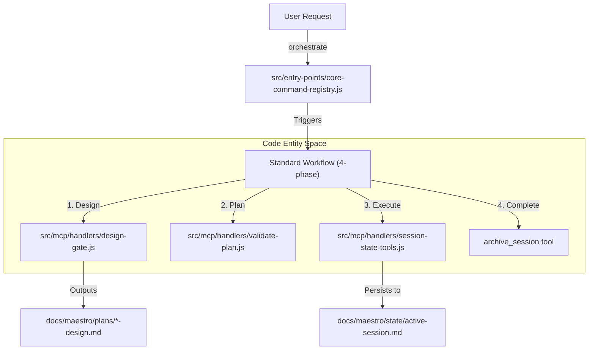
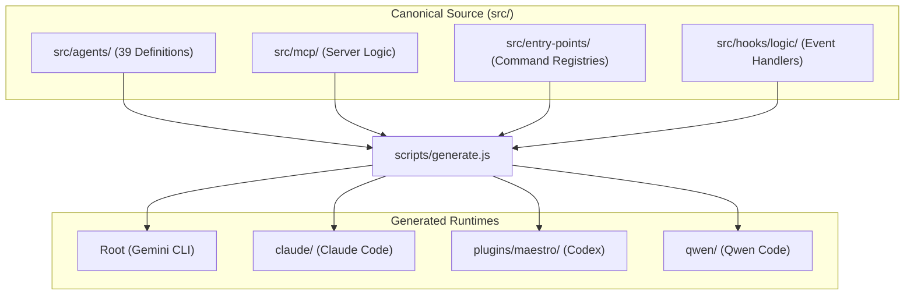

<!-- source: DeepWiki mcp.deepwiki.com · repo josstei/maestro-orchestrate · page 1 Overview · fetched 2026-10-26 -->

# Overview

Relevant source files

The following files were used as context for generating this wiki page:

- [ARCHITECTURE.md](ARCHITECTURE.md)
- [CHANGELOG.md](CHANGELOG.md)
- [OVERVIEW.md](OVERVIEW.md)
- [README.md](README.md)
- [docs/architecture.md](docs/architecture.md)
- [docs/overview.md](docs/overview.md)
- [docs/usage.md](docs/usage.md)
- [package.json](package.json)
- [plugins/maestro/.mcp.json](plugins/maestro/.mcp.json)
- [plugins/maestro/README.md](plugins/maestro/README.md)

Maestro is a multi-agent development orchestration platform designed to coordinate 39 specialized AI agents through structured software development lifecycles [README.md:1-10](). It functions as a "TechLead" persona that handles task classification, solution design, implementation planning, and delegated execution [docs/overview.md:10-22]().

The system is built on a **src-first, generated-runtime** architecture [docs/architecture.md:5-12](). All core logic, agent methodologies, and orchestration protocols are authored once in a canonical `src/` directory and then transformed into optimized adapters for four distinct LLM runtimes: **Gemini CLI**, **Claude Code**, **Codex**, and **Qwen Code** [README.md:10-20]().

## System Concept

Maestro bridges the gap between high-level user requirements and low-level agent execution by maintaining a persistent session state and enforcing a 4-phase standard workflow (Design → Plan → Execute → Complete) [docs/overview.md:14-24]().

### From Natural Language to Code Entities
The following diagram illustrates how a user's natural language request is transformed into specific code entities and managed by the orchestration system.

**Workflow Entity Mapping**

Sources: [docs/overview.md:14-24](), [docs/architecture.md:87-97](), [docs/usage.md:143-158](), [CHANGELOG.md:30-32]()

## Key Capabilities

*   **Multi-Agent Roster**: 39 specialists categorized into capability tiers (e.g., `full`, `read_write`, `read_shell`, `read_only`) to ensure security and tool-access boundaries [docs/overview.md:95-102]().
*   **Persistent Sessions**: All progress is saved as Markdown with YAML frontmatter in a configurable `MAESTRO_STATE_DIR` (defaulting to `docs/maestro/`), allowing for session resumption across restarts [docs/usage.md:60-69](), [docs/usage.md:160-175]().
*   **MCP Integration**: A built-in Model Context Protocol (MCP) server provides 17 specialized tools for workspace analysis, plan validation, and state management [docs/overview.md:104-111]().
*   **Zero-Drift Generation**: A manifest-driven generator ensures that all four runtime targets stay perfectly synchronized with the canonical source [docs/architecture.md:28-37]().

## Project Structure

Maestro organizes its logic into a clear hierarchy that separates source-of-truth from generated artifacts.

**Codebase Organization**

Sources: [docs/architecture.md:5-26](), [docs/overview.md:40-89]()

## Wiki Organization

This wiki is organized to guide you from initial setup to deep architectural understanding:

### 1.1 [Getting Started](#1.1)
Covers prerequisites (Node.js 20+), installation steps for all four runtimes, and the "Quick Start" commands to get your first orchestration running. For details, see [Getting Started](#1.1).
*   **Sources**: [README.md:21-123]()

### 1.2 [Command Reference & Cheatsheet](#1.2)
A comprehensive list of all 12 available commands (9 entry-points + 3 core commands) and their syntax across different platforms (e.g., `/maestro:review` vs `$maestro:review-code`). For details, see [Command Reference & Cheatsheet](#1.2).
*   **Sources**: [README.md:145-161](), [docs/usage.md:82-142]()

### 2. [Core Architecture](#2)
Deep dive into the `src-first` philosophy, the 41-step orchestration sequence, and how the generator pipeline (`scripts/generate.js`) maintains consistency across the project.
*   **Sources**: [docs/architecture.md:1-37](), [CHANGELOG.md:49-56]()

---

