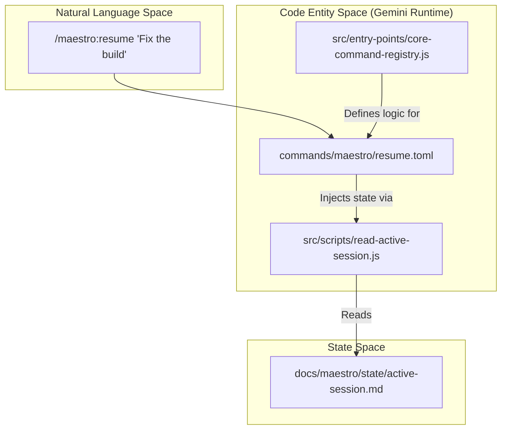
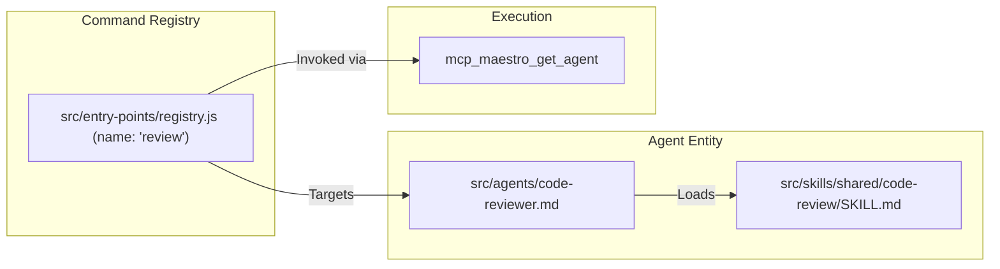

<!-- source: DeepWiki mcp.deepwiki.com · repo josstei/maestro-orchestrate · page 1.2 Command Reference & Cheatsheet · fetched 2026-10-26 -->

# Command Reference & Cheatsheet

Relevant source files

The following files were used as context for generating this wiki page:

- [.gitignore](.gitignore)
- [EXAMPLES.md](EXAMPLES.md)
- [GEMINI.md](GEMINI.md)
- [USAGE.md](USAGE.md)
- [commands/maestro/execute.toml](commands/maestro/execute.toml)
- [commands/maestro/orchestrate.toml](commands/maestro/orchestrate.toml)
- [commands/maestro/resume.toml](commands/maestro/resume.toml)
- [docs/maestro-cheatsheet.md](docs/maestro-cheatsheet.md)
- [src/entry-points/core-command-registry.js](src/entry-points/core-command-registry.js)
- [src/entry-points/registry.js](src/entry-points/registry.js)
- [tests/unit/doc-drift-guard.test.js](tests/unit/doc-drift-guard.test.js)

This page provides a comprehensive technical reference for all Maestro entry-point commands across the four supported runtimes: Gemini CLI, Claude Code, Codex, and Qwen Code. It details command syntax, runtime-specific remapping, and the underlying registry implementation that ensures cross-runtime consistency.

## 1. Runtime Command Matrix

Maestro uses a unified registry to define command behavior, but each runtime imposes its own syntax constraints and naming conventions.

| Capability | Gemini CLI | Claude Code | Codex CLI | Qwen Code |
| :--- | :--- | :--- | :--- | :--- |
| **Full Orchestration** | `/maestro:orchestrate` | `/orchestrate` | `$maestro:orchestrate` | `/maestro:orchestrate` |
| **Execute Plan** | `/maestro:execute` | `/execute` | `$maestro:execute` | `/maestro:execute` |
| **Session Status** | `/maestro:status` | `/status` | `$maestro:status` | `/maestro:status` |
| **Resume Session** | `/maestro:resume` | `/resume-session` | `$maestro:resume-session` | `/maestro:resume` |
| **Archive Session** | `/maestro:archive` | `/archive` | `$maestro:archive` | `/maestro:archive` |
| **Code Review** | `/maestro:review` | `/review-code` | `$maestro:review-code` | `/maestro:review` |
| **Debug Workflow** | `/maestro:debug` | `/debug-workflow` | `$maestro:debug-workflow` | `/maestro:debug` |
| **Security Audit** | `/maestro:security-audit` | `/security-audit` | `$maestro:security-audit` | `/maestro:security-audit` |
| **Performance Check** | `/maestro:perf-check` | `/perf-check` | `$maestro:perf-check` | `/maestro:perf-check` |

**Sources:** [docs/maestro-cheatsheet.md:14-30](), [EXAMPLES.md:13-31]()

### 1.1 Command Remapping Logic
Claude Code and Codex reserve specific keywords (`/review`, `/debug`, `/resume`) for host-level native behaviors [EXAMPLES.md:30-31](). To avoid collisions, the Maestro generator uses the `runtimeNames` property in the command registry to rename these entry points for those specific targets [src/entry-points/core-command-registry.js:27-27](), [src/entry-points/registry.js:16-16]().

## 2. Command Implementation & Data Flow

Maestro commands are defined in a central registry and expanded into runtime-specific artifacts (TOML files, SKILL.md files, or JSON manifests) by the generator pipeline.

### 2.1 Registry Structure
The system distinguishes between **Core Commands** (orchestration lifecycle) and **Standalone Commands** (specialist tasks).

*   **Core Registry**: Defines `orchestrate`, `execute`, and `resume`. These commands are tightly coupled with the 4-phase Standard workflow and require preloading specific orchestration resources [src/entry-points/core-command-registry.js:3-37]().
*   **General Registry**: Defines standalone utilities like `review`, `status`, and `security-audit`. These specify the specialist agents to delegate to and the specific workflow steps to follow [src/entry-points/registry.js:13-165]().

### 2.2 Execution Data Flow
When a command is invoked, the runtime loads the prompt template. For Gemini, this is a TOML file; for Claude, it is a skill definition.

#### Diagram: Command Dispatch to Logic
This diagram shows how a Natural Language command like `/maestro:resume` maps to code entities and state files.

**Sources:** [commands/maestro/resume.toml:1-39](), [src/entry-points/core-command-registry.js:26-37]()

## 3. Detailed Command Reference

### 3.1 Orchestrate
**Purpose**: Start a new task from scratch.
*   **Implementation**: Triggers the `orchestration-steps` protocol [src/entry-points/core-command-registry.js:8-8]().
*   **Logic**: Maestro assesses `task_complexity`. Simple tasks trigger the **Express** workflow; medium/complex tasks trigger the **Standard** 4-phase workflow (Design → Plan → Execute → Complete) [GEMINI.md:5-10]().
*   **Gate**: Requires user approval of the generated implementation plan before moving to the `execute` phase [GEMINI.md:94-96]().

### 3.2 Execute
**Purpose**: Run a previously approved plan.
*   **Syntax**: `/maestro:execute <path-to-plan.md>`
*   **Implementation**: Reads the plan, resolves the `MAESTRO_EXECUTION_MODE` (ask, parallel, or sequential), and dispatches agents [src/entry-points/core-command-registry.js:23-23]().
*   **State**: Creates or resumes session state in `docs/maestro/state/active-session.md` [src/entry-points/core-command-registry.js:23-23]().

### 3.3 Status
**Purpose**: Read-only inspection of the current session.
*   **Logic**: Calls the MCP tool `mcp_maestro_get_runtime_context` or runs `read-active-session.js` to extract session ID, phase progress, and token usage per agent [src/entry-points/registry.js:86-91]().
*   **Constraint**: Must not mutate state or archive the session [src/entry-points/registry.js:93-93]().

### 3.4 Resume
**Purpose**: Recover an interrupted session.
*   **Logic**: Injects the current content of `active-session.md` into the prompt context [commands/maestro/resume.toml:13-15](). It identifies the first `pending` or `failed` phase and resumes delegation from that point [src/entry-points/core-command-registry.js:33-34]().

## 4. Specialist Command Architecture

Standalone commands (e.g., `review`, `debug`) bypass the full orchestration lifecycle and delegate directly to a primary specialist agent.

#### Diagram: Specialist Delegation Flow
This diagram bridges the standalone command to the specific agent code and tool access.

**Sources:** [src/entry-points/registry.js:15-21](), [GEMINI.md:79-79]()

### 4.1 Standalone Workflow Protocols
Each standalone command follows a specific sequence defined in the registry:

1.  **Review**: Identifies scope (staged vs. last commit), delegates to `code-reviewer`, and enforces severity-ordered reporting (Critical → Major → Minor → Suggestion) [src/entry-points/registry.js:22-28]().
2.  **Debug**: Establishes repro path, forms 2-3 hypotheses, gathers evidence, and isolates the root cause using the `debugger` agent [src/entry-points/registry.js:44-50]().
3.  **Security Audit**: Traces trust boundaries and auth flows to identify OWASP Top 10 risks using the `security-engineer` agent [src/entry-points/registry.js:105-110]().

## 5. Summary Cheatsheet

| Task | Recommended Command | Key File/State Involved |
| :--- | :--- | :--- |
| **New Feature** | `orchestrate` | `docs/maestro/plans/` |
| **Fix Bug (Known Cause)** | `orchestrate` | `docs/maestro/state/active-session.md` |
| **Investigate Crash** | `debug-workflow` | Specialist: `debugger` |
| **PR Review** | `review-code` | Specialist: `code-reviewer` |
| **Check Progress** | `status` | `read-active-session.js` |
| **Cleanup** | `archive` | `docs/maestro/state/archive/` |

**Sources:** [docs/maestro-cheatsheet.md:100-114](), [src/entry-points/registry.js:59-77]()

---

