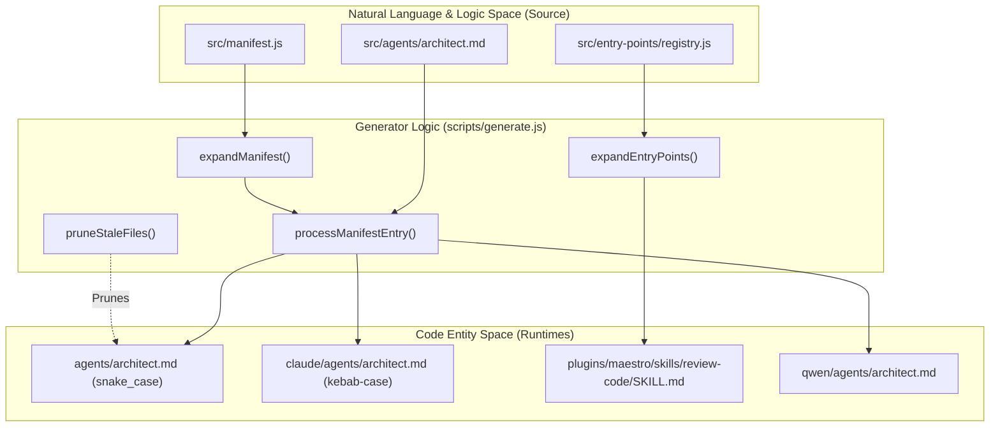
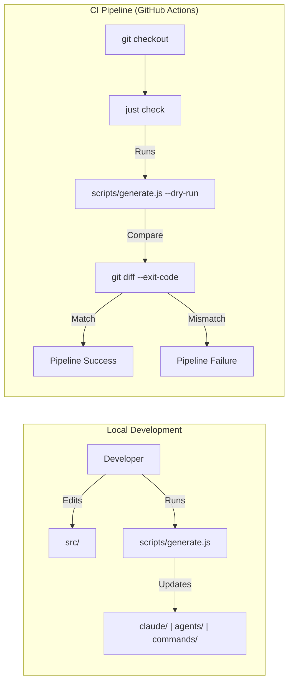

<!-- source: DeepWiki mcp.deepwiki.com · repo josstei/maestro-orchestrate · page 2.1 Generator Pipeline · fetched 2026-10-26 -->

# Generator Pipeline

Relevant source files

The following files were used as context for generating this wiki page:

- [docs/architecture.md](docs/architecture.md)
- [docs/overview.md](docs/overview.md)
- [docs/runtime-codex.md](docs/runtime-codex.md)
- [docs/runtime-gemini.md](docs/runtime-gemini.md)
- [docs/runtime-qwen.md](docs/runtime-qwen.md)
- [docs/usage.md](docs/usage.md)
- [scripts/generate.js](scripts/generate.js)
- [src/generator/entry-point-expander.js](src/generator/entry-point-expander.js)
- [src/generator/payload-builder.js](src/generator/payload-builder.js)
- [tests/integration/entry-point-templates.test.js](tests/integration/entry-point-templates.test.js)
- [tests/integration/zero-diff.test.js](tests/integration/zero-diff.test.js)

The **Generator Pipeline** is the build boundary between Maestro's canonical source of truth and its four supported runtime targets. It implements a **src-first, generated-runtime** architecture where shared behavior, agent methodologies, and core logic are authored once in `src/` and automatically transformed into platform-specific manifests, entry-points, and detached payloads [docs/architecture.md:5-26]().

## Pipeline Overview

The generator, implemented in `scripts/generate.js`, orchestrates the transformation process through five distinct stages:

1.  **Configuration Loading**: Loads runtime-specific settings from `src/platforms/*/runtime-config.js` [scripts/generate.js:26-37]().
2.  **Manifest Expansion**: Resolves glob patterns and mapping rules from `src/manifest.js` into concrete source-to-output pairs [scripts/generate.js:85-87]().
3.  **Transform Execution**: Applies a series of functional transforms (e.g., frontmatter rebuilding, agent stubbing) to source content based on the target runtime [scripts/generate.js:39-66]().
4.  **Entry-Point Expansion**: Generates command surfaces (TOML for Gemini, Markdown skills for Claude/Codex) from the centralized registries [scripts/generate.js:68-76]().
5.  **Payload & Versioning**: Builds detached `src/` copies for plugin runtimes and stamps version metadata from `package.json` [scripts/generate.js:123-132]().

### Data Flow: Source to Runtime

The following diagram illustrates how a single source file in `src/` propagates through the pipeline to create distinct artifacts across the four runtimes.

**Figure 1: Generation Flow**

Sources: [docs/architecture.md:7-26](), [scripts/generate.js:8-13](), [src/generator/entry-point-expander.js:19-52]()

## The Manifest System

`src/manifest.js` is the declarative source of truth for file mapping. Each entry defines a source file (or glob), the target runtimes, and the sequence of transforms to apply [docs/architecture.md:40-59]().

### Transform Pipeline
The generator exposes six specialized transforms located in `src/transforms/` [docs/architecture.md:60-62]().

| Transform | Purpose |
| :--- | :--- |
| `parse-frontmatter` | Extracts YAML frontmatter into the pipeline state [docs/architecture.md:66](). |
| `extract-examples` | Extracts `<example>` blocks specifically for Claude's context window [docs/architecture.md:67](). |
| `rebuild-frontmatter` | Emits runtime-specific YAML (e.g., remapping tool names for Qwen) [docs/architecture.md:68](). |
| `agent-stub` | Replaces the agent body with an MCP delegation call to `get_agent()` [docs/architecture.md:69](). |
| `skill-discovery-stub` | Replaces shared skill bodies with a stub referencing `get_skill_content()` [docs/architecture.md:70](). |
| `skill-metadata` | Injects `user-invocable: false` into Claude skill frontmatter [docs/architecture.md:71](). |

Sources: [docs/architecture.md:60-72](), [scripts/generate.js:57-60]()

## Entry-Point Expansion

Maestro provides 9 entry-point commands (e.g., `review`, `debug`, `status`) and 3 core commands (`orchestrate`, `execute`, `resume`). The `expandEntryPoints` function in `src/generator/entry-point-expander.js` maps these to platform-specific surfaces [src/generator/entry-point-expander.js:126-149]().

### Platform Mapping Logic
- **Gemini**: Generates TOML commands in `commands/maestro/` using `gemini-command.toml.tmpl` [src/generator/entry-point-expander.js:20-24]().
- **Claude**: Generates Markdown skills in `claude/skills/` with a `protocol_block` preamble [src/generator/entry-point-expander.js:25-29]().
- **Codex**: Generates Markdown skills in `plugins/maestro/skills/` with a `refs_list` preamble [src/generator/entry-point-expander.js:30-34]().
- **Qwen**: Does not emit unique command files; it reuses the Gemini TOML commands at runtime [docs/runtime-qwen.md:44](), [src/generator/entry-point-expander.js:35]().

### Name Remapping
To avoid collisions with host-native commands (like Claude's built-in `/review`), the expander enforces a remapping strategy. For example, `review` is remapped to `review-code` for Claude and Codex [src/generator/entry-point-expander.js:10-17](), [tests/integration/entry-point-templates.test.js:25-33]().

Sources: [src/generator/entry-point-expander.js:19-52](), [tests/integration/entry-point-templates.test.js:1-53]()

## Detached Payloads and Pruning

For runtimes like Claude and Codex that may be installed as detached plugins, the generator creates a standalone `src/` directory within the runtime folder [scripts/generate.js:123-131]().

### Payload Building
The `buildDetachedPayload` function in `src/generator/payload-builder.js` performs a filtered sync of the root `src/` directory [src/generator/payload-builder.js:100-103](). It excludes "foreign adapters"—files belonging to other runtimes—ensuring that the Claude plugin does not contain Gemini-specific adapter logic [src/generator/payload-builder.js:19-28]().

### Stale Pruning
To prevent "ghost" files from lingering in generated directories, `pruneStaleFiles` compares the current filesystem against the manifest's intended output list [scripts/generate.js:116-117](). Any file in an "owned directory" (like `agents/` or `commands/`) that is not present in the manifest is deleted [scripts/generate.js:18](), [docs/architecture.md:36]().

Sources: [scripts/generate.js:116-132](), [src/generator/payload-builder.js:19-49](), [src/generator/stale-pruner.js:1-10]()

## Zero-Drift Guarantee

Maestro enforces a **Zero-Drift Guarantee** via CI. Developers are prohibited from editing generated files directly [docs/usage.md:45-47]().

### CI Enforcement
The `just check` command runs the generator in a clean environment and executes `git diff --exit-code` [docs/usage.md:32-36](). If the generated output differs from the committed artifacts by even a single character, the CI pipeline fails [docs/usage.md:52]().

**Figure 2: Zero-Drift Verification Architecture**

Sources: [docs/usage.md:32-52](), [tests/integration/zero-diff.test.js:5-44]()

---

