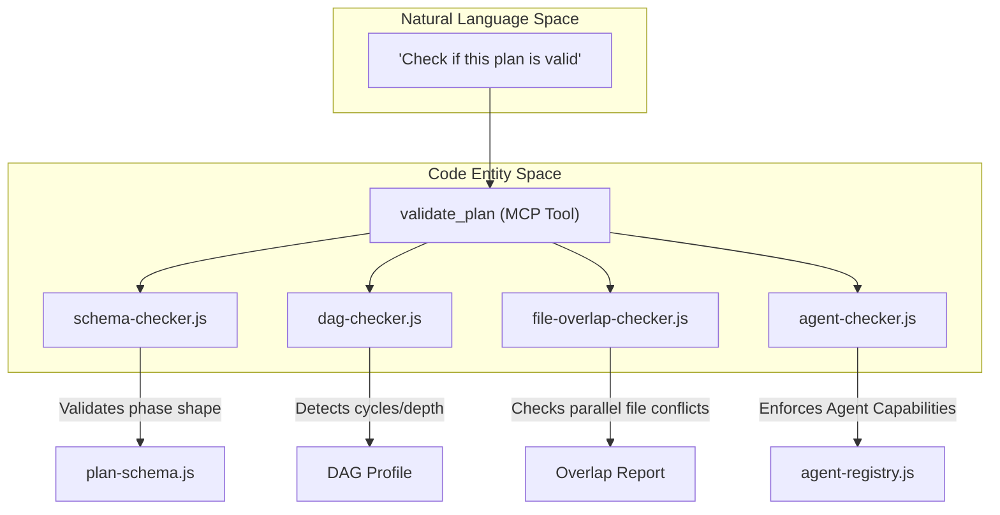
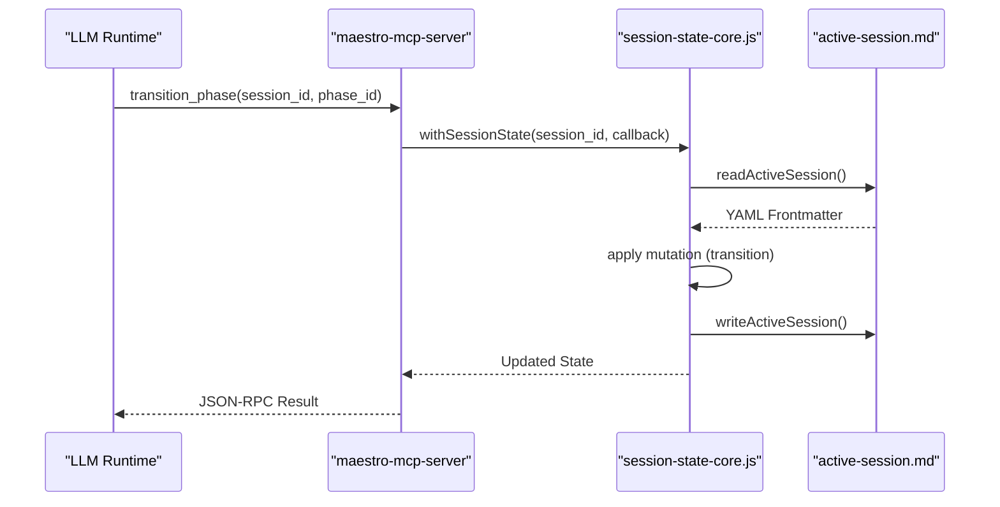

<!-- source: DeepWiki mcp.deepwiki.com · repo josstei/maestro-orchestrate · page 3.1 MCP Tool Packs · fetched 2026-10-26 -->

# MCP Tool Packs

Relevant source files

The following files were used as context for generating this wiki page:

- [CHANGELOG.md](CHANGELOG.md)
- [claude/src/mcp/handlers/get-runtime-context.js](claude/src/mcp/handlers/get-runtime-context.js)
- [claude/src/mcp/handlers/session-state-core.js](claude/src/mcp/handlers/session-state-core.js)
- [claude/src/mcp/handlers/session-state-tools.js](claude/src/mcp/handlers/session-state-tools.js)
- [claude/src/mcp/handlers/validate-plan.js](claude/src/mcp/handlers/validate-plan.js)
- [claude/src/mcp/validation/agent-checker.js](claude/src/mcp/validation/agent-checker.js)
- [claude/src/mcp/validation/schema-checker.js](claude/src/mcp/validation/schema-checker.js)
- [claude/src/platforms/claude/runtime-config.js](claude/src/platforms/claude/runtime-config.js)
- [docs/architecture.md](docs/architecture.md)
- [docs/overview.md](docs/overview.md)
- [docs/usage.md](docs/usage.md)
- [plugins/maestro/.mcp.json](plugins/maestro/.mcp.json)
- [plugins/maestro/src/mcp/handlers/get-runtime-context.js](plugins/maestro/src/mcp/handlers/get-runtime-context.js)
- [plugins/maestro/src/mcp/handlers/session-state-tools.js](plugins/maestro/src/mcp/handlers/session-state-tools.js)
- [plugins/maestro/src/platforms/codex/runtime-config.js](plugins/maestro/src/platforms/codex/runtime-config.js)
- [src/mcp/handlers/get-runtime-context.js](src/mcp/handlers/get-runtime-context.js)
- [src/mcp/handlers/session-state-tools.js](src/mcp/handlers/session-state-tools.js)
- [tests/unit/session-state-tools.test.js](tests/unit/session-state-tools.test.js)

The Maestro MCP Server provides a suite of 17 specialized tools designed to facilitate multi-agent orchestration. These tools are logically grouped into three packs: **Workspace**, **Session**, and **Content**. The server implements the Model Context Protocol (MCP) JSON-RPC 2.0 interface, allowing various LLM runtimes (Claude, Gemini, Codex, Qwen) to interact with the local filesystem and session state in a standardized way [src/mcp/maestro-server.js:100-106]().

### Tool Pack Architecture

The tools are defined in `src/mcp/tool-packs/` and registered via a central registry that enforces constraints like `requiresWorkspace` [CHANGELOG.md:41-41]().

| Pack | Tool Count | Purpose |
| :--- | :--- | :--- |
| **Workspace Pack** | 4 | Environment initialization, task complexity assessment, and plan validation. |
| **Session Pack** | 10 | Lifecycle management, phase transitions, and design-gate enforcement. |
| **Content Pack** | 3 | Dynamic retrieval of agent methodologies, skills, and runtime metadata. |

---

## 1. Workspace Pack

The Workspace Pack manages the initial interaction between the LLM and the repository. It handles the "Design" and "Plan" phases of the Standard workflow [docs/overview.md:108-108]().

### Key Tools

*   `initialize_workspace`: Sets up the canonical `MAESTRO_STATE_DIR` (default: `docs/maestro/`) and writes a marker file to verify the project root [CHANGELOG.md:42-42]().
*   `assess_task_complexity`: Analyzes the repository using framework indicators and configuration files to classify tasks as `simple`, `medium`, or `complex` [src/lib/framework-detection.js:54-54]().
*   `validate_plan`: Performs deep analysis on implementation plans, including DAG cycle detection and file overlap checks [CHANGELOG.md:44-44]().
*   `resolve_settings`: Aggregates configuration from environment variables, workspace `.env`, and defaults [docs/usage.md:58-60]().

### Natural Language to Code: Plan Validation Flow

The following diagram illustrates how a natural language request to "validate the plan" triggers specific code entities within the Workspace Pack.

"Plan Validation Data Flow"

Sources: [src/mcp/handlers/validate-plan.js:1-10](), [CHANGELOG.md:44-44](), [src/mcp/tool-packs/workspace/index.js:1-10]()

---

## 2. Session Pack

The Session Pack manages the stateful lifecycle of an orchestration task. It utilizes `session-state-core.js` for atomic transactions on the `active-session.md` file [src/mcp/handlers/session-state-core.js:33-34]().

### Lifecycle and Design Gates
The Session Pack enforces a **Design Gate**. A session cannot be created via `create_session` if a design gate has been entered but not yet approved via `record_design_approval` [src/mcp/handlers/session-state-tools.js:171-175]().

### Tools Reference
| Tool | Function |
| :--- | :--- |
| `create_session` | Materializes the session and implementation plan into the state directory [src/mcp/handlers/session-state-tools.js:166-170](). |
| `transition_phase` | Advances the `current_phase` and handles downstream context handoffs [src/mcp/handlers/session-state-tools.js:8-13](). |
| `reconcile_phase` | Syncs the actual file manifest with the plan if an agent deviates [CHANGELOG.md:32-32](). |
| `archive_session` | Moves the active session and associated plans to the `archive/` directory [docs/usage.md:151-158](). |

"Session State Transaction Flow"

Sources: [src/mcp/handlers/session-state-core.js:33-34](), [src/mcp/handlers/session-state-tools.js:33-34]()

---

## 3. Content Pack

The Content Pack provides the "brain" of the orchestrator, serving methodologies and runtime-specific metadata.

### Content Resolution Logic
*   `get_agent`: Retrieves the Markdown methodology for one of the 39 specialist agents. It applies the `agent-stub` transform to replace the body with an MCP delegation call [docs/architecture.md:69-69]().
*   `get_skill_content`: Serves the 7 shared skills (e.g., `delegation`, `code-review`). In Claude and Gemini, these are resolved via the filesystem; in Codex, they are served as detached payloads [docs/architecture.md:141-144]().
*   `get_runtime_context`: Returns a machine-readable snapshot of the current environment, including agent naming conventions (`snake_case` vs `kebab-case`) and delegation patterns [src/mcp/handlers/get-runtime-context.js:27-45]().

### Runtime Context Schema
The `get_runtime_context` tool is critical for cross-platform compatibility.

| Field | Purpose | Example (Claude) |
| :--- | :--- | :--- |
| `agent_dispatch.pattern` | How to call a sub-agent | `Agent(subagent_type: "maestro:{{agent}}", ...)` |
| `mcp_prefix` | The runtime's specific MCP tool prefix | `mcp__plugin_maestro_maestro__` |
| `plan_mode_native` | Whether the host supports native plan mode | `true` |
| `workspace_suggestion` | Recommended path if auto-resolution fails | `/home/user/project` |

Sources: [src/mcp/handlers/get-runtime-context.js:7-13](), [src/mcp/handlers/get-runtime-context.js:27-45](), [CHANGELOG.md:46-48]()

---

## Implementation Details

### Data Flow: Content Materialization
When `create_session` or `record_design_approval` is called, the server must handle path resolution differences between runtimes (e.g., Gemini's temporary execution roots). To solve this, the tools accept both a `path` and a `content` variant [CHANGELOG.md:43-43]().

1.  **Content Variant**: If `implementation_plan_content` is provided, `writePlansDocumentContent` materializes the bytes atomically into the `plans/` directory [src/mcp/handlers/session-state-tools.js:111-116]().
2.  **Path Variant**: If only a path is provided, `materializeSessionDocument` verifies the file exists on the local disk before proceeding [src/mcp/handlers/session-state-tools.js:51-66]().

### Dependency Management
The MCP server uses a shared contract for plan phases defined in `src/mcp/contracts/plan-schema.js`. This ensures that the structure validated by `validate_plan` is identical to the structure persisted by `create_session` [CHANGELOG.md:44-44]().

Sources: [src/mcp/handlers/session-state-tools.js:1-13](), [src/mcp/handlers/session-state-tools.js:86-124]()

---

