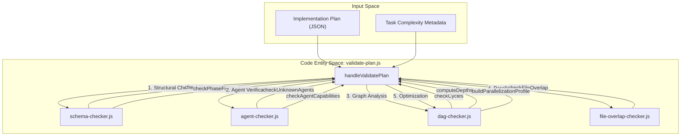
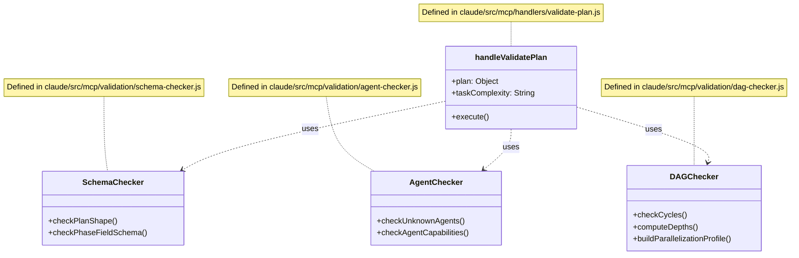

<!-- source: DeepWiki mcp.deepwiki.com · repo josstei/maestro-orchestrate · page 3.2 Plan Validation & DAG Checker · fetched 2026-10-26 -->

# Plan Validation & DAG Checker

<details>
<summary>Relevant source files</summary>

The following files were used as context for generating this wiki page:

- [CHANGELOG.md](CHANGELOG.md)
- [claude/src/mcp/handlers/session-state-core.js](claude/src/mcp/handlers/session-state-core.js)
- [claude/src/mcp/handlers/validate-plan.js](claude/src/mcp/handlers/validate-plan.js)
- [claude/src/mcp/validation/agent-checker.js](claude/src/mcp/validation/agent-checker.js)
- [claude/src/mcp/validation/schema-checker.js](claude/src/mcp/validation/schema-checker.js)
- [claude/src/platforms/claude/runtime-config.js](claude/src/platforms/claude/runtime-config.js)
- [plugins/maestro/.mcp.json](plugins/maestro/.mcp.json)
- [tests/unit/adapter-factory.test.js](tests/unit/adapter-factory.test.js)
- [tests/unit/assess-task-complexity.test.js](tests/unit/assess-task-complexity.test.js)
- [tests/unit/check-layer-boundaries.test.js](tests/unit/check-layer-boundaries.test.js)
- [tests/unit/line-reader.test.js](tests/unit/line-reader.test.js)
- [tests/unit/manifest-curator.test.js](tests/unit/manifest-curator.test.js)
- [tests/unit/protocol-dispatcher.test.js](tests/unit/protocol-dispatcher.test.js)

</details>


The `validate_plan` tool is a critical component of the **Orchestration Workflow**, serving as a gatekeeper between the **Design** and **Plan** phases. It ensures that the implementation plan generated by the orchestrator is structurally sound, logically consistent, and executable within the constraints of the assigned specialist agents.

## Validation Pipeline Overview

The validation process is implemented in `handleValidatePlan` [claude/src/mcp/handlers/validate-plan.js:22-72](). It executes a series of specialized checkers in a specific order to catch errors ranging from basic JSON schema violations to complex circular dependencies in the task graph.

### Data Flow & Logic Execution

The following diagram illustrates how a plan payload is processed through the validation layers:

**Plan Validation Flow**

**Sources:** [claude/src/mcp/handlers/validate-plan.js:22-72](), [claude/src/mcp/validation/schema-checker.js:1-9](), [claude/src/mcp/validation/agent-checker.js:1-13]()

---

## 1. Schema & Structural Validation
The first layer ensures the plan conforms to the `Plan` and `Phase` contracts.

*   **Shape Check**: `checkPlanShape` verifies the top-level structure (e.g., presence of a `phases` array) [claude/src/mcp/handlers/validate-plan.js:25-32]().
*   **Field Schema**: `checkPhaseFieldSchema` validates that individual phases contain required fields like `id`, `name`, `agent`, and `description` [claude/src/mcp/handlers/validate-plan.js:34-41]().
*   **Integrity Checks**:
    *   `checkDuplicateIds`: Ensures every phase has a unique ID [claude/src/mcp/handlers/validate-plan.js:48-48]().
    *   `checkDanglingDependencies`: Verifies that any ID listed in `depends_on` actually exists within the plan [claude/src/mcp/handlers/validate-plan.js:49-49]().
    *   `checkPhaseCount`: Compares the number of phases against the `task_complexity` to warn if a plan is suspiciously simple or overly complex [claude/src/mcp/handlers/validate-plan.js:47-47]().

**Sources:** [claude/src/mcp/handlers/validate-plan.js:25-50](), [CHANGELOG.md:44-44]()

---

## 2. Agent Capability Enforcement
The `agent-checker.js` module enforces that the assigned specialist agents are capable of performing the tasks described in their phases.

### Capability Mismatch Detection
Maestro uses the `agent-registry` to look up the capability tier of an agent (e.g., `read_only`, `read_write`, `full`) [claude/src/mcp/validation/agent-checker.js:3-8]().

| Check Type | Trigger | Severity |
| :--- | :--- | :--- |
| **Unknown Agent** | Agent name not found in `KNOWN_AGENTS` | `error` |
| **Explicit Mutation** | `read_only` agent assigned to phase with `files`, `files_created`, or `files_modified` | `error` |
| **Implicit Mutation** | `read_only` agent assigned to phase name containing "create", "implement", "build" | `warning` |

**Code Implementation**:
*   `checkUnknownAgents`: Normalizes names to `kebab-case` or `snake_case` (depending on runtime) before checking the registry [claude/src/mcp/validation/agent-checker.js:16-29]().
*   `checkAgentCapabilities`: Uses `canCreateFiles(normalizedAgent)` to block read-only agents from implementation tasks [claude/src/mcp/validation/agent-checker.js:38-76]().

**Sources:** [claude/src/mcp/validation/agent-checker.js:16-76](), [CHANGELOG.md:33-38]()

---

## 3. DAG Analysis & Cycle Detection
The `dag-checker.js` treats the plan as a Directed Acyclic Graph (DAG) where phases are nodes and `depends_on` entries are edges.

### Core Algorithms
1.  **Cycle Detection (`checkCycles`)**: Uses a depth-first search to identify circular dependencies. If a cycle is detected, further graph analysis (like depth computation) is aborted to prevent infinite loops [claude/src/mcp/handlers/validate-plan.js:55-60]().
2.  **Depth Computation (`computeDepths`)**: Calculates the longest path from a root node to each phase. This depth determines the "execution layer" for parallelization [claude/src/mcp/handlers/validate-plan.js:61-61]().
3.  **Redundant Dependency Pruning**: Identifies "shortcuts" in the graph. If Phase C depends on both Phase A and Phase B, but Phase B already depends on Phase A, the direct dependency from C to A is redundant [claude/src/mcp/handlers/validate-plan.js:63-63]().

**Sources:** [claude/src/mcp/handlers/validate-plan.js:52-65]()

---

## 4. Parallelization Safety
Maestro supports parallel execution of phases that reside at the same "depth" in the DAG. However, this introduces the risk of file-access conflicts.

### File Overlap Checker
The `checkFileOverlap` function analyzes the `files` (or `files_modified`/`files_created`) arrays of all phases scheduled for the same depth [claude/src/mcp/handlers/validate-plan.js:62-62]().

*   **Violation**: If two phases at the same depth claim to modify the same file, a validation error is raised.
*   **Resolution**: The user/orchestrator must add a dependency between these phases to force sequential execution, or split the file responsibilities.

**Sources:** [claude/src/mcp/validation/file-overlap-checker.js:20-20](), [CHANGELOG.md:44-44]()

---

## 5. Parallelization Profile Output
If the plan is valid, `validate_plan` returns a `parallelization_profile` [claude/src/mcp/handlers/validate-plan.js:64-64](). This metadata is used by the orchestrator to optimize execution.

**Structure of the Profile:**
```json
{
  "max_width": 3,
  "total_depth": 5,
  "layers": [
    { "depth": 0, "phase_ids": ["init-repo"] },
    { "depth": 1, "phase_ids": ["pkg-auth", "db-schema", "ui-scaffold"] }
  ]
}
```

**Code Entity to System Name Mapping**


**Sources:** [claude/src/mcp/handlers/validate-plan.js:1-20](), [claude/src/mcp/handlers/validate-plan.js:67-71]()

---

