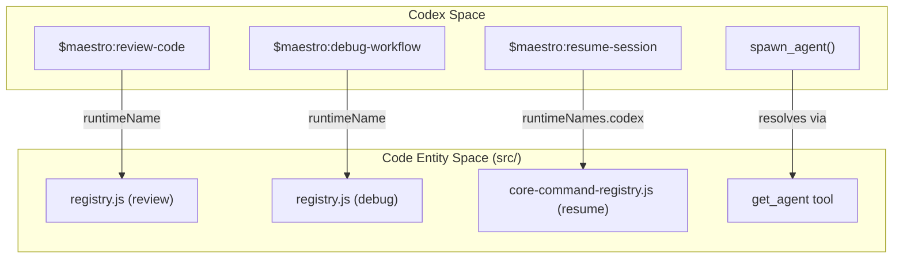
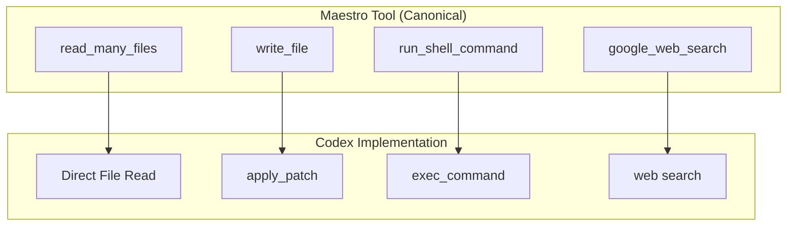

<!-- source: DeepWiki mcp.deepwiki.com · repo josstei/maestro-orchestrate · page 4.3 Codex Runtime · fetched 2026-10-26 -->

# Codex Runtime

Relevant source files

The following files were used as context for generating this wiki page:

- [claude/src/version.json](claude/src/version.json)
- [docs/runtime-codex.md](docs/runtime-codex.md)
- [docs/runtime-gemini.md](docs/runtime-gemini.md)
- [docs/runtime-qwen.md](docs/runtime-qwen.md)
- [package-lock.json](package-lock.json)
- [plugins/maestro/.codex-plugin/plugin.json](plugins/maestro/.codex-plugin/plugin.json)
- [plugins/maestro/src/entry-points/core-command-registry.js](plugins/maestro/src/entry-points/core-command-registry.js)
- [plugins/maestro/src/entry-points/registry.js](plugins/maestro/src/entry-points/registry.js)
- [plugins/maestro/src/version.json](plugins/maestro/src/version.json)
- [scripts/generate.js](scripts/generate.js)

The Codex runtime is a generated plugin located in the `plugins/maestro/` directory [docs/runtime-codex.md:3-3](). It implements the Maestro multi-agent orchestration workflow specifically for the Codex environment, utilizing a detached payload strategy where shared methodology and agent bodies are resolved from generated local source files [docs/runtime-codex.md:110-114]().

## Configuration and Manifests

The Codex plugin is defined by a primary manifest and several auxiliary configuration files that govern its integration with the Codex host and the MCP server.

| File | Purpose |
|------|---------|
| `plugins/maestro/.codex-plugin/plugin.json` | Primary plugin manifest [docs/runtime-codex.md:7-7]() |
| `plugins/maestro/.mcp.json` | MCP server connection configuration [docs/runtime-codex.md:9-9]() |
| `plugins/maestro/.app.json` | Application-level configuration [docs/runtime-codex.md:10-10]() |
| `plugins/maestro/references/runtime-guide.md` | Codex-specific runtime instructions [docs/runtime-codex.md:11-11]() |

### MCP Server Invocation
Unlike Claude or Gemini, Codex lacks a plugin-root substitution variable. Consequently, Maestro invokes the MCP server via `npx` to ensure the versioned package is used regardless of the user's local path [docs/runtime-codex.md:23-23]().

The server is launched with the following configuration:
*   **Command**: `npx` [docs/runtime-codex.md:17-17]()
*   **Arguments**: `-y -p @josstei/maestro@<version> maestro-mcp-server` [docs/runtime-codex.md:18-18]()
*   **Environment**: `MAESTRO_RUNTIME=codex` [docs/runtime-codex.md:19-19]()

### Workspace Resolution Strategy
To maintain state isolation under `docs/maestro/`, the Codex runtime resolves the workspace root using a tiered strategy:
1.  Use `MAESTRO_WORKSPACE_PATH` if exported by the host [docs/runtime-codex.md:26-26]().
2.  Fall back to the MCP client `roots/list` response [docs/runtime-codex.md:27-27]().
3.  Fall back to inherited environment variables and `cwd` heuristics [docs/runtime-codex.md:28-28]().

**Sources:** [docs/runtime-codex.md:7-31](), [plugins/maestro/.codex-plugin/plugin.json:1-41]()

## Runtime Architecture and Data Flow

The Codex runtime follows a "detached payload" model. While the source of truth resides in the canonical `src/` directory, the generator produces a standalone copy in `plugins/maestro/src/` for the published bundle [docs/runtime-codex.md:163-169]().

### Codex Entity Space Mapping
The following diagram illustrates how Codex-specific identifiers map to the underlying Maestro system entities.

Title: Codex to Code Entity Mapping

**Sources:** [plugins/maestro/src/entry-points/registry.js:15-40](), [plugins/maestro/src/entry-points/core-command-registry.js:26-37](), [docs/runtime-codex.md:82-94]()

## Skills and Commands

Maestro exposes 19 Markdown skills in `plugins/maestro/skills/` [docs/runtime-codex.md:80-80](). Because Codex has built-in commands like `/review`, Maestro entry points are remapped to use the `$maestro:` prefix to avoid collisions [docs/runtime-codex.md:82-83]().

### Command Mapping Table
| Maestro Command | Codex Invocation | Type |
|-----------------|------------------|------|
| `orchestrate` | `$maestro:orchestrate` | Core |
| `execute` | `$maestro:execute` | Core |
| `resume` | `$maestro:resume-session` | Core |
| `review` | `$maestro:review-code` | Entry-point |
| `debug` | `$maestro:debug-workflow` | Entry-point |

**Sources:** [docs/runtime-codex.md:84-98](), [plugins/maestro/src/entry-points/core-command-registry.js:27-27](), [plugins/maestro/src/entry-points/registry.js:16-16]()

## Agent Delegation and State

Codex uses **kebab-case** for agent naming (e.g., `code-reviewer`) [docs/runtime-codex.md:63-63](). It does not consume plugin-level agent files; instead, the `get_agent` MCP tool serves canonical methodology bodies directly to the runtime [docs/runtime-codex.md:169-169]().

### Tool Mapping
Codex maps canonical Maestro tools to its native capabilities or shell executions:

Title: Codex Tool Execution Flow

### State Isolation
Codex operates with `codexStateContract: true` [docs/runtime-codex.md:141-147](). It lacks a native hook system; delegation tracking and policy enforcement are handled via inline methodology constraints within the generated skills [docs/runtime-codex.md:102-102](). If the MCP server is unavailable, the runtime falls back to direct filesystem operations under `docs/maestro/` [docs/runtime-codex.md:112-113]().

**Sources:** [docs/runtime-codex.md:61-78](), [docs/runtime-codex.md:100-108](), [docs/runtime-codex.md:118-135]()

## Generation Pipeline

The `scripts/generate.js` script is responsible for maintaining the Codex runtime. It performs the following specific actions for Codex:
1.  **Detached Payload**: Copies canonical `src/` to `plugins/maestro/src/` [scripts/generate.js:124-124]().
2.  **Version Stamping**: Synchronizes the version from `package.json` into `plugins/maestro/src/version.json` [scripts/generate.js:127-127]().
3.  **Skill Expansion**: Renders the Markdown skills into `plugins/maestro/skills/` based on the registries [scripts/generate.js:18-18]().
4.  **Metadata Generation**: Builds the `plugin.json` manifest with aligned release metadata [scripts/generate.js:105-105]().

**Sources:** [scripts/generate.js:115-132](), [plugins/maestro/src/version.json:1-3]()

---

