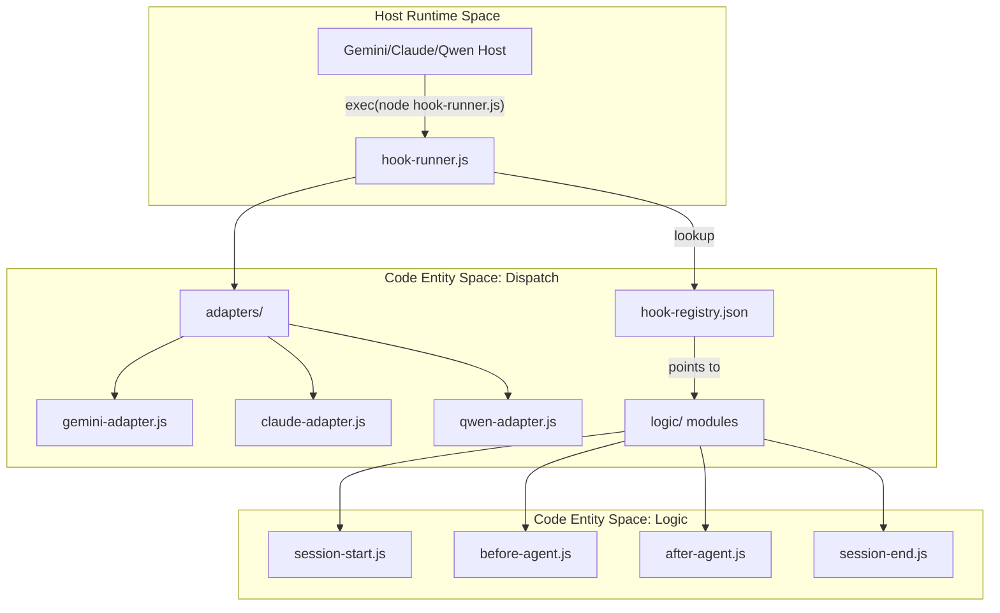
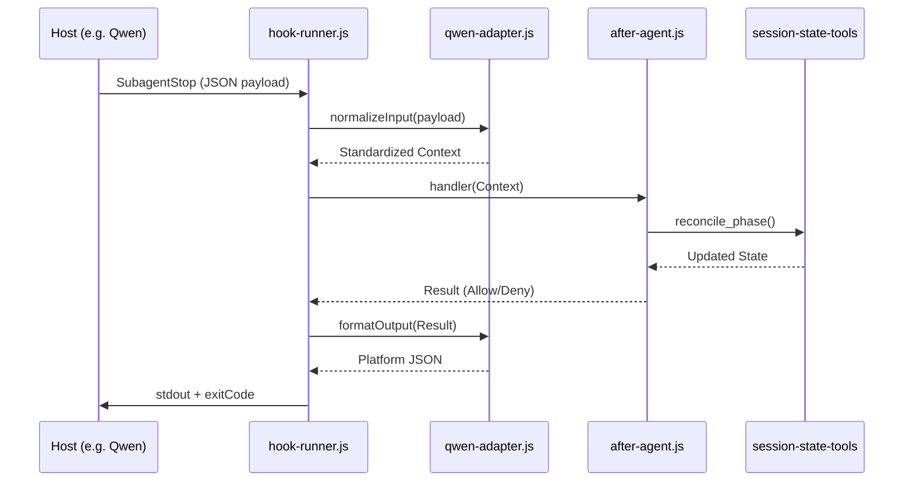

<!-- source: DeepWiki mcp.deepwiki.com · repo josstei/maestro-orchestrate · page 5 Hook System · fetched 2026-10-26 -->

# Hook System

Relevant source files

The following files were used as context for generating this wiki page:

- [.githooks/lib/semantic-git.sh](.githooks/lib/semantic-git.sh)
- [.githooks/pre-commit](.githooks/pre-commit)
- [claude/src/platforms/shared/hook-runner.js](claude/src/platforms/shared/hook-runner.js)
- [plugins/maestro/src/platforms/shared/hook-runner.js](plugins/maestro/src/platforms/shared/hook-runner.js)
- [src/platforms/shared/hook-runner.js](src/platforms/shared/hook-runner.js)
- [tests/integration/git-hooks.test.js](tests/integration/git-hooks.test.js)
- [tests/integration/hook-entrypoints.test.js](tests/integration/hook-entrypoints.test.js)
- [tests/unit/platform-adapters.test.js](tests/unit/platform-adapters.test.js)

The Maestro Hook System is an event-driven architecture designed to maintain session context, enforce security policies, and validate agent handoffs across diverse LLM runtimes. It uses a centralized **Hook Runner** and an **Adapter Pattern** to abstract away the differences between platforms like Gemini, Claude, and Qwen, ensuring that core logic remains "runtime-agnostic."

### Architecture Overview

The system operates by intercepting lifecycle events from the host LLM environment. When an event occurs (e.g., an agent is about to start), the host environment executes `hook-runner.js`. This runner identifies the appropriate platform adapter, normalizes the input, executes the shared logic, and formats the response back to the host's expected schema.

#### Code Entity Map: Hook Dispatch
This diagram shows how the generic `hook-runner.js` bridges the host environment to the specific logic modules via adapters.

**Sources:** [src/platforms/shared/hook-runner.js:8-38](), [src/platforms/shared/adapters/claude-adapter.js:1-5](), [src/platforms/shared/adapters/gemini-adapter.js:1-5]()

---

### The Adapter Pattern

Because different LLM runtimes provide data in varying formats (e.g., Gemini uses `prompt` while Claude uses `tool_input.prompt`), Maestro employs a strict adapter contract defined by `defineAdapter`. This allows the core hook logic to operate on a standardized `ctx` object.

| Method | Purpose |
| :--- | :--- |
| `normalizeInput` | Converts platform-specific JSON (stdin) into a standard Maestro context object. |
| `formatOutput` | Converts the Maestro result into the JSON schema required by the host runtime. |
| `getExitCode` | Determines if the process should exit with 0 (success/allow) or a non-zero code (deny). |
| `errorFallback` | Provides a safe "fail-closed" response if the hook logic throws an error. |

For details on the implementation of these adapters and the registry, see **[Hook Runner & Adapter Pattern](#5.1)**.

**Sources:** [tests/unit/platform-adapters.test.js:10-65](), [tests/unit/platform-adapters.test.js:115-159]()

---

### Hook Lifecycle & Session Context

The hook system is responsible for ensuring that the Orchestration Workflow remains coherent as control passes between different specialist agents.

1.  **Session Management**: Hooks read and write to the `active-session.md` to track which phase (Design, Plan, Execute, Complete) the orchestration is currently in.
2.  **Handoff Validation**: The `after-agent` hook validates that agents have provided required sections like `## Task Report` and `## Downstream Context` before allowing the workflow to proceed.
3.  **Security**: A policy enforcer monitors shell command execution in environments like Claude Code to prevent destructive operations.

#### Data Flow: Agent Boundary
This diagram illustrates how hooks maintain state as the system transitions from one agent to another.

**Sources:** [tests/integration/hook-entrypoints.test.js:105-150](), [src/platforms/shared/hook-runner.js:40-52]()

For details on specific hook logic modules and the command filtering policies, see **[Hook Logic & Policy Enforcer](#5.2)**.

---

### Integration & Reliability

The hook system is verified through extensive integration tests that simulate host runtime behavior by spawning the `hook-runner.js` with mock stdin payloads.

*   **Zero-Exit Policy**: Gemini hooks typically exit with code `0` even on denial, relying on the JSON `continue: false` field to signal the host.
*   **Hard-Block Policy**: Qwen hooks use exit code `2` to signal a hard stop to the host runtime when validation fails.
*   **Fail-Closed**: In all runtimes, if a hook encounters an unhandled exception or invalid input, the `errorFallback` ensures the action is blocked by default.

**Sources:** [tests/integration/hook-entrypoints.test.js:87-103](), [tests/integration/hook-entrypoints.test.js:127-150](), [tests/integration/hook-entrypoints.test.js:152-170]()

---

