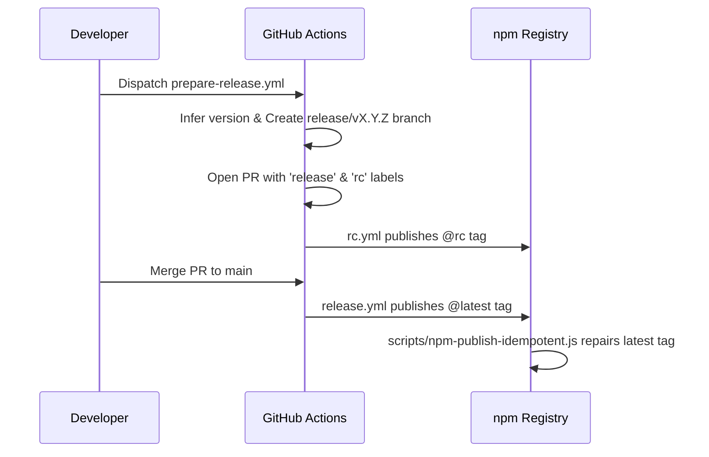

<!-- source: DeepWiki mcp.deepwiki.com · repo josstei/maestro-orchestrate · page 6 CI/CD & Release Pipeline · fetched 2026-10-26 -->

# CI/CD & Release Pipeline

<details>
<summary>Relevant source files</summary>

The following files were used as context for generating this wiki page:

- [.github/workflows/generator-check.yml](.github/workflows/generator-check.yml)
- [.github/workflows/nightly.yml](.github/workflows/nightly.yml)
- [.github/workflows/prepare-release.yml](.github/workflows/prepare-release.yml)
- [.github/workflows/release.yml](.github/workflows/release.yml)
- [docs/cicd.md](docs/cicd.md)
- [justfile](justfile)
- [scripts/npm-publish-idempotent.js](scripts/npm-publish-idempotent.js)
- [tests/unit/npm-publish-idempotent.test.js](tests/unit/npm-publish-idempotent.test.js)
- [tests/unit/workflow-security.test.js](tests/unit/workflow-security.test.js)

</details>


The Maestro Orchestrate pipeline is built on a **source-of-truth enforcement** model. Because the project uses a "src-first" architecture where runtime adapters (Gemini, Claude, Codex, Qwen) are generated from canonical sources, the CI/CD system serves as the ultimate gatekeeper for synchronization. Every automated workflow regenerates these adapters and verifies zero drift before proceeding with tests or publishing.

## Workflow Ecosystem

The pipeline consists of seven GitHub Actions workflows that manage the lifecycle from local commit to global npm release.

### CI/CD High-Level Flow
```mermaid
graph TD
    subgraph "Continuous Integration"
        [".github/workflows/generator-check.yml"] --> ["Source Of Truth Check"]
        [".github/workflows/commit-message-check.yml"] --> ["Commit Message Check"]
    end

    subgraph "Pre-release Publishing"
        [".github/workflows/preview.yml"] --> ["Preview Build (PR Label)"]
        [".github/workflows/nightly.yml"] --> ["Nightly Build (Cron)"]
        [".github/workflows/prepare-release.yml"] --> ["Prepare Release (Manual)"]
        ["Prepare Release (Manual)"] --> [".github/workflows/rc.yml"]
    end

    subgraph "Stable Release"
        [".github/workflows/rc.yml"] --> ["Merge Release PR"]
        ["Merge Release PR"] --> [".github/workflows/release.yml"]
    end

    ["Source Of Truth Check"] -- "Verify" --> ["npm pack:verify"]
    ["Release"] -- "Publish" --> ["scripts/npm-publish-idempotent.js"]
```
Sources: [docs/cicd.md:9-29](), [.github/workflows/generator-check.yml:1-42](), [.github/workflows/release.yml:1-181]()

## Source-of-Truth Enforcement

The project enforces a **zero-drift guarantee**. Any change to the `src/` directory must be accompanied by the resulting changes in the generated runtime directories (e.g., `claude/`, `plugins/maestro/`).

1.  **Generation**: Workflows run `node scripts/generate.js` [.github/workflows/generator-check.yml:21-21]().
2.  **Drift Check**: The system executes `git diff --exit-code --name-only` [.github/workflows/generator-check.yml:24-29](). If any files differ from the committed state, the CI fails with an error annotation.
3.  **Validation**: Once drift-free, the pipeline runs the full test suite via `node --test` [justfile:43-49]().
4.  **Artifact Verification**: Before publishing, `npm run pack:verify` and `npm run release:verify-artifacts` ensure the package structure is correct and all required runtime files are present [.github/workflows/generator-check.yml:34-41]().

For details on the individual workflows and trigger conditions, see [GitHub Actions Workflows](#6.1).

Sources: [docs/cicd.md:33-60](), [justfile:79-87](), [.github/workflows/generator-check.yml:20-42]()

## Multi-Stage Release Process

Maestro uses a structured release ladder involving four distinct npm `dist-tags`: `latest`, `rc`, `preview`, and `nightly`.

### Release Promotion Path

Sources: [.github/workflows/prepare-release.yml:129-169](), [.github/workflows/release.yml:58-72](), [scripts/npm-publish-idempotent.js:209-268]()

The publishing logic is handled by a specialized helper, `scripts/npm-publish-idempotent.js`. This script prevents accidental overwrites and ensures that the `latest` tag always points to the highest stable version, even if a pre-release was published more recently.

For details on the publishing logic and tag management, see [Idempotent Publishing & Dist-Tag Policy](#6.2).

Sources: [scripts/npm-publish-idempotent.js:193-207](), [tests/unit/workflow-security.test.js:112-148]()

## Local Development & Conventions

To maintain the integrity of the CI/CD pipeline, developers are required to use semantic conventions locally.

*   **Git Hooks**: Local hooks (pre-commit, commit-msg, pre-push) enforce `scripts/generate.js` execution and Conventional Commits before code ever reaches GitHub.
*   **Semantic Branching**: PRs are gated by `commit-message-check.yml`, which validates that branch names (e.g., `feat/`, `fix/`) and PR titles match the project's semantic rules [.github/workflows/commit-message-check.yml:1-151]().

For details on local setup and commit rules, see [Git Hooks & Commit Conventions](#6.3).

Sources: [docs/cicd.md:91-122](), [justfile:92-93]()

## Child Pages
*   [GitHub Actions Workflows](#6.1) — Detailed coverage of the seven workflows, triggers, and job sequences.
*   [Idempotent Publishing & Dist-Tag Policy](#6.2) — Technical deep dive into `npm-publish-idempotent.js` and version repair.
*   [Git Hooks & Commit Conventions](#6.3) — Local enforcement of semantic rules and the project's branching model.

---

