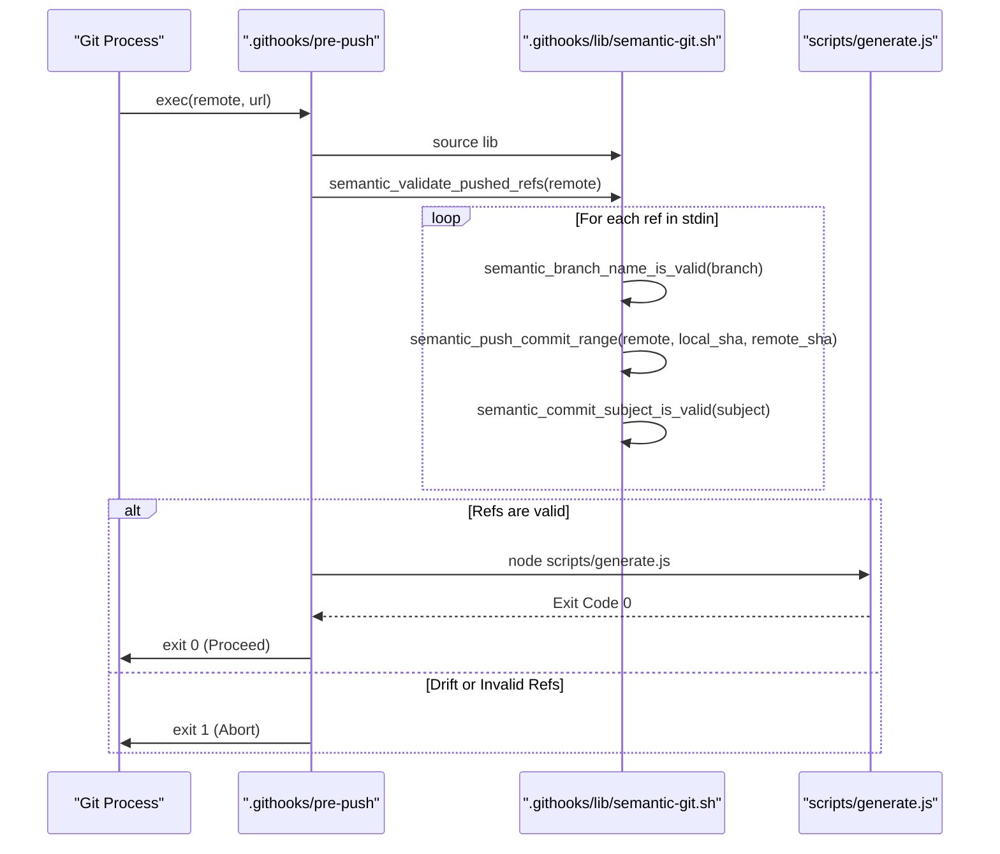

<!-- source: DeepWiki mcp.deepwiki.com · repo josstei/maestro-orchestrate · page 6.3 Git Hooks & Commit Conventions · fetched 2026-10-26 -->

# Git Hooks & Commit Conventions

Relevant source files

The following files were used as context for generating this wiki page:

- [.githooks/commit-msg](.githooks/commit-msg)
- [.githooks/lib/semantic-git.sh](.githooks/lib/semantic-git.sh)
- [.githooks/pre-commit](.githooks/pre-commit)
- [.githooks/pre-push](.githooks/pre-push)
- [.github/ISSUE_TEMPLATE/bug_report.md](.github/ISSUE_TEMPLATE/bug_report.md)
- [.github/ISSUE_TEMPLATE/config.yml](.github/ISSUE_TEMPLATE/config.yml)
- [.github/ISSUE_TEMPLATE/feature_request.md](.github/ISSUE_TEMPLATE/feature_request.md)
- [.github/PULL_REQUEST_TEMPLATE.md](.github/PULL_REQUEST_TEMPLATE.md)
- [.github/workflows/commit-message-check.yml](.github/workflows/commit-message-check.yml)
- [CODE_OF_CONDUCT.md](CODE_OF_CONDUCT.md)
- [SECURITY.md](SECURITY.md)
- [scripts/install-git-hooks.js](scripts/install-git-hooks.js)
- [tests/integration/git-hooks.test.js](tests/integration/git-hooks.test.js)

This section details the local and CI-driven enforcement mechanisms that ensure code quality, semantic consistency, and the integrity of the "source-of-truth" architecture. Maestro utilizes a suite of Git hooks and GitHub Actions to enforce Conventional Commits, semantic branch naming, and zero-drift between the `src/` directory and generated runtime outputs.

## Local Hook Activation

Local Git hooks are stored in the `.githooks/` directory within the repository root [.githooks/:1-2](). To ensure these hooks are active for all contributors without manual setup, the project uses a post-install script.

### scripts/install-git-hooks.js
This script is executed during the `npm install` process. It performs the following checks before activation:
1.  **Environment Check**: Verifies that the `.githooks/` directory exists [.scripts/install-git-hooks.js:24-26]().
2.  **Context Check**: Ensures the script is running inside the actual Maestro source tree (and not as a dependency in a downstream `node_modules`) by comparing the current directory to the result of `git rev-parse --show-toplevel` [.scripts/install-git-hooks.js:28-40]().
3.  **Configuration**: If checks pass, it runs `git config core.hooksPath .githooks`, redirecting Git to look for hooks in the version-controlled directory instead of the default `.git/hooks/` [.scripts/install-git-hooks.js:42]().

**Sources:** [.scripts/install-git-hooks.js:1-44]()

## Commit Message Conventions

Maestro enforces the **Conventional Commits 1.0.0** specification for all commit subjects. This enables automated versioning and clear changelog generation.

### Validation Logic
The validation is centralized in `.githooks/lib/semantic-git.sh` using the `SEMANTIC_COMMIT_PATTERN` regex:
`^(feat|fix|chore|docs|test|refactor|perf|style|build|ci|revert|release)(\([a-z0-9_./-]+\))?!?: .+` [.githooks/lib/semantic-git.sh:5-5]().

### Allowed Types
The following types are recognized by the `semantic_commit_subject_is_valid` function [.githooks/lib/semantic-git.sh:10-18]():

| Type | Description |
| :--- | :--- |
| `feat` | New user-facing features |
| `fix` | Bug fixes |
| `chore` | Housekeeping (config, deps, tooling, generated files) |
| `docs` | Documentation only |
| `test` | Adding or fixing tests |
| `refactor` | Structural changes without behavior changes |
| `perf` | Performance improvements |
| `style` | Formatting changes |
| `build` | Build system or external dependencies |
| `ci` | CI configuration changes |
| `revert` | Reverting a previous commit |
| `release` | Version bumps or release preparation |

**Sources:** [.githooks/commit-msg:33-54](), [.githooks/lib/semantic-git.sh:5-18]()

## Semantic Branching Rules

To maintain an organized repository structure, Maestro requires branch names to follow a semantic format.

### Branch Formats
The `semantic_branch_name_is_valid` function enforces two primary patterns [.githooks/lib/semantic-git.sh:20-29]():
1.  **Standard**: `[namespace/]<type>/<slug>` (e.g., `feat/semantic-git-hooks` or `codex/chore/enforce-git-conventions`) [.githooks/lib/semantic-git.sh:6-6]().
2.  **Release**: `release/vX.Y.Z` [.githooks/lib/semantic-git.sh:7-7]().

**Exceptions**: The following branches are always permitted: `main`, `master`, `develop`, `dev`, `trunk`, and automated prefixes like `dependabot/*`, `renovate/*`, or `github-actions/*` [.githooks/lib/semantic-git.sh:23-26]().

**Sources:** [.githooks/lib/semantic-git.sh:20-29](), [.githooks/pre-commit:11-21]()

## Hook Implementation Detail

The hooks utilize a shared library to ensure identical logic between pre-commit and pre-push phases.

### Hook Execution Flow
The following diagram illustrates how a `git push` triggers the validation pipeline, bridging the shell scripts to the validation logic.

**Title: Pre-Push Validation Sequence**

**Sources:** [.githooks/pre-push:1-60](), [.githooks/lib/semantic-git.sh:124-161]()

### Source-of-Truth Drift Check
The `pre-push` hook performs a critical "zero-drift" check. Because Maestro uses a generator-based architecture, runtime files must never be edited directly.
1.  It checks for uncommitted changes to avoid false positives [.githooks/pre-push:32-36]().
2.  It executes `node scripts/generate.js` to refresh all runtime outputs [.githooks/pre-push:39-39]().
3.  It runs `git diff --exit-code` [.githooks/pre-push:41-41](). If the generator produced any changes not already committed, the push is blocked [.githooks/pre-push:43-57]().

**Sources:** [.githooks/pre-push:32-57]()

## CI Enforcement

While local hooks provide immediate feedback, the `commit-message-check.yml` workflow provides the final gate in GitHub Actions.

### Workflow Jobs
-   **check-pr-title**: Validates the PR title against Conventional Commits, as Maestro uses squash-merges where the PR title becomes the commit subject on `main` [.github/workflows/commit-message-check.yml:14-50]().
-   **check-pr-branch**: Validates the source branch name against semantic rules [.github/workflows/commit-message-check.yml:51-96]().
-   **check-commits**: Validates every individual commit subject within the PR range (from `PR_BASE` to `PR_HEAD`) to ensure the history remains clean [.github/workflows/commit-message-check.yml:97-160]().

**Sources:** [.github/workflows/commit-message-check.yml:1-160]()

## Testing Infrastructure

The integrity of the Git hooks is verified via integration tests in `tests/integration/git-hooks.test.js`. These tests simulate Git environments to ensure hooks correctly block or allow operations.

| Test Case | Code Entity | Target Logic |
| :--- | :--- | :--- |
| Rejects non-semantic subjects | `runHook('commit-msg', ...)` | `semantic_commit_subject_is_valid` |
| Rejects non-semantic branches | `runHook('pre-commit', ...)` | `semantic_branch_name_is_valid` |
| Validates pushed ranges | `runHook('pre-push', ...)` | `semantic_validate_pushed_refs` |

**Sources:** [tests/integration/git-hooks.test.js:49-125]()

---

