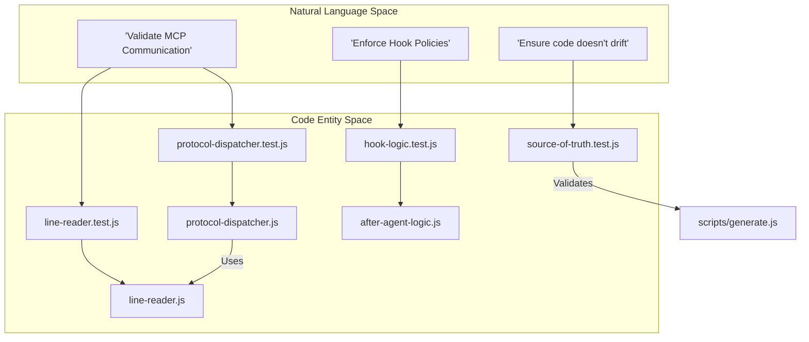
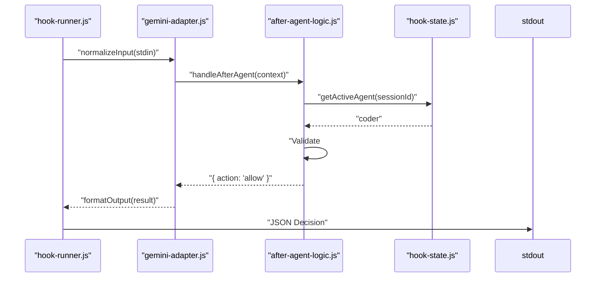

<!-- source: DeepWiki mcp.deepwiki.com · repo josstei/maestro-orchestrate · page 7 Testing Infrastructure · fetched 2026-10-26 -->

# Testing Infrastructure

Relevant source files

The following files were used as context for generating this wiki page:

- [tests/integration/hook-entrypoints.test.js](tests/integration/hook-entrypoints.test.js)
- [tests/integration/source-of-truth.test.js](tests/integration/source-of-truth.test.js)
- [tests/unit/adapter-factory.test.js](tests/unit/adapter-factory.test.js)
- [tests/unit/assess-task-complexity.test.js](tests/unit/assess-task-complexity.test.js)
- [tests/unit/check-layer-boundaries.test.js](tests/unit/check-layer-boundaries.test.js)
- [tests/unit/hook-logic.test.js](tests/unit/hook-logic.test.js)
- [tests/unit/line-reader.test.js](tests/unit/line-reader.test.js)
- [tests/unit/manifest-curator.test.js](tests/unit/manifest-curator.test.js)
- [tests/unit/platform-adapters.test.js](tests/unit/platform-adapters.test.js)
- [tests/unit/protocol-dispatcher.test.js](tests/unit/protocol-dispatcher.test.js)

The Maestro testing infrastructure is designed to ensure the reliability of the src-first, generated-runtime architecture. It validates that the canonical source logic remains correct, that the generator transforms produce functional code for all four runtimes, and that the resulting artifacts adhere to system invariants.

The infrastructure is divided into three primary suites: **Unit Tests**, **Transforms**, and **Integration Tests**, all orchestrated using the native `node:test` runner and measured with `c8` for coverage.

### Test Suite Overview

| Suite | Purpose | Key Components Tested |
| :--- | :--- | :--- |
| **Unit** | Validates individual modules in isolation. | MCP protocol dispatchers, state management, platform adapters. |
| **Transforms** | Ensures generator scripts correctly modify source code. | Agent stubbing, example extraction, skill discovery. |
| **Integration** | Validates end-to-end behavior and cross-runtime consistency. | Hook entrypoints, zero-drift guarantees, policy enforcement. |

## Test Categories & Tooling

The codebase employs several specialized test categories to maintain the "Zero-Drift" guarantee between the `src/` directory and the generated runtime directories (e.g., `claude/`, `plugins/maestro/`).

### Layer Boundary Enforcement
A specialized linter, `check-layer-boundaries.js`, ensures that library code in `src/lib` remains modular and does not leak dependencies into core orchestration or external packages.
*   **Behavior**: Scans `src/lib` for non-relative or non-node imports [scripts/check-layer-boundaries.js:1-136]().
*   **Verification**: Tested in [tests/unit/check-layer-boundaries.test.js:48-57]().

### Protocol & I/O Validation
The MCP (Model Context Protocol) layer is heavily tested to ensure that JSON-RPC frames are correctly framed and dispatched over standard I/O.
*   **Line Dispatching**: Validates that newline-delimited JSON is correctly buffered and parsed [tests/unit/line-reader.test.js:13-24]().
*   **Message Dispatching**: Ensures the `protocol-dispatcher` correctly handles `initialize`, `ping`, and `tools/call` methods [tests/unit/protocol-dispatcher.test.js:117-155]().

### Test Entity Relationship
The following diagram illustrates how test entities bridge the gap between high-level requirements and specific code implementations.

**Diagram: Testing Architecture Mapping**

Sources: [tests/unit/protocol-dispatcher.test.js:1-14](), [tests/unit/line-reader.test.js:1-7](), [tests/integration/source-of-truth.test.js:1-10](), [tests/unit/hook-logic.test.js:1-17]()

## Unit Tests
The unit test suite focuses on the core logic within `src/`. It covers critical paths such as the MCP server handlers, session state tools, and the adapter factory that standardizes platform-specific inputs.

*   **Platform Adapters**: Validates `claude-adapter`, `gemini-adapter`, and `qwen-adapter` to ensure they correctly normalize runtime-specific payloads (e.g., `PreToolUse` vs `SubagentStart`) into a unified internal format [tests/unit/platform-adapters.test.js:9-215]().
*   **Complexity Assessment**: Tests the `handleAssessTaskComplexity` logic which scans repositories to detect frameworks, test infrastructure, and LoC estimates [tests/unit/assess-task-complexity.test.js:33-164]().
*   **Manifest Curation**: Ensures that `collectManifestPaths` correctly identifies all files that need to be generated or pruned [tests/unit/manifest-curator.test.js:8-98]().

For details, see [Unit Tests](#7.1).

Sources: [tests/unit/platform-adapters.test.js:1-215](), [tests/unit/assess-task-complexity.test.js:1-165](), [tests/unit/manifest-curator.test.js:1-99]()

## Integration & Transform Tests
Integration tests verify the "Source of Truth" model by ensuring that generated runtimes (Claude, Gemini, Codex, Qwen) behave identically when executing shared hook logic.

*   **Hook Entrypoints**: Spawns actual `node` processes for the generated `hook-runner.js` in different runtime directories to verify they correctly dispatch events like `session-start` and `after-agent` [tests/integration/hook-entrypoints.test.js:23-171]().
*   **Source-of-Truth Invariants**: Validates that generated artifacts do not re-introduce mirrored shared code and that detached payloads (like those for Claude and Codex) are correctly structured [tests/integration/source-of-truth.test.js:11-86]().
*   **Transform Validation**: Tests the pipeline in `scripts/generate.js` to ensure transforms like `agent-stub` and `skill-discovery` correctly modify the source files for target environments.

**Diagram: Hook Integration Flow**

Sources: [tests/integration/hook-entrypoints.test.js:38-43](), [tests/unit/platform-adapters.test.js:114-160](), [tests/unit/hook-logic.test.js:22-102]()

For details, see [Integration & Transform Tests](#7.2).

Sources: [tests/integration/hook-entrypoints.test.js:1-171](), [tests/integration/source-of-truth.test.js:1-87](), [scripts/generate.js:1-100]()

---

