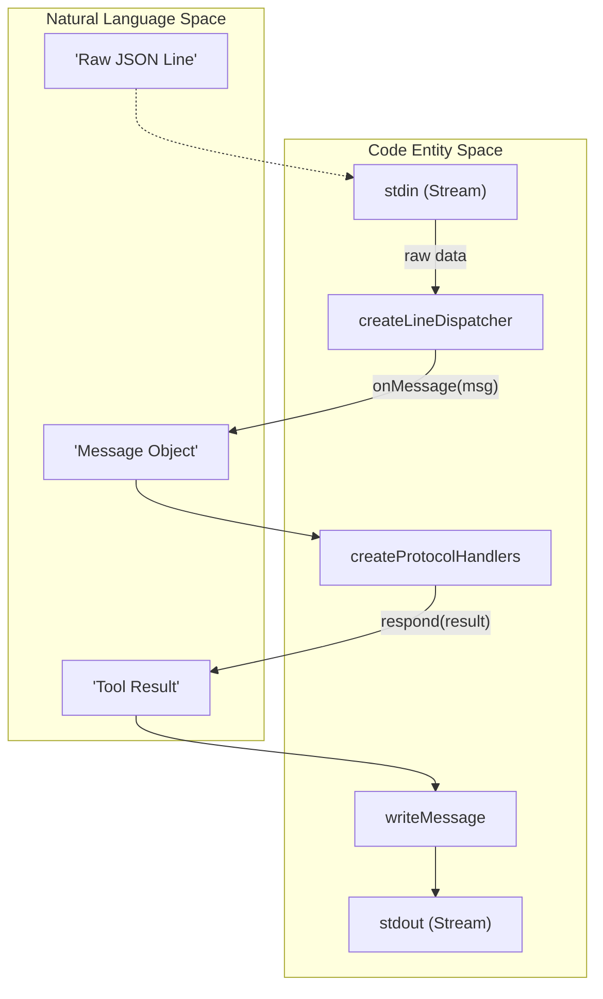
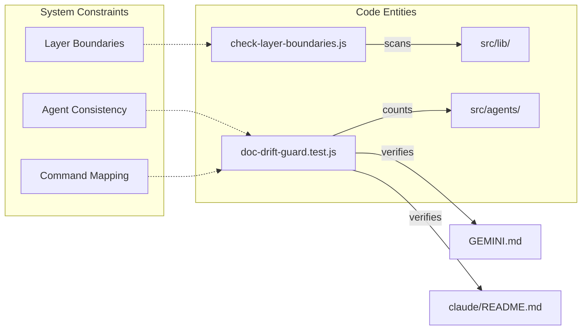

<!-- source: DeepWiki mcp.deepwiki.com · repo josstei/maestro-orchestrate · page 7.1 Unit Tests · fetched 2026-10-26 -->

# Unit Tests

Relevant source files

The following files were used as context for generating this wiki page:

- [EXAMPLES.md](EXAMPLES.md)
- [claude/src/mcp/handlers/session-state-tools.js](claude/src/mcp/handlers/session-state-tools.js)
- [docs/maestro-cheatsheet.md](docs/maestro-cheatsheet.md)
- [plugins/maestro/src/mcp/handlers/session-state-tools.js](plugins/maestro/src/mcp/handlers/session-state-tools.js)
- [src/mcp/handlers/session-state-tools.js](src/mcp/handlers/session-state-tools.js)
- [tests/unit/adapter-conventions.test.js](tests/unit/adapter-conventions.test.js)
- [tests/unit/adapter-factory.test.js](tests/unit/adapter-factory.test.js)
- [tests/unit/assess-task-complexity.test.js](tests/unit/assess-task-complexity.test.js)
- [tests/unit/check-layer-boundaries.test.js](tests/unit/check-layer-boundaries.test.js)
- [tests/unit/doc-drift-guard.test.js](tests/unit/doc-drift-guard.test.js)
- [tests/unit/lib-naming.test.js](tests/unit/lib-naming.test.js)
- [tests/unit/line-reader.test.js](tests/unit/line-reader.test.js)
- [tests/unit/manifest-curator.test.js](tests/unit/manifest-curator.test.js)
- [tests/unit/payload-builder.test.js](tests/unit/payload-builder.test.js)
- [tests/unit/platform-metadata.test.js](tests/unit/platform-metadata.test.js)
- [tests/unit/protocol-dispatcher.test.js](tests/unit/protocol-dispatcher.test.js)
- [tests/unit/session-state-tools.test.js](tests/unit/session-state-tools.test.js)
- [tests/unit/stdin-reader.test.js](tests/unit/stdin-reader.test.js)
- [tests/unit/tool-registry.test.js](tests/unit/tool-registry.test.js)

The Maestro unit test suite provides granular verification of core logic, protocol implementations, and architectural constraints. It ensures that critical components—ranging from the Model Context Protocol (MCP) dispatcher to documentation consistency guards—function correctly in isolation before integration.

### Core Test Categories

The suite is organized into functional domains, each targeting a specific layer of the system:

| Category | Primary Focus | Key Files |
|:---|:---|:---|
| **MCP & Communication** | JSON-RPC 2.0 compliance, tool dispatch, and stream parsing. | `protocol-dispatcher.test.js`, `line-reader.test.js` |
| **State & Logic** | Session lifecycle, task complexity scoring, and data validation. | `session-state-tools.test.js`, `assess-task-complexity.test.js` |
| **Platform Adapters** | Normalization of inputs/outputs across Gemini, Claude, and Qwen. | `adapter-factory.test.js`, `adapter-conventions.test.js` |
| **Integrity Guards** | Layer boundary enforcement and documentation drift prevention. | `check-layer-boundaries.test.js`, `doc-drift-guard.test.js` |

Sources: [tests/unit/protocol-dispatcher.test.js:1-14](), [tests/unit/doc-drift-guard.test.js:15-27](), [tests/unit/check-layer-boundaries.test.js:48-57]()

---

### Protocol & Communication Tests

These tests validate the implementation of the Model Context Protocol (MCP) used to bridge the LLM runtimes with Maestro's toolset.

#### Protocol Dispatcher
The `protocol-dispatcher.test.js` suite ensures that the server correctly handles the JSON-RPC lifecycle.
*   **Initialization**: Verifies that `buildInitializeResult` correctly negotiates protocol versions [tests/unit/protocol-dispatcher.test.js:58-70]().
*   **Tool Execution**: Validates that `callTool` results are wrapped in the correct MCP `content` structures for both success and error states [tests/unit/protocol-dispatcher.test.js:108-115](), [tests/unit/protocol-dispatcher.test.js:181-195]().
*   **Error Handling**: Confirms that `createToolErrorResult` includes recovery hints and error codes [tests/unit/protocol-dispatcher.test.js:72-80]().

#### Line Reader & Stream Parsing
The `line-reader.test.js` suite validates the robust parsing of standard input streams.
*   **Resilience**: It tests that the `createLineDispatcher` skips blank lines [tests/unit/line-reader.test.js:41-52]() and recovers from malformed JSON [tests/unit/line-reader.test.js:54-64]().
*   **Buffering**: Ensures partial lines are buffered until a newline (LF or CRLF) is received [tests/unit/line-reader.test.js:66-94]().

**Communication Data Flow**

Sources: [tests/unit/protocol-dispatcher.test.js:7-14](), [tests/unit/line-reader.test.js:7-11](), [tests/unit/protocol-dispatcher.test.js:48-56]()

---

### Platform & Adapter Infrastructure

Maestro uses an adapter pattern to handle the diverse requirements of different LLM runtimes (Gemini, Claude, Codex, Qwen).

#### Adapter Factory
The `adapter-factory.test.js` suite validates the `defineAdapter` contract. It ensures that every adapter provides:
1.  `normalizeInput`: Maps runtime-specific payloads to internal formats [tests/unit/adapter-factory.test.js:11-14]().
2.  `formatOutput`: Maps internal results back to runtime-specific formats [tests/unit/adapter-factory.test.js:11-14]().
3.  `errorFallback`: Provides a safe return value during failures [tests/unit/adapter-factory.test.js:11-14]().
4.  `getExitCode`: Defaults to `EXIT_SUCCESS` unless overridden [tests/unit/adapter-factory.test.js:30-34]().

#### Manifest Curator
The `manifest-curator.test.js` validates the `collectManifestPaths` function, which is critical for the generator pipeline. It ensures that output paths from manifest entries and entry-point expanders are correctly aggregated and deduplicated [tests/unit/manifest-curator.test.js:15-34]().

Sources: [tests/unit/adapter-factory.test.js:6-15](), [tests/unit/manifest-curator.test.js:6-25]()

---

### Integrity & Drift Guards

These tests enforce architectural constraints and ensure that documentation remains synchronized with the code.

#### Layer Boundary Enforcement
The `check-layer-boundaries.test.js` suite uses a specialized script to scan `src/lib` for illegal imports.
*   **Isolation**: It ensures that utility functions in `lib` do not depend on higher-level orchestration or platform-specific code [tests/unit/check-layer-boundaries.test.js:83-92]().
*   **Dependency Control**: It flags non-relative and non-Node.js built-in imports to prevent supply chain bloat in the core library [tests/unit/check-layer-boundaries.test.js:94-102]().

#### Doc-Drift Guard
The `doc-drift-guard.test.js` is a unique suite that treats documentation as a testable artifact.
*   **Agent Roster Sync**: It verifies that every agent in `src/agents/` is listed in the `GEMINI.md` and `QWEN.md` rosters [tests/unit/doc-drift-guard.test.js:62-69]().
*   **Claim Validation**: It ensures that claims like "39 specialist agents" are updated across all READMEs and overview files when the actual agent count changes [tests/unit/doc-drift-guard.test.js:15-36]().
*   **Command Mapping**: It checks that Claude and Codex documentation uses remapped command names (e.g., `review-code` instead of `/review`) to avoid conflicts with host-reserved names [tests/unit/doc-drift-guard.test.js:80-99]().

**Integrity Verification Mapping**

Sources: [tests/unit/check-layer-boundaries.test.js:10-11](), [tests/unit/doc-drift-guard.test.js:10-16](), [tests/unit/doc-drift-guard.test.js:153-162]()

---

### State & Validation

#### Session State Tools
The `session-state-tools.test.js` focuses on data validation and coercion. A key function tested is `coercePositiveInteger`, which is used for phase lookups and ID normalization [tests/unit/session-state-tools.test.js:7-30](). It ensures that string-based IDs from LLM outputs are safely converted to integers while rejecting invalid inputs like floats or non-numeric strings [tests/unit/session-state-tools.test.js:41-53]().

#### Implementation Plan Resolution
Though tested within the tool suites, the logic in `session-state-tools.js` ensures that implementation plans are materialized correctly into the `plans/` directory, handling both path-based and content-based inputs to bridge the gap between runtime write surfaces and the MCP workspace [src/mcp/handlers/session-state-tools.js:68-124]().

Sources: [tests/unit/session-state-tools.test.js:5-30](), [src/mcp/handlers/session-state-tools.js:36-66]()

---

