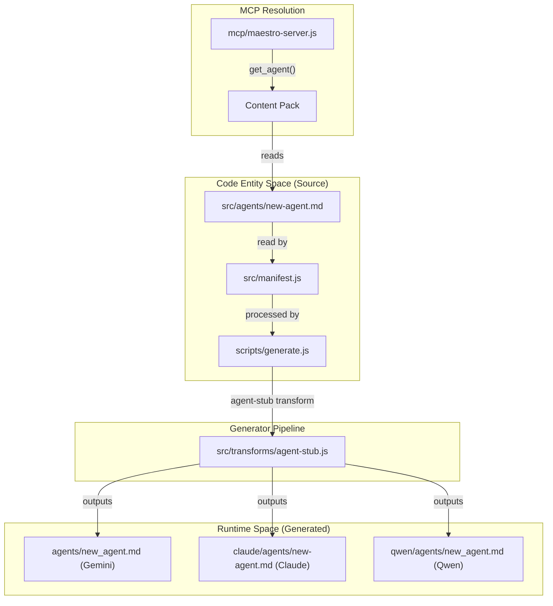
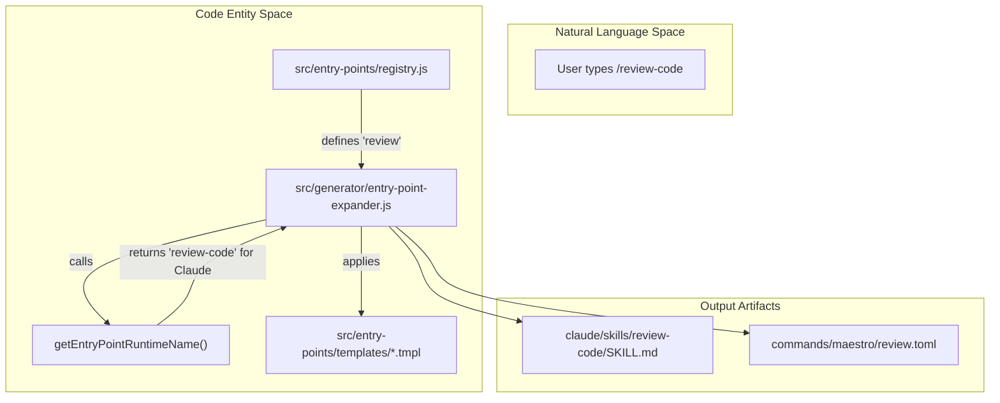

<!-- source: DeepWiki mcp.deepwiki.com · repo josstei/maestro-orchestrate · page 8.1 Adding Agents & Entry Points · fetched 2026-10-26 -->

# Adding Agents & Entry Points

<details>
<summary>Relevant source files</summary>

The following files were used as context for generating this wiki page:

- [CONTRIBUTING.md](CONTRIBUTING.md)
- [EXAMPLES.md](EXAMPLES.md)
- [agents/architect.md](agents/architect.md)
- [agents/coder.md](agents/coder.md)
- [agents/debugger.md](agents/debugger.md)
- [agents/refactor.md](agents/refactor.md)
- [docs/maestro-cheatsheet.md](docs/maestro-cheatsheet.md)
- [src/entry-points/registry.js](src/entry-points/registry.js)
- [src/generator/entry-point-expander.js](src/generator/entry-point-expander.js)
- [tests/unit/doc-drift-guard.test.js](tests/unit/doc-drift-guard.test.js)

</details>


This page provides a technical guide for extending Maestro by adding new specialist agents or new entry-point commands. Maestro uses a **src-first, generated-runtime architecture** [CONTRIBUTING.md:47-51](), meaning all additions must be made to the canonical source in `src/` rather than the generated runtime directories like `claude/`, `plugins/maestro/`, or `qwen/` [CONTRIBUTING.md:49-51]().

## Adding a New Specialist Agent

Maestro supports 39 specialist agents [tests/unit/doc-drift-guard.test.js:15-36](). Each agent is defined by a Markdown file in `src/agents/` containing YAML frontmatter and a methodology.

### 1. Define the Agent File
Create a new file `src/agents/<agent-name>.md`. The filename must be kebab-case.

### 2. Configure Frontmatter Schema
The frontmatter defines the agent's identity and capabilities. Key fields include:
- `name`: The unique identifier for the agent.
- `kind`: Typically `local`.
- `description`: A detailed prompt explaining when the orchestrator should delegate to this agent [agents/architect.md:4-4]().
- `tools`: A list of MCP tools the agent is permitted to use [agents/architect.md:5-13]().
- `capability tier`: (Inferred by tool list) Agents range from `read_only` (e.g., `architect`) to `full` (e.g., `coder` with `write_file` and `run_shell_command`) [agents/architect.md:5-13](), [agents/coder.md:5-16]().

### 3. Capability Tiers and Tools
When selecting tools, adhere to the following conventions:
| Tier | Representative Tools | Example Agent |
| :--- | :--- | :--- |
| **Read Only** | `read_file`, `list_directory`, `google_web_search` | `architect` [agents/architect.md:5-13]() |
| **Read/Shell** | `read_file`, `run_shell_command` | `debugger` [agents/debugger.md:5-13]() |
| **Read/Write** | `read_file`, `write_file`, `replace` | `refactor` [agents/refactor.md:5-16]() |
| **Full** | All above + `activate_skill` | `coder` [agents/coder.md:5-16]() |

### 4. Implementation Flow

The following diagram illustrates how a new agent definition in `src/agents/` is transformed into runtime-specific stubs.

**Agent Generation and Resolution Flow**

Sources: [CONTRIBUTING.md:47-60](), [src/generator/entry-point-expander.js:126-149](), [agents/architect.md:19-20]()

---

## Adding a New Entry Point

Entry points are the public-facing commands (e.g., `/maestro:orchestrate`, `/review-code`) that users invoke.

### 1. Register the Command
Add a new entry to the appropriate registry file:
- **Core Commands**: (e.g., `orchestrate`, `execute`) Add to `src/entry-points/core-command-registry.js` [src/generator/entry-point-expander.js:160-160]().
- **Specialist/Standalone Commands**: (e.g., `review`, `security-audit`) Add to `src/entry-points/registry.js` [src/entry-points/registry.js:13-14]().

### 2. Configure Runtime Name Remapping
Some runtimes reserve specific command names (e.g., Claude reserves `/review`). Use the `runtimeNames` property to provide alternatives [src/generator/entry-point-expander.js:14-17](), [src/entry-points/registry.js:16-16]().

```javascript
// Example in src/entry-points/registry.js
{
  name: 'review',
  runtimeNames: { 
    codex: 'review-code', 
    claude: 'review-code' 
  },
  description: '...',
  agents: ['code-reviewer'],
  workflow: [ ... ]
}
```
Sources: [src/entry-points/registry.js:15-28](), [src/generator/entry-point-expander.js:69-71]()

### 3. Template Selection
The `entry-point-expander.js` uses templates to generate the final command files [src/generator/entry-point-expander.js:19-52]().
- **Gemini/Qwen**: `.toml` files in `commands/maestro/` [src/generator/entry-point-expander.js:22-22]().
- **Claude**: `SKILL.md` files in `claude/skills/` [src/generator/entry-point-expander.js:27-27]().
- **Codex**: `SKILL.md` files in `plugins/maestro/skills/` [src/generator/entry-point-expander.js:32-32]().

### 4. Update Doc-Drift Guard
Maestro enforces documentation consistency via `tests/unit/doc-drift-guard.test.js`. If you add an agent or command, you must update the expected counts and rosters in this test file to pass CI [tests/unit/doc-drift-guard.test.js:15-36](), [tests/unit/doc-drift-guard.test.js:62-69]().

**Entry Point Expansion Logic**

Sources: [src/generator/entry-point-expander.js:69-109](), [src/entry-points/registry.js:15-34](), [docs/maestro-cheatsheet.md:16-30]()

---

## Verification Checklist

After adding an agent or entry point, perform the following steps:

1.  **Regenerate**: Run `just generate` to produce the runtime files [CONTRIBUTING.md:71-73]().
2.  **Verify Drift**: Run `just check` to ensure all generated files are correctly committed and match the source [CONTRIBUTING.md:81-84]().
3.  **Run Tests**: Run `just test` to verify that the `doc-drift-guard` and other unit tests pass [CONTRIBUTING.md:76-79]().
4.  **Update Examples**: Add a new scenario to `EXAMPLES.md` to demonstrate the new capability [EXAMPLES.md:5-11]().
5.  **Changelog**: Add an entry to the `[Unreleased]` section of `CHANGELOG.md` [CONTRIBUTING.md:156-158]().

| File to Edit | Purpose |
| :--- | :--- |
| `src/agents/*.md` | Define new agent methodology and tools |
| `src/entry-points/registry.js` | Define standalone commands |
| `src/entry-points/core-command-registry.js` | Define core orchestration commands |
| `tests/unit/doc-drift-guard.test.js` | Update agent/command counts and rosters |
| `EXAMPLES.md` | Add usage examples for the new feature |

Sources: [CONTRIBUTING.md:62-86](), [tests/unit/doc-drift-guard.test.js:15-36](), [EXAMPLES.md:1-11]()

---

