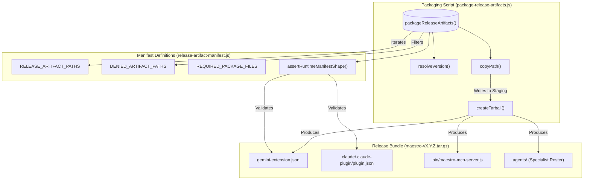
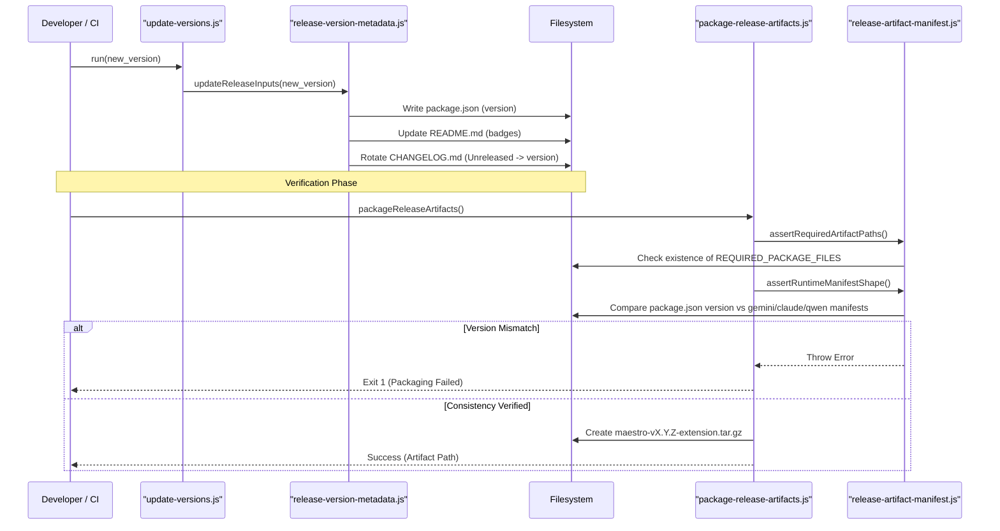

<!-- source: DeepWiki mcp.deepwiki.com · repo josstei/maestro-orchestrate · page 8.2 Version Management & Release Artifacts · fetched 2026-10-26 -->

# Version Management & Release Artifacts

Relevant source files

The following files were used as context for generating this wiki page:

- [scripts/package-release-artifacts.js](scripts/package-release-artifacts.js)
- [scripts/release-artifact-manifest.js](scripts/release-artifact-manifest.js)
- [scripts/release-version-metadata.js](scripts/release-version-metadata.js)
- [scripts/update-versions.js](scripts/update-versions.js)
- [src/core/version.js](src/core/version.js)
- [tests/unit/update-versions.test.js](tests/unit/update-versions.test.js)

This page details the mechanisms used to maintain version consistency across the multi-runtime Maestro ecosystem and the process for packaging verified release artifacts.

## Version Synchronization

Maestro uses a centralized versioning strategy where `package.json` serves as the primary source of truth for stable releases. However, because Maestro supports multiple runtimes (Claude, Gemini, Qwen, Codex), version information must be propagated to various manifests and internal metadata files to ensure that telemetry, MCP server connections, and marketplace listings remain synchronized.

### The update-versions.js Pipeline

The synchronization is handled by `scripts/update-versions.js` [scripts/update-versions.js:1-33](), which leverages logic in `scripts/release-version-metadata.js` [scripts/release-version-metadata.js:101-117]().

When a new version is triggered, the following operations occur:
1.  **Validation**: The version string is checked against `STABLE_SEMVER_RE` (`^\d+\.\d+\.\d+$`) [scripts/release-version-metadata.js:6-6]().
2.  **Package Update**: The `version` field in the root `package.json` is updated [scripts/release-version-metadata.js:31-35]().
3.  **Badge Propagation**: Version badges in `README.md` and `claude/README.md` are updated using a regex replacement for `version-X.Y.Z-blue` [scripts/release-version-metadata.js:37-45]().
4.  **Changelog Rotation**: Content under the `## [Unreleased]` header in `CHANGELOG.md` is moved into a new versioned section, and the current date is appended [scripts/release-version-metadata.js:62-99]().

**Note on Runtime Manifests**: While the root `package.json` is updated by this script, specific runtime manifests (like `gemini-extension.json` or `claude/.claude-plugin/plugin.json`) are validated against this version during the packaging phase rather than being updated by the same script to prevent accidental drifts in development [tests/unit/update-versions.test.js:80-99]().

### Version Resolution Logic
At runtime, the system resolves its own version using `src/core/version.js` [src/core/version.js:1-50]().

**Version Resolution Flow**
The `resolveVersion` function [src/core/version.js:43-45]() attempts to find the version in this order:
1.  **package.json**: Searches upward from the current directory for a `package.json` where `name` is `@josstei/maestro` [src/core/version.js:10-30]().
2.  **version.json Fallback**: If no `package.json` is found (e.g., in a compiled or bundled environment), it reads `src/version.json` [src/core/version.js:32-41]().
3.  **Default**: Returns `'unknown'` if both fail.

**Sources:**
- [scripts/update-versions.js:1-33]()
- [scripts/release-version-metadata.js:1-130]()
- [src/core/version.js:1-50]()
- [tests/unit/update-versions.test.js:80-99]()

## Release Artifact Packaging

Release artifacts are bundled into a compressed tarball (`maestro-vX.Y.Z-extension.tar.gz`) using `scripts/package-release-artifacts.js` [scripts/package-release-artifacts.js:113-140](). This process ensures that only necessary files are included and that all runtime manifests are internally consistent.

### The Packaging Workflow

The packaging logic follows a strict "Staging and Verification" pattern:

1.  **Pre-flight Checks**: The script calls `assertRequiredArtifactPaths` to ensure all 33+ critical paths defined in `RELEASE_ARTIFACT_PATHS` exist [scripts/release-artifact-manifest.js:6-34]().
2.  **Manifest Validation**: `assertRuntimeManifestShape` verifies that the version string in `package.json` matches the versions declared in all runtime-specific manifests [scripts/release-artifact-manifest.js:223-247]().
3.  **Staging**: Files are copied to a temporary directory. The `copyPath` function filters out any files matching `DENIED_ARTIFACT_PATHS` (e.g., `.git`, `node_modules`, `tests`, `coverage`) [scripts/release-artifact-manifest.js:36-54]().
4.  **Security Filtering**: A secondary regex filter `DENIED_ARTIFACT_PATTERNS` blocks any accidental inclusion of test files (`.test.js`, `__tests__`) [scripts/release-artifact-manifest.js:56-60]().
5.  **Archiving**: The staging directory is compressed using `tar -czf` [scripts/package-release-artifacts.js:104-111]().

### Code Entity to Artifact Mapping

The following diagram bridges the relationship between the packaging script entities and the filesystem requirements.

**Artifact Composition Diagram**

**Sources:**
- [scripts/package-release-artifacts.js:1-157]()
- [scripts/release-artifact-manifest.js:1-247]()

## Data Flow: Version Update to Release

The following diagram illustrates the end-to-end data flow from a developer triggering a version update to the generation of a verified artifact.

**Version and Artifact Data Flow**

### Critical Verification Checks
The system enforces strict consistency through `assertRuntimeManifestShape` [scripts/release-artifact-manifest.js:223-247](). It ensures the following files all report the exact same version string:
*   `package.json`
*   `gemini-extension.json`
*   `qwen-extension.json`
*   `claude/.claude-plugin/plugin.json`
*   `plugins/maestro/.codex-plugin/plugin.json`
*   `.claude-plugin/marketplace.json` (metadata and plugin entry)

**Sources:**
- [scripts/update-versions.js:1-33]()
- [scripts/release-version-metadata.js:101-117]()
- [scripts/release-artifact-manifest.js:62-69]()
- [scripts/release-artifact-manifest.js:223-247]()

---

