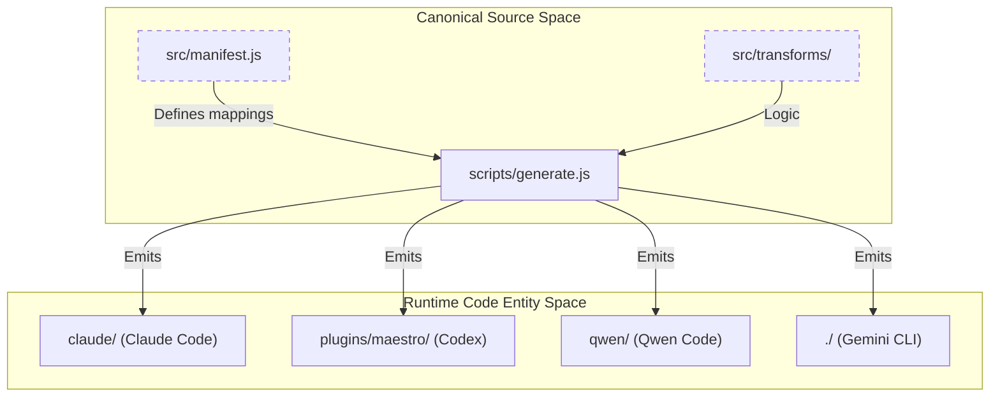
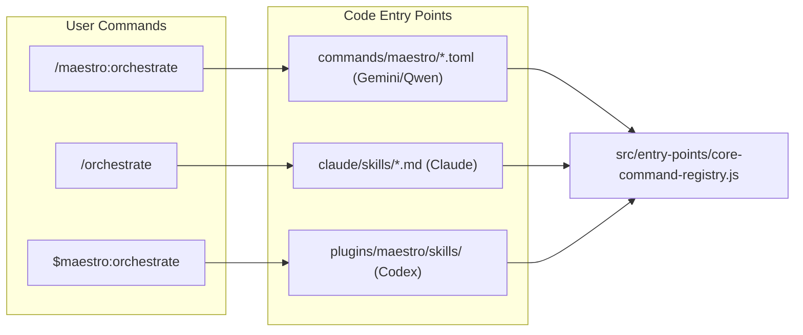

<!-- source: DeepWiki mcp.deepwiki.com · repo josstei/maestro-orchestrate · page 9 Glossary · fetched 2026-10-26 -->

# Glossary

Relevant source files

The following files were used as context for generating this wiki page:

- [.gitignore](.gitignore)
- [CHANGELOG.md](CHANGELOG.md)
- [EXAMPLES.md](EXAMPLES.md)
- [GEMINI.md](GEMINI.md)
- [README.md](README.md)
- [USAGE.md](USAGE.md)
- [claude/src/version.json](claude/src/version.json)
- [docs/architecture.md](docs/architecture.md)
- [docs/flow.md](docs/flow.md)
- [docs/maestro-cheatsheet.md](docs/maestro-cheatsheet.md)
- [docs/overview.md](docs/overview.md)
- [docs/usage.md](docs/usage.md)
- [gemini-extension.json](gemini-extension.json)
- [package-lock.json](package-lock.json)
- [plugins/maestro/.codex-plugin/plugin.json](plugins/maestro/.codex-plugin/plugin.json)
- [plugins/maestro/.mcp.json](plugins/maestro/.mcp.json)
- [plugins/maestro/README.md](plugins/maestro/README.md)
- [plugins/maestro/src/version.json](plugins/maestro/src/version.json)
- [src/skills/shared/delegation/SKILL.md](src/skills/shared/delegation/SKILL.md)
- [tests/unit/doc-drift-guard.test.js](tests/unit/doc-drift-guard.test.js)

This glossary defines the technical terms, architectural patterns, and domain-specific jargon used within the Maestro codebase. It serves as a reference for onboarding engineers to understand how conceptual workflows map to specific code entities and file structures.

## Core Concepts & Workflow Terms

| Term | Definition | Code Pointer |
|:---|:---|:---|
| **Orchestrator** | The high-level persona (TechLead) responsible for designing, planning, and delegating tasks. | [GEMINI.md:1-12]() |
| **Specialist Agent** | One of 39 specialized subagents (e.g., `architect`, `coder`, `security-engineer`) that perform specific technical tasks. | [docs/architecture.md:94-94]() |
| **Standard Workflow** | A 4-phase process (Design → Plan → Execute → Complete) used for medium to complex tasks. | [GEMINI.md:5-10]() |
| **Express Workflow** | A streamlined, inline flow for simple tasks involving minimal questions and a single specialist. | [docs/maestro-cheatsheet.md:73-81]() |
| **Design Gate** | A mandatory approval step where the user must approve the design document before a session is created. | [CHANGELOG.md:31-31]() |
| **Phase Reconciliation** | The process of updating the session state when an agent's actual file changes diverge from the original plan. | [CHANGELOG.md:32-32]() |
| **HARD-GATE** | An orchestration step that requires explicit user intervention or validation before proceeding. | [docs/maestro-cheatsheet.md:92-98]() |

**Sources:** [GEMINI.md:1-12](), [docs/architecture.md:94-94](), [docs/maestro-cheatsheet.md:73-98](), [CHANGELOG.md:31-32]()

## Architectural Entities

### Source-First Generation
Maestro uses a "src-first" model where all logic lives in `src/` and is transformed into runtime-specific adapters.

**Natural Language to Code Entity Space: Generation Pipeline**

**Sources:** [docs/architecture.md:5-26](), [docs/architecture.md:28-37]()

### Session State
Persistence is managed via Markdown files with YAML frontmatter.

*   **Active Session:** The current task state stored in `docs/maestro/state/active-session.md`. [docs/usage.md:149-150]()
*   **Session ID:** A unique identifier (usually `<date>-<topic>`) used for file naming and archival. [docs/usage.md:166-166]()
*   **Transaction Helpers:** Functions like `withSessionState` and `readActiveSession` ensure atomic updates. [CHANGELOG.md:56-56]()

**Sources:** [docs/usage.md:143-174](), [CHANGELOG.md:56-56]()

## MCP (Model Context Protocol)

Maestro implements an MCP server to provide tools to LLM runtimes.

| Entity | Role | Code Pointer |
|:---|:---|:---|
| `maestro-server.js` | The main entry point for the MCP server. | [docs/architecture.md:106-106]() |
| `tool-registry.js` | Composes tool schemas and handlers. | [docs/architecture.md:112-112]() |
| `validate_plan` | MCP tool that checks plans for cycles (DAG) and agent capabilities. | [CHANGELOG.md:44-44]() |
| `get_agent` | MCP tool that serves agent methodology/instructions to the runtime. | [CHANGELOG.md:39-39]() |
| `requiresWorkspace` | A declarative contract enforcing that a tool only runs in an initialized repo. | [CHANGELOG.md:41-41]() |

**Sources:** [docs/architecture.md:105-137](), [CHANGELOG.md:39-44]()

## Runtime Specifics

**Code Entity Space: Runtime Entry Points**

**Sources:** [docs/usage.md:83-142](), [docs/architecture.md:85-97]()

### Runtime Abbreviations & Jargon
*   **Snake-case Agents:** Naming convention for Gemini/Qwen (e.g., `code_reviewer`). [README.md:16-19]()
*   **Kebab-case Agents:** Naming convention for Claude/Codex (e.g., `code-reviewer`). [README.md:17-18]()
*   **Detached Payload:** The subset of `src/` mirrored into `claude/src/` or `plugins/maestro/src/` for standalone installations. [docs/architecture.md:48-48]()
*   **Hook Runner:** The event dispatcher (`hook-runner.js`) that triggers logic before/after agent execution. [CHANGELOG.md:51-52]()
*   **Policy Enforcer:** A system that blocks destructive shell commands in specific runtimes. [docs/maestro-cheatsheet.md:128-128]()

**Sources:** [README.md:14-20](), [docs/architecture.md:47-53](), [docs/maestro-cheatsheet.md:115-146]()

## Internal Tools & Scripts

*   **`justfile`:** The command runner for development tasks (e.g., `just check`, `just test`). [docs/usage.md:23-43]()
*   **`generate.js`:** The primary build script for regenerating runtime adapters. [docs/architecture.md:30-37]()
*   **`doc-drift-guard`:** A test suite ensuring that documentation (like agent counts) stays in sync with code. [tests/unit/doc-drift-guard.test.js:15-36]()
*   **`npm-publish-idempotent.js`:** Script for safe, multi-stage releases to npm. [CHANGELOG.md:22-22]()

**Sources:** [docs/usage.md:7-43](), [docs/architecture.md:30-37](), [tests/unit/doc-drift-guard.test.js:1-13](), [CHANGELOG.md:22-22]()