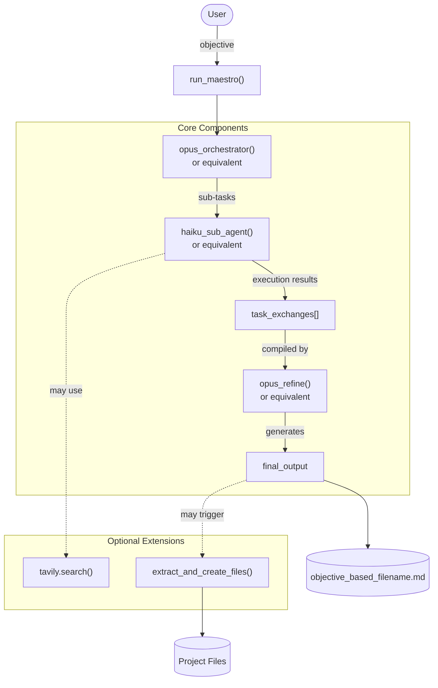
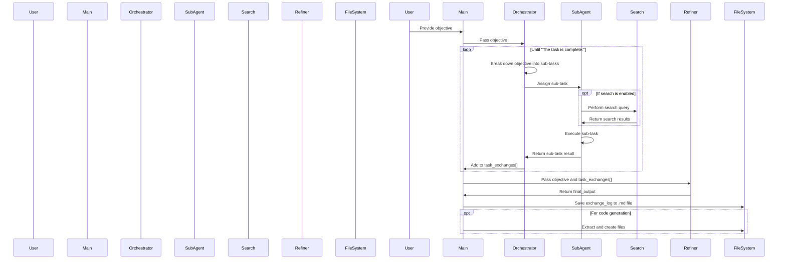
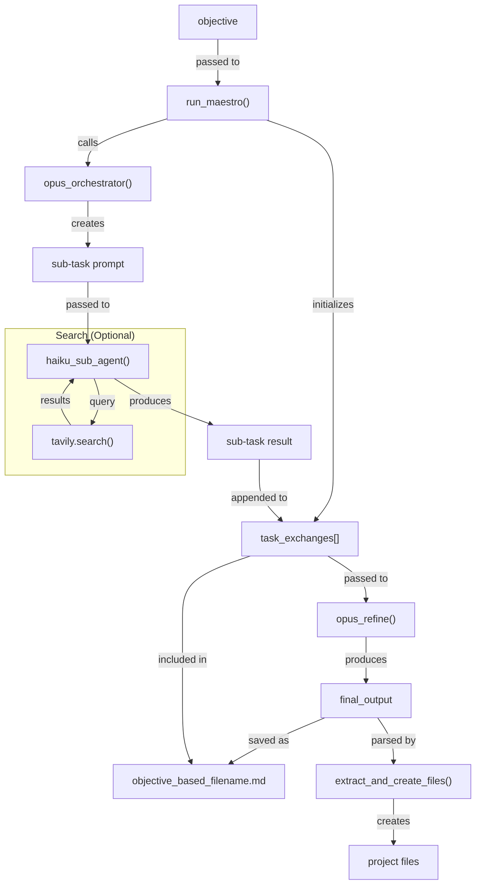

<!-- source: DeepWiki mcp.deepwiki.com · repo Doriandarko/maestro · page 1 Overview · fetched 2026-10-26 -->

# Overview

Relevant source files

The following files were used as context for generating this wiki page:

- [README.md](README.md)

This document provides a technical introduction to the Maestro LLM Orchestration Framework, a system designed to decompose complex tasks into manageable sub-tasks executed by language models. Maestro supports multiple LLM providers including Anthropic Claude, OpenAI GPT, Google Gemini, Groq, and local models through platforms like Ollama and LM Studio.

For installation instructions, see [Installation & Setup](#2).
For detailed usage guidance, see [Usage Guide](#3).
For information about specific implementations, see [Implementations](#4).
For web interface documentation, see [Web Interface](#5).

## Core Architecture

Maestro employs a three-tier orchestration model to tackle complex tasks:

Sources: [README.md](README.md:1-225)

This architecture consists of:

1. An **Orchestrator Model** that breaks down objectives into sub-tasks
2. **Sub-agent Models** that execute individual sub-tasks
3. A **Refiner Model** that integrates sub-task results into a cohesive final output

The framework allows large language models to handle complex, multi-step tasks by dividing them into smaller, manageable components while maintaining context between steps.

## Implementation Variants

Maestro provides multiple implementation files to support different LLM providers:

| Variant File | Primary Function | LLM Provider |
|--------------|-----------------|-------------|
| `maestro.py` | Original implementation | Anthropic Claude (Opus/Sonnet/Haiku) |
| `maestro-anyapi.py` | Multi-provider support via LiteLLM | OpenAI, Anthropic, Gemini, etc. |
| `maestro-gpt.py` | GPT-4 implementation | OpenAI GPT-4 |
| `maestro-gpt4o.py` | Optimized for GPT-4o | OpenAI GPT-4o |
| `maestro-groq.py` | Fast inference implementation | Groq |
| `maestro-lmstudio.py` | Local model support | LM Studio |
| `maestro-ollama.py` | Local model support | Ollama |

Sources: [README.md](README.md:6-110)

## Execution Workflow

The execution workflow in Maestro follows this sequence:

Sources: [README.md](README.md:190-201)

The workflow terminates when the Orchestrator model includes the phrase "The task is complete:" in its response, indicating that the objective has been fully achieved.

## Core Components

### Main Execution Function

The `run_maestro()` function (or equivalent in each variant) manages the overall execution flow:

- Initializes the task execution process
- Manages the loop between orchestrator and sub-agents
- Calls the refiner when all sub-tasks are complete
- Handles result logging and file creation

### Orchestrator Model

The orchestrator function (e.g., `opus_orchestrator()`) is responsible for:

1. Breaking down the main objective into a series of sub-tasks
2. Tracking progress and determining when the task is complete
3. Providing context from previous results to guide future task generation

### Sub-agent Model

The sub-agent function (e.g., `haiku_sub_agent()`) is responsible for:

1. Executing individual sub-tasks based on the prompt from the orchestrator
2. Utilizing search (if enabled) to gather information
3. Maintaining context of previous sub-task results

### Refiner Model

The refiner function (e.g., `opus_refine()`) is responsible for:

1. Reviewing all sub-task results
2. Synthesizing the information into a cohesive output
3. Ensuring the final output fully addresses the original objective

Sources: [README.md](README.md:194-201)

## Data Flow

Sources: [README.md](README.md:190-201)

## Key Features

### Task Decomposition

Maestro breaks down complex objectives into sub-tasks, maintaining context across multiple steps. Each sub-task execution builds on previous results, allowing the system to tackle complex problems incrementally.

### LLM Provider Flexibility

The framework supports multiple LLM providers through variant implementations:

- Cloud-based APIs: `maestro.py` (Anthropic), `maestro-gpt4o.py` (OpenAI), etc.
- Local models: `maestro-ollama.py`, `maestro-lmstudio.py`
- Multi-provider: `maestro-anyapi.py` (using LiteLLM)

### Search Integration

When enabled, the `tavily.search()` function provides web search capabilities to sub-agents, enhancing their ability to complete tasks with up-to-date information. This requires a Tavily API key.

Sources: [README.md](README.md:115-119)

### Code Generation

For coding tasks, Maestro can:
- Create directory structures based on the generated output
- Extract code blocks and save them to appropriate files
- Support complete project generation

Sources: [README.md](README.md:139-141)

### Exchange Logging

The system generates a detailed exchange log capturing the entire task breakdown and execution process, saved to a Markdown file named based on the objective.

Sources: [README.md](README.md:138)

### Web Interface

Maestro includes a Flask-based web application (`app.py`) that provides:
- A form-based interface for submitting objectives
- Real-time progress tracking
- Results display and exchange log access

For details on the web interface, see [Web Interface](#5).

## Technical Requirements

To use Maestro, you need:

- Python installed on your system
- API keys for the LLM providers you intend to use
- Required Python packages (varies by implementation)
- Tavily API key (if using search functionality)

For detailed setup instructions, refer to [Installation & Setup](#2).

Sources: [README.md](README.md:143-169)

---

