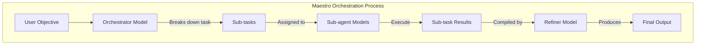
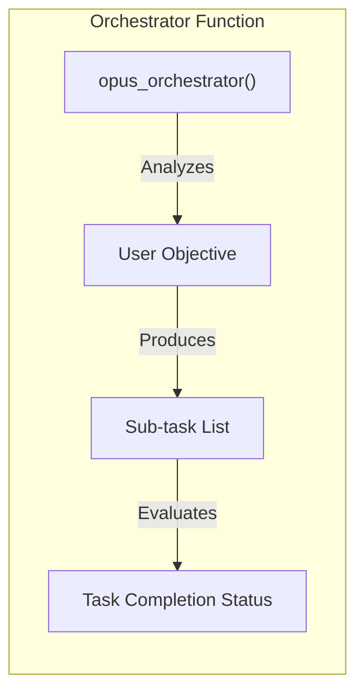
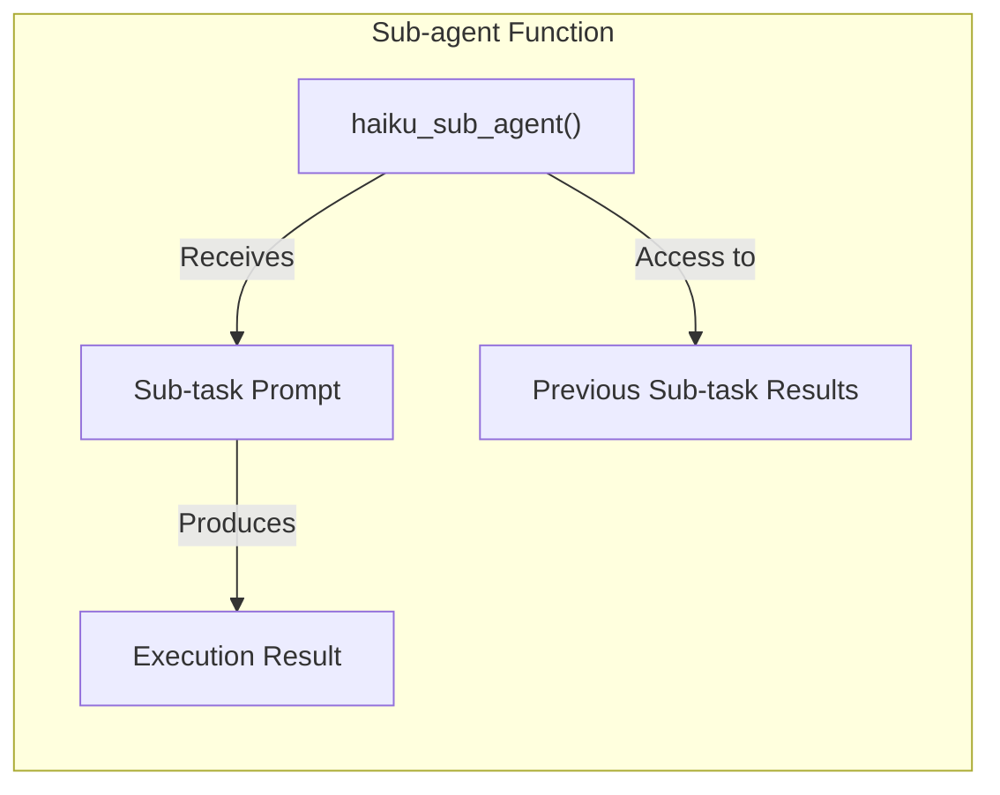
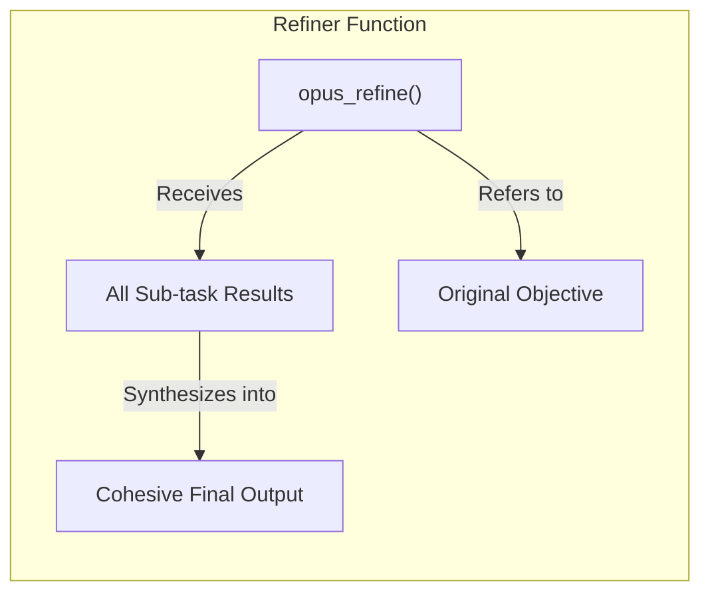
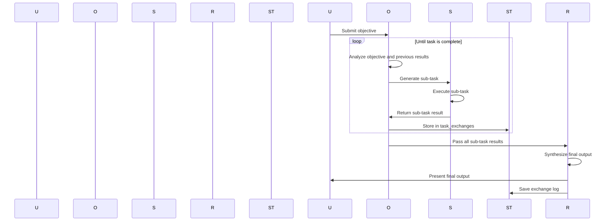
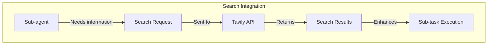
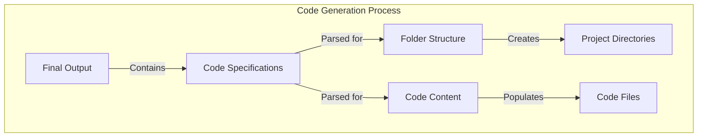
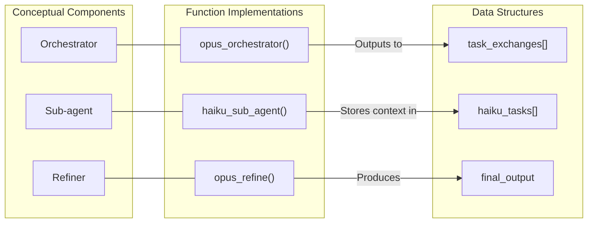
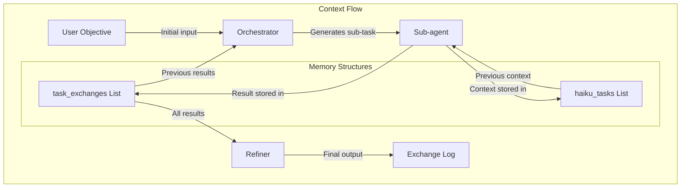

<!-- source: DeepWiki mcp.deepwiki.com · repo Doriandarko/maestro · page 1.1 Core Concepts · fetched 2026-10-26 -->

# Core Concepts

Relevant source files

The following files were used as context for generating this wiki page:

- [README.md](README.md)

This document explains the fundamental concepts that power the Maestro LLM Orchestration Framework. It covers the core components, their relationships, and how they work together to accomplish complex tasks by breaking them down into manageable sub-tasks. For details on the system architecture and implementation, see [Architecture](#1.2).

## The Maestro Orchestration Model

Maestro employs a hierarchical approach to task accomplishment, using different models for different roles in the orchestration process. This design enables complex tasks to be broken down, executed, and refined in a systematic way.

Sources: [README.md:134-140]()

## Key Components

Maestro's framework consists of three primary components that work in concert to process complex objectives:

### 1. Orchestrator Model

The Orchestrator is a Large Language Model (typically a more capable model like Claude Opus or GPT-4) responsible for:
- Analyzing and understanding the user's objective
- Breaking down complex objectives into manageable sub-tasks
- Determining when each sub-task should be executed
- Assessing when the overall objective has been completed

The Orchestrator acts as the "project manager" that oversees the entire workflow and makes strategic decisions about task decomposition.

Sources: [README.md:194-195]()

### 2. Sub-agent Model

The Sub-agent model (typically a smaller, more efficient model like Claude Haiku or similar models in other providers) is responsible for:
- Executing individual sub-tasks defined by the Orchestrator
- Receiving context from previously completed sub-tasks
- Providing detailed results for each sub-task

Sub-agents are the "workers" that handle specific pieces of the overall objective, with each focusing on a well-defined portion of the problem.

Sources: [README.md:196]()

### 3. Refiner Model

The Refiner model (typically the same model as the Orchestrator) is responsible for:
- Reviewing all sub-task results collectively
- Ensuring consistency across the various sub-task outputs
- Synthesizing the individual results into a cohesive final output
- Formatting the output appropriately based on the original objective

The Refiner serves as the "editor" that transforms a collection of individual results into a unified, polished final product.

Sources: [README.md:197]()

## Task Orchestration Process

The Maestro framework follows a systematic process to accomplish objectives:

1. **Objective Submission**: The user provides a high-level objective to the system.

2. **Task Breakdown**: The Orchestrator analyzes the objective and breaks it down into sequential sub-tasks.

3. **Sub-task Execution**: Each sub-task is assigned to a Sub-agent model, which executes it and returns the result.

4. **Context Preservation**: Each Sub-agent has access to the results of previously completed sub-tasks, providing necessary context.

5. **Completion Assessment**: The Orchestrator continuously evaluates whether the objective has been fully addressed based on the accumulated sub-task results.

6. **Refinement**: Once all necessary sub-tasks are complete, the Refiner synthesizes the individual results into a cohesive final output.

7. **Documentation**: The entire exchange, including the objective, task breakdown, sub-task results, and final output, is saved to a Markdown file.

Sources: [README.md:192-202]()

## Enhanced Capabilities

Maestro includes several enhanced capabilities that extend its basic orchestration model:

### Search Integration

When enabled, Maestro can leverage external search APIs (primarily Tavily) to gather relevant information while executing sub-tasks. This allows the Sub-agents to access up-to-date information beyond what's in the LLM's training data.

Sources: [README.md:113-119]()

### Code Generation

Maestro can generate not just text but also functional code, including creating the appropriate file structure and populating files with code content.

Sources: [README.md:141]()

## Implementation Models

Maestro supports various model implementations that follow the same orchestration pattern but use different LLM providers:

| Implementation | Orchestrator Model | Sub-agent Model | Refiner Model | Provider |
|----------------|-------------------|----------------|---------------|----------|
| maestro.py | Claude Opus | Claude Haiku | Claude Opus | Anthropic |
| maestro-gpt.py | GPT-4 | GPT-3.5 Turbo | GPT-4 | OpenAI |
| maestro-gpt4o.py | GPT-4o | GPT-4o | GPT-4o | OpenAI |
| maestro-groq.py | Mixtral/Llama | Mixtral/Llama | Mixtral/Llama | Groq |
| maestro-lmstudio.py | Local Model | Local Model | Local Model | LMStudio |
| maestro-ollama.py | Llama 3 (70B) | Llama 3 (8B) | Llama 3 (70B) | Ollama |
| maestro-anyapi.py | Configurable | Configurable | Configurable | Multiple |

Sources: [README.md:7-98]()

## Code to Concept Mapping

The following diagram maps the conceptual components of Maestro to their corresponding code implementations:

Sources: [README.md:194-197]()

## Memory and Context Flow

An important aspect of Maestro is how it maintains context between different sub-tasks and components:

The system maintains two key memory structures:
- `task_exchanges`: Stores all interactions between the Orchestrator and Sub-agents
- `haiku_tasks`: Maintains a history of previous Sub-agent outputs to provide context for future sub-tasks

This memory architecture ensures that each component has access to the appropriate context and history when performing its role.

Sources: [README.md:198-202]()

---

