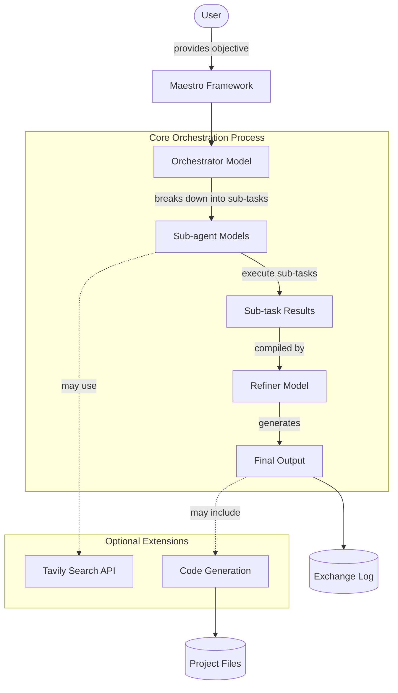
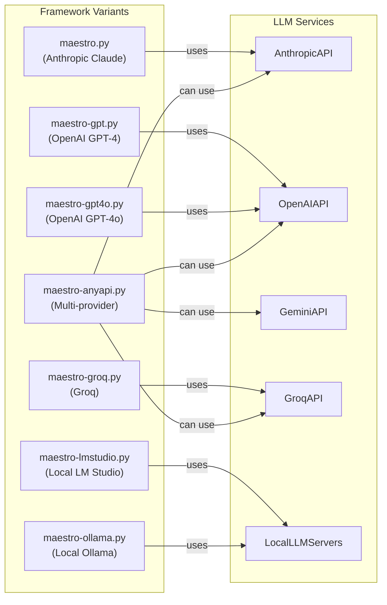
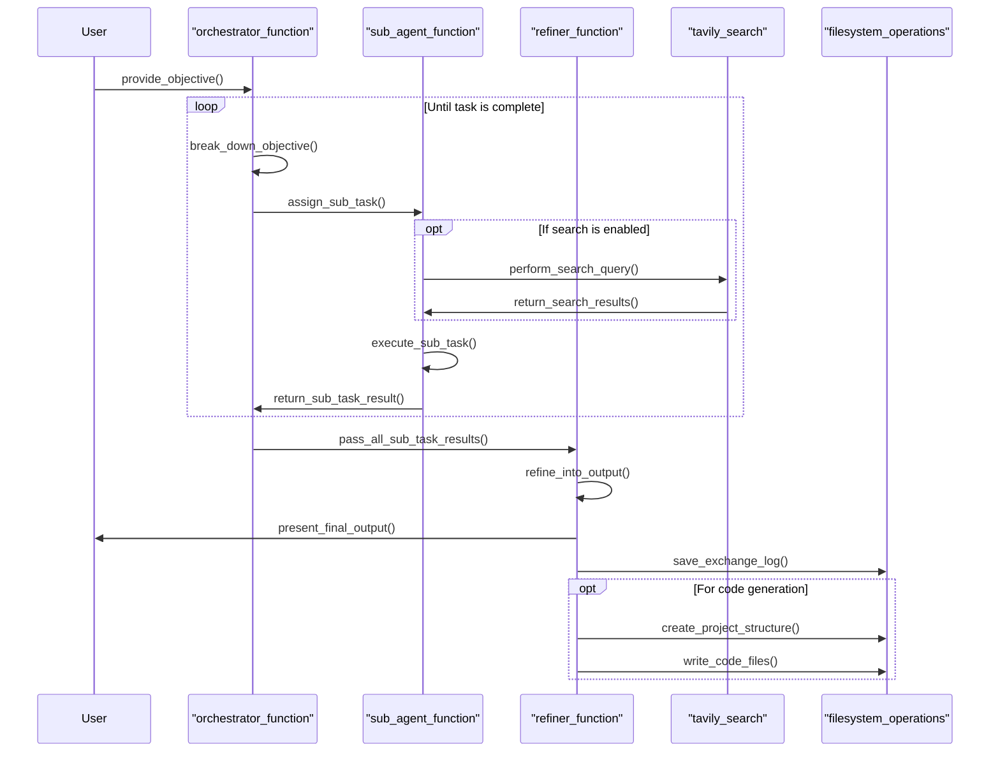
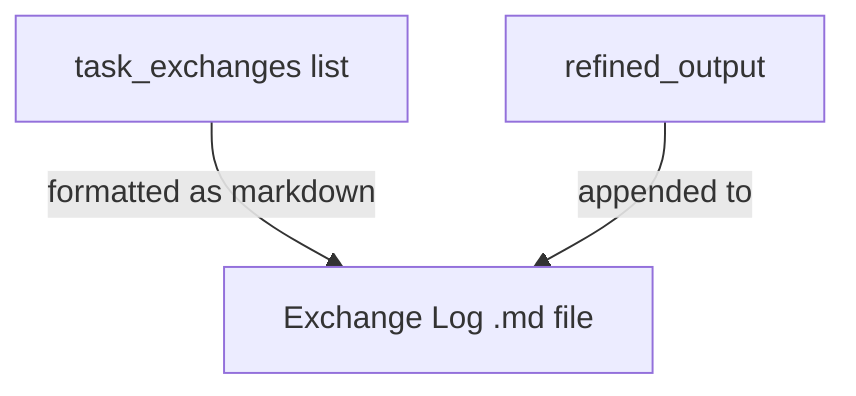
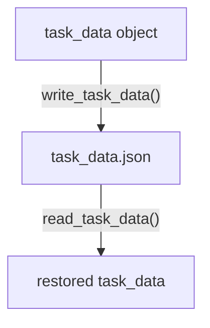
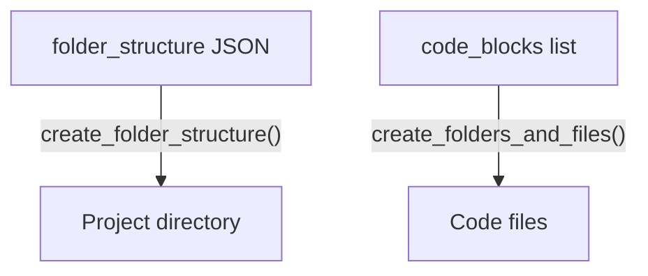
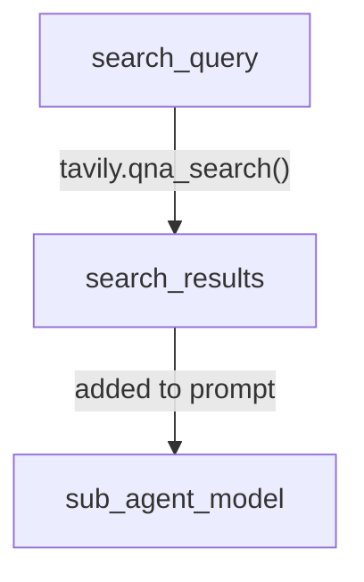
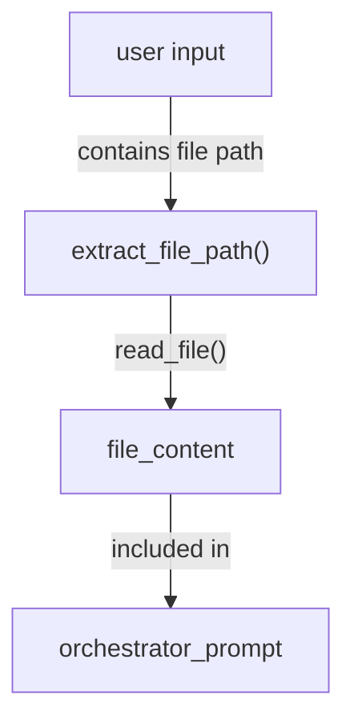
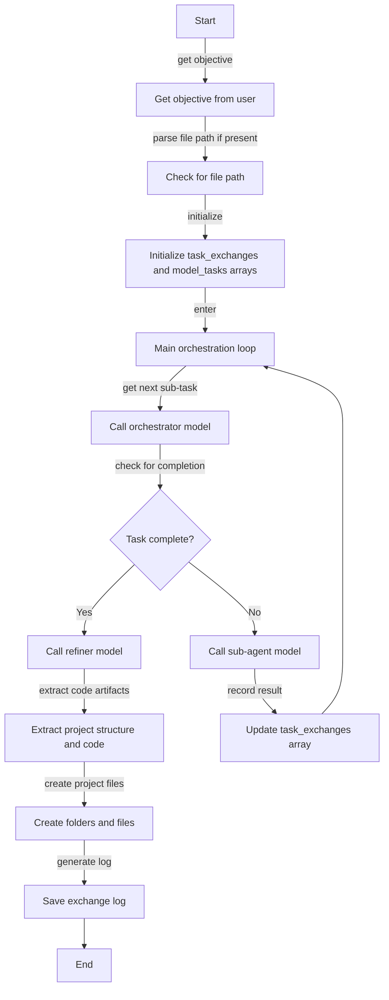

<!-- source: DeepWiki mcp.deepwiki.com · repo Doriandarko/maestro · page 1.2 Architecture · fetched 2026-10-26 -->

# Architecture

<details>
<summary>Relevant source files</summary>

The following files were used as context for generating this wiki page:

- [README.md](README.md)
- [maestro-gpt4o.py](maestro-gpt4o.py)
- [maestro-ollama.py](maestro-ollama.py)

</details>


This document provides a detailed explanation of the Maestro LLM Orchestration Framework's system architecture, component relationships, and workflow. It describes how Maestro breaks down complex tasks into sub-tasks, processes them through various models, and combines the results into a cohesive output.

For information about core concepts and terminology, see [Core Concepts](#1.1).

## 1. System Overview

Maestro is an orchestration framework that uses multiple language models in coordinated roles to solve complex tasks. At a high level, Maestro follows a three-step process:

1. An orchestrator model breaks down a user objective into manageable sub-tasks
2. Sub-agent models execute each sub-task independently
3. A refiner model combines the sub-task results into a cohesive final output



Sources: [README.md:3-6](), [README.md:132-141]()

## 2. Core Components

The Maestro architecture consists of three primary components, each leveraging different language models:

| Component | Role | Typical Models |
|-----------|------|----------------|
| Orchestrator | Breaks down objectives into sub-tasks | GPT-4o, Claude 3.5 Sonnet, Claude Opus, Llama 3 70B |
| Sub-agent | Executes individual sub-tasks | GPT-4o, Claude Haiku, Llama 3 8B |  
| Refiner | Synthesizes sub-task results into final output | GPT-4o, Claude Opus, Llama 3 70B |

Different implementations of Maestro may use various models for each component, but the architectural pattern remains consistent.

```mermaid
classDiagram
    class "MaestroFramework" {
        +run_objective(objective)
        -task_exchanges[]
        -previous_results[]
    }
    
    class "OrchestratorModel" {
        +break_down_task(objective, previous_results)
        +check_completion(results)
    }
    
    class "SubAgentModel" {
        +execute_task(prompt, previous_tasks)
        +handle_search_results(search_data)
    }
    
    class "RefinerModel" {
        +synthesize_results(objective, sub_task_results)
        +generate_code_artifacts(results)
    }
    
    class "SearchIntegration" {
        +perform_search(query)
        +format_results()
    }
    
    class "FileSystemInterface" {
        +create_folder_structure(structure)
        +write_code_files(code_blocks)
        +save_exchange_log(log)
    }
    
    MaestroFramework --> OrchestratorModel
    MaestroFramework --> SubAgentModel
    MaestroFramework --> RefinerModel
    MaestroFramework --> FileSystemInterface
    SubAgentModel --> SearchIntegration
    RefinerModel --> FileSystemInterface
```

Sources: [maestro-gpt4o.py:16-20](), [maestro-ollama.py:19-21]()

## 3. Implementation Variants

Maestro supports multiple LLM providers through different implementation files:



Sources: [README.md:9-98]()

The `maestro-anyapi.py` file provides a unified interface for multiple LLM providers through LiteLLM, allowing configuration of different models for each component via environment variables:

```
ORCHESTRATOR_MODEL = "gemini/gemini-1.5-flash-latest"
SUB_AGENT_MODEL = "gemini/gemini-1.5-flash-latest"
REFINER_MODEL = "gemini/gemini-1.5-flash-latest"
```

Sources: [README.md:25-29]()

## 4. Process Flow

The following sequence diagram illustrates the end-to-end process flow in Maestro:



Sources: [maestro-gpt4o.py:40-123](), [maestro-ollama.py:37-111]()

### 4.1 Orchestrator Function Flow

The orchestrator function (`gpt_orchestrator` in `maestro-gpt4o.py` or `opus_orchestrator` in `maestro-ollama.py`) operates as follows:

1. Receives the user objective and any previous sub-task results
2. Constructs a prompt for the orchestrator model that:
   - Contains the objective
   - Includes any provided file content
   - Lists previous sub-task results
   - Asks for the next sub-task or final completion
3. Sends the prompt to the orchestrator model
4. Parses the response:
   - If "The task is complete:" is present, it signals completion
   - Otherwise, it generates a sub-task for the sub-agent

Sources: [maestro-gpt4o.py:40-81](), [maestro-ollama.py:37-55]()

### 4.2 Sub-agent Function Flow

The sub-agent function (`gpt_sub_agent` in `maestro-gpt4o.py` or `haiku_sub_agent` in `maestro-ollama.py`) operates as follows:

1. Receives the sub-task prompt and previous sub-task context
2. Optionally performs a search query if search integration is enabled
3. Constructs a message for the sub-agent model that:
   - Contains previous task context
   - Includes the current sub-task prompt
   - Adds search results if available
4. Sends the message to the sub-agent model
5. Returns the sub-agent's response

Sources: [maestro-gpt4o.py:83-123](), [maestro-ollama.py:57-88]()

### 4.3 Refiner Function Flow

The refiner function (`anthropic_refine` in `maestro-gpt4o.py` or `opus_refine` in `maestro-ollama.py`) operates as follows:

1. Receives the original objective and all sub-task results
2. Constructs a prompt for the refiner model asking it to:
   - Synthesize the results into a cohesive output
   - For code projects, generate project structure and code files
3. Sends the prompt to the refiner model
4. Returns the refined output
5. Extracts code artifacts if present

Sources: [maestro-gpt4o.py:125-153](), [maestro-ollama.py:90-111]()

## 5. Data Structures

Maestro manages several key data structures throughout its operation:

### 5.1 Task Exchanges

The `task_exchanges` list stores tuples of sub-task prompts and their corresponding results:

```python
task_exchanges = []  # List of (prompt, result) tuples
```

This list is used to:
- Track all sub-tasks and their results
- Provide context to the orchestrator for deciding next steps
- Feed into the refiner for final output synthesis
- Generate the exchange log for documentation

Sources: [maestro-gpt4o.py:211-232](), [maestro-ollama.py:201-227]()

### 5.2 Previous Tasks Context

The `previous_tasks` list maintains context for the sub-agent models:

```python
haiku_tasks = []  # List of {"task": prompt, "result": response} dictionaries
```

This allows sub-agents to have "memory" of previous tasks, which helps maintain context and coherence across multiple sub-tasks.

Sources: [maestro-ollama.py:202-225]()

### 5.3 Code Generation Data

For code generation, Maestro extracts several data structures from the refiner's output:

1. Project name
2. Folder structure (as a JSON object)
3. Code blocks (as filename-content pairs)

```python
# Extract project name
project_name_match = re.search(r'Project Name: (.*)', refined_output)
project_name = project_name_match.group(1).strip() if project_name_match else sanitized_objective

# Extract folder structure
folder_structure_match = re.search(r'<folder_structure>(.*?)</folder_structure>', refined_output, re.DOTALL)
folder_structure = json.loads(folder_structure_match.group(1).strip())

# Extract code blocks
code_blocks = re.findall(r'Filename: (\S+)\s*```[\w]*\n(.*?)\n```', refined_output, re.DOTALL)
```

Sources: [maestro-gpt4o.py:239-253](), [maestro-ollama.py:242-258]()

## 6. Storage and Persistence

Maestro includes several mechanisms for persisting data:

### 6.1 Exchange Log

All task exchanges and the final output are saved to a Markdown file:



The exchange log includes:
- Original objective
- All sub-tasks and their results
- Final refined output

Sources: [maestro-gpt4o.py:261-273](), [maestro-ollama.py:271-284]()

### 6.2 Task Data Persistence

In some implementations (e.g., `maestro-ollama.py`), task data is persisted to a JSON file:



This allows for resuming task execution between sessions.

Sources: [maestro-ollama.py:149-161](), [maestro-ollama.py:174-187]()

### 6.3 Project Files

For code generation tasks, Maestro creates physical folders and files:



Sources: [maestro-gpt4o.py:155-185](), [maestro-ollama.py:113-142]()

## 7. Optional Integrations

### 7.1 Search Integration

Maestro can enhance sub-agent performance by integrating with the Tavily Search API:



When enabled, the orchestrator model generates a search query related to the sub-task, which is sent to the Tavily API. The results are then incorporated into the sub-agent's prompt.

Sources: [maestro-gpt4o.py:92-104](), [README.md:113-119]()

### 7.2 File Content Processing

Maestro can process file content as part of the objective:



This allows users to provide source files to be analyzed or modified as part of the task.

Sources: [maestro-gpt4o.py:187-206](), [maestro-ollama.py:188-199]()

## 8. Error Handling

Maestro includes several error handling mechanisms:

1. JSON parsing error handling for folder structures
2. File and folder creation error handling
3. Response continuation for handling truncated model outputs
4. File path validation

These mechanisms help ensure the system remains robust even when encountering unexpected inputs or model limitations.

Sources: [maestro-gpt4o.py:147-150](), [maestro-ollama.py:243-255]()

## 9. Control Flow

The main control flow of Maestro follows this pattern:



Sources: [maestro-gpt4o.py:211-273](), [maestro-ollama.py:204-284]()

---

