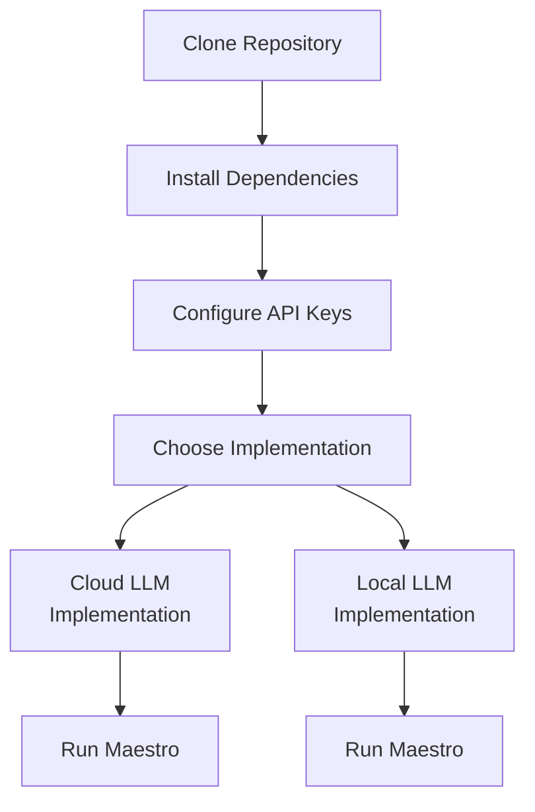
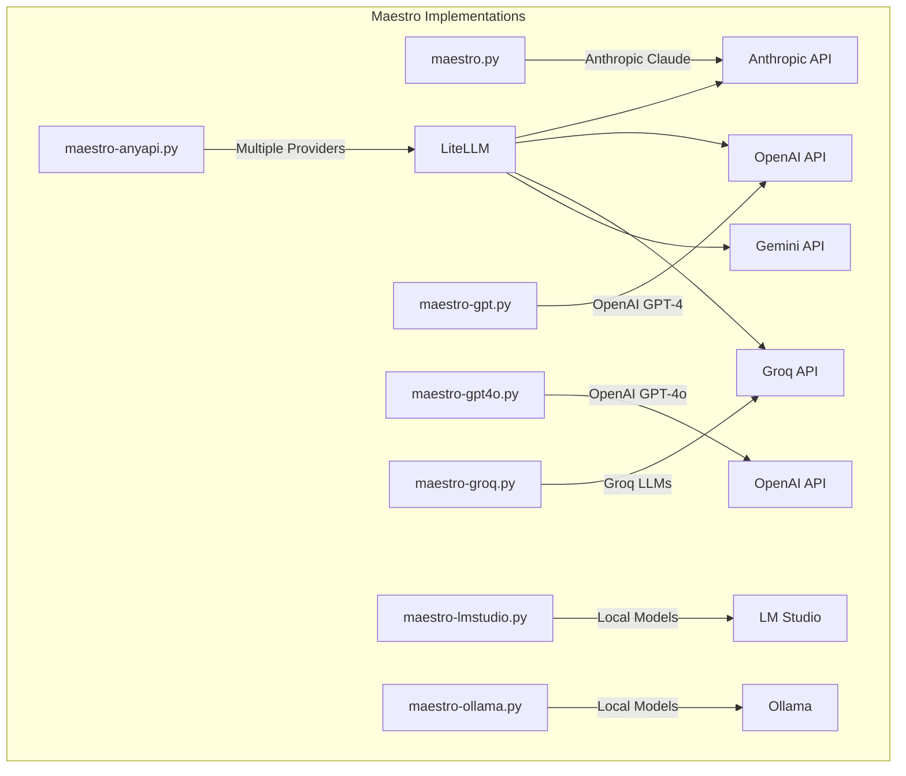

<!-- source: DeepWiki mcp.deepwiki.com · repo Doriandarko/maestro · page 2 Installation & Setup · fetched 2026-10-26 -->

# Installation & Setup

<details>
<summary>Relevant source files</summary>

The following files were used as context for generating this wiki page:

- [README.md](README.md)

</details>


This page provides detailed instructions for installing the Maestro framework and setting up your environment to run it with various LLM providers. For specific information about configuring API keys for different services, see [API Keys Configuration](#2.1).

## Prerequisites

Before installing Maestro, ensure you have the following prerequisites:

- Python 3.7 or higher installed on your system
- Git (to clone the repository)
- Access to at least one of the supported LLM providers (Anthropic, OpenAI, Gemini, Groq, or local options)

## Installation Steps



Sources: [README.md:151-164]()

### 1. Clone the Repository

First, clone the Maestro repository to your local machine:

```bash
git clone https://github.com/Doriandarko/maestro.git
cd maestro
```

### 2. Install Dependencies

Install the required Python packages using pip:

```bash
pip install -r requirements.txt
```

This installs the common dependencies needed for all implementations. For specific implementations, you might need additional packages as detailed in the sections below.

Sources: [README.md:156-158]()

### 3. Configure API Keys

Set up the necessary API keys for your chosen LLM provider. The specific keys required depend on the implementation you plan to use. See [API Keys Configuration](#2.1) for detailed instructions.

Sources: [README.md:162-169]()

## Implementation-Specific Setup

Maestro offers multiple implementations to work with different LLM providers. Choose the one that suits your needs.



Sources: [README.md:6-110]()

### Original Maestro (Anthropic Claude)

The original implementation uses Anthropic's Claude models (Opus and Haiku/Sonnet).

1. Install the Anthropic Python package if not already included:
   ```bash
   pip install anthropic
   ```

2. Set your Anthropic API key:
   ```python
   export ANTHROPIC_API_KEY="your_anthropic_api_key"
   ```

3. Run the original Maestro implementation:
   ```bash
   python maestro.py
   ```

Sources: [README.md:6-10](), [README.md:148-164]()

### Maestro with Any API (LiteLLM)

This implementation uses LiteLLM to support various LLM providers (Anthropic, OpenAI, Gemini, etc.).

1. Install LiteLLM:
   ```bash
   pip install litellm
   ```

2. Set environment variables for the API keys of the services you want to use:
   ```bash
   export OPENAI_API_KEY="your_openai_api_key"
   export ANTHROPIC_API_KEY="your_anthropic_api_key"
   export GEMINI_API_KEY="your_gemini_api_key"
   ```

3. Run the Any API implementation:
   ```bash
   python maestro-anyapi.py
   ```

Sources: [README.md:13-42]()

### OpenAI GPT-4 Implementation

1. Install the OpenAI Python package if not already included:
   ```bash
   pip install openai
   ```

2. Set your OpenAI API key:
   ```bash
   export OPENAI_API_KEY="your_openai_api_key"
   ```

3. Run the GPT-4 implementation:
   ```bash
   python maestro-gpt.py
   ```

Sources: [README.md:121-129]()

### OpenAI GPT-4o Implementation

1. Install the OpenAI Python package if not already included:
   ```bash
   pip install openai
   ```

2. Set your OpenAI API key:
   ```bash
   export OPENAI_API_KEY="your_openai_api_key"
   ```

3. Run the GPT-4o implementation:
   ```bash
   python maestro-gpt4o.py
   ```

Sources: [README.md:45-53]()

### Local Setup with LM Studio

1. Download and install LM Studio from [https://lmstudio.ai/](https://lmstudio.ai/)

2. Launch LM Studio and start the local server:
   - Load your preferred model
   - Start the local server
   - Remove any system prompt (leave the prompt field empty)

3. Run the LM Studio implementation:
   ```bash
   python maestro-lmstudio.py
   ```

Sources: [README.md:57-67]()

### Local Setup with Ollama

1. Install Ollama client from [https://ollama.com/download](https://ollama.com/download)

2. Install the Ollama Python package:
   ```bash
   pip install ollama
   ```

3. Pull the desired models:
   ```bash
   ollama pull llama3:70b
   ollama pull llama3:8b  # Optional, for smaller model
   ```

4. Run the Ollama implementation:
   ```bash
   python maestro-ollama.py
   ```

Sources: [README.md:70-98]()

### Groq Implementation

1. Install the Groq Python package:
   ```bash
   pip install groq
   ```

2. Set your Groq API key:
   ```bash
   export GROQ_API_KEY="your_groq_api_key"
   ```

3. Run the Groq implementation:
   ```bash
   python maestro-groq.py
   ```

Sources: [README.md:101-110]()

## Search Integration (Optional)

Maestro supports integration with the Tavily search API for enhanced results.

1. Get a Tavily API key from [https://tavily.com/](https://tavily.com/)

2. Set your Tavily API key:
   ```bash
   export TAVILY_API_KEY="your_tavily_api_key"
   ```

Sources: [README.md:113-120]()

## Dependency Relationships

```mermaid
graph TD
    subgraph "Core Dependencies"
        Python["Python 3.7+"]
        Rich["rich"]
    end
    
    subgraph "LLM API Dependencies"
        Anthropic["anthropic"]
        OpenAI["openai"]
        Groq["groq"]
        LiteLLM["litellm"]
    end
    
    subgraph "Local LLM Dependencies"
        OllamaPkg["ollama"]
        LMStudioApp["LM Studio App"]
    end
    
    subgraph "Optional Dependencies"
        Tavily["tavily-python"]
    end
    
    Python --> Rich
    Python --> Anthropic
    Python --> OpenAI
    Python --> Groq
    Python --> LiteLLM
    Python --> OllamaPkg
    Python --> Tavily
    
    Maestro["maestro.py"] --> Python
    Maestro --> Rich
    Maestro --> Anthropic
    
    MaestroAny["maestro-anyapi.py"] --> Python
    MaestroAny --> Rich
    MaestroAny --> LiteLLM
    
    MaestroGPT["maestro-gpt.py"] --> Python
    MaestroGPT --> Rich
    MaestroGPT --> OpenAI
    
    MaestroGPT4o["maestro-gpt4o.py"] --> Python
    MaestroGPT4o --> Rich
    MaestroGPT4o --> OpenAI
    
    MaestroGroq["maestro-groq.py"] --> Python
    MaestroGroq --> Rich
    MaestroGroq --> Groq
    
    MaestroLM["maestro-lmstudio.py"] --> Python
    MaestroLM --> Rich
    MaestroLM --> LMStudioApp
    
    MaestroOllama["maestro-ollama.py"] --> Python
    MaestroOllama --> Rich
    MaestroOllama --> OllamaPkg
    
    SearchFeature["Search Feature"] --> Tavily
```



Sources: [README.md:144-150](), [README.md:13-42](), [README.md:57-110](), [README.md:113-120]()

## Verifying Installation

To verify that your installation is working correctly:

1. Run your chosen implementation:
   ```bash
   python <implementation-file>.py
   ```
   
2. When prompted, enter a simple objective like "Write a short poem about AI."

3. Maestro should break down this objective, execute it, and provide a final output. The success of this process confirms that your installation is working correctly.

## Implementation Comparison

| Implementation | File | LLM Provider | Key Requirements | Local/Cloud | Additional Dependencies |
|----------------|------|--------------|------------------|-------------|-------------------------|
| Original Maestro | maestro.py | Anthropic (Claude) | ANTHROPIC_API_KEY | Cloud | anthropic |
| Any API | maestro-anyapi.py | Multiple | Various API keys | Cloud | litellm |
| GPT-4 | maestro-gpt.py | OpenAI | OPENAI_API_KEY | Cloud | openai |
| GPT-4o | maestro-gpt4o.py | OpenAI | OPENAI_API_KEY | Cloud | openai |
| Groq | maestro-groq.py | Groq | GROQ_API_KEY | Cloud | groq |
| LM Studio | maestro-lmstudio.py | Local models | None | Local | LM Studio App |
| Ollama | maestro-ollama.py | Local models | None | Local | ollama |

Sources: [README.md:6-110]()

This comparison can help you choose the appropriate implementation based on your specific requirements and available resources.

---

